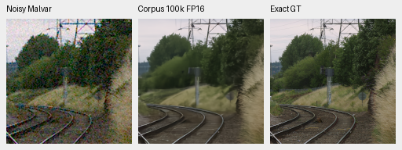
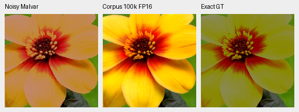

# Corpus 100k FP16 inference on NVIDIA GB10

Use `--precision float16` for a faster Corpus 100k CUDA run. On the cached
102 MP GFX100S scene, tiled restoration takes **53.40 s** instead of
**287.38 s**, a **5.38×** speedup. RAW decode, checkpoint setup, restore and
RGB16 export together take **111.56 s** instead of **334.77 s**. At native
scale, the sky, foliage, fine building lines and both fences look the same
as the FP32 render. The 100 MP in 10 seconds target remains unmet.

[Machine results](results/corpus100k-mixed-precision-v1/publication.json) ·
[Frozen drivers and receipts](results/corpus100k-mixed-precision-v1/evidence.tar.xz) ·
[Native crop provenance](images/corpus100k-mixed-precision-v1/manifest.json).

## Timing and precision

The tested EMA is Corpus 100k
`87b96f3c487b9edaf1c477742b6c38f2a82cc6b20a94716d51cc8cf46a17a760`.
The full-frame runs use DSCF3879, nominal shot/read
`0.00128/6.5536e-6`, 512-pixel tiles, overlap 64 and batch four. Each
fresh process restores 520 tiles and writes a 11662×8746 camera-linear
uint16 RGB TIFF. PyTorch 2.14.1+cu130, CUDA 13.0 and cuDNN 9.24 run on
a shared GB10. These are one full-frame measurement per precision.
The warmed resident comparison uses eight interleaved timings per arm.

| Policy on four 512-pixel GPU-resident tiles | Median forward | Camera-RGB difference RMS vs IEEE FP32 |
| --- | ---: | ---: |
| IEEE FP32 | 1.416 s | 0 |
| TF32 where permitted | 0.428 s | 0.140 DN16 |
| Standard FP16 AMP | 0.221 s | 0.211 DN16 |
| FP16 with an explicit half cast into the first encoder residual branch | 0.211 s | 0.506 DN16 |

Standard FP16 runs eligible DINO and DRUNet operations in half precision.
The native input head, final native skip addition and RGB tail still compute
in IEEE FP32. Bayer values, variance and inverse image transforms also stay
FP32 through tile accumulation. The writer clips and rounds to unsigned
16-bit once. Separate GPU event probes measure the restoration trunk at 1,318 → 157 ms
and the frozen DINO backbone at 68 → 32 ms. The native heads keep their
FP32 inputs and outputs.
TF32 is closer to IEEE FP32 and takes almost twice as long as standard
FP16 in this resident measurement. The hidden cast saves about 10 ms
and more than doubles RMS error. A separate run under heavier GPU load
measures 0.785 s BF16 and 0.812 s FP16 for the same tile group. Their
camera-RGB RMS differences from FP32 are 1.615 and 0.211 DN16. The same
session measured warmed FP32 at 4.824 s and toggling cuDNN autotuning at
4.632 s, with the FP32 algorithms already warm before the toggle. [Original precision plan](mixed-precision-inference-2026-11-18.md).

| Full-frame phase | FP32 | FP16 |
| --- | ---: | ---: |
| RAW decode | 1.22 s | 1.45 s |
| Checkpoint setup | 45.31 s | 55.56 s |
| Restore and blend | 287.38 s | 53.40 s |
| RGB16 export | 0.83 s | 1.13 s |
| RAW to TIFF | 334.77 s | 111.56 s |
| Peak PyTorch CUDA allocation during restoration | 3.16 GB | 2.12 GB |

The full-frame timings include CPU validation, per-batch packing and copying,
and float32 overlap blending. Blending takes 0.72–0.73 seconds in these runs.
Peak allocation describes PyTorch CUDA allocations and excludes CPU buffers
and unrelated GPU jobs. The GPU was shared during both passes.

A separate cold-load trace with the same cached DINO revision spends
56.59 of 59.67 seconds in the CUDA staging step. Loading the CPU checkpoint,
hashing it and constructing DINO take less than four seconds combined
in that trace. Combining weight transfer and channels-last layout reduces
median warmed staging from 1.04 to 0.55 seconds with byte-identical
test output. A fresh process with the combined upload still spends
59.92 seconds in CUDA staging. Disk loading and TIFF writing leave
little headroom compared with neural restoration and fresh GPU startup.

## Output fidelity

Among **305,987,556** exported RGB channel codes, 92.55% match exactly
and **99.79%** are within one code. RMS difference is **0.319 DN16**.
The 99.9th percentile difference is two codes. RMS is **0.299 DN16**
in the overlap-midpoint bands and **0.323 DN16** elsewhere. There is no seam
increase in this check. The largest difference is **70 DN16** in red
at sensor coordinate `[8388,3429]` on a bright illuminated sign.
The native views of the sign look alike.
[Worst-code native crop](images/corpus100k-mixed-precision-v1/outlier.png).

### Fixed photo and measured-camera panels

FP16 covers all 3,162 canonical batches. The table compares against
the saved Corpus 100k IEEE FP32 predictions on the same Bayer arrays.
The photo row averages source scores. Camera rows average valid
measured-CFA crops. A 200-case stratified GPU IEEE FP32 control
also checks the same-device precision effect.

| Fixed panel | Coverage | Mean PSNR change | 95th-percentile absolute crop change |
| --- | ---: | ---: | ---: |
| Photographic sRGB | 427 sources, 11,956 cases | −0.00004 dB | 0.00083 dB |
| Known measured CFA | 72 crops | +0.00012 dB | 0.00304 dB |
| Unseen measured CFA | 90 crops | +0.00023 dB | 0.00194 dB |

The largest photometric regression across photo cases is −0.03252 dB
and the largest gain is +0.06736 dB. Both are in the highlights
condition. The largest loss also appears against the same-GPU FP32
control. On average the seven photo conditions each move by less
than 0.00031 dB. These are precision comparisons of one checkpoint.
[Original checkpoint evaluation](full-corpus-long100k.md#broader-evaluation).

On 24 exact wire backgrounds at ISO6400, weak-direction response is
45.326% FP32 and 45.333% FP16. The largest single-background shift is
0.070 points. Strong-band amplitude changes by at most 0.162 DN16.
Mean independent fine-increment error is 210.00 and 210.02 DN16.
Quiet-core luma and chroma RMS rise by 0.016 and 0.017 DN16 at ISO6400.
Across both noise levels the largest flat mean-colour shift is 0.347
DN16. On 24 calibrated shadow and bright-colour ramps covering four
Bayer layouts and three noise conditions, the largest column-mean
luma difference is 9.31 DN16 and the largest adjacent-column slope
difference is 4.05 DN16.

### Native exact-target triplets

The triplets use noisy Malvar, Corpus 100k FP16 and exact benchmark targets.
Cells are 160×160 unchanged pixels at `[48,48,160,160]` in the native
RGGB query. The capture uses 16-bit ADC and black 0.03. Every method receives
the same Bayer observation and display transform. The direct FP32 and
FP16 comparisons are linked alongside the triplets.

**Birmingham railway**, mattbuck, CC BY-SA 3.0. ISO12800 shot/read
`0.00256/2.62144e-5`, display ×1. Fine track and foliage are visually
matched. sRGB PSNR is 32.87158 dB for both.
[Source](https://commons.wikimedia.org/wiki/File:Birmingham_MMB_07_Grand_Junction_43366.jpg) ·
[FP32 and FP16 comparison](images/corpus100k-mixed-precision-v1/railway-comparison.png).



**Dahlia ‘Moonfire’**, Dominicus Johannes Bergsma, CC BY-SA 4.0.
Shot/read `8e-5/2.56e-8`, capture exposure 4 and display ×0.25. The
existing over-bright yellow petals persist. sRGB PSNR drops from 23.71244
to 23.70390 dB. No additional colour or contour change was visible at native
scale. [Source](https://commons.wikimedia.org/wiki/File:Dahlia_%27Moonfire%27_005.JPG) ·
[FP32 and FP16 comparison](images/corpus100k-mixed-precision-v1/dahlia-comparison.png).



## Standing GFX100S comparisons

All eight boards were viewed at native scale. Main-scene results come
from the two full TIFF runs before output quantization and use display ×4.
The sky stays smooth, the coarse crossings stay visible and foliage and
thin cables remain soft. RMS differences across the four crops are
0.099–0.139 DN16 in camera RGB. The two cab regions use the established
native 768-pixel context, display ×16, and their nominal and transferred
`0.0014635775921166604/1.0715704128646712e-6` noise profiles.
Cab RMS differences are 0.049–0.074 DN16. Both precisions leave fine crossings
incomplete. ISO100 AHD and camera JPEGs are qualitative references obtained
under different aperture, exposure time and subject motion.

[Sky](images/corpus100k-mixed-precision-v1/overcast-sky.png) ·
[Building](images/corpus100k-mixed-precision-v1/building-detail.png) ·
[Foliage](images/corpus100k-mixed-precision-v1/foliage.png) ·
[Coarse fence](images/corpus100k-mixed-precision-v1/chain-link-fence.png).

| Cab profile | Native comparisons |
| --- | --- |
| Nominal | [Left](images/corpus100k-mixed-precision-v1/mesh-nominal-fine-green-mesh-left.png) · [Right](images/corpus100k-mixed-precision-v1/mesh-nominal-fine-green-mesh-right.png) |
| Transferred | [Left](images/corpus100k-mixed-precision-v1/mesh-profile3879-fine-green-mesh-left.png) · [Right](images/corpus100k-mixed-precision-v1/mesh-profile3879-fine-green-mesh-right.png) |

## Running the faster path

```bash
source scripts/env.sh
uv run --no-sync demosaic infer /path/to/corpus-100k.pt photo.raf output-linear.tiff \
  --device cuda --tile 512 --overlap 64 --batch-size 4 --precision float16 \
  --shot 0.00128 --read 0.0000065536
```

Supply the noise coefficients for the actual capture. The command above uses
the standing GFX prior. IEEE FP32 remains available for reference exports.
Use IEEE FP32 for bit-exact reference comparisons. TensorRT FP8 and
NVFP4 remain open experiments. [Usage](usage.md) · [Checkpoint](full-corpus-long100k.md).
