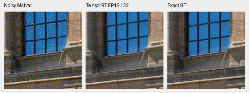
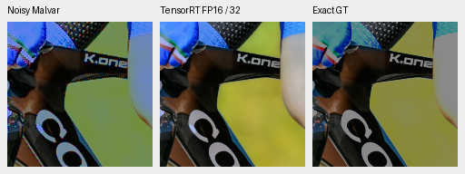

# Corpus 100k overlap at fixed tile size

November 19, 2026, NVIDIA GB10. **Keep 512-pixel tiles and 64 pixels
of overlap for the Corpus 100k FP16 path.** Compiling the trunk and
DINO cuts the paired tile loop by 16.5% at that geometry. Reducing
overlap to 32 saves another 8.9% and changes bright lights and tile seams.

The tested weights are the Corpus 100k
EMA at SHA256
`87b96f3c487b9edaf1c477742b6c38f2a82cc6b20a94716d51cc8cf46a17a760`.
The [FP16 precision comparison](corpus100k-mixed-precision.md) measured
53.40 s versus 287.38 s for a 102 MP tiled restore in IEEE FP32. The
[compiled DINO comparison](corpus100k-trt-dino.md) fixed the geometry and
measured a further 17.2% reduction in paired forward time versus eager FP16.
This experiment holds the 512-pixel context constant and varies the
overlap used by the TensorRT FP16 trunk and DINO path.

[Machine results](results/corpus100k-overlap-v1/publication.json) ·
[Frozen drivers and receipts](results/corpus100k-overlap-v1/evidence.tar.xz) ·
[Native crop provenance](images/corpus100k-overlap-v1/manifest.json).

## 102 MP tile loop

The full frame is cached DSCF3879 at ISO6400, with shot/read
`0.00128/6.5536e-6`. Tile batches are interleaved by traversal progress
on the shared GB10. Each method warms its initial and final batch shape
before timing. Each measurement includes packing, dispatch, restoration,
return to the host and the FP32 Hann-window blend. The maximum batch
is four. Start-up, normalization and RGB16 write are measured separately.
The experiment keeps the observed Bayer values, camera transforms, raw
variance, native heads and blending in FP32, followed by one export
conversion to unsigned 16-bit. Both 64-pixel controls match their archived
full-frame TIFFs byte for byte.

| Policy | Tiles | Paired tile loop | FP32 normalization | RGB16 write |
| --- | ---: | ---: | ---: | ---: |
| Eager FP16, overlap 64 | 520 | 170.69 s | 0.33 s | 2.06 s |
| TensorRT FP16 trunk and DINO, overlap 64 | 520 | 142.48 s | 0.73 s | 3.74 s |
| TensorRT FP16 trunk and DINO, overlap 48 | 494 | 135.43 s | 0.78 s | 4.24 s |
| TensorRT FP16 trunk and DINO, overlap 32 | 475 | 129.74 s | 0.75 s | 2.51 s |

Compiling both networks saves **16.53%** at the same 64-pixel overlap.
With those engines, overlap 48 saves **4.94%** and overlap 32 saves **8.94%**
versus overlap 64. The paired block-bootstrap 95% intervals for the
time reductions are 14.53–18.43%, 1.20–8.57% and 3.61–14.28% respectively.
The shortest run saves 23.99% versus eager FP16 overall.

Five separate demosaic evaluation processes were active on the GPU
throughout the comparison. Decode took 6.46 s, checkpoint staging 9.82 s
and loading the two prebuilt plans 1.75 s once for the process. The software
was PyTorch 2.14.1+cu130, cuDNN 9.24 and TensorRT 11.4.0.106. Earlier
full-frame [warm repeats](corpus100k-trt-dino.md#precision-and-timing)
show how absolute timing varies with shared load.

The 32-pixel setting advances interior tiles by 480 pixels, a multiple of
the DINO striding grid. The 48-pixel setting advances 464 pixels and
alternates the DINO phase of consecutive starts. Each policy anchors the
last tile to the frame edge, on the Bayer grid.

## RGB16 agreement on the full frame

| Comparison | Camera-RGB RMS | Codes within one DN16 | 99.9th-percentile change | Largest change |
| --- | ---: | ---: | ---: | ---: |
| Compiled 64 vs IEEE FP32 64 | 0.544 DN16 | 99.37% | 5 DN16 | [163 DN16](images/corpus100k-overlap-v1/compiled64-vs-ieee-outlier.png) |
| Compiled 48 vs compiled 64 | 10.19 DN16 | 33.26% | 80 DN16 | [4,479 DN16](images/corpus100k-overlap-v1/compiled48-vs-compiled64-outlier.png) |
| Compiled 32 vs compiled 64 | 11.50 DN16 | 34.92% | 86 DN16 | [9,716 DN16](images/corpus100k-overlap-v1/compiled32-vs-compiled64-outlier.png) |

The comparison covers all 305,987,556 exported channel codes. With
overlap 32, RMS difference grows to 16.20 DN16 within eight pixels of
either overlap midpoint and measures 11.07 DN16 elsewhere. For the 0.285%
of frame pixels within six pixels of a Bayer sample at or above
0.9995 normalized signal, the RMS is 138.61 DN16. It is 8.81 DN16
elsewhere. Overlap 48 changes the warmth and size of a distant light's
halo. Overlap 32's largest change is on blue at the edge of a bright
train display, where the little glyphs vary in brightness and color.

## Exact wire and gap tests

The seam fixture uses 12 ellipse and strip backgrounds at each of ISO400
and ISO6400. It symmetrically extends the frozen 512-pixel RAW in whole
Bayer cells to a 512 × 1440 canvas. The 128-pixel scoring region crosses
the first vertical join. Paired draws isolate the weak and strong wire
directions. The exact weak-signal gaps allow separate measurements of
false continuation and quiet-region chroma.

| Noise | Overlap | Weak response | Strong response | Fine increment RMS | Quiet chroma RMS | Exact-gap luma RMS |
| --- | ---: | ---: | ---: | ---: | ---: | ---: |
| ISO400 | 48 | +0.116 pp | −0.005 pp | +0.051 DN16 | +0.141 DN16 | +0.017 DN16 |
| ISO400 | 32 | +0.266 pp | −0.008 pp | +0.232 DN16 | +0.416 DN16 | +0.177 DN16 |
| ISO6400 | 48 | −0.007 pp | −0.357 pp | −0.038 DN16 | +0.326 DN16 | +0.383 DN16 |
| ISO6400 | 32 | +0.406 pp | −0.489 pp | +0.684 DN16 | +1.348 DN16 | +0.488 DN16 |

All changes are means versus compiled overlap 64. At ISO6400, overlap 32
raises the weak response from 39.06% to 39.46% and increases fine-increment
error. The fitted weak component leaking into the gaps changes by
+0.123 DN16 at ISO400 and −0.041 DN16 at ISO6400. General luma error
inside the exact gaps increases at both ISO levels.

## Native exact-target triplets

Across six long photo contexts, the mean sRGB PSNR changes by −0.01649 dB
at overlap 48 and −0.03533 dB at overlap 32 versus the compiled 64-pixel
path. The Karajà statuette accounts for most of the loss, at −0.09986 and
−0.19445 dB respectively. Its linear RGB RMSE in the 32-pixel policy's join
bands rises from 7,521 to 7,841 DN16. The other five contexts change by at
most 0.00713 dB at overlap 32. [Statuette source](https://commons.wikimedia.org/wiki/File:Statuette_Karaj%C3%A0_MHNT.ETH.2010.24.44-45-46.jpg).

Every cell is 160 × 160 pixels at `[680,480,160,160]` within its cache
box. The crops show noisy Malvar, TensorRT FP16 with 32-pixel overlap,
and the exact synthetic target. The camera simulation uses normalized
black level 0.03 and a 16-bit ADC. The same noise draws, camera transforms
and display exposure are used for each comparison.

**Alte Pinakothek**, AuHaidhausen, CC BY 4.0. Cache box
`[102,10,1536,1152]`, GBRG, shot/read `0.00256/2.62144e-5`, display ×1.
The window bars stay coherent, while fine horizontal cables and masonry
stay soft. sRGB PSNR is 33.86015 dB at compiled 64 and 33.85546 at
compiled 32.
[Source](https://commons.wikimedia.org/wiki/File:Alte_Pinakothek_lateral.jpg) ·
[All policies](images/corpus100k-overlap-v1/pinakothek-comparison.png).



**Elisa Longo Borghini time trial**, Granada, CC BY-SA 4.0. Cache box
`[264,112,1536,1152]`, RGGB, shot/read `8e-5/2.56e-8`, capture
exposure ×4 and display ×0.25.
The sleeve stays too warm and the clipped background has extra yellow
variation in every path. sRGB PSNR is 27.79306 dB at compiled 64 and
27.79584 at compiled 32.
[Source](https://commons.wikimedia.org/wiki/File:20180925_UCI_Road_World_Championships_Innsbruck_Women_Elite_ITT_Elisa_Longo_Borghini_850_8800.jpg) ·
[All policies](images/corpus100k-overlap-v1/highlight-comparison.png).



## Standing GFX100S comparisons

The DSCF3879 crops are taken from the full frame and displayed at ×4.
The DSCF3842 cab mesh uses the fixed native ROIs on the full RAW grids
under both established noise profiles at display ×4 and ×16. For each ROI the
replay uses every intersecting tile and its original batch, weights
and accumulation order. It recovers all four main-scene crops exactly
at FP32 precision under both 64- and 32-pixel overlap. The independently
demosaiced ISO100 references and both cab camera JPEGs are qualitative.
Capture times, aperture and subject motion differ.

All four main ROIs were viewed at native scale. The overcast sky
stays smooth, the coarse fence keeps its diamond crossings, and fine
building wires and leaf subdivisions remain soft. Overlap 32 changes the
main crop values by 4.16–9.89 DN16 camera-RGB RMS versus compiled 64.
The fixed-grid eager and compiled FP16 policies differ by 0.20–0.30 DN16
on the same four crops.

The transferred conditioning still gives the clearest diagonals on the
right of the fine cab mesh. The nominal left is mottled and mostly
unresolved, and crossings remain incomplete across the overlap sweep.
The 32-pixel path changes the cab crops by 2.52–4.85 DN16 RGB RMS
versus the compiled 64-pixel path. The transferred right crop darkens
slightly, by 3.15/3.87/2.72 DN16 in the three camera channels.

[Sky](images/corpus100k-overlap-v1/overcast-sky.png) ·
[Building](images/corpus100k-overlap-v1/building-detail.png) ·
[Foliage](images/corpus100k-overlap-v1/foliage.png) ·
[Coarse fence](images/corpus100k-overlap-v1/chain-link-fence.png).

| Cab conditioning, shot/read | Left ROI | Right ROI |
| --- | --- | --- |
| Nominal `0.00128/6.5536e-6` | [×4](images/corpus100k-overlap-v1/mesh-nominal-fine-green-mesh-left-display4.png) · [×16](images/corpus100k-overlap-v1/mesh-nominal-fine-green-mesh-left.png) | [×4](images/corpus100k-overlap-v1/mesh-nominal-fine-green-mesh-right-display4.png) · [×16](images/corpus100k-overlap-v1/mesh-nominal-fine-green-mesh-right.png) |
| Transferred `0.0014635775921166604/1.0715704128646712e-6` | [×4](images/corpus100k-overlap-v1/mesh-profile3879-fine-green-mesh-left-display4.png) · [×16](images/corpus100k-overlap-v1/mesh-profile3879-fine-green-mesh-left.png) | [×4](images/corpus100k-overlap-v1/mesh-profile3879-fine-green-mesh-right-display4.png) · [×16](images/corpus100k-overlap-v1/mesh-profile3879-fine-green-mesh-right.png) |

This is an inference experiment with an existing checkpoint. The
[fixed photo and measured-camera panels](corpus100k-trt-dino.md#fixed-photo-and-camera-panels)
establish the precision comparison on fixed input contexts. The changed
full-image origins are assessed here on one complete GFX export, two
cab ROIs under two priors, six exact-target photo contexts and 24 wire/gap draws.
Those scoped measurements do not enter the
[PSNR history](performance-history.md).

## Reproduction

Restore the drivers from the evidence archive into the matching
experiment directories under `.cache/experiments`. The benchmark uses the
checkpoint, cached RAW and TensorRT 11.4.0.106 plans from the compiled-DINO
study. Keep the project source and prior experiment dependencies on
`PYTHONPATH` and run the three drivers from the repository root in order.

```bash
study=.cache/experiments/corpus100k-overlap-v1
export PYTHONPATH="$PWD/src:$PWD/scripts:$PWD/.cache/experiments/corpus100k-faster-inference-v1/runtime"
.venv/bin/python "$study/benchmark.py"
.venv/bin/python "$study/review_geometry.py"
.venv/bin/python "$study/seams.py"
```

The supported `demosaic infer` precision path is eager. The compiled
engines here are experimental. [Inference usage](usage.md).
