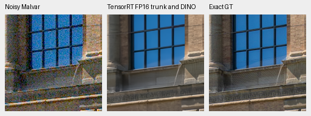
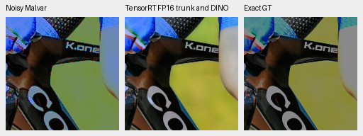

# Corpus 100k inference with compiled DINO

November 19, 2026, GB10. **Compiling DINO saves another 4.1%, or 1.68 s
across the 102 MP frame's paired tile loop.** This study compares the same
Corpus 100k EMA under eager FP16, TensorRT FP16 on the restoration trunk,
and TensorRT FP16 on the trunk plus all four DINOv3 ConvNeXt stages. The previously
validated eager FP16 CLI cuts a full restore from 287.38 to 53.40 s versus
IEEE FP32. This follow-up measures the smaller gains available beyond
that first precision change. [Original FP16 benchmark](corpus100k-mixed-precision.md) ·
[Earlier paired trunk benchmark](corpus100k-trt-tactics.md).

[Machine results](results/corpus100k-trt-dino-v1/publication.json) ·
[Frozen scripts and receipts](results/corpus100k-trt-dino-v1/evidence.tar.xz) ·
[Native crop provenance](images/corpus100k-trt-dino-v1/manifest.json).

## Precision and timing

All arms use EMA SHA256
`87b96f3c487b9edaf1c477742b6c38f2a82cc6b20a94716d51cc8cf46a17a760`.
The GFX test uses DSCF3879 at ISO6400, shot/read `0.00128/6.5536e-6`,
and the same 520 tiles at 512 pixels with 64 pixels of overlap and
batch four. All arms use the existing Bayer and camera transforms
with PyTorch 2.14.1+cu130 and cuDNN 9.24. The native DRUNet head,
output addition and overlap blend run in FP32, followed by one RGB16
conversion.

The compiled ConvNeXt uses TensorRT 11.4.0.106. Its depthwise and stem
convolutions, pointwise projections and GELU use FP16. Layer normalization,
learned channel scaling, residual additions and all four stage outputs
use FP32, matching the eager dtype boundaries. The pointwise projections
are 1×1 convolutions and the pyramid still fuses its four stage outputs
in PyTorch. The unused classification work is omitted. Dynamic batches
one through four were exercised. The fixture uses 512-pixel tiles,
while the frozen evaluation also needs a 256-pixel profile. TensorRT
build and engine load are measured outside warm restoration. [TensorRT
precision controls](https://docs.nvidia.com/deeplearning/tensorrt/11.4.1/inference-library/precision-control.html).

The four-tile screen gives medians of 31.96 ms for eager DINO and
20.69 ms for compiled DINO, down 35.3%. Its complete forward time
falls from 190.79 to 179.01 ms versus TensorRT on the trunk alone.
The 512-pixel DINO engine takes 37.28 s to build and occupies 97 MiB.
The separate 256-pixel engine takes 86.27 s to build on the shared GPU.
This is an inference experiment with the existing trained weights.

Interleaving all three arms on each of the 130 four-tile batches gives
42.70 s for eager FP16, 36.33 s for the TensorRT trunk, and 35.36 s for
the TensorRT trunk plus DINO. The combined plan saves 17.19% versus
eager FP16. Compiling DINO alone saves 2.68% on top of the TensorRT trunk
in this comparison. The block-bootstrap interval for the incremental
change is −7.60% to +2.12%. These times exclude packing, transfers,
blending and export.

In a second interleave, each arm packs the RAW tiles, runs the forward
pass, copies back the RGB and blends it into its own FP32 accumulator.
The same 520 tiles take 41.03 s with the TensorRT trunk and 39.35 s with
the trunk plus DINO, a 4.10% reduction. The block-bootstrap interval
is −7.70% to −0.59%. Blend time is 0.72 and 0.71 s respectively.
Both interleaved accumulators reproduce their corresponding full
exports byte for byte. The final normalization takes 0.06–0.07 s
and TIFF writing takes 1.07–1.10 s. These operations and frame
setup are timed separately from the tile loop.

Whole restores in opposite order vary on the shared GPU. The two eager
restores take 31.44 and 45.55 s. The two trunk-only restores take
28.11 and 37.11 s. The two trunk-plus-DINO restores take 39.03 and
38.91 s. Those repeats establish output stability while the paired timing
estimates the runtime effect. Decode takes 0.40 s, checkpoint setup
1.79 s, and loading both engines 0.20 s once in that process.
TIFF writing takes 0.58–1.09 s per pass. Peak PyTorch CUDA allocation
is about 2.30 GB for eager FP16 and 2.05 GB for both TensorRT paths.
TensorRT's allocations are outside that statistic.
The 10-second restore target remains open.

## Image fidelity

Each policy produces byte-identical TIFFs across its two restores. Across
305,987,556 channel codes, trunk plus DINO differs by 0.484 DN16 RMS
from trunk-only TensorRT and 0.544 DN16 RMS from IEEE FP32. Respectively,
99.56% and 99.37% of codes stay within one DN16. The 99.9th-percentile
differences are four and five codes. The largest changes are 136 codes
beside a distant light versus trunk-only and 163 beside magenta signage
versus IEEE FP32. Both lights retain their visible shapes and colors at
display ×1. Overlap bands have lower RMS changes than the interiors.
[Largest change versus trunk-only](images/corpus100k-trt-dino-v1/static_vs_dynamic-outlier.png) ·
[Largest change versus IEEE FP32](images/corpus100k-trt-dino-v1/static_vs_ieee-fp32-outlier.png).

In six long exact-target contexts, rendered PSNR changes by at most
0.00033 dB versus trunk-only TensorRT. The largest camera-RGB changes
versus IEEE FP32 occur in the clipped cyclist (176.18 DN16 RMS) and
Karajà statuette (71.84 DN16 RMS). Their rendered scores change by
+0.04931 and −0.00776 dB respectively. Both are also sensitive to
trunk-only TensorRT.

The weak-wire panel tests 24 held-out backgrounds at ISO400 and ISO6400
with the same 512-pixel inputs across methods. Against trunk-only
TensorRT, fitting the weak direction changes mean response by +0.0047
and −0.0017 percentage points. The largest per-case shift is 0.223
points. Mean flat chroma RMS moves by −0.0084 and +0.0048 DN16,
respectively. The largest per-case chroma RMS change is 0.090 DN16.

The ellipse and strip fixtures also have exact zero weak-signal gaps.
Across twelve held-out backgrounds at each ISO, compiled DINO changes
mean absolute gap luma RMS by −0.0010 DN16 at ISO400 and +0.0008 at
ISO6400. Mean fitted weak-direction error in the gaps changes by +0.0030
and +0.0006 DN16. The largest absolute per-case change is 0.0443 DN16.
The fit includes the continuing strong wire and a smooth background.

### Fixed photo and camera panels

All 3,162 frozen batches use the same observations and scoring crops as
the earlier TensorRT comparison. The photo mean balances 427 sources
and the camera panels score measured CFA samples.
[Prior fixed-panel evaluation](corpus100k-fp16-throughput.md#tensorrt-fp16-on-the-fixed-panels).

| Panel | Coverage | Mean change vs TensorRT trunk | Mean change vs archived IEEE FP32 | Absolute per-case change p95 vs TensorRT trunk |
| --- | ---: | ---: | ---: | ---: |
| Photographic sRGB | 11,956 cases, 427 sources | −0.0000004 dB | −0.000214 dB | 0.000999 dB |
| Known camera CFA | 72 crops | +0.000232 dB | +0.000237 dB | 0.001760 dB |
| Unseen camera CFA | 90 crops | −0.000017 dB | +0.000030 dB | 0.000708 dB |

The largest added loss against the trunk-only engine is 0.02769 dB on
the nearly white background in ROCKY's sickle photograph, CC BY-SA 4.0.
The GBRG case gains 0.05338 dB versus the same-GPU IEEE FP32 replay.
The RGGB case on the same photo has the largest loss versus IEEE FP32,
0.2854 dB, with 0.00261 dB of that loss added by compiling DINO.
Mean green rises by 17.95 DN16 in GBRG and 5.23 DN16 in RGGB versus the
trunk-only engine. Both native `[48,48,160,160]` crops look nearly
white at display ×1. Both draw shot/read `2e-5/1.6e-9` at 16-bit ADC
and black level 0.03. [Source](https://commons.wikimedia.org/wiki/File:Sickle_-_%E0%A6%95%E0%A6%BE%E0%A6%B8%E0%A7%8D%E0%A6%A4%E0%A7%87_-_DSC00435.jpg) ·
[GBRG comparison](images/corpus100k-trt-dino-v1/worst-vs-trt_fp16-comparison.png) ·
[RGGB comparison](images/corpus100k-trt-dino-v1/worst-vs-fp16-comparison.png).

## Native exact-target triplets

Every cell contains 160 × 160 native pixels at
`[680,480,160,160]` in its cached crop. Noisy Malvar, the compiled DINO
pipeline and the exact synthetic target share the same display transform.
The sensor simulation uses a 16-bit ADC and normalized black level 0.03.

**Alte Pinakothek** by AuHaidhausen, CC BY 4.0. Cache box
`[102,10,1536,1152]`, GBRG, shot/read `0.00256/2.62144e-5`,
display ×1. Window bars stay coherent and fine masonry stays soft.
[Source](https://commons.wikimedia.org/wiki/File:Alte_Pinakothek_lateral.jpg) ·
[Four inference policies](images/corpus100k-trt-dino-v1/pinakothek-comparison.png).



**Elisa Longo Borghini time trial** by Granada, CC BY-SA 4.0. Cache box
`[264,112,1536,1152]`, RGGB, shot/read `8e-5/2.56e-8`,
capture exposure ×4 and display ×0.25. The clipped background shifts
toward yellow and the white sleeve loses tonal variation.
[Source](https://commons.wikimedia.org/wiki/File:20180925_UCI_Road_World_Championships_Innsbruck_Women_Elite_ITT_Elisa_Longo_Borghini_850_8800.jpg) ·
[Four inference policies](images/corpus100k-trt-dino-v1/highlight-comparison.png).



## Standing GFX100S comparisons

The main scene shows the four fixed native crops from the full restore at
display ×4. The fine cab mesh uses the fixed 768-pixel source contexts at
display ×16. The ISO100 AHD renders and both fine-cab camera JPEGs are
qualitative references with different aperture, exposure, or subject motion.
At native scale the sky stays smooth and the coarse fence crossings
stay coherent. Building wires and foliage remain soft. The transferred
prior still gives the clearest right-side cab diagonals. Left-side
mottling and incomplete fine crossings persist. The compiled path
differs from IEEE FP32 by 0.186–0.301 DN16 camera-RGB RMS on the main
crops and 0.091–0.109 DN16 on the cab crops.

[Sky](images/corpus100k-trt-dino-v1/overcast-sky.png) ·
[Building](images/corpus100k-trt-dino-v1/building-detail.png) ·
[Foliage](images/corpus100k-trt-dino-v1/foliage.png) ·
[Coarse fence](images/corpus100k-trt-dino-v1/chain-link-fence.png).

| Cab conditioning, shot/read | Left ROI | Right ROI |
| --- | --- | --- |
| Nominal `0.00128/6.5536e-6` | [Native board](images/corpus100k-trt-dino-v1/mesh-nominal-fine-green-mesh-left.png) | [Native board](images/corpus100k-trt-dino-v1/mesh-nominal-fine-green-mesh-right.png) |
| Transferred `0.0014635775921166604/1.0715704128646712e-6` | [Native board](images/corpus100k-trt-dino-v1/mesh-profile3879-fine-green-mesh-left.png) | [Native board](images/corpus100k-trt-dino-v1/mesh-profile3879-fine-green-mesh-right.png) |

## Reproducing the prototype

Use a fresh sibling experiment directory under `.cache/experiments/` with
the Python drivers from the frozen archive. Run from the repository root
with the pinned checkpoint, frozen inputs and TensorRT 11.4.0.106 available
to the project virtual environment. The archive includes the engine
inspector outputs and plan hashes. The plans are rebuilt locally.

```bash
study=.cache/experiments/corpus100k-trt-dino-replay
.venv/bin/python "$study/dino_engine.py" 512 3
.venv/bin/python "$study/review.py" screen
.venv/bin/python "$study/review.py" full
```

The full review also uses the prior TensorRT FP16 trunk plan and the
same local GFX fixture. The supported CLI uses eager CUDA FP16 with
`--precision float16 --tile 512 --overlap 64 --batch-size 4`.
[Inference usage](usage.md).
