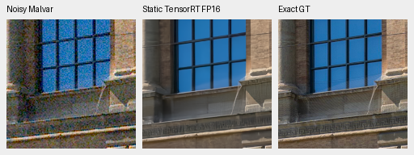
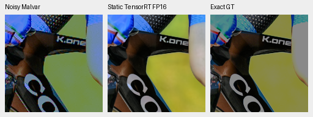

# Corpus 100k TensorRT FP16 kernel selection

**TensorRT FP16 cuts forward time by 12.4% on the same 520 tiles as
eager FP16.** The existing engine and a newly built fixed-batch engine
finish within 2 ms of each other over all 130 paired batches. The
fixed-batch export keeps the view of the sky and both standing fences,
although clipped exact-target photographs show larger arithmetic
differences. The existing TensorRT engine has the broader quality
review. [Earlier full-frame timing](corpus100k-faster-inference.md#warm-tensorrt-comparison) ·
[Existing TensorRT fixed-panel results](corpus100k-fp16-throughput.md#tensorrt-fp16-on-the-fixed-panels).

[Machine results](results/corpus100k-trt-tactics-v1/publication.json) ·
[Frozen drivers and receipts](results/corpus100k-trt-tactics-v1/evidence.tar.xz) ·
[Native crop provenance](images/corpus100k-trt-tactics-v1/manifest.json).

## Timing on GB10

The test uses the Corpus 100k EMA
`87b96f3c487b9edaf1c477742b6c38f2a82cc6b20a94716d51cc8cf46a17a760`
and cached DSCF3879 at ISO6400. Shot/read are `0.00128/6.5536e-6`.
All variants use PyTorch 2.14.1+cu130, cuDNN 9.24, 512-pixel tiles,
64-pixel overlap and batch four. Only the hidden DRUNet uses strongly
typed TensorRT 11.4.0. Bayer processing, native input skip and output
head, camera transforms, overlap blending and RGB16 export retain the
existing FP32 precision boundaries. DINO keeps its eager FP16 policy.

The existing engine accepts one to four tiles. Two new engines fix the
batch to four and use TensorRT builder optimization levels 3 and 5,
five timing iterations, a 2 GiB workspace limit and no auxiliary
streams. Builds take 44.37 and 43.49 s respectively and are outside
inference timing. Across 12 four-tile forwards on the default CUDA
stream, the previous engine and the two fixed engines have median
times of 316.5, 289.5 and 311.5 ms. On the explicit stream used for
full-frame timing, those medians are 289.6, 304.3 and 299.3 ms.
The two screens vary enough to change the ranking. The level-3 engine
goes to the full-frame test because it has the lower pooled timing and
closer output to eager FP16 in the resident screen. [NVIDIA TensorRT builder reference](https://docs.nvidia.com/deeplearning/tensorrt/11.4.0/_static/python-api/infer/Core/BuilderConfig.html).

Each engine warms up and then runs two complete 102 MP restores in the
order shown. Restore timing includes packing, transfers and FP32
blending. Decode takes 0.48 s and pinned checkpoint setup 2.20 s once
per process. Deserializing and preparing both TensorRT engines takes
0.30 s. PyTorch peak allocation is 2.39 GB for eager FP16 and 2.14 GB
with TensorRT. TensorRT's own allocations are outside that measure.

| Engine | Warm restores in order | Median restore | RGB16 writer |
| --- | ---: | ---: | ---: |
| Eager FP16, first and last | 40.55 / 29.82 s | 35.18 s | 0.54–0.59 s |
| Previous TensorRT FP16, second and fifth | 27.29 / 40.67 s | 33.98 s | 0.82–1.17 s |
| Fixed-batch TensorRT FP16, third and fourth | 28.75 / 27.42 s | 28.09 s | 0.93–1.15 s |

The shared GPU produces wide variation across full passes. A second
timing run interleaves all three engines on every four-tile batch.
It rotates the six possible orderings and synchronizes after each
forward. This isolates forward time and excludes packing, transfer,
blend and TIFF write. The sums across 130 batches are **25.832 s**
eager, **22.631 s** previous TensorRT and **22.633 s** fixed-batch
TensorRT. Both engines are faster than eager FP16 on every batch.
The previous engine reduces summed wall time **12.39%**
[12.17%, 12.64%]. The fixed engine is **0.007% slower** than the
previous one [−0.395%, +0.402%]. Intervals resample blocks of five
neighboring batches. CUDA events give the same ordering.
The tiled-restore target remains 10 seconds for 100 MP.

## RGB16 and detail fidelity

The two complete exports of each policy match byte for byte. The
eager TIFF also matches the earlier pinned-transfer CLI output.
Across all 305,987,556 channel codes, the fixed-batch TIFF differs
from IEEE FP32 by **0.541 DN16 RMS** and from eager FP16 by **0.553
DN16 RMS**. Over **99.3%** of codes stay within one DN16 in either
comparison and the 99.9th percentile is five DN16. The previous and
fixed TensorRT TIFFs differ by **0.601 DN16 RMS**. The two largest
fixed-engine changes versus eager and previous TensorRT are **248
DN16** near bright magenta signage and **167 DN16** near a narrow
lit strip. Both crops retain the signs' color and shape at display ×1.
Overlap midpoint bands have smaller RMS changes than the interiors.
[Magenta sign](images/corpus100k-trt-tactics-v1/static_vs_eager-outlier.png) ·
[Lit strip](images/corpus100k-trt-tactics-v1/static_vs_dynamic-outlier.png).

A separate weak-wire panel uses 24 held-out photos at ISO400 and ISO6400
with all inputs at 512 pixels. Each capture has an exact weak-plus-strong,
strong-only and flat reference. Against eager FP16 at ISO6400, the previous
and fixed engines change fitted weak-wire response by +0.006 and +0.013
percentage points on average. Flat chroma RMS rises 0.005 and 0.021 DN16.
The largest absolute per-case weak response change is 0.215 points with
the fixed engine. Mean strong-wire response changes by at most 0.007
points at either ISO. The largest flat chroma increase for either engine
is 0.176 DN16 at ISO400. These timings and quality checks favor the
existing FP16 engine over the previously studied selective FP8 path,
which saved 1.44 s and raised mean flat chroma RMS by 8.42 DN16 at
ISO6400 in its separate 256-pixel wire test. [Earlier FP8 experiment](corpus100k-faster-inference.md#warm-tensorrt-comparison).

Six exact-target long contexts use the same observations in all four
arithmetic policies. The largest sRGB PSNR shift versus eager is
**+0.0543 dB** on the clipped cyclist. The largest loss is **−0.0091
dB** on the Karajà statuette. The other four shifts are within
0.00021 dB. The cyclist's full context changes by **184 DN16 RMS**
versus eager FP16 in camera RGB and the statuette changes by **81
DN16 RMS**. Relative to IEEE FP32, the cyclist changes by **204
DN16 RMS**, with a gain of 0.0682 dB in rendered PSNR. Keep these
content-dependent tails in view when using TensorRT. The new fixed
engine has the six exact-target contexts, the weak-wire tests and
both GFX families. The broad 427-photo and known/unseen camera
results apply to the previous engine. [Broad arithmetic comparison](corpus100k-fp16-throughput.md#tensorrt-fp16-on-the-fixed-panels).

## Native exact-target triplets

Each cell uses 160 × 160 native pixels at `[680,480,160,160]` in the
listed cached photo. Noisy Malvar, fixed TensorRT FP16 and the exact
synthetic target share the display transform and the same 16-bit ADC
observation with black level 0.03.

**Alte Pinakothek**, AuHaidhausen, CC BY 4.0. Cache box
`[102,10,1536,1152]`, GBRG, shot/read `0.00256/2.62144e-5`, display
×1. The restored window bars are coherent and fine masonry stays soft.
[Source](https://commons.wikimedia.org/wiki/File:Alte_Pinakothek_lateral.jpg) ·
[All four arithmetic paths](images/corpus100k-trt-tactics-v1/pinakothek-comparison.png).

**Elisa Longo Borghini time trial**, Granada, CC BY-SA 4.0. Cache box
`[264,112,1536,1152]`, RGGB, shot/read `8e-5/2.56e-8`, capture
exposure ×4 and display ×0.25. The green background still renders too
yellow after clipping, and the white sleeve loses tonal variation.
[Source](https://commons.wikimedia.org/wiki/File:20180925_UCI_Road_World_Championships_Innsbruck_Women_Elite_ITT_Elisa_Longo_Borghini_850_8800.jpg) ·
[All four arithmetic paths](images/corpus100k-trt-tactics-v1/highlight-comparison.png).

## Standing GFX100S comparisons

The complete DSCF3879 restores give 0.201–0.305 DN16 camera-RGB
RMS changes versus eager FP16 across the four main crops at
display ×4. The sky is smooth, the coarse fence crossings are
coherent and building wires and foliage stay soft. The DSCF3842
cab comparisons use fixed 768-pixel contexts at display ×16 and
change by 0.078–0.109 DN16 RMS versus eager FP16. Viewed at native
scale, the transferred prior keeps clearer right diagonals. Left
mottling and missing fine crossings remain. Both ISO100 AHD
captures and the cab camera JPEGs provide qualitative references.
Aperture, exposure and subject motion differ.

[Sky](images/corpus100k-trt-tactics-v1/overcast-sky.png) ·
[Building](images/corpus100k-trt-tactics-v1/building-detail.png) ·
[Foliage](images/corpus100k-trt-tactics-v1/foliage.png) ·
[Coarse fence](images/corpus100k-trt-tactics-v1/chain-link-fence.png).

| Cab shot/read | Left | Right |
| --- | --- | --- |
| Nominal `0.00128/6.5536e-6` | [Native board](images/corpus100k-trt-tactics-v1/mesh-nominal-fine-green-mesh-left.png) | [Native board](images/corpus100k-trt-tactics-v1/mesh-nominal-fine-green-mesh-right.png) |
| Transferred `0.0014635775921166604/1.0715704128646712e-6` | [Native board](images/corpus100k-trt-tactics-v1/mesh-profile3879-fine-green-mesh-left.png) | [Native board](images/corpus100k-trt-tactics-v1/mesh-profile3879-fine-green-mesh-right.png) |

For the supported CUDA CLI path, use
`--precision float16 --tile 512 --overlap 64 --batch-size 4`.
The paired IEEE FP32 benchmark measured **287.38 → 53.40 s** with
those FP16 settings. The earlier TensorRT engine's paired warm test
measured **42.04 → 37.05 s** versus eager FP16. These timings come
from separate sessions with distinct shared-GPU load. [Standard FP16](corpus100k-mixed-precision.md) ·
[Previous TensorRT and pinned upload](corpus100k-faster-inference.md).
