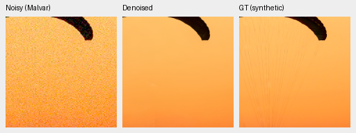
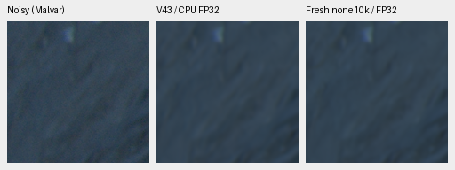
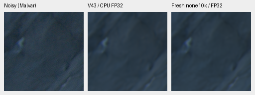
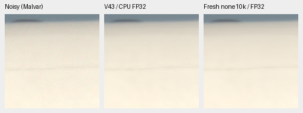
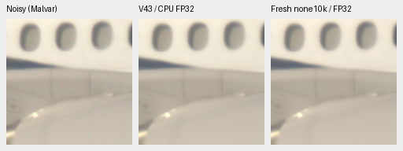
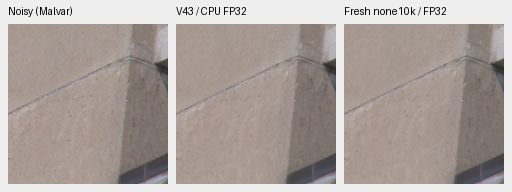
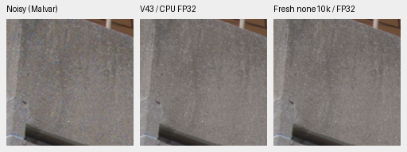
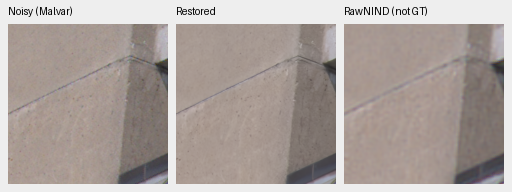

# CPU qualitative check of the completed no-context model

The completed fresh no-context 10,000-step arm looks close to retained V43 on
the three fixed additional-camera contexts. This check does not support a new
model promotion. Both learned methods show sharper GFX50R concrete seams than
RawNIND, while Q2 shadows and Sony window detail remain soft. Fine cords are
still missing in the fixed synthetic fabric example; the fresh model has a
more yellow/darker cast there. Full matched S/B/numerical/analytic/GFX review
is still pending in the [original long comparison](fresh-dino-capacity-10k.md).
[All 38 native PNGs and complete provenance](results/cross-camera-none10k-cpu-review.json).

Both learned models and both RawNIND calibration variants were actually rerun
on **CPU FP32**. This keeps GPU training isolated and uses the same compute
precision for both learned models. V43 has a different training history and a
DINO branch; fresh no-context starts from the Gaussian prior. This is a
descriptive development check, not a causal test of DINO or training duration,
an inference-speed measurement, or a full-frame quality claim.

## Two fixed examples with exact simulated GT

These are the two previously chosen README source IDs, at the original
8×8-binned evaluation resolution. Every displayed panel is a native 160×160
crop, without resizing, sharpening or independent exposure adjustments.
The clean transformed target is exact for this synthetic noise experiment.
It is not a clean camera-RAW measurement.

The shared condition is RGGB, shot .00256, read variance .0000262144, exposure 1,
16-bit ADC, WB [2,1,1.5], and the original evaluation camera matrix. CPU noise
is seeded by source/condition/CFA. It differs from the earlier CUDA observations;
no previous GPU score or noise realization is silently reused. There are only
two source cases here; their aggregate metrics are not used for model selection.

| Source | 256px tile in the binned source | Native 160px ROI in that source |
| --- | --- | --- |
| Fabric/cords, `0014aa4e…` | [189,3,256,256] | [237,51,160,160] |
| Building/sky, `002fc6ee…` | [195,89,256,256] | [243,137,160,160] |

Within each tile the displayed ROI is [48,48,160,160]. All four methods have
byte-identical noisy and GT panels. The underlying CPU observations and targets
are saved separately with hashes. Labels below identify the denoised method;
each image reads **noisy → denoised → exact simulated GT**.

V43, fabric/cords:



Fresh no-context 10k, same fabric/cords observation:


V43, building/sky:


Fresh no-context 10k, same building/sky observation:


Both learned models preserve cleaner architectural edges than RawNIND on this
example, with remaining sky/cloud and fine-detail loss. RawNIND global/channel
triplets for both examples are included in the linked receipt. This is not a
full-suite ranking.

Sources: [Roy Egloff](https://commons.wikimedia.org/wiki/File:CH.VD.Villeneuve_2007-08-25_Vertigo-Swiss-Riviera_2392_3x2-R_4K.jpg)
and [Dietmar Rabich](https://commons.wikimedia.org/wiki/File:Vancouver_(BC,_Canada),_Coal_Harbour_Seaside_Park,_Blick_in_den_Himmel_--_2022_--_2158.jpg),
[CC BY-SA 4.0](https://creativecommons.org/licenses/by-sa/4.0/). Modified by
8× binning, crop, camera/noise simulation and restoration. Derived photographs
retain their source license; full source/attribution fields are in the receipt.

## Three cached real captures

These are the unchanged [fixed selections](../configs/real-camera-qualitative.json)
from the [earlier V43 check](cross-camera-qualitative.md). All source reads use
local caches. No original photo directory is accessed, modified or admitted to
training by this execution. These are development examples, not a strict unseen
benchmark. Each 512px context contains fixed ROIs [64,64,160,160] and
[256,256,160,160]. Shot/read values are input-only Haar/flat-patch estimates,
not dedicated camera calibration.

| Camera / ISO / CFA | Context xywh | Shot / read variance | Display |
| --- | --- | --- | --- |
| Q2 / 100 / GBRG | [250,4054,512,512] | 4.3728329e-5 / 1.60487778e-7 | ×2 (+1 EV) |
| a7R II / 400 / RGGB | [3984,2978,512,512] | 8.19833844e-5 / 1.20619875e-7 | ×1 |
| GFX50R / 100 / RGGB | [1656,1552,512,512] | 1.94142414e-5 / 1.64130628e-7 | ×2 (+1 EV) |

The following rows read **noisy → V43 CPU FP32 → fresh no-context 10k CPU FP32**.
Neither learned panel is GT. The source PNG pixels are copied exactly into
these direct comparisons; there is no additional resampling or display fitting.
Photos by the project owner, used with permission.

Q2 upper-left and lower-right: both learned results remain soft and close.





Sony upper-left and lower-right: the input is already soft; windows and panel
detail remain soft after restoration, with no clear new winner.





GFX50R upper-left and lower-right: the learned methods remain close.





For comparison, this row is **noisy → fresh no-context 10k → RawNIND channel
calibration (not GT)**. Both learned models show sharper concrete seams and
more visible surface variation than RawNIND here. Without a clean reference,
not every retained fluctuation can be called true detail. All 24 real method/
calibration triplets are published in the receipt, with no real pixelwise score.



The standing GFX100S DSCF3879/DSCF3880 full-frame sky/building/foliage/fence
evaluation remains part of the running long comparison. These additional
captures do not replace that scene or its accurately labeled ISO100 reference.

## Execution and integrity

All **38 native PNGs** were verified and visually inspected: 24 real method/
calibration triplets, six direct learned comparisons and eight exact-GT example
triplets. Every panel is 160×160 within a 512×192 canvas. All **21 float32 real
context arrays** pass shape/dtype/finite/hash checks. CPU rerendering reproduces
all real PNG panel pixels exactly. Shared noisy/reference panels are byte-exact
across methods/calibrations. Two simulated observations/GT arrays are saved
separately with input fingerprints and binned-source coordinates.

Both learned models use EMA for inference. V43 checkpoint SHA256
`0d74cf31fb1c7e3f97fc692c855a2ca0ee3ebf562b454e4f8b135c28fc0aa5c5`;
fresh no-context 10k checkpoint SHA256
`0df4ff404c38b8f4b42f6451486e91c97631544b1c817c126f371195942f3af4`.
Hash-checked complete checkpoint snapshots are archived with each execution.
Both RawNIND adapters share publisher weights SHA256
`c1f7de3de24cb12f4803ee65e11cfb467e9a5b80c3cb7126746ef026106c15e0`.
No reference fitting or per-method display adjustment is used.

The qualitative helper now supports `--device cpu --precision float32` and
rejects CPU half-precision labels before reading inputs or creating outputs.
No CUDA context was initialized by these executions. GPU remains the default;
the running experiment's frozen source/evaluation scripts remain unchanged.
Only report helpers changed, so the production package retains its existing
validation. Actual three-camera inference, two exact-GT replays, artifact/guard
checks and Ruff pass. No new speed or CUDA-validation claim is made.

Example real-capture replay after sourcing `scripts/env.sh`:

```bash
CUDA_VISIBLE_DEVICES='' OMP_NUM_THREADS=4 HF_HUB_OFFLINE=1 \
  uv run --no-sync python scripts/compare_raw_crops.py \
  configs/real-camera-qualitative.json \
  /mnt/external/demosaic/models/v43-step2000.pt \
  /mnt/external/demosaic/runs/control-anchored-native-fresh-b16-v45/last.pt \
  --rawnind /mnt/external/demosaic/references/rawnind \
  --rawnind-gain-modes cfa-ls cfa-channel --device cpu --precision float32 \
  --output /mnt/external/demosaic/evaluation/private-three-camera-none10k-cpu-replay
```

Use the receipt's archived snapshots for immutable checkpoint replay. V43 stays
the README reference until a complete quality review supports a change.
