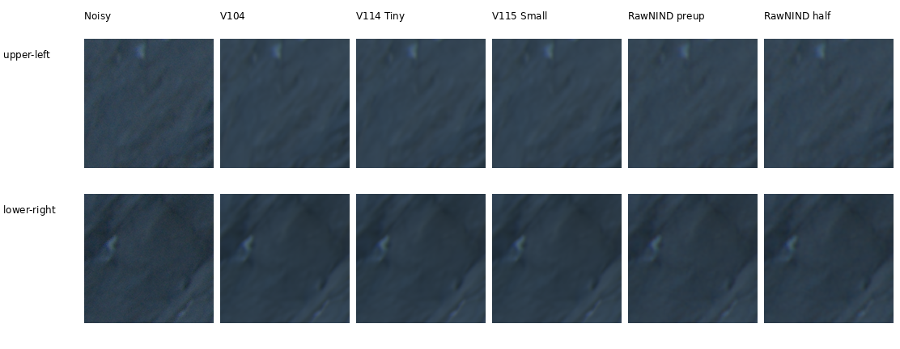
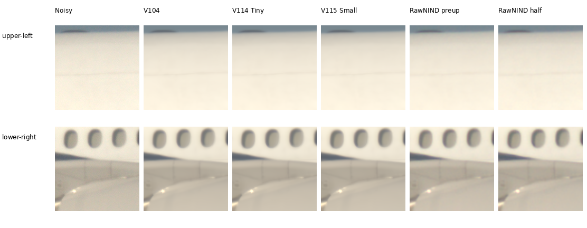
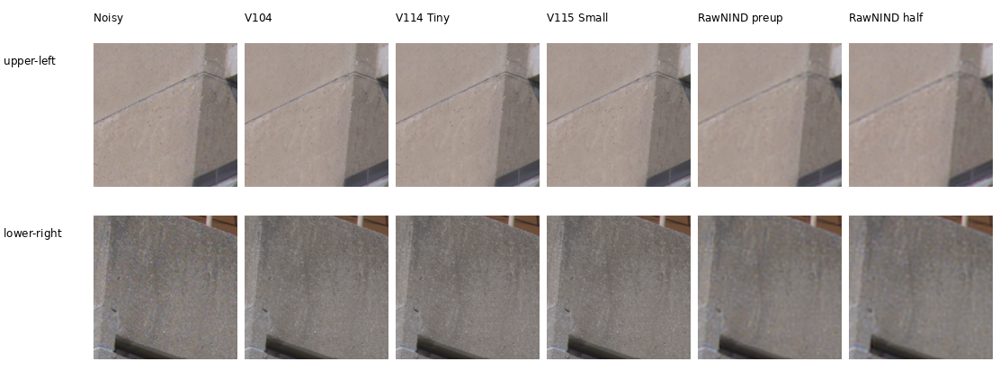

# Cached Q2, Sony a7R II and GFX50R comparisons

**V114 Tiny and V115 Small now have current comparisons on all three cameras,**
alongside retained V104 and both released RawNIND variants. Tiny/Small look
close to each other and to V104 here. All three preserve finer-looking concrete
texture than RawNIND, while Q2 shadows and Sony windows remain soft. These six
fixed low-ISO regions establish no large new qualitative gain over V104.
[Current choices](current-model.md) · [Complete Tiny/Small quality and exact-GT crops](v114-v115-quality.md).

Each cell is an unchanged **160×160 native sensor-pixel crop**. Rows are the
fixed upper-left/lower-right regions; columns are noisy Malvar, V104, V114 Tiny,
V115 Small, RawNIND pre-upsampled and RawNIND half-resolution. Both RawNIND
variants use input-only CFA-channel gain matching. There is **no clean reference**:
both are restorations of the same noisy capture, **not GT**. No pixelwise quality
score is reported. The [released-reference comparison](rawnind-variants.md)
identifies the distinct architectures and weights.
Open the original PNG at 100% if the browser fits the board to its window.

[All 24 native triplets and metadata](images/current-cameras-v114-v115/manifest.json) ·
[Execution, float-render verification and actual-viewing receipt](results/cross-camera-v114-v115-current-v1.json) ·
[Independent saved-array/publication checks](results/cross-camera-v114-v115-publication-v1.json).

The [V102/V104 gallery](images/current-cameras-v102-v104/manifest.json) and
[original receipt](results/cross-camera-v104-current-v1.json) retain their bytes.

The previous [V100/V102/V103 gallery](images/current-cameras-v102-v103/manifest.json)
and its [receipt](results/cross-camera-v102-v103-current-v1.json) remain available.

Earlier [Q2](images/current-cameras/q2-comparison.png),
[Sony](images/current-cameras/a7rii-comparison.png) and
[GFX50R](images/current-cameras/gfx50r-comparison.png) boards preserve the
V43/V84/V100 comparisons and their [original receipt](results/cross-camera-current-v1.json).

## Leica Q2: rocks and shadows



The methods suppress fine grain but leave soft dark rock structure. These
crops do not show a clear overall separation between V104, V114 and V115.

## Sony a7R II: airplane fuselage



All methods remove fuselage grain. Windows, joints and highlights remain soft;
V104, Tiny and Small differ little at native size. The noisy input already has
soft window edges.

## GFX50R: concrete architecture



The joint models retain finer-looking concrete-surface variation and thinner,
more coherent joints than both RawNIND variants, which look coarser and more
mottled here. V104, Tiny and Small look close to each other. Without a
clean reference, not every retained fluctuation can be established as true
surface detail. The [exact synthetic detail gallery](heldout-detail.md) provides
a complementary check with known targets.

## Fixed inputs and display

| Camera | ISO | CFA | Shot estimate | Read variance | Display | Sensor context xywh |
| --- | ---: | --- | ---: | ---: | --- | --- |
| LEICA Q2 | 100 | GBRG | 4.3728329e-05 | 1.60487778e-07 | ×2 (+1EV) | [250,4054,512,512] |
| ILCE-7RM2 | 400 | RGGB | 8.19833844e-05 | 1.20619875e-07 | ×1 | [3984,2978,512,512] |
| GFX 50R | 100 | RGGB | 1.94142414e-05 | 1.64130628e-07 | ×2 (+1EV) | [1656,1552,512,512] |

Noise coefficients are the existing input-only Haar/flat-patch estimates,
not dedicated camera calibration. The [fixed selection](../configs/real-camera-qualitative.json)
records source SHA256s, noise profiles and regions. Native ROIs are
[64,64,160,160] and [256,256,160,160] inside each context. Even context origins
preserve CFA phase. Source coordinates are unrotated visible-sensor pixels.
These are 512-pixel context restorations, not full-frame results.

WB, camera matrix and display exposure are identical across methods. Sony uses
×1 to avoid clipping its white fuselage in the display; Q2/GFX50R use ×2.
No resizing, sharpening or method-specific exposure fitting is applied.
All inference is CPU FP32. Joint models use their final EMAs; RawNIND uses the
released weights. Full hashes and effective configurations are in the manifest:

| Method | Selected endpoint | Checkpoint SHA256 prefix |
| --- | --- | --- |
| V104 | Fixed final20000 reviewed-corpus continuation EMA | 8a3a7d94f2b1 |
| V114 Tiny | Fixed final20000 Tiny continuation EMA | 2285c84b7015 |
| V115 Small | Fixed final20000 fitted-Small continuation EMA | fee5d05c599c |
| RawNIND pre-upsampled | Publisher weights, observed-CFA channel gain | 3d8d5fab966f |
| RawNIND half-resolution | Earlier publisher weights, observed-CFA channel gain | c1f7de3de24c |

All **36 distinct cells** in these three published boards were viewed at native
resolution. The 21 retained float32 contexts reproduce all 72 triplet panels
exactly after display rendering: 5,529,600 RGB8 channel values. Twelve contexts—
Bilinear, Malvar, half-resolution RawNIND and V104 on each capture—are reused
byte-for-byte. All six V104 triplet PNGs retain identical bytes. Shared noisy
and half-resolution RawNIND panels match across all restored methods.

Only **nine new CPU predictions** were made: three per current model and three
for the stronger released reference, with six DINO encoder calls. Each joint
model loads its exact 91-tensor final EMA and the pinned official frozen Tiny
or Small encoder. Measured CFA sites in the saved Bilinear RGB
reconstruct the original packed samples; the fingerprints of all five inputs
(samples, variance, CFA, WB and matrix) match the preceding execution exactly.
Weights, configuration, parameter identities, inputs and per-forward Torch RNG
stayed unchanged. Two CPU cores/nice10 kept this separate from the original
V117/V118 GPU training. Rendering forbids Torch module calls; no neural work is
repeated for assets or verification. Single view/hot-pixel repair off; no CUDA
or full-frame/timing comparison is added. RawNIND uses publisher ADC normalization
and input-only gain matching, with no explicit shot/read input.

The three cached RAWs total 218.7MiB in `.cache/real-camera-qualitative/`.
This refresh decoded **no RAWs** and read no originals. Exact source
hashes/filenames are absent from the current 90,864-source Commons, native and
corrected-paired training manifests. The earlier seven-manifest audit remains
preserved. These are existing development selections, with no complete
near-scene independence or strict-unseen claim. Photos by the project owner,
used with permission; public artifacts contain small crops and provenance.

## Reproduce

Source `scripts/env.sh`, then run the existing CPU comparison helper with the
fixed selection and desired checkpoints:

```bash
uv run --no-sync python scripts/compare_raw_crops.py \
  configs/real-camera-qualitative.json \
  /mnt/external/demosaic/models/v114-final20000.pt \
  /mnt/external/demosaic/V112-continuations-20261024-v2/V115/train/V115/last.pt \
  --rawnind /mnt/external/demosaic/references/rawnind-preupsample-20261023-v1 \
  --rawnind-gain-modes cfa-channel --device cpu --precision float32 \
  --output /mnt/external/demosaic/three-camera-current-replay
```

The public helper decodes the cached RAWs and computes the requested models.
The completed refresh instead uses the retained inputs and adds only the nine
new predictions. Its frozen worker, plan, raw predictions, rendering/publication
sources and per-case completion receipts are in
`.cache/current-quality-20261023-v1/three-camera-V114-V115-CPU-v1/`.
The plan pins 61 implementation/reference files and 29 input bindings. Successful
predictions are retained before rendering and are never rerun for bookkeeping.
The [earlier V43 execution receipt](results/cross-camera-v43-qualitative.json)
and timestamped diary preserve historical evidence.
