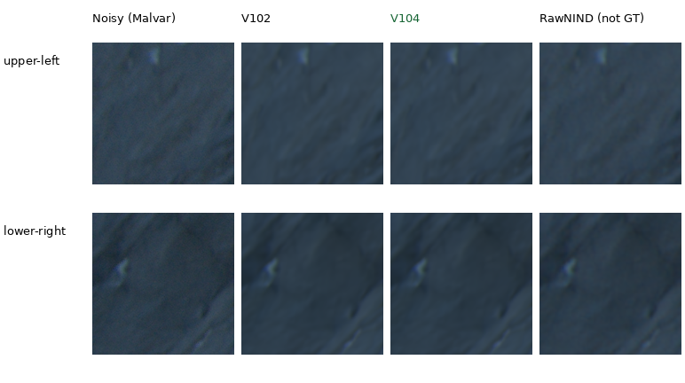
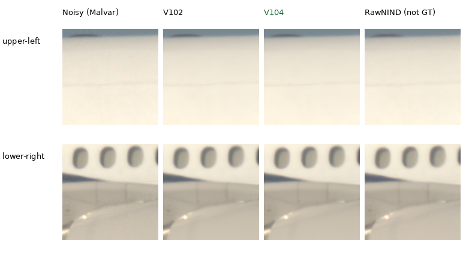
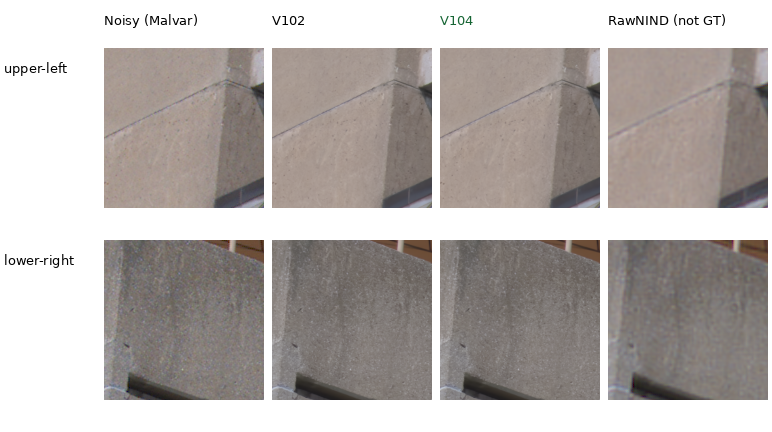

# Cached Q2, Sony a7R II and GFX50R comparisons

Current comparisons show **V104 and V102 final20k**, alongside RawNIND. They
extend the standing [GFX100S train scene](gfx-qualitative.md) using three existing
cached captures. V104 and V102 look close here, with no clear overall gain or
regression on these six low-ISO regions. The clearest separation from RawNIND
is on the GFX50R concrete; Q2 shadows and Sony windows remain soft.
[Completed exact-target results](v104-reviewed-corpus-quality.md) provide
complementary evidence for V104 as the positive-noise and training baseline.

Each cell is an unchanged **160×160 native sensor-pixel crop**. Rows are the
fixed upper-left/lower-right regions; columns are noisy Malvar, V102, V104
and input-only CFA-channel-calibrated RawNIND. There is **no clean reference**.
RawNIND is a comparator, **not GT**, and no pixelwise quality score is reported.
Open the original PNG at 100% if the browser fits the board to its window.

[All 12 source triplets and metadata](images/current-cameras-v102-v104/manifest.json) ·
[Execution, float-render verification and actual-viewing receipt](results/cross-camera-v104-current-v1.json).

The previous [V100/V102/V103 gallery](images/current-cameras-v102-v103/manifest.json)
and its [receipt](results/cross-camera-v102-v103-current-v1.json) remain available.

Earlier [Q2](images/current-cameras/q2-comparison.png),
[Sony](images/current-cameras/a7rii-comparison.png) and
[GFX50R](images/current-cameras/gfx50r-comparison.png) boards preserve the
V43/V84/V100 comparisons and their [original receipt](results/cross-camera-current-v1.json).

## Leica Q2: rocks and shadows



The methods suppress fine grain but leave soft dark rock structure. These
crops do not show a clear overall separation between V102 and V104.

## Sony a7R II: airplane fuselage



All methods remove fuselage grain. Windows, joints and highlights remain soft;
V102 and V104 differ little at native size. The noisy input already has
soft window edges.

## GFX50R: concrete architecture



The learned outputs retain finer concrete-surface variation and more coherent
joints than RawNIND here. V102 and V104 look close to each other. Without a
clean reference, not every retained fluctuation can be established as true
surface detail. The [exact synthetic detail gallery](heldout-detail.md) provides
a complementary check with known targets.

## Fixed inputs and display

| Camera | ISO | CFA | Shot estimate | Read variance | Display | Sensor context xywh |
| --- | ---: | --- | ---: | ---: | --- | --- |
| LEICA Q2 | 100 | GBRG | 4.3728329e-05 | 1.60487778e-07 | ×2 (+1EV) | [250,4054,512,512] |
| ILCE-7RM2 | 400 | RGGB | 8.19833844e-05 | 1.20619875e-07 | ×1 | [3984,2978,512,512] |
| GFX 50R | 100 | RGGB | 1.94142414e-05 | 1.64130628e-07 | ×2 (+1EV) | [1656,1552,512,512] |

Noise coefficients are the existing input-only Haar/flat-patch estimates,
not dedicated camera calibration. The [fixed selection](../configs/real-camera-qualitative.json)
records source SHA256s, noise profiles and regions. Native ROIs are
[64,64,160,160] and [256,256,160,160] inside each context. Even context origins
preserve CFA phase. Source coordinates are unrotated visible-sensor pixels.
These are 512-pixel context restorations, not full-frame results.

WB, camera matrix and display exposure are identical across methods. Sony uses
×1 to avoid clipping its white fuselage in the display; Q2/GFX50R use ×2.
No resizing, sharpening or method-specific exposure fitting is applied.
All inference is CPU FP32, with the standard loader selecting each checkpoint's
final EMA. Full hashes and effective configurations are in the manifest:

| Method | Selected endpoint | Checkpoint SHA256 prefix |
| --- | --- | --- |
| V102 | Fixed final20000 six-ROI continuation EMA | 55936a11ca5b |
| V104 | Fixed final20000 reviewed-corpus continuation EMA | 8a3a7d94f2b1 |
| RawNIND | Publisher weights, observed-CFA channel gain | c1f7de3de24c |

All **24 distinct cells** in these three published boards were viewed at native
resolution. The 15 retained float32 contexts reproduce all 36 triplet panels
exactly after display rendering. Twelve contexts—Bilinear, Malvar, RawNIND and
V102 on each capture—are reused byte-for-byte from the preceding report. All
six V102 triplet PNGs retain identical bytes. Shared noisy and RawNIND panels
match across learned methods.

The three new V104 DINO-backed forwards use its exact 91-tensor final EMA and
the official frozen encoder. Measured CFA sites in the saved Bilinear RGB
reconstruct the original packed samples; the fingerprints of all five inputs
(samples, variance, CFA, WB and matrix) match the preceding execution exactly.
Restoration inference modules are byte-identical to that run. Weights,
configuration, parameter identities, inputs and per-forward Torch RNG stayed
unchanged; CUDA was not initialized.

The three cached RAWs total 218.7MiB in `.cache/real-camera-qualitative/`.
This refresh decoded **no RAWs** and read no originals. Exact source
hashes/filenames are absent from seven checked Commons/native/paired manifests,
including V104's 90,872-source and V111/V112's 90,864-source cohorts. These are existing
development selections, with no complete
near-scene independence or strict-unseen claim. Photos by the project owner,
used with permission; public artifacts contain small crops and provenance.

## Reproduce

Source `scripts/env.sh`, then run the existing CPU comparison helper with the
fixed selection and desired checkpoints:

```bash
uv run --no-sync python scripts/compare_raw_crops.py \
  configs/real-camera-qualitative.json \
  /mnt/external/demosaic/models/v102-final20000.pt \
  /mnt/external/demosaic/models/v104-final20000.pt \
  --rawnind /mnt/external/demosaic/references/rawnind \
  --rawnind-gain-modes cfa-channel --device cpu --precision float32 \
  --output /mnt/external/demosaic/three-camera-current-replay
```

The public helper decodes the cached RAWs and computes both models. The completed
refresh instead reconstructs the bit-exact old inputs and computes only V104:
`.cache/current-quality-20261023-v1/three-camera-V104-CPU-v2/worker.py`.
Its frozen plan binds the retained inputs, prior execution witness, weights and
copied implementation. Outputs are in
`/mnt/external/demosaic/three-camera-V104-CPU-20261023-v2/`.
The [earlier V43 execution receipt](results/cross-camera-v43-qualitative.json)
and timestamped diary preserve historical evidence.
