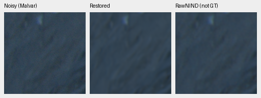
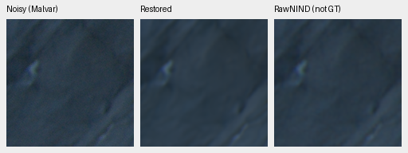
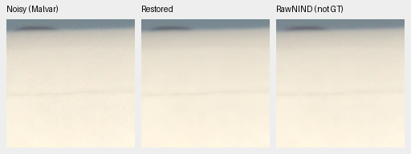
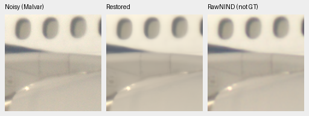
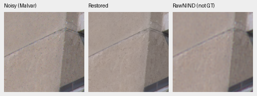
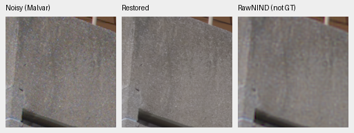

# Cached Q2, Sony a7R II and GFX50R qualitative checks

The retained V43 step 2,000 model now has fixed native comparisons on three
additional personal-camera captures. This extends the standing GFX100S scene;
it does not replace DSCF3879/DSCF3880 or promote a newly trained model.
[All 12 triplets, source/ROI/noise/checkpoint records and float artifacts](results/cross-camera-v43-qualitative.json).

A later [CPU FP32 check against the completed fresh no-context10k arm](cross-camera-none10k-cpu-review.md)
reruns both models and RawNIND, adds direct learned comparisons and two exact-GT
synthetic examples. It finds no clear new real-capture winner; V43 remains the
reference while the complete long comparison continues.

The [matched fresh no-context/S10k CPU review](fresh-none-S10k-cpu-review.md#three-additional-camera-contexts)
now adds the completed S arm on these same fixed inputs. It recovers the noisy
CFA from retained float arrays, repeats no RAW decoding or no-context/RawNIND
inference, and finds no clear new S advantage across the six ROIs.

Each row is **noisy Malvar → V43 → RawNIND comparator (not GT)**. There is no
clean reference or pixelwise quality score. Both RawNIND global/channel CFA
calibrations use the same publisher weights and observed noisy CFA, without
reference fitting. The examples below use its channel calibration; the global
variants are also published. All 12 PNGs were inspected at their native size.

| Camera | ISO | CFA | Input-only shot estimate | Read estimate | Display | Context xywh |
| --- | ---: | --- | ---: | ---: | --- | --- |
| LEICA Q2 | 100 | GBRG | 4.3728329e-05 | 1.60487778e-07 | ×2.0 | [250, 4054, 512, 512] |
| ILCE-7RM2 | 400 | RGGB | 8.19833844e-05 | 1.20619875e-07 | ×1 | [3984, 2978, 512, 512] |
| GFX 50R | 100 | RGGB | 1.94142414e-05 | 1.64130628e-07 | ×2.0 | [1656, 1552, 512, 512] |

Noise coefficients come from the existing conservative Haar/flat-patch fit on
each cached full capture. They are scene-dependent estimates, not dedicated
camera calibration. Q2 rocks/shadows, Sony fuselage/windows and GFX50R concrete
architecture were already selected before these model outputs. Native ROIs
are fixed [64,64,160,160] and [256,256,160,160] inside each 512px context, with
unrotated full-sensor coordinates in every receipt. Context origins are even
to preserve CFA phase. These are context restorations, not full-frame outputs.

The old Sony ×2 (+1 EV) input display clips much of its white fuselage. The
current selection uses shared ×1 for Sony; Q2/GFX50R remain shared ×2. This is
an input-preview display revision, with no model-specific exposure fitting or
ROI change. The earlier v1 execution/selection stays archived separately.

### LEICA Q2: upper-left



### LEICA Q2: lower-right



### ILCE-7RM2: upper-left



### ILCE-7RM2: lower-right



### GFX 50R: upper-left



### GFX 50R: lower-right




Q2 shadows remain soft in both models. Sony windows/edges are also soft without a clear overall winner. On these GFX50R concrete crops V43 shows sharper seams and more visible surface variation than RawNIND; without a clean reference this does not establish that every retained fluctuation is true detail. These few fixed contexts do not establish a broad real-photo or SOTA advantage.

Every panel is native 160×160, with identical coordinates, WB, camera matrix
and exposure across methods. No resizing or sharpening. PNGs are 8-bit display
copies; 18 verified float32 linear-camera-RGB context arrays preserve unquantized
predictions before display/clipping. CPU rerendering from those arrays agrees
with every saved panel within one 8-bit code; matching noisy/restored panels
across RawNIND calibration variants are byte-exact. Further display checks can
reuse these arrays without reloading RAWs or recomputing models.

Actual GPU execution uses V43 EMA SHA256
`0d74cf31fb1c7e3f97fc692c855a2ca0ee3ebf562b454e4f8b135c28fc0aa5c5`,
FP16 neural compute/FP32 physical reconstruction, and IEEE FP32 RawNIND. The
comparison helper now explicitly supplies shot/read conditioning before every
model call; the prior helper omitted it and could not run the stabilized model.
Both calibration adapters share upstream network weights. The resized overview
is separate and is not a 100% view.

The three RAWs are cached read-only in `.cache/real-camera-qualitative/`:
218.7 MiB total, each matching the filename SHA-1 and its copied SHA256. Original
identity/size/mtime stayed unchanged; all source access was read-only. Cache and
prepared metadata are for development qualitative testing, with no training
admission or strict-unseen claim. The public artifacts contain only small crops
and provenance, not source RAWs. Photos by the project owner, used with permission.

Reproduce after sourcing `scripts/env.sh` from the repository root with the `eval` extra installed:

```bash
uv run --no-sync python scripts/compare_raw_crops.py \
  configs/real-camera-qualitative.json /mnt/external/demosaic/models/v43-step2000.pt \
  --rawnind /mnt/external/demosaic/references/rawnind \
  --rawnind-gain-modes cfa-ls cfa-channel --precision float16 \
  --output /mnt/external/demosaic/evaluation/private-three-camera-v43-replay
```
