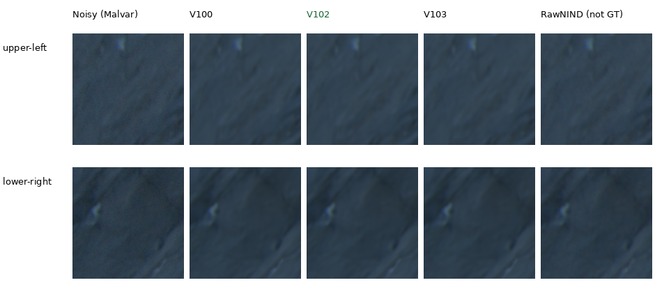
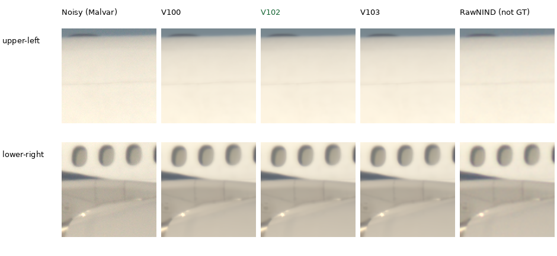
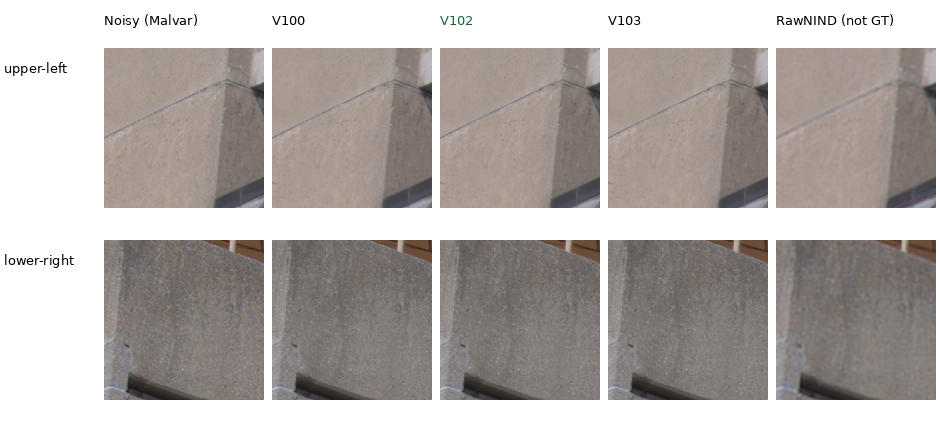

# Cached Q2, Sony a7R II and GFX50R comparisons

Current comparisons include **V102 and V103 final20k**, with V100 final10k and
RawNIND as comparators. They extend the standing [GFX100S train scene](gfx-qualitative.md)
using three existing cached captures. V100/V102/V103 look close here. The clearest
separation from RawNIND is on the GFX50R concrete; Q2 shadows and Sony windows
remain soft. These six low-ISO regions show little visual separation between
the learned versions. [Exact-target quality results](v102-v103-quality-review.md)
provide complementary evidence for the current V102 recommendation.

Each cell is an unchanged **160×160 native sensor-pixel crop**. Rows are the
fixed upper-left/lower-right regions; columns are noisy Malvar, V100, V102,
V103 and input-only CFA-channel-calibrated RawNIND. There is **no clean reference**.
RawNIND is a comparator, **not GT**, and no pixelwise quality score is reported.
Open the original PNG at 100% if the browser fits the board to its window.

[All 18 source triplets and metadata](images/current-cameras-v102-v103/manifest.json) ·
[Execution, float-render verification and actual-viewing receipt](results/cross-camera-v102-v103-current-v1.json).

Earlier [Q2](images/current-cameras/q2-comparison.png),
[Sony](images/current-cameras/a7rii-comparison.png) and
[GFX50R](images/current-cameras/gfx50r-comparison.png) boards preserve the
V43/V84/V100 comparisons and their [original receipt](results/cross-camera-current-v1.json).

## Leica Q2: rocks and shadows



The methods suppress fine grain but leave soft dark rock structure. These
crops do not show a clear overall separation between V100, V102 and V103.

## Sony a7R II: airplane fuselage



All methods remove fuselage grain. Windows, joints and highlights remain soft;
V100, V102 and V103 differ little at native size. The noisy input already has
soft window edges.

## GFX50R: concrete architecture



The learned outputs retain finer concrete-surface variation and more coherent
joints than RawNIND here. V100/V102/V103 look close to each other. Without a
clean reference, not every retained fluctuation can be established as true
surface detail. The [exact synthetic detail gallery](heldout-detail.md) provides
a complementary check with known targets.

## Fixed inputs and display

| Camera | ISO | CFA | Shot estimate | Read variance | Display | Sensor context xywh |
| --- | ---: | --- | ---: | ---: | --- | --- |
| LEICA Q2 | 100 | GBRG | 4.3728329e-05 | 1.60487778e-07 | ×2 (+1EV) | [250,4054,512,512] |
| ILCE-7RM2 | 400 | RGGB | 8.19833844e-05 | 1.20619875e-07 | ×1 | [3984,2978,512,512] |
| GFX 50R | 100 | RGGB | 1.94142414e-05 | 1.64130628e-07 | ×2 (+1EV) | [1656,1552,512,512] |

Noise coefficients are the existing input-only Haar/flat-patch estimates,
not dedicated camera calibration. The [fixed selection](../configs/real-camera-qualitative.json)
records source SHA256s, noise profiles and regions. Native ROIs are
[64,64,160,160] and [256,256,160,160] inside each context. Even context origins
preserve CFA phase. Source coordinates are unrotated visible-sensor pixels.
These are 512-pixel context restorations, not full-frame results.

WB, camera matrix and display exposure are identical across methods. Sony uses
×1 to avoid clipping its white fuselage in the display; Q2/GFX50R use ×2.
No resizing, sharpening or method-specific exposure fitting is applied.
All inference is CPU FP32, with the standard loader selecting each checkpoint's
final EMA. Full hashes and effective configurations are in the manifest:

| Method | Selected endpoint | Checkpoint SHA256 prefix |
| --- | --- | --- |
| V100 | Fixed final10000 continuation EMA | 4b689fb187b1 |
| V102 | Fixed final20000 six-ROI continuation EMA | 55936a11ca5b |
| V103 | Fixed final20000 32-ROI continuation EMA | eb20e21163d0 |
| RawNIND | Publisher weights, observed-CFA channel gain | c1f7de3de24c |

All 30 distinct cells in these three published boards were actually viewed at
native resolution. The 21 retained float32 contexts reproduce all 54 triplet
panels exactly after display rendering. Fifteen shared contexts—including V100,
RawNIND and the three classical baselines on each capture—reproduce the earlier
float output exactly. All six V100 triplet PNGs retain identical bytes. Shared
noisy and RawNIND panels match across learned methods. Every model uses its
exact final EMA, makes three real DINO-backed forwards on identical inputs,
and retains its weights/configuration/parameter identities. Source/checkpoint
bytes and per-forward Torch RNG stayed unchanged; CUDA was not initialized.

The three cached RAWs total 218.7MiB in `.cache/real-camera-qualitative/`; only
these local copies were decoded. Originals remain read-only. Exact source
hashes/filenames are absent from six checked Commons/native/paired manifests,
covering V100/V102/V103 and the active/future cohorts. These are existing
development selections, with no complete
near-scene independence or strict-unseen claim. Photos by the project owner,
used with permission; public artifacts contain small crops and provenance.

## Reproduce

Source `scripts/env.sh`, then run the existing CPU comparison helper with the
fixed selection and desired checkpoints:

```bash
uv run --no-sync python scripts/compare_raw_crops.py \
  configs/real-camera-qualitative.json \
  /mnt/external/demosaic/v84-curated-quality-20261022-v2/train/V100/last.pt \
  /mnt/external/demosaic/models/v102-final20000.pt \
  /mnt/external/demosaic/models/v103-final20000.pt \
  --rawnind /mnt/external/demosaic/references/rawnind \
  --rawnind-gain-modes cfa-channel --device cpu --precision float32 \
  --output /mnt/external/demosaic/three-camera-current-replay
```

The completed run used copied numerical source at
`.cache/current-quality-20261023-v1/three-camera-V102-V103-CPU-v2/work/`.
Its plan binds the cached inputs, weights and implementation. Outputs are in
`/mnt/external/demosaic/three-camera-V102-V103-CPU-20261023-v2/`.
The optional resized overview is separate from the native crops above.
The [earlier V43 execution receipt](results/cross-camera-v43-qualitative.json)
and timestamped diary preserve historical evidence.
