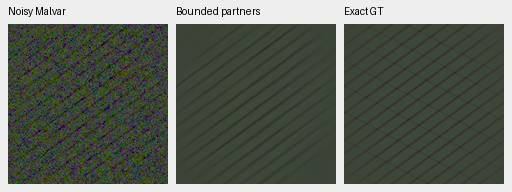
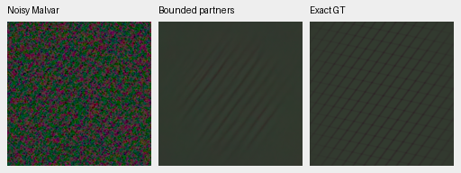

# Cross-color validation for the screened RAW refit

Bounded support from the other Bayer colors raises weak-wire response slightly
at ISO400 on both archived ordinary-wire panels. It barely changes recovery of
the weaker wire beside a rail, and increases false correction on rail-only
controls. The fine green cab mesh stays at V120 in every fixed crop. The
independent per-color gate remains the experimental baseline.
[Metrics, source and native-crop receipt](results/cross-colour-refit-v1/publication.json).

## Comparison

This replay changes the gate from the [nested background screen](screened-query-edges.md).
All arms use the same two RAW folds, discovery-only background screening, donor
frequencies and eight-knot phase fits. Each output color reuses the same
weighted-refit coefficients from its own Bayer samples. The validation window
is 129×129 samples. The same-side rule for camera crops also applies to pooled
validation.

- **Independent.** Average the two crossed-fold scores for a color where each
  predicts lower RAW error than its conditional null.
- **Joint.** Sum the held-out gains and prediction energies across the observed
  CFA channels before normalizing each fold, and share the crossed evidence
  across colors.
- **Bounded partners.** Compute separate crossed evidence for the other two
  colors. Where both own-color comparisons are positive, allow partner support
  to raise that color's score by up to its own score. An adverse own-color fold
  therefore still blocks delivery, and strong independent evidence is preserved.

The older [joint phase-profile study](joint-phase-profile-support.md) shared
the gate on discovery-fold coefficients. Here the refit is identical across
all three arms, so any change comes from the gate. Archived independent
prediction arrays replay exactly for all ordinary-wire and camera cases.
The rail-only and wire-beside-rail controls reproduce the original metrics.

## Ordinary wires

Fixed nominal thresholds are 2 for ISO400 and 1 for ISO6400, with the archived
scales 0.822120 and 0.561062 respectively. The quiet-capped columns reduce
scale only when the corresponding arm exceeds the independent arm's quiet
RMS on the same panel. This diagnostic uses the evaluation panel's quiet
targets. Each row averages eight case geometries, and response is the
projection of the recovered weak increment on the exact target increment.

| Panel and guide | Gate | Fixed weak response | Quiet-capped weak response | Capped increment RMS DN16 |
| --- | --- | ---: | ---: | ---: |
| Main ISO400, full-frame | Independent | 4.801% | 4.801% | 11.1802 |
| | Joint | 4.860% | 4.197% | 11.1824 |
| | Bounded partners | 5.036% | 4.970% | 11.1804 |
| Separate ISO400, full-frame | Independent | 6.436% | 6.436% | 11.2023 |
| | Joint | 7.526% | 6.161% | 11.2011 |
| | Bounded partners | 6.941% | 6.774% | 11.2003 |
| Main ISO400, exact center | Independent | 9.005% | 9.005% | 11.1573 |
| | Joint | 10.048% | 8.293% | 11.1571 |
| | Bounded partners | 9.534% | 9.389% | 11.1562 |

At ISO6400, the main full-frame responses are 0.661%, 0.669% and 0.661%
in the same arm order. On the separate ISO6400 panel both pooling arms lose
response after the quiet cap, from 2.464% to 2.328% joint and 2.382%
bounded. The receipt includes the stricter gates and exact-center
comparisons for both profiles. [Complete metrics](results/cross-colour-refit-v1/summary.json).

## Weak wires beside rails

These 16 cases give the refit exact frequencies and an analytic parent
with the rail background. The weaker wire is 12° from the rail normal
and one quarter the amplitude of the stronger family. Each case uses
independent corruptions of the strong-only and strong-plus-weak targets.
Values below use the fixed nominal gate and scale.

| Noise | Gate | Weak response | Quiet RMS DN16 | Weak-increment RMS DN16 |
| --- | --- | ---: | ---: | ---: |
| ISO400 | Independent | 0.0158% | 2.140 | 7.140 |
| | Joint | −0.0122% | 3.202 | 7.238 |
| | Bounded partners | 0.0149% | 2.693 | 7.192 |
| ISO6400 | Independent | 0.1313% | 0.351 | 6.950 |
| | Joint | −0.0106% | 0.327 | 6.963 |
| | Bounded partners | 0.1325% | 0.353 | 6.956 |

The 48 rail-only and flat controls use the original deliberately misleading
guides. The table gives added correction RMS and peak DN16, measured on
the same native 160×160 region of each exact null.

| Control | Independent | Joint | Bounded partners |
| --- | ---: | ---: | ---: |
| Flat, 8 cases | 0.416 / 15.35 | 0.214 / 11.54 | 0.417 / 15.35 |
| Straight step or rail, 16 cases | 0.447 / 6.34 | 0.585 / 6.75 | 0.475 / 8.79 |
| Complex rail, 24 cases | 1.313 / 20.18 | 1.671 / 23.42 | 1.522 / 22.87 |

The joint gate adds a correction in 20/24 complex cases, versus 19/24
for each of the other arms. The strict gates reduce all three RMS values,
while keeping the same ordering. Partner evidence can agree with own-color
evidence on a systematic rail residual.

## Native crops

Both triplets are noisy Malvar, bounded-partner restoration, and exact
constructed GT, with the same native 160×160 ROI `[176,176,160,160]` and no
resizing. Sources 88 RGGB and 89 BGGR use V143 EMA
`96d146d017c54196288c585f8b7eddcf030e8a235061049c31e985b9380b7ce4`,
the far two-direction role, ISO400 shot/read `8e-5/2.56e-8`, ADC16,
black 0.03, display exposure ×2, contrast 5 and matched WB/matrix.
The dominant lines persist and the weaker crossings remain faint in
both full comparisons. [Source, crop and transform manifest](images/cross-colour-refit-v1/manifest.json).

[Source 88 all gates](images/cross-colour-refit-v1/iso400-source88-RGGB-comparison.png) ·
[Source 89 all gates](images/cross-colour-refit-v1/iso400-source89-BGGR-comparison.png).

## Native GFX100S review

All comparisons use V120 EMA
`a9d9b6b4f974e24a6b11e5e740aab32314233a7f53c056cf37c7d2aac1c589fb`,
threshold 2, fixed guides and native crops. DSCF3879 uses nominal shot/read
`.00128/6.5536e-6` at display exposure ×4. DSCF3880 ISO100 AHD is an
independently demosaiced qualitative reference.

- The [overcast sky](images/cross-colour-refit-v1/main-overcast-sky.png)
  matches V120 exactly with both guide families. No added sky texture.
- The full-frame [building](images/cross-colour-refit-v1/main-building-detail.png)
  stays at V120, and the spectral variants differ only subtly. The
  reference's thin hardware remains poorly resolved.
- The full-frame [foliage](images/cross-colour-refit-v1/main-foliage.png)
  stays at V120. Spectral joint correction increases from 2.21 to 2.85 DN16
  RMS relative to V120 without a clear gain in leaf detail.
- The [coarse fence](images/cross-colour-refit-v1/main-chain-link-fence.png)
  keeps the existing lattice. The full-frame joint correction increases
  from 9.00 to 9.93 DN16 RMS relative to V120, with no clear new crossings.

On DSCF3842, both `[806,6489,160,160]` and `[1026,6449,160,160]`
match their own conditioned V120 pixels under all three gates and both guide
families. At exposure ×16 the faint diagonal modulation is visible in parts
of the right crop, with no new crosses or splotches. The DSCF3835 ISO100
AHD and both camera JPEGs remain qualitative references with aperture,
exposure time and subject motion differences.

| Cab conditioning | Shot/read | Native boards |
| --- | --- | --- |
| Nominal | `.00128/6.5536e-6` | [Left](images/cross-colour-refit-v1/mesh-nominal-left.png) · [Right](images/cross-colour-refit-v1/mesh-nominal-right.png) |
| DSCF3879 profile | `.0014635775921166604/1.0715704128646712e-6` | [Left](images/cross-colour-refit-v1/mesh-profile3879-left.png) · [Right](images/cross-colour-refit-v1/mesh-profile3879-right.png) |

This was a CPU replay of a scoped inference component. No training ran
for this comparison. The full427 and held-out camera score panels do
not cover these gates.
