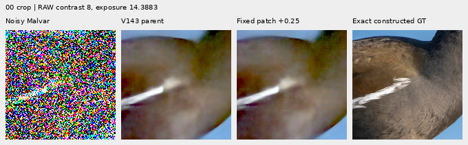
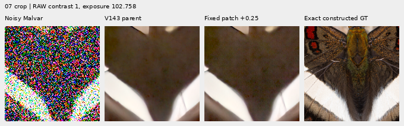
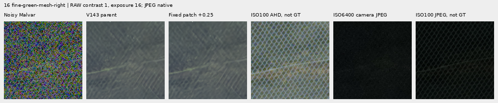

# Whole RAW patches: fixed probe adds noise, not useful detail

**The first untrained patch-return probe fails the intended detail/noise
tradeoff.** Relative band error increases on all eight photographic observations;
spatial error increases on all six noisy analytic flats. Native views show
added grain without clear feather, moth-scale or green-mesh recovery. This
operator stays outside inference. V120 and V143 recommendations are unchanged.

This is a small development diagnostic using previously reviewed data, not new
held-out validation or a trained architecture comparison. The separate
[V144/V145 review](v144-v145-quality.md) measures the completed neural trial.

[Locked plan](results/cross-phase-patch-return-plan-v1.json) ·
[Actual result](results/cross-phase-patch-return-result-v1.json) ·
[Independent audit](results/cross-phase-patch-return-audit-v1.json) ·
[Nine native figures and source metadata](images/cross-phase-patch-return-v1/manifest.json) ·
[Frozen operators](results/cross-phase-patch-return-operators-v1.json).

## Mechanism and fixed scope

The probe asks whether returning whole RAW patches over a wider field can
carry useful information that short local windows and shared memory slots
miss. The trained V143 parent stays frozen. Its EMA checkpoint SHA256 is
`96d146d017c54196288c585f8b7eddcf030e8a235061049c31e985b9380b7ce4`.
Only its cached predictions are read; no model or DINO forward is added.

For each of four packed CFA phases, keys concatenate centered 8×8 patches
from the other three phases. Cosine attention at temperature 8 matches all
stride-4 tokens in the retained context, excluding the identical token. Values
are whole centered patches from the selected value phase. Positive overlap
weights blend the returned patches; a fixed 9×9 packed box high-pass removes
coarser variation. Fixed FP32 Malvar demosaicing converts the signed field to
camera RGB, and gain 0.25 adds it to the cached parent. Neither target nor
parent prediction enters the matching operator. Patch size, stride, temperature,
gain, cases and high-pass size were fixed before its outputs.

This excludes the value phase from its own matching keys, but does not establish
noise rejection. There is no calibrated noise threshold or learned residual
shrinkage. Twelve noiseless constant probes, three colors across four CFAs,
return exactly zero. The noisy-flat results below demonstrate why that property
alone is insufficient.

Seventeen cached contexts are used: four organic sources with faint/dark
variants, six noisy RGGB analytic flats, the standing DSCF3879 sky and the fine
DSCF3842 mesh under both existing noise priors. Organic photo construction uses
native bin8 linear-sRGB16, mean .02/contrast .125 or mean .003/full contrast,
shot .00128/read 6.5536e−6, ADC16/black .03. Flat cases retain their ISO12800
conditioning. The operator does not alter or redraw any observation.

## Exact constructed targets and flat costs

Means below describe only the four selected photos per condition or six flats.
RMS units are camera-linear DN16. The native photo band uses the same 3–8px
DCT diagnostic as the [photographic supplement](spatial-photo-supplement.md).
An increase in response does not imply lower detail error.

| Diagnostic | V143 parent | Fixed patch return |
| --- | ---: | ---: |
| Faint photo full-context RMS | 38.85059 | 38.88429 |
| Faint photo relative band error | .920178 | .922901 |
| Faint photo band response, ideal 1 | .169137 | .169010 |
| Dark photo full-context RMS | 34.84551 | 34.85863 |
| Dark photo relative band error | .751590 | .752462 |
| Dark photo band response, ideal 1 | .448418 | .450432 |
| Noisy-flat spatial RMS | 18.88188 | 20.89483 |

Mean noisy-flat spatial RMS rises 10.66%. Every flat worsens, by .78–3.82 DN16;
all eight photo band errors also worsen. Seven of eight photo full-context
errors increase. These are descriptive development results, without a
significance or generalization claim.

Below: noisy Malvar → V143 → fixed probe → **exact constructed target**, native
160-pixel cells at ROI [112,112,160,160] inside each 384 context. Feather display
uses exposure 14.388348 and shared 8× contrast about the original target's
channel means; moth display uses exposure 102.757633 and contrast 1. The exact
source/ROI, input and parent hashes and transforms are preserved in the manifest.
No crop pixels are resized. Constructed targets are not exact physical-scene GT.

[Dark gray flat](images/cross-phase-patch-return-v1/08-crop-contrast40.png) and
[blue-green flat](images/cross-phase-patch-return-v1/12-crop-contrast40.png) use
native ROI [48,48,160,160], exposure 1 and shared 40× contrast about the exact
analytic target means. The added fine texture is unsupported by those targets.

## Standing real scenes

Main sky uses DSCF3879 ISO6400, native ROI [176,176,160,160] in a 512 context
and +2EV. The [sky comparison](images/cross-phase-patch-return-v1/14-crop-contrast1.png)
looks quiet at that display; this does not cancel the measured noisy-flat cost.

Fine mesh uses DSCF3842 ISO6400, both existing priors, both native 160-pixel
windows in the 768 context and common RAW display +4EV. Camera JPEGs keep their
native sRGB8 display without that exposure adjustment. DSCF3835 ISO100 f/5.6
differs in aperture, exposure time and moving subjects. Both scenes' independent
ISO100/AHD/JPEG references are **not exact GT** and receive no error scores.
The mesh still has weak, incomplete lattice traces; added grain does not resolve
the missing crossings.

Both windows under both priors are published in the manifest. These protected
captures and their siblings remain excluded from training.

## Evidence and implication

All 17 array/parent bindings are unchanged; all corrected arrays equal the
stored parent plus correction exactly. Python, NumPy, Torch CPU and CUDA RNG
states are unchanged. Independent NumPy64 reductions reproduce all 160 scored
values exactly and all 7,680,000 displayed channels; all 23 boards were viewed
in six unresized sheets. CUDA peak allocation is 131,088,384 bytes. This adds
fixed data operations only: zero training updates, model/DINO forwards, noise
draws or RAW decodes. No original photo drive or `/mnt/dataz` is opened.

The initial renderer assumed the main-sky ISO100 reference was a full context;
it is already a native 160 crop. Its failed operator and 18 partial boards are
preserved. A separate renderer fixes that crop; the final version also labels
native JPEG display separately. The numerical operator/results never changed.
[Preservation record](results/cross-phase-patch-return-publication-v1.json).

This rejects the fixed additive probe at its locked settings. It does not rule
out learning from whole patches. Any further design must demonstrate rejection
of unsupported noisy patches alongside actual recovery; cross-phase matching
and constant-input cancellation alone have not supplied that behavior.
