# Reciprocal green prediction removes unsupported wave regions

The later [supported-amplitude option](supported-wave-amplitude.md) recovers
more contrast inside reciprocal support, with higher added boundary spill than
`cross`. Its fresh/complete-frame comparison retains this earlier method and evidence.

**Reciprocal green support reduces fresh mean added blank-region RMS 89.0% and
its worst case 91.9% versus wider-context fitting.** The cost is 9.5% lower mesh
response and 0.8% higher image RMS. Complete GFX crops retain much of the crossing
lattice under both priors, with some weakening. The known detached false patch
is removed; true texture loss and small boundary spill remain. Use the explicit
`--phase-harmonic-envelope cross` option when stricter support is useful.

[Implementation](../src/demosaic/phase_cross.py) ·
[Publication and preserved evidence](results/cross-phase-support-publication-v1.json) ·
[Native source/ROI/checkpoint/noise/display manifest](images/cross-phase-support-v1/manifest.json).

## What changes

The [larger-context method](wide-phase-context.md) recovers measured fence detail,
but can add a detached stripe patch beside real texture. Its Gaussian coefficient
support can connect that patch to real detail through a weak bridge. Checking an
entire connected component therefore accepts both regions.

The new option tests spatial support using reciprocal green-phase prediction.
For each proposed wave, estimate its local sine/cosine coefficients from one
observed green phase, then predict the other at its physical Bayer positions.
Reverse the roles and use both predictions. Each phase has its own affine RAW
background and Gaussian 32 fit. The reciprocal templates use observed RAW;
parent predictions and GT do not enter those templates.

Jointly fit a nonnegative spatial mask for each active wave:

```
0.5 * ||sum(templates * P(mask)) - observed_green_residual||²
  + 0.5 * sum(norm(gradient(mask))) + (1/1610) * sum(P(mask))
subject to 0 <= mask <= 1
```

Templates and residuals are whitened by the same effective variances as the
existing correction. `P` interpolates a 32×32 grid with native 8-pixel knot spacing;
actual RAW samples stay at their native positions. Threshold the interpolated
mask at .5 and keep the original RGB wave inside that support. This selects
support rather than applying a second amplitude shrink. It retains the existing
carrier frequencies and phases. Removing one wave can alter cancellation with
another, so whole-image spill is measured directly.

The solver uses diagonal primal–dual updates of the type described by
[Chambolle and Pock](https://www.cambridge.org/core/journals/acta-numerica/article/an-introduction-to-continuous-optimization-for-imaging/1115AA7E36FC201E811040D11118F67F).
Absolute row/column sums give a preconditioned operator norm at most .99.
Every 32 iterations it checks a feasible-dual lower bound, targeting relative
gap 1e−6 with an 8192-step cap. The scale is half the total squared template norm,
with minimum 1. These are numerical bounds for fixed templates, not probabilities
that recovered texture exists.

Frequency selection, the variance floor and initial waves already reuse both
greens. Reciprocal prediction is **not independent validation or calibrated
uncertainty**. Local Gaussian templates can still borrow neighboring texture.
The larger 512 context, original frequencies/inactive gates, connected 805 support,
TV refit, phase/color transport, aprons and native 256/stride 128 blend remain.
Observed-clipped windows retain the earlier fixed-bin TV correction. Images
shorter than 512 in either dimension retain the exact earlier sparse fallback.

## Development evidence

Compact 34/66-pixel RAW gates reduced the known false patch but left broken stripe
fragments. Pixel-resolution RAW masks introduced speckling. Coarse reciprocal
masks were smoother. A softer mask dimmed real texture; selecting support at .5
preserved more of the original wave contrast.

The previous 64-recipe/512-parent larger-context validation became development
for this rule. The chosen binary policy reduces mean added blank RMS 72.3% and
its worst case 77.1% versus wide context, with 7.1% lower response and 0.8% higher
image RMS. On the same observations it retains 6.3% more response than the earlier
sparse option with 67.5% less mean added blank RMS. A lighter area cost 1/12868 and
zero area cost preserve more response but retain the known false island exactly.
Those alternatives and their outputs remain archived.

A separate 256-observation mask stress test uses 16 level/phase recipes, four CFAs
and peak sine amplitudes 0/.03/.06/.12 times single-pixel noise sigma. Three fixed
frequency proposals force the mask to run even on pure flats; this is a primitive
test with no neural parent or normal frequency selector. At .03/.06/.12 sigma,
mean true-band support is .02%/1.96%/96.57%. This makes the loss of very faint
detail explicit. Tiny unsupported flags occur in 7/64 pure-flat inputs, at most
541 pixels. Applying the complete local gates/TV/cross correction to those same
64 inputs with fixed foreign proposals changes **zero parent pixels**. The mask
alone is not a flatness certificate. These controls precede the final policy lock
and are reported separately from fresh end-to-end validation.

## Fresh independent validation

The policy was fixed before seeds 2026112100–2163 were generated: 64 new native 512
mesh/empty recipes × four CFAs × presence/absence = 512 actual V143/DINO calls.
There are 64 scene recipes, not 512 independent scenes. Continuous 1024 geometry
precedes twofold area sampling, with scene level .02, zero optical blur, original
.005–.2 peak relative mesh contrast, shot .00128, read 6.5536e−6, ADC16/black .03.
Model, backbone, input and RNG checks pass; learned weights remain unchanged.
Every method shares the same observed RAW and actual parent. GT enters scoring
and clearly labeled common display controls only.

| Fresh present observations, mean unless specified | V143 parent | Wide context | Reciprocal support |
| --- | ---: | ---: | ---: |
| Full 512 template response, ideal 1 | .020919 | **.048583** | .043948 |
| Full 512 image RMS, DN16 | 8.93606 | **8.50086** | 8.56979 |
| Central 160 spatial RMS, DN16 | 13.37277 | **12.52334** | 12.66470 |
| Added RMS in exact blank support, DN16 | 0 | .003997 | **.000438** |
| Worst added blank RMS, DN16 | 0 | .56184 | **.04578** |
| Changed present observations /256 | 0 | 47 | 44 |

All 256 fresh absent observations retain every parent pixel. Fourteen recipes
activate correction. Compared with wide context, response decreases and image
error increases in all 47 previously changed observations; 209 are unchanged.
Three observations now reject the entire wide correction. Added blank RMS falls
in ten, increases in none and is unchanged in 246. Blank-GT error falls in eight
and increases in two, with maximum increase 1.71e−6 DN16. Its mean changes only
5.597984→5.597837 DN16; parent mean is 5.597836. An unchanged parent can still have
its own error or mottling. Average template response remains just 4.4% of ideal.

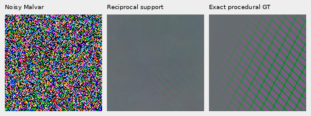

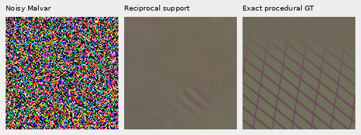

These two retained-detail views use the first two active sources, then select
the largest added RMS on the fixed native 160 grid at starts 0/160/320. All three
columns share `empty+8*(value-empty)` before WB/matrix/+3EV. The exact empty field
is a display base only. Recovery is localized and largely one-directional, with
a large gap to the complete grid. Their [normal comparison1](images/cross-phase-support-v1/mesh-seed2026112114-present-iso6400-prior-RGGB-retained-comparison.png) and [comparison2](images/cross-phase-support-v1/mesh-seed2026112121-present-iso6400-prior-GBRG-retained-comparison.png) retain the ordinary display.

The fixed central diagnostics use native 160×160 ROI [176,176,160,160] and
WB/matrix/+3EV for every method. The additional retained-detail ROIs above do not
change the predeclared metrics. Central comparisons: [case 1](images/cross-phase-support-v1/mesh-seed2026112114-present-iso6400-prior-RGGB-comparison.png), [case 2](images/cross-phase-support-v1/mesh-seed2026112121-present-iso6400-prior-GBRG-comparison.png), [case 3](images/cross-phase-support-v1/mesh-seed2026112100-present-iso6400-prior-RGGB-comparison.png), [case 4](images/cross-phase-support-v1/mesh-seed2026112121-present-iso6400-prior-RGGB-comparison.png). Their exact-GT triplets: [case 1](images/cross-phase-support-v1/mesh-seed2026112114-present-iso6400-prior-RGGB-triplet.png), [case 2](images/cross-phase-support-v1/mesh-seed2026112121-present-iso6400-prior-GBRG-triplet.png), [case 3](images/cross-phase-support-v1/mesh-seed2026112100-present-iso6400-prior-RGGB-triplet.png), [case 4](images/cross-phase-support-v1/mesh-seed2026112121-present-iso6400-prior-RGGB-triplet.png). The first two active recipe seeds, largest
blank-RMS increase and first rejected wide change (otherwise first inactive)
are selected after evaluation and disclosed in the manifest. No pixels resize.
The worst absolute blank-support control also has a shared 40× camera-linear
display, using the exact empty field only as a display base.

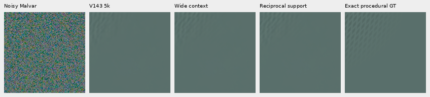

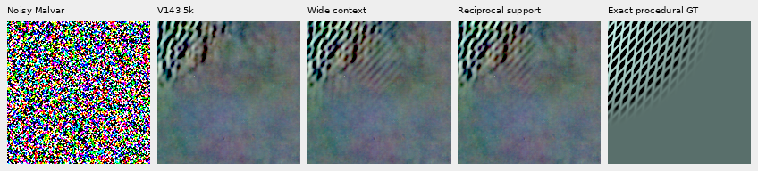

The amplified fresh control shows much less continuation beyond the real grid,
with faint spill and missing true structure still visible.

The earlier 1938/GRBG worst failure keeps its original ROI. It is development,
not a new independent holdout. The public complete 512 result equals the stored
private result exactly; all added values in its exact-blank support become zero.

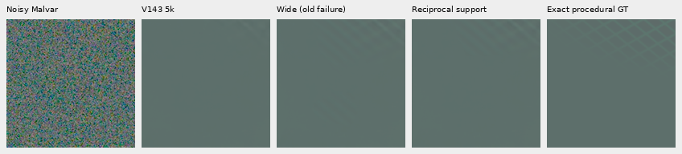

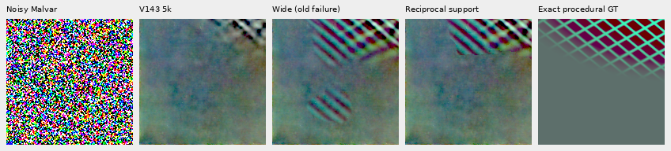

The earlier 4,096 matched and 1,024 prior-mismatch flat controls retain their
parents by an unchanged empty-peak bypass. An AST/source audit verifies all
selection/fitting functions and the early return; no cross mask is reached.
This is a derived compatibility result, with **zero new draws or reexecutions**.
The fresh absent neural observations provide a separate end-to-end check.

## Complete GFX photographs

Three complete 101,995,852-pixel outputs reuse the cached V143 parents and observed
RAW: DSCF3879 with the fixed historical Haar prior, and DSCF3842 with both nominal
and nearby priors. The main comparison includes sky, building, foliage and
chain-link fence. Fine mesh includes both straight-out-of-camera JPEGs.
DSCF3880/DSCF3835 ISO100 AHD and JPEG exposures are independent qualitative
references, **not exact GT**: aperture, exposure, processing and motion differ.
Captures, siblings and JPEGs remain excluded from training; originals stay
read-only. This study adds zero real RAW decodes or source-disk accesses.

Main scene, common +2EV: noisy → V120 → V143 → sparse → wide context → reciprocal
support → independent ISO100 reference.

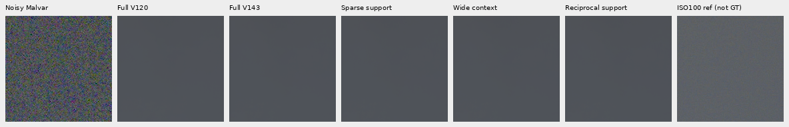

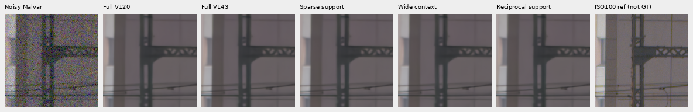

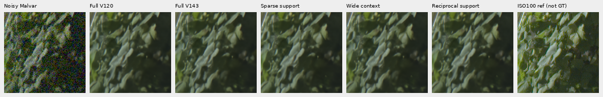

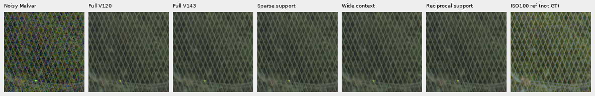

Fine mesh, common +4EV: noisy → V143 → sparse → wide context → reciprocal support →
ISO6400 JPEG → independent ISO100 AHD → ISO100 JPEG. Nominal prior first, nearby
prior second.

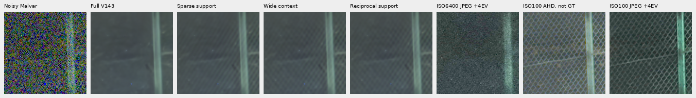

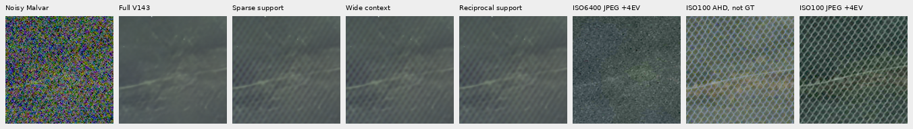

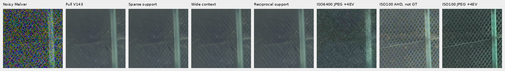

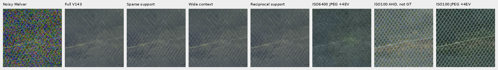

Compact views without JPEGs: [mesh-nominal 1](images/cross-phase-support-v1/mesh-nominal-mesh-nominal-fine-green-mesh-left.png), [mesh-nominal 2](images/cross-phase-support-v1/mesh-nominal-mesh-nominal-fine-green-mesh-right.png), [mesh-nearby-Haar 1](images/cross-phase-support-v1/mesh-nearby-Haar-mesh-profile3879-fine-green-mesh-left.png), [mesh-nearby-Haar 2](images/cross-phase-support-v1/mesh-nearby-Haar-mesh-profile3879-fine-green-mesh-right.png).

Actual native inspection finds most of the wide-context crossing lattice
retained, with some weakening. Recovery stays soft and uneven relative to the
independent ISO100 exposures. Foliage is still painterly and building detail
soft. The complete 2.88MP sky box `[5200,200,2400,1200]` retains all 8,640,000 parent
channels exactly. Three [sky views](images/cross-phase-support-v1/wider-sky-1.png), [second](images/cross-phase-support-v1/wider-sky-2.png) and [third](images/cross-phase-support-v1/wider-sky-3.png) show that unchanged region.

Nominal conditioning is shot .00128/read 6.5536e−6; nearby and main use fixed
historical Haar shot .0014635775921166604/read 1.0715704128646712e−6. These are
comparison priors, not newly calibrated camera profiles. The initial variance
floor is unchanged. Every panel binds its supplied coefficients, relevant
floor contexts and full execution receipt; observed-clipped local windows
bypass the new floor/support paths as specified.

Outcome-selected strongest total fields and largest changes from wide context
use a fixed native 160 grid and common −2EV. Independent AHD registration uses
input Malvar only and integer offsets within 16 pixels. These are stress views,
not pixelwise scoring against the independent exposure.

| Frame | Strongest total correction | Largest change from wide |
| --- | --- | --- |
| main-fixed-Haar | [Native view](images/cross-phase-support-v1/main-fixed-Haar-strongest-total.png) | [Native view](images/cross-phase-support-v1/main-fixed-Haar-strongest-delta.png) |
| mesh-nominal | [Native view](images/cross-phase-support-v1/mesh-nominal-strongest-total.png) | [Native view](images/cross-phase-support-v1/mesh-nominal-strongest-delta.png) |
| mesh-nearby-Haar | [Native view](images/cross-phase-support-v1/mesh-nearby-Haar-strongest-total.png) | [Native view](images/cross-phase-support-v1/mesh-nearby-Haar-strongest-delta.png) |

Bright-sign color and clipped-window changes remain unresolved. The maximum
added-channel values retain the old fallback: main 8288.47, nominal 11638.23 and
nearby 12083.39 DN16. No pixelwise accuracy claim is made against ISO100.

Each full frame has 6,188 local fits and 1,530 actual contexts. Correction-only
seconds below include three CPU workers sharing CUDA graphs, concurrent with
other audits; they are not isolated speed comparisons or end-to-end times.

| Frame | Seconds | Active local fits | Mask caps/solves | Maximum mask relative gap |
| --- | ---: | ---: | ---: | ---: |
| Main | 1659.49 | 259 | 44/78 | 1.98e−5 |
| Mesh nominal | 1340.25 | 145 | 43/56 | 1.45e−5 |
| Mesh nearby | 1641.65 | 296 | 33/89 | 1.40e−5 |

In fresh procedural validation, 146/173 mask solves cap at 8192 steps; maximum
relative gap 2.15e−5 and absolute gap .003709. Thus the measured policy is a
**bounded estimator**, not a claim that these photographic objectives meet the
1e−6 target. Hard support boundaries can move with further optimization. Support
clipping can also create abrupt wave boundaries. Existing coefficient-TV caps
remain in the receipts. The 100MP/10s target is still far away.

## Use and remaining limits

Add to the usual `infer` input/output arguments:

```bash
--phase-harmonic --phase-harmonic-envelope cross
```

The current optional-stage default is [Detail](supported-wave-amplitude.md).
`cross` is retained explicitly, and `wide` remains available for its
higher measured response. This additional option favors stricter support and
can remove weak real texture. The default general model remains V120, whose
broad camera/photo panels are measured. Very weak/nonperiodic detail, partial
support errors, highlight color, uncertainty calibration and the 100MP/10s target
remain unresolved.

The V1435k checkpoint SHA256 is
`96d146d017c54196288c585f8b7eddcf030e8a235061049c31e985b9380b7ce4`.
This study adds 512 actual neural forwards and 768 unique sensor-noise observations,
including the 256 primitive controls. Reused development parents and repeated
control evaluations are not new neural calls or independent noise draws.

All 80 package modules match the frozen complete-frame run. Public/private
whole 512 outputs agree exactly for all 512 fresh observations in both modes:
805,306,368 values, including 402,653,184 unchanged-baseline values. Independent
ten-column affine/template and direct pixel/blank/DC/block checks verify all
1,536 rows. Four actual-parent patches covering all CFAs match CPU/CUDA within
3.47e−18, with unchanged RNG. Constructed positive-TV/area optima and explicit
dense operators verify the solver and diagonal norm bound; they do not establish
convergence on the actual capped cases. All 141 distinct targeted tests pass.

All 37 native boards were actually viewed. Independent PNG copy/matrix/gamma
checks verify 15,129,600 channel values, including common 8×/40× displays. All
917,962,668 linear RGB16 export channels match clip/round/orientation exactly;
all three sRGB16 exports are within 1 DN of an independent FP64 render, with
16-bit/ICC metadata checked. The appended presentation adds four boards and
rechecks PNGs and all TIFF hashes without repeating unchanged export tests.
Original failures, source snapshots, locks, receipts and previous reports remain
intact.
