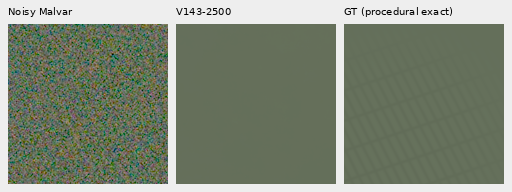
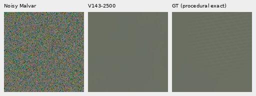

# Controlled mesh response under noise

**V120, V142 and V143 at2.5k all erase these ISO6400-prior meshes.** They
retain about90% of the ADC-only response. The failure therefore also occurs
within the new procedural family, rather than appearing only on real photos.
The added data's earlier faint/flat gains remain useful, but do not establish
learning to recover noisy lines. V120 remains the general recommendation.

[Results](results/crossed-line-response-v1.json) ·
[Independent audit](results/crossed-line-response-audit-v1.json) ·
[RAW evidence](results/crossed-line-raw-evidence-v1.json) ·
[Execution and publication](results/crossed-line-response-publication-v1.json) ·
[Native metadata](images/crossed-line-response-v1/manifest.json).

## A separate fixed procedural test

Four new fixed seeds2026110201–2026110204 each generate present/absent pairs
through the actual continuous512 → geometry → area2 → native256 path, with no
optical PSF. The scene level is normalized to0.02 before camera transport;
contrast, tint, direction, periods, widths and compact visibility masks retain
their generator values. Empty counterfactuals use identical geometry/RNG
consumption. This is one level and four shapes, not a broad texture benchmark.

ADC-only and ISO6400-prior observations use all four CFA layouts, one draw per
case:64 inputs shared byte-for-byte across the three models. ISO6400 prior is
shot0.00128/read variance6.5536×10⁻⁶. The common evaluation WB/matrix,16-bit ADC,
black0.03 and source recipes are recorded with every array. No protected
capture, JPEG or personal source enters this generator.

This adds192 root/DINO calls, including128 new V120/V142 control calls, plus64
new observation tensors. It is explicitly separate from the original fixed
photographic review ledger. There are no RAW decodes or training updates.
All models use IEEE FP32, one CPU thread and their exact saved EMA; full model,
backbone, input bytes and RNG checks pass before any result is used.

## What the response measures

Within the native160 ROI`[48,48,160,160]`, subtract the exact empty target and
remove a separate affine plane from each camera-RGB channel. Project onto the
similarly detrended exact present-minus-empty template. Gain1 reproduces the
present template; gain0 reproduces its absence. For absent cases, projection
uses the hypothetical present template solely as a false-pattern diagnostic.
Nonmesh RMS measures the remaining detrended variation. Nothing is fitted
inside inference; all templates are available only to the report.

| Mean known-template gain,16 cases each | V120 | V1421k | V1432500of5000 |
| --- | ---: | ---: | ---: |
| ADC-only, present | 0.90975 | 0.89471 | 0.89511 |
| ADC-only, absent | 0.000044 | 0.000025 | 0.000045 |
| ISO6400 prior, present | 0.000946 | 0.000010 | 0.000088 |
| ISO6400 prior, absent | −0.001045 | −0.000620 | −0.000348 |

The small noisy gains should not be ranked as useful recovery. The outputs
look mostly empty on all four present cases. Near-zero absent projection is
also insufficient to prove flat safety: other structure can be orthogonal to
the template. For noisy present cases, mean spatial error is12.430/12.461/12.434
DN16 and detrended nonmesh RMS3.633/3.631/3.560 DN16 for V120/V142/V143.
For noisy empty cases, spatial RMS is4.340/4.399/4.299 DN16. All per-case DC,
spatial and block errors remain in the results, with no uncertainty or broad
quality claim from this small support.

Noisy → V143 progress EMA → **exact procedural GT**, two unchanged160×160
triplets. Shared +3 EV display (8×), common coordinates and camera transform;
no crop pixels are resized. V143 checkpoint SHA256 is
`6b3aec97ae9c6e210017f45da2bbf3c729ad311d3b703969617e4e71db771b57`.
All three full hashes and detailed source/noise metadata are in the manifest.

All16 native five-way boards were viewed, including ADC and absent cases.
ADC meshes remain visible with slight smoothing; absent outputs look quiet
at this display. Two triplets are exact column extractions from audited boards.

## Evidence in the saved RAW inputs

A model-free companion reuses the same32 noisy observations and160-pixel ROI.
Weighted least squares fits the exact packed present-minus-empty template,
with separate affine nuisance planes in all four CFA phases. Weights use the
known clean shot/read variance plus the ADC16/black0.03 quantization-variance
approximation. QR residualization agrees with a joint13-column fit and inverse
normal-matrix approximate covariance.

| Recipe seed | True template RMS, camera RGB DN16 | Mean RAW fitted gain, present | Approximate known-template SNR |
| --- | ---: | ---: | ---: |
| 2026110201 | 23.715 | 0.992 | 12.513 |
| 2026110202 | 12.926 | 1.138 | 6.649 |
| 2026110203 | 4.684 | 1.019 | 2.388 |
| 2026110204 | 3.634 | 0.902 | 1.974 |

The two clearest recipes have coherent evidence in this exact-template fit,
while their mean model gains stay below0.004. This supports testing how the model
uses spatial evidence under noise. The template, background and clean variance
are oracle information: this SNR is a second-moment approximation, **not a
bound for a blind denoiser, proof of natural-detail recoverability or an exact
confidence interval** under Poisson/ADC observations. Unknown mesh geometry
and noise-driven false detections remain practical problems.

## Verification and relation to real photos

An independent joint10-column affine/template fit checks all256 metric rows
against the report's sequential detrending/projection, maximum gain difference
1.49×10⁻¹⁴. Direct matrix-product/gamma rendering checks6,144,000 saved PNG
channels exactly. The report also checks39,321,600 QR/detrending values.
Seven targeted tests cover true/false signal, unrelated detail, DC separation,
phase-plane nuisance rejection and variance/uncertainty scaling.

[Response driver](../scripts/diagnose_crossed_line_response.py) ·
[Independent auditor](../scripts/audit_crossed_line_response.py) ·
[RAW-only fit](../scripts/diagnose_crossed_line_raw_evidence.py).

The [V1432.5k photographic report](v143-progress2500-quality.md) includes both
protected GFX scenes, main foliage/fence/sky/building, both extra-mesh priors
and both camera JPEGs, with independent ISO100 references labeled **not exact
GT**. It also finds no clear new real-mesh recovery. The original5k worker
continues; its endpoint and broader camera/full-photo evaluations remain open.
