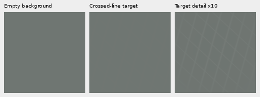
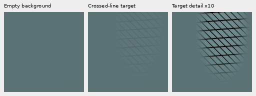

# Crossed thin lines with matched empty backgrounds

**An optional procedural source now supplies weak crossed lines and empty
backgrounds.** It is implemented in the actual training reader and remains off
by default. The prepared V142 data-only recipe has not started production and
has no restoration-quality result. V141's frozen loss trial is unchanged.
[Sources, tests, targets and prepared recipe](results/crossed-line-training-data-v1.json).

The previous weak generator provides band-limited fields and curved fibers.
This source adds two crossing families of thin wires, without copying any test
capture or fitting its geometry. Periods span6–32 final sensor pixels, wire
sigma.4–1.2px and family separation35–145°. Level spans2⁻¹⁰–2⁻¹ and requested
peak relative contrast.005–.2. Neutral and chromatic positive/negative line
contrasts vary independently of presence. Backgrounds are constant or gently
affine, with random colors.

Presence is sampled with probability.5. The generator also supports explicit
present/empty counterfactuals with identical geometry/background parameters and
RNG consumption. A compact visibility mask leaves exactly empty areas even
inside a present example. The masked detail has approximately zero mean within
FP32 precision, so an overall color shift does not identify the present target.
Negligible Gaussian tails are not amplified when no wire crosses a small mask.

Targets stay scene-linear FP32, evaluated on the2× augmentation canvas before
the existing geometry and final area2 reduction. No8-bit rasterization, camera
noise, Bayer sampling or display transform is introduced by the generator;
the ordinary training degradation applies afterwards. No optical PSF is added.

## Native target inspection

Each cell below is an unchanged160px crop after the actual geometry/area2 path:
empty background → present target → target detail amplified10× for inspection.
Both first cells share a source-level display exposure, recorded in the
[manifest](images/crossed-line-training-data-v1/manifest.json). The third cell's
contrast boost is display-only. These are procedural training targets, **not
noisy/restored/GT model-performance comparisons**.





All six examples were viewed, including faint positive/negative and chromatic
patterns. The data inspection establishes sensible generated targets, not that
a trained model will recover real mesh or avoid false texture.

## Reader and compatibility

```yaml
weak_texture_fraction: 0.15
fine_weak_texture_fraction: 0.0
mesh_texture_fraction: 0.10
augmentation_downsample: 2
optical_blur_probability: 0.0
```

The mesh and existing fine-texture fractions must fit inside the weak-texture
quota. Thus this example replaces part of the existing synthetic component;
it does not expand total procedural probability. About half the new draws are
empty backgrounds. Existing photographs, reviewed regions, smooth fields and
unselected procedural draws retain their previous pixel values. Validation
always disables this source. The effective mesh fraction is serialized; a changed
fraction rejects before constructing a resumed model. Initializing a fresh run
from the same parent remains supported.

The44-test data/regression suite checks independent NumPy64 construction,
background/mean/presence behavior, continuous precision and RNG preservation,
exact unchanged routing outside the replaced subquota, validation exclusion,
quota bounds and an actual optimizer update on an asserted crossed-line reader
target. Changed-fraction resume rejects before model construction. Some tests
overlap the gradient-loss suite;44 is this suite's count, not additional unique
loss tests.

The [prepared V142 recipe](../configs/quality-v120-crossed-line-pilot-v142.yaml)
keeps V129's V120 parent,cohort,seed70,quota.5,zeroPSF,B16/native256/BF16,
LR1e−5,warm100 and1k budget. It keeps pixel/gradient epsilon.0003, independently
of V141's tested loss change. Actual CPU/CUDA checks, non-Commons noise/input
comparisons and matched material/GFX/uniform-field review remain required.
V129's newly retained48 flat controls can be reused. Both protected GFX pairs,
their JPEGs and siblings remain out of training.

[Generator](../src/demosaic/textures.py) · [Reader](../src/demosaic/data.py) ·
[Tests](../tests/test_crossed_line_textures.py) ·
[Gallery driver](../scripts/report_crossed_line_training_examples.py).
