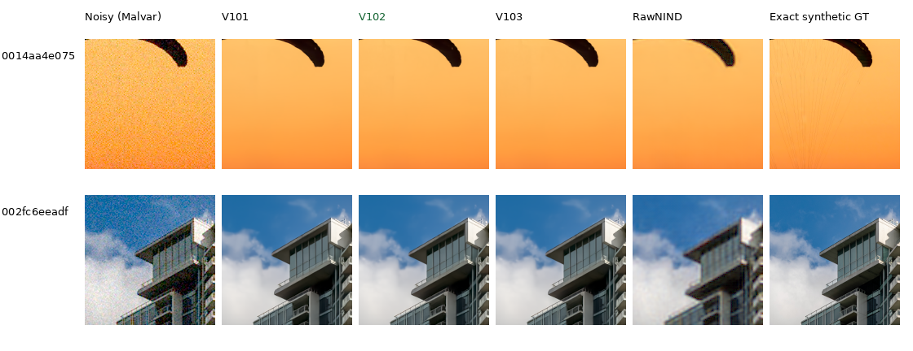

# Current models and development baseline

**V102 final20k is the fully evaluated inference/training reference.** It continues
V84's full-resolution pretrained DRUNet RGB trunk, physical noise anchors and
frozen official DINOv3 ConvNeXt-Tiny pyramid. V103 is a close alternative;
V43 remains a historical comparator.
V104's completed selected-material gains are already published, and its exact
final EMA initializes the [next quality trial](loss-scale-training.md). Its
broader photographic/camera/GFX evaluation is still running.

| Version | Photo sRGB PSNR | Known4 CFA PSNR | Unseen5 CFA PSNR | Main use |
| --- | ---: | ---: | ---: | --- |
| V43 | 34.89934 | 54.23332 | 53.80606 | Earlier ViT-S baseline |
| V84 | 36.43996 | 54.17122 | 53.92823 | Architectural reference |
| V95 | 35.29553 | **54.33307** | 53.76990 | Weak-carrier comparator with color tradeoffs |
| V100 | 36.47264 | 54.17846 | 53.89614 | Earlier curated control |
| V101 | 36.50347 | 54.17404 | 53.92334 | Detail-recipe parent |
| **V102** | **36.67951** | **54.23709** | **53.97177** | **Preferred overall quality/training checkpoint** |
| V103 | 36.68091 | 54.22003 | 53.96410 | Similar photo quality,32 reviewed regions |

V102 gains+.17604dB over V101, improves425/427 photographic source means and
all seven condition means, and raises both measured-camera means. V103's
+.00140dB photo advantage over V102 has a source interval including zero.
V102's higher CFA means, stronger tested weak-carrier response and lower ADC
flat-color error favor it as the next baseline. These are useful gains even
though high-noise detail remains soft and some individual cases regress.
[Completed results, intervals, native triplets and remaining weaknesses](v102-v103-quality-review.md).

Photo means cover427 images/seven conditions/four CFAs. Camera means balance
four/five development scenes against measured CFA references; independently
processed AHD RGB is auxiliary, not exact GT. Training budgets/data differ
across versions. [PSNR history and source provenance](performance-history.md).

## Current native comparisons

Each cell is an unchanged160×160 crop with identical coordinates and display
transforms. Fine fabric cords remain missing at high noise. The
[natural-detail gallery](heldout-detail.md) shows V102's stronger low-noise
bark/canopy results. The [complete GFX gallery](gfx-qualitative.md) includes
sky, building, foliage, chain-link fence and two illuminated regions from
full102MP blended outputs. Real f/5.6 ISO100 is an independent reference,not GT.
The [camera guide](real-camera-quality.md) shows known/unseen native crops.
The [Q2, Sony and GFX50R gallery](cross-camera-qualitative.md) now compares
V100/V102/V103 on six fixed native regions. These low-ISO real-photo changes
remain small; dark rocks and window detail are still soft.

V84's broader improvement over V43 remains visible in the
[low-noise photographic comparisons](images/current-quality/iso100-prior/photo-comparison.png)
and the [bright-magenta comparison](images/native-data-hue-all-methods-native.png).
V84 gains1.54dB on full427; V102 is about1.78dB above V43. These stronger
architectural-family results inform today's baseline without erasing earlier
tradeoffs or original study decisions.

## Use and next training

Checkpoint:`/mnt/external/demosaic/models/v102-final20000.pt`.
SHA256:`55936a11ca5be7c1ae941953e14c8afe1186123f366e54f1947104a894e64c7a`.
Inference selects its final EMA and loads official frozen DINO separately from
the local cache. [Current selector](../configs/current-model.json) ·
[Completion and independent audit](results/v102-v103-quality-complete-v1.json) ·
[Commands](usage.md) · [Linear DNG/JPEG and optional hot pixels](dng-export.md).

V102/V103 both completed20k fresh-optimizer continuations from V101 on the
88,477-source cohort. Only six/32 reviewed ROIs differ; zero-PSF,weak-texture,
photographic-contrast recipes and numerical code match. V104 completed 20k
updates from V102 on 90,872 sources. It improves PSNR, SSIM and gradient error
in all 12 selected material cases, with mean PSNR gains of +.246/.166/.024dB
at ADC-only/ISO100/ISO12800.
[Native V104/V102/RawNIND comparisons](heldout-detail.md#v104-versus-v102-on-the-fixed-material-panel).
Its full photographic, camera and GFX evaluation is active. The read-only
candidate is `/mnt/external/demosaic/models/v104-final20000.pt`; broader results
will inform the next useful baseline.
The queued V111/V112 loss-scale test preserves V104's learned fusion gates and
holds the cleaned data and budget fixed. It has no production quality result yet.
[Current recipes and data](quality-first-training.md) · [Incoming source review](incoming-commons-quality.md).
Earlier [V100/V101](v84-curated-quality-review.md) and
[V84/V85](native-data-original20k-review.md) reports retain their results;
timestamped decisions live in the [diary](../diary/index.md).
