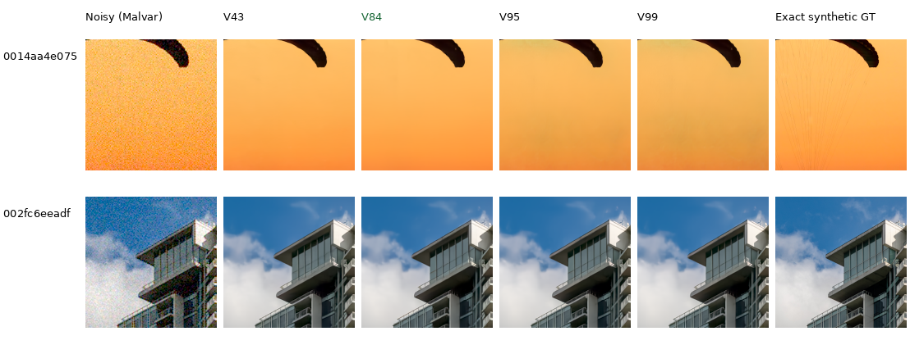

# Current models and development baseline

**V84 final20k is the preferred baseline for image quality and further training.**
V85 is a closely matched alternative. They use the full-resolution pretrained
DRUNet RGB trunk, physical noise anchors and a frozen official DINOv3
ConvNeXt-Tiny feature pyramid. V43 remains a useful historical comparator.

| Version | Photo sRGB PSNR | Known-camera CFA PSNR | Unseen-camera CFA PSNR | Main use |
| --- | ---: | ---: | ---: | --- |
| V43 | 34.89934 | 54.23332 | 53.80606 | Earlier ViT-S baseline |
| **V84** | **36.43996** | 54.17122 | 53.92823 | Preferred quality/training baseline |
| V85 | 36.43574 | 54.17942 | 53.93069 | Similar quality, expanded native targets |
| V95 | 35.29553 | **54.33307** | 53.76990 | Stronger tested weak-carrier response |
| V99 | 35.40133 | 54.31940 | 53.72165 | ADC-consistency experiment |

V84 gains about **1.54 dB over V43** on the full fixed photographic panel and
has a higher unseen-camera mean. Its known-camera mean is slightly lower.
The stronger ConvNeXt family is a useful advance despite that small-panel
tradeoff. V84/V85 also reduce bright-magenta mottling relative to their V63
parent. V95 retains more of a tested noisy low-contrast carrier, but introduces
larger color errors in some natural images. These differences guide development;
there is no requirement that one version win every diagnostic before we use it
or publish its progress.

Photo means cover 427 images, seven conditions and four CFAs. Camera means
cover four/five development scenes and use measured CFA targets. Versions have
different training budgets and data; this table compares available checkpoints,
not an isolated architectural ablation. [Full history and provenance](performance-history.md).

V84's gain over V43 is larger in the low-noise conditions than the existing
ISO 12800 gallery suggested:

| Photographic condition | V84−V43 sRGB PSNR, dB |
| --- | ---: |
| ADC-only | +2.30 |
| ISO 100 prior | +2.01 |
| ISO 1600 prior | +1.40 |
| ISO 12800 prior | +0.57 |
| Shadows | +0.33 |
| Highlights | +3.21 |
| Legacy noise | +0.96 |

These descriptive means cover all 427 photos and four CFAs per condition.
Each photo's average over all 28 condition/CFA combinations improves; 24 of
11,956 individual cases regress. The paired source interval for the overall
+1.54 dB change is [+1.46,+1.62] dB. This describes source variation, with unequal model training
histories. [Per-condition counts, scores and provenance](results/v84-v43-photographic-comparison-v1.json).

## Native comparisons

Each cell below is an unchanged 160×160-pixel crop. The same source coordinates,
conditioning and display transforms apply across methods. Synthetic references
are exact for the simulated observations. All images and complete per-method
source/checkpoint/ROI metadata accompany each gallery; the
[high-noise/GFX manifest](images/current-quality/manifest.json) covers the earlier crops.

The same two fixed photographic examples at ISO 100 show a clear V84 improvement
in fine suspension lines, broad orange color and building boundaries. RawNIND
uses input-only CFA-channel gain. These fresh CPU observations share source,
noise, display and exact GT pixels across methods; the full-panel scores above
retain their original CUDA evaluations.

[ISO100 source/ROI/checkpoint metadata](images/current-quality/iso100-prior/manifest.json) ·
[ADC-only comparison](images/current-quality/adc-only/photo-comparison.png)
([metadata](images/current-quality/adc-only/manifest.json)).
V84's ISO100 triplets: [fabric](images/current-quality/iso100-prior/V84-0014aa4e075b.png)
([metadata](images/current-quality/iso100-prior/V84-0014aa4e075b.json)) and
[building](images/current-quality/iso100-prior/V84-002fc6eeadf6.png)
([metadata](images/current-quality/iso100-prior/V84-002fc6eeadf6.json)).

At ISO 12800, the models remain much closer and suppress fine cords:

V84's high-noise triplets: [fabric](images/current-quality/photo-V84-0014aa4e075b.png)
([metadata](images/current-quality/photo-V84-0014aa4e075b.json)) and
[building](images/current-quality/photo-V84-002fc6eeadf6.png)
([metadata](images/current-quality/photo-V84-002fc6eeadf6.json)).

V84 retains the fabric's broad orange color more faithfully than V95/V99 in
this high-noise example. Fine cords remain a development target for every model.
The [GFX page](gfx-qualitative.md) compares sky, building, foliage and fence at
native sensor resolution, including RawNIND and a separate ISO 100 reference.
The [natural-detail gallery](heldout-detail.md) adds bark, white feathers,
forest canopy and fur at three noise levels. It shows V84's remaining
high-noise detail loss as well as its sharper low-noise output.
V100's cleaned-data continuation now adds small gains on those selected
contexts; the full-photo and camera comparison is still pending.
The [Q2, Sony a7R II and GFX50R gallery](cross-camera-qualitative.md) also
compares V84/V100 with V43 and RawNIND on six fixed native ROIs. Those
low-ISO captures show closer results, with the clearest RawNIND separation
on concrete texture; there is no clean reference.

The [completed V84/V85 study](native-data-original20k-review.md) retains detailed
metrics, uncertainty, color/weak-detail diagnostics and capture limitations.
Its [bright-magenta comparison](images/native-data-hue-all-methods-native.png)
shows the reduction in V63's spatial color mottling in V84/V85.
Its stringent original study gates answered whether adding 22 native captures
demonstrated a particular matched benefit. They do not erase V84's absolute
improvement or determine the current baseline. Immutable receipts and diary
entries retain the original decisions.

## Use the current checkpoint

Local checkpoint: `/mnt/external/demosaic/models/v84-original20000.pt`.
SHA256: `134887e12357aabf420cceee3ee53fc8832cf02a8f81ff883b829a9e51e16f10`.
Inference selects its final EMA; the official DINOv3 checkpoint is loaded
separately from the local Hugging Face cache. See [usage](usage.md).
The current loader preserves all 91 EMA tensors and the frozen DINO identity;
a 64×64 CPU smoke matches the archived implementation bit-for-bit.
[Selection, loader and gallery verification](results/current-model-baseline-selection-v1.json).

Quality work now applies the curated 88,484-source Commons cohort and the
fine-detail augmentation ideas to this stronger architecture. The
[training plan](quality-first-training.md) records the current experiments.
Keep the README, this guide and GFX comparisons updated as useful versions
appear. Reserve the timestamped diary for chronological decisions.

Full-frame RGB16 and timing measurements are checkpoint-specific. Existing V43
full-frame measurements do not describe V84's runtime. Quality remains the
priority; the 100MP/10s and broader state-of-the-art targets remain open.
