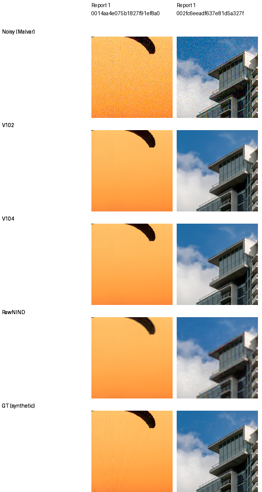

# Current models and development baseline

**V111 final20k adds measured material gains over V104; V104 remains the fully
evaluated working baseline.** [V111's native comparisons](v111-early-quality.md)
show improvements in all twelve material cases and small real GFX changes.
Its complete camera panels change −.01336/+.02006dB known/unseen versus V104;
full-photo results are pending. Its complete analytic grids improve high-noise
color and coarse carriers, while worst ADC mean-channel bias rises to 2,143 DN16.
Both retain V84's pretrained DRUNet RGB trunk, physical noise anchors
and official frozen DINOv3 ConvNeXt-Tiny pyramid. V102 remains useful for lower
ADC flat-color bias and its higher unseen-camera CFA mean. V43 is a
historical comparator. [Completed V104 report and native comparisons](v104-reviewed-corpus-quality.md).

For optional inference quality, [V104 with eight exact views](dihedral-quality.md)
improves all twelve selected material cases and two adverse camera crops.
Use `--self-ensemble dihedral8`; it requires eight model evaluations per tile.
Full-panel and complete 102MP policy results remain pending, and dark-field
blotches/high-noise fine-detail loss remain visible.

For explicitly ADC-only photographic restoration, the [optional V104 sites
export](adc-consistency.md) gains +.28850dB on all 427 sources/all 1,708 CFA cases,
with the exact same learned weights. It remains an inference-only policy;
the original positive-noise/training checkpoint stays current.

| Version | Photo sRGB PSNR | Known4 CFA PSNR | Unseen5 CFA PSNR | Main use |
| --- | ---: | ---: | ---: | --- |
| V43 | 34.89934 | 54.23332 | 53.80606 | Earlier ViT-S reference |
| V84 | 36.43996 | 54.17122 | 53.92823 | Architectural reference |
| V95 | 35.29553 | 54.33307 | 53.76990 | Weak-carrier comparator with color tradeoffs |
| V100 | 36.47264 | 54.17846 | 53.89614 | Earlier curated control |
| V101 | 36.50347 | 54.17404 | 53.92334 | Detail-recipe parent |
| V102 | 36.67951 | 54.23709 | **53.97177** | Lower ADC bias; unseen-camera reference |
| V103 | 36.68091 | 54.22003 | 53.96410 | Similar photo quality, expanded ROI catalogue |
| **V104** | **36.80085** | **54.26606** | 53.91700 | **Current positive-noise and training baseline** |
| V111 | pending | 54.25270 | 53.93706 | Material/coarse-detail/high-noise color gains; worse ADC tail |

V104 improves 424/427 photographic source means and all seven condition means
over V102. All source SSIM/gradient means and all 12 selected material
PSNR/SSIM/gradient cases improve. The source-bootstrap 95% interval for its
+.12134dB photo gain is [+.11705,+.12573]. Known-camera CFA rises .02897dB;
unseen-camera CFA falls .05477dB, with both small-panel intervals including zero.
These intervals describe source/scene sampling rather than training-seed uncertainty.

The stronger [released RawNIND pre-upsampled reference](rawnind-variants.md)
now reaches 54.26068/53.86528 dB on the complete known/unseen development
panels. V104's corresponding advantages are small and uncertain. The selected
synthetic-photo and GFX comparisons retain useful detail gains, while broad
real-camera superiority remains open.
The [tested width48 RawNIND checkpoint](rawnind-variants.md) scores below both
width32 references on the matched photographic and camera means, so it does
not replace the pre-upsampled comparator.

At the tested weak high-noise carrier, period16 gain rises .49887→.60487 and
period8 gain .02135→.05945; the finer carrier remains largely absent. High-noise
flat-color bias improves, but worst ADC-only flat-color mean bias rises
59.23→1,218.06 DN16. The report shows that post hoc worst case alongside the
fixed native comparisons. Use the V102 checkpoint for explicit zero-noise ADC
workflows when lower unprojected flat-color bias matters; selection is not switched automatically.

A [saved-prediction ADC diagnostic](v104-adc-color-projection.md) reduces V104's
worst grid bias to 31.91 DN16 with the existing Malvar residual projection.
The [ADC texture check](v104-adc-color-projection.md#adc-texture-check) finds
carrier gains and phase-specific regressions. The completed photographic study
supports the optional sites export; its worst analytic-grid bias remains
610.67DN16, so it does not remove the flat-color tradeoff.

Photo means cover 427 images, seven conditions and four CFAs. Camera means
balance four/five development scenes against measured CFA references;
independently processed AHD RGB is auxiliary, not exact GT. Training histories
differ. [PSNR history and provenance](performance-history.md).

## Current native comparisons

Each cell is an unchanged 160×160 crop with identical coordinates and display
transforms. Fine fabric cords remain missing at high noise. The
[natural-detail gallery](heldout-detail.md) includes V104's low-noise bark/canopy
gains. The [complete GFX gallery](gfx-qualitative.md) compares V102/V104/RawNIND
on sky, buildings, foliage, chain-link fence and two illuminated regions from
blended 102MP outputs. Real ISO100 f/5.6 is an independent reference, not GT.
The [camera guide](real-camera-quality.md) shows the current known/unseen crops.

All seven evaluation panels and complete RGB16 exports are finished. Eighty-eight
new photo/camera/diagnostic/GFX native cells and three resized full-frame
overviews were viewed. Real model differences remain small; fine foliage and
saturated-sign detail remain weaknesses. The separate
[Q2, Sony and GFX50R gallery](cross-camera-qualitative.md) now compares
V102/V104 on six fixed low-ISO regions. Its 24 native cells show little visual
separation, with no clear overall gain or regression.

The [current conditioning study](noise-conditioning.md) shows more fine
structure and grain under lower V104 noise priors. All alternative strengths
lose high-noise PSNR on the four fixed exact-target contexts; the nominal
protocol remains unchanged. Six native GFX regions show the real-photo tradeoff.

## Use and next training

Current checkpoint: `/mnt/external/demosaic/models/v104-final20000.pt`.
SHA256: `8a3a7d94f2b1465cbdddbeec201fb37a2f69b12c74f9298527a94e3a7bbf6300`.
The lower-ADC-bias alternative is `/mnt/external/demosaic/models/v102-final20000.pt`,
SHA256 `55936a11ca5be7c1ae941953e14c8afe1186123f366e54f1947104a894e64c7a`.
Inference selects the final EMA and loads the official frozen encoder from the
local cache. [Current selector](../configs/current-model.json) ·
[Completed review and presentation snapshots](results/v104-reviewed-corpus-quality-complete-v1.json) ·
[Commands](usage.md) · [Linear DNG/JPEG and optional hot pixels](dng-export.md).

V104 adds 20k fresh-optimizer updates on 90,872 reviewed Commons sources to V102.
More training, seed and data change together, so this does not isolate a corpus
effect. [Original endpoint/source boundary](results/V104-original20000-training-boundary-v1.json).
The [V111/V112 loss-scale test](loss-scale-training.md) retains its exact EMA
and learned fusion gates on the further-cleaned 90,864-source corpus. V111 has
completed20k and [improves all twelve material cases](v111-early-quality.md);
V112 has also completed20k, changing only epsilon .001→.0003 under matched
budgets. Full comparisons are running. [Actual production launch and corrected handoff](results/v104-loss-scale-training-started-v2.json).
The read-only V111 candidate is `/mnt/external/demosaic/models/v111-final20000.pt`,
SHA256 `97ab9ca5f1f182ff42a4245c630bba810607a3d13b61cf8aae5842192a18da15`.

Earlier [V102/V103](v102-v103-quality-review.md),
[V100/V101](v84-curated-quality-review.md) and
[V84/V85](native-data-original20k-review.md) studies preserve their scores and
original evidence. Historical decisions remain in the [diary](../diary/index.md).
