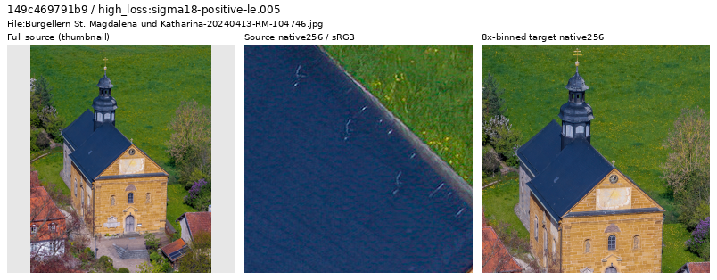
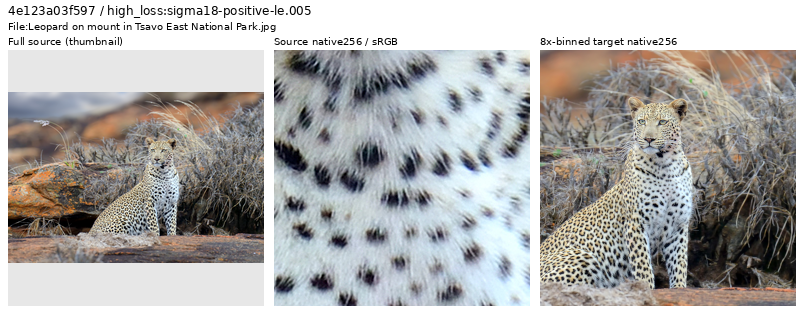

# Current photographic-source review

**The latest pass retains40 newly inspected sources; the review ledger now has
1,759 distinct IDs.** Some originals show grain, softness or edge processing.
Their inspected area8 targets retain coherent photographic structure. This is
targeted curation, not certification of noiseless targets or the whole corpus.
V120 Small remains the general model recommendation.

[All40 decisions and source credits](results/v123-source-loss-through12000-decisions-v1.csv) ·
[Trace, actual viewing and independent verification](results/v123-source-loss-through12000-review-v1.json) ·
[Native source-image metadata](images/v123-source-loss-through12000-v1/manifest.json).

## Current data snapshots

| Use | Commons train sources / reviewed regions | State |
| --- | --- | --- |
| V122/V123 frequency comparison | 90,786 /14 | V12220k complete; V123 saved-state continuation running |
| V124/V125 mean-loss comparison | 90,784 /20 | Four CPU/CUDA checks reused; production queued after frequency review |
| Latest prepared bank / completed V126/V127 pilot | 90,783 /23 | Preparation and1k pilot complete; no useful shadow-policy gain |

[V123 continuation and current owners](v123-memory-guard-recovery.md) ·
[Mean-loss recipe](conditional-mean-training.md) ·
[Completed shadow-pilot results](reviewed-shadow-pilot-quality.md).
The latest pass changes none of these memberships, recipes or sampling policies.

The [23-region catalogue](../configs/low-contrast-training-rois-cleaned90783-v2.json)
retains all20 preceding region objects plus inspected pale hair, gray feathers
and whitewashed brick. Its90783/2303/2255 train/validation/test manifest and
catalogue bytes remain unchanged. The original preparation-status text is
preserved because experiment plans bind those bytes; the completed pilot is
reported separately. The pilot does not isolate a new-bank effect from its
changed quota and continuation versus V120.

Current preparation uses bin4 → geometry → final area2, zero optical PSF blur,
corrected paired32 and native128 catalogues. Private GFX test pairs, camera
JPEGs and siblings remain outside training. [Pipeline](training-pipeline.md) ·
[Material-bank admission and reader checks](v123-source-review-through9800.md).

## Latest loss-nominated inspection

The original V123 trace through update12,000 contains912 diagnostic draws:
666 photographic draws from631 IDs. Removing145 draws covered by the prior
1,719-ID ledger leaves521 eligible draws from521 distinct sources.

| Noise stratum | Eligible draws / IDs | Newly inspected |
| --- | ---: | ---: |
| ADC-only, shot/read both zero | 52 | 8 |
| Positive sigma18 ≤.005 | 209 | 8 |
| .005 < sigma18 ≤.02 | 229 | 8 |
| sigma18 >.02 | 31 | 8 |
| Highest remaining gradient errors | Same eligible pool | 8 |

Sigma18 is`sqrt(.18×shot+read)`. Singleton losses depend on the evolving model,
noise, exposure and camera transform; they nominate inspection rather than
label source quality. Source review uses a centered512px bin4 field inside the
traced pre-augmentation crop; it does not regenerate scored geometry or noise.

Actually viewed: seven sheets,40 thumbnails,80 native256 source/target cells,
four native1024 follow-ups and four separately extracted native256 target cells.
All40 remain eligible. No new exclusion or material-region addition is made.

Below: whole-source thumbnail → native256 source → native256 area8 target.
Only the first column resizes pixels. These are source-quality views, with no
restoration output or exact-GT claim.

Reinhold Möller,
[Burgellern church](https://commons.wikimedia.org/wiki/File:Burgellern_St._Magdalena_und_Katharina-20240413-RM-104746.jpg),
[CC BY-SA4.0](https://creativecommons.org/licenses/by-sa/4.0/).
The [native1024 follow-up](images/v123-source-loss-through12000-v1/retained-processed-roof-native1024.png)
shows conspicuous edge processing and mottled blue texture. The separately
inspected binned target retains coherent roof, shutters and masonry; retaining
it does not certify its processing history or absence of residual noise.

Byrdyak,
[leopard in Tsavo East](https://commons.wikimedia.org/wiki/File:Leopard_on_mount_in_Tsavo_East_National_Park.jpg),
[CC BY-SA4.0](https://creativecommons.org/licenses/by-sa/4.0/).
The [native1024 view](images/v123-source-loss-through12000-v1/retained-physical-fur-native1024.png)
resolves physical hair and whiskers. Naturally defocused background coexists
with usable subject texture. Published images are cropped/binned/display-converted
derivatives with author/license/source metadata.

## Admission and verification

Review original and binned pixels before excluding a source. Inspect ambiguous
processing, blur or nonphotographic content at native scale. A painting-dominated
reproduction and a photographed physical relief need different decisions;
art/HDR titles, high loss, low contrast or a soft background are not automatic
exclusion rules. Earlier specific exclusions remain in their separate future
manifests; original files and existing experiment cohorts remain intact.

Independent heap ranking reproduces all40 nominations. All7,864,320 native-source
channels,30,294,720 sheet channels,12,582,912 larger-view channels and786,432
extracted-target channels match exactly. Of7,864,320 target channels recomputed
with UINT32 sums and FP64 display,34 differ by one DN8 from FP32 rendering;
all others match. Curation imports no Torch and performs no neural/encoder call,
noise generation, RAW decode or optimizer update.

The1,759-ID ledger prevents repeated manual inspection. It is not a training
membership list, an exclusion list or a uniform corpus audit. The preceding
source-review chronology and decisions are preserved in the
[timestamped diary archive](../diary/2026-10-26-23-37-23-v123-resumption-source-review.md#archived-previous-source-review-page),
with exact earlier Markdown bytes and their hash retained in the local receipt.
