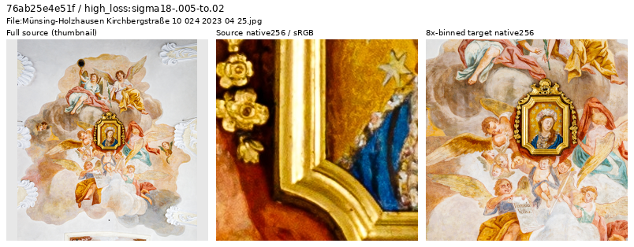
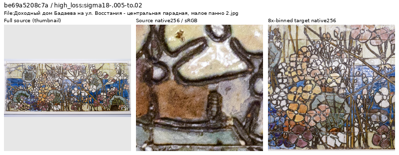
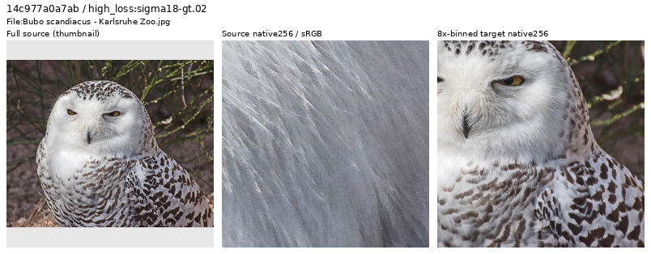
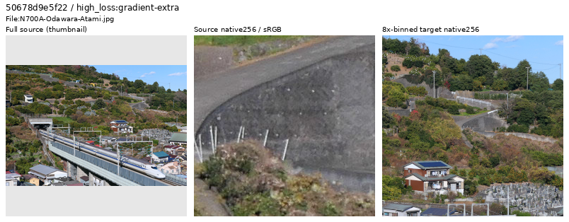
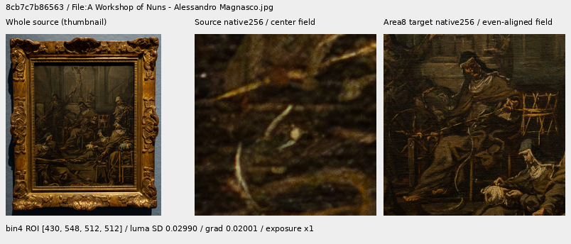
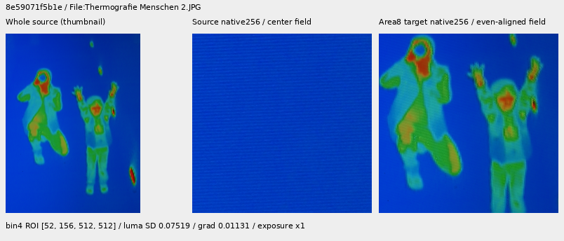
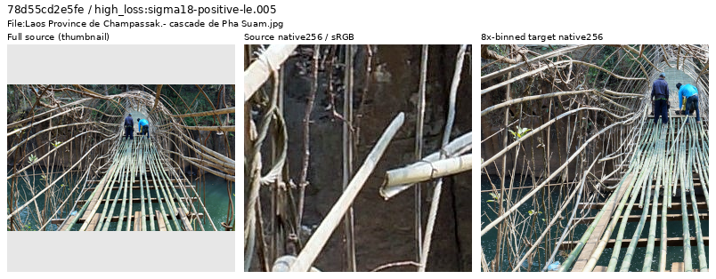
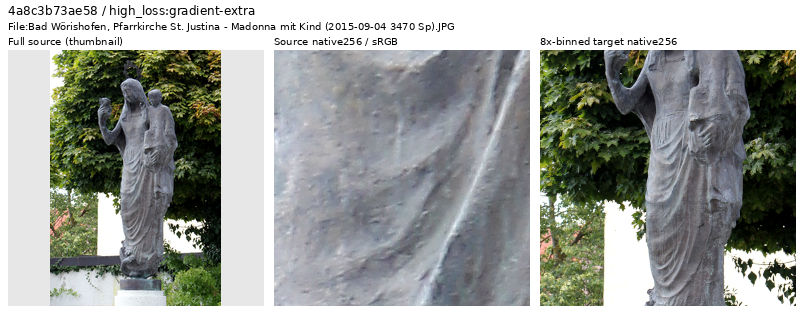
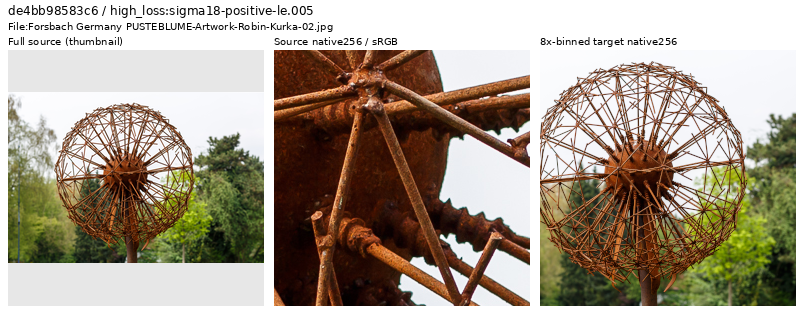

# Current Small-model source review

**The latest V123 pass retains all40 newly inspected source IDs and extends a
separate future material bank from20 to23 regions.** Pale animal hair, gray
feathers and whitewashed brick add physical fine-detail contexts. The earlier
90,783-source future manifest is unchanged, including its existing exclusions;
all twenty prior region objects remain exact. V122/V123 keep90,786/fourteen;
queued V124/V125 keep their
frozen90,784-source/twenty-region inputs. The separate
[completed V126/V127 pilot](reviewed-shadow-pilot-quality.md) uses the23-region
bank and shows no useful shadow-policy gain after1,000 matched updates. It does
not isolate the new bank's effect from quota and continuation changes versus V120.

[Latest40 decisions, native fields and actual23-region reader checks](v123-source-review-through9800.md) ·
[All40 decisions and credits](results/v123-source-loss-through9800-decisions-v1.csv) ·
[Execution and independent verification](results/v123-source-loss-through9800-review-v1.json).

The trace through update9,800 contains752 diagnostic draws,546 photographic
draws and451 eligible draws from450 IDs after skipping previously inspected
sources. Eight distinct IDs per noise group plus eight remaining high-gradient
cases receive actual native review. Seven sheets, four larger source views and
specific local source/target fields support retaining all40. No automatic
loss/title filter is applied. The future23-region catalogue passes59 actual
clean reads; controlled common-region/control targets match5,505,024 values.
These contexts mix fine detail with strong boundaries, rather than certifying
uniformly weak contrast or noiseless targets.

[Earlier20 decisions and independent checks](results/v123-source-loss-through5400-review-v1.json) ·
[Decisions and source credits, CSV](results/v123-source-loss-through5400-decisions-v1.csv) ·
[Native image metadata](images/v123-source-loss-through5400-v1/manifest.json).

## Earlier V123 source inspection through5,400

The frozen trace prefix through update5,400 contains448 diagnostic draws,
including326 photographic-branch draws. Skipping49 draws already covered by the
1,659-ID review ledger leaves277 distinct eligible sources. Nomination selects
four highest singleton losses per noise group, then four remaining highest
gradient errors. All twenty IDs are new to that ledger.

| Training noise group | Eligible draws/IDs | Selected |
| --- | ---: | ---: |
| ADC-only: shot/read both zero | 25 | 4 |
| Positive sigma18 ≤ .005 | 112 | 4 |
| .005 < sigma18 ≤ .02 | 116 | 4 |
| sigma18 > .02 | 24 | 4 |
| Remaining highest gradient error | Same eligible pool | 4 |

Here sigma18 = `sqrt(.18 × shot + read)` uses training coefficients. Evolving
weights, exposure, camera transforms and noise confound these scores; they
nominate source inspection and are not endpoint quality measurements.
All four sheets were actually viewed:20 source thumbnails and40 native256
source/area8-target cells. Three ambiguous or weak-detail cases received native1024
source views. No scored augmentation or noise realization is replayed.

The ceiling photograph below is dominated by painted figures and a painted
portrait. The larger view confirms that target content. Consistent with the
earlier painting-reproduction decision, this exact source is omitted from a
separate future photographic-target cohort. This is a domain choice, not a
claim that the photograph is technically defective.

Source: [Friedrich Haag, Münsing-Holzhausen ceiling](https://commons.wikimedia.org/wiki/File:M%C3%BCnsing-Holzhausen_Kirchbergstra%C3%9Fe_10_024_2023_04_25.jpg),
[CC BY-SA4.0](https://creativecommons.org/licenses/by-sa/4.0/).

The tiled mural remains eligible. Its
[native1024 view](images/v123-source-loss-through5400-v1/native1024-physical-mosaic.png)
resolves grout seams, uneven reflections, pits and glaze texture. Those are
physical surface features worth learning, despite the artistic subject.

Source: [Zofo, Badaev house tiled panel](https://commons.wikimedia.org/wiki/File:%D0%94%D0%BE%D1%85%D0%BE%D0%B4%D0%BD%D1%8B%D0%B9_%D0%B4%D0%BE%D0%BC_%D0%91%D0%B0%D0%B4%D0%B0%D0%B5%D0%B2%D0%B0_%D0%BD%D0%B0_%D1%83%D0%BB._%D0%92%D0%BE%D1%81%D1%81%D1%82%D0%B0%D0%BD%D0%B8%D1%8F_-_%D1%86%D0%B5%D0%BD%D1%82%D1%80%D0%B0%D0%BB%D1%8C%D0%BD%D0%B0%D1%8F_%D0%BF%D0%B0%D1%80%D0%B0%D0%B4%D0%BD%D0%B0%D1%8F,_%D0%BC%D0%B0%D0%BB%D0%BE%D0%B5_%D0%BF%D0%B0%D0%BD%D0%BD%D0%BE_2.jpg),
[CC BY-SA4.0](https://creativecommons.org/licenses/by-sa/4.0/).

Faint owl feather filaments and overlapping white/gray edges are retained after
[larger native inspection](images/v123-source-loss-through5400-v1/native1024-weak-feathers.png).
The photograph is not proven noiseless or unprocessed; high loss does not make
coherent weak plumage a reason for exclusion.

Source: [H. Zell, snowy owl at Karlsruhe Zoo](https://commons.wikimedia.org/wiki/File:Bubo_scandiacus_-_Karlsruhe_Zoo.jpg),
[CC BY-SA3.0](https://creativecommons.org/licenses/by-sa/3.0/).

The railway hillside also stays eligible: fine fences, wires, roofs and foliage
remain coherent in the area8 target despite some native softness and grain.

Source: [MaedaAkihiko, N700A near Odawara and Atami](https://commons.wikimedia.org/wiki/File:N700A-Odawara-Atami.jpg),
[CC BY-SA4.0](https://creativecommons.org/licenses/by-sa/4.0/).
All examples above are modified by cropping, binning and ICC/display conversion;
only full-source thumbnails resize. The source256 cell is centered within the
larger field covered by the target256 cell. Display exposure is ×1. These are
source/target inspections, without restored predictions.

The future4×/8× manifests remove exactly
`76ab25e4e51fdfe4981f4d42739153da1db2d812` from the earlier90,784-source cohort.
Every other literal row and all2,303/2,255 validation/test rows remain identical
and ordered. The [rebound20-region catalogue](../configs/low-contrast-training-rois-cleaned90783-v1.json)
preserves all twenty example objects and changes their manifest binding only.
The actual frozen reader validates all20 regions, reproduces20 augmented region
targets plus four ordinary and four procedural controls exactly across the
90784/90783 bindings:5,505,024 FP32 values. Replaying the nominated source draw
opens only its eligible replacement, without opening the withheld source cache.
This is readiness evidence; no training run uses the new cohort yet.

Independent checks reproduce the20-source selection, verify original JPEG SHA1
and cache SHA256 bindings, and compare3,932,160 native-source channels exactly.
Among3,932,160 target-preview channels,13 differ by one DN8 at FP32/FP64 rounding;
all others match. The three larger views overlap prior crops at589,824 exact
channels. Six published PNGs are byte-identical to the actually viewed originals.
No neural inference, new noise, RAW decode or optimizer work is added.

## Earlier material/domain extension

[Sixteen decisions, pixel reconstruction and actual reader](results/thin-photographic-materials-v1.json) ·
[Sixteen decisions and source credits, CSV](results/thin-photographic-materials-decisions-v1.csv) ·
[Prepared20-region targets](weak-photographic-targets.md#prepared20-region-material-extension).

These nominees come from an existing historical ADC-only target-statistic query,
not the live V121 loss stream. All sixteen full-source thumbnails and32 native256
source/area8-target cells were actually viewed. Six local original512/target64
pairs establish specific weak material structure. Three previously reviewed
bamboo/rod/sculpture contexts were also inspected for regions; their mixed/high
contrast did not justify a weak-region addition.

The painting reproduction's target is dominated by painted figures and canvas
texture. The thermographic capture shows false-color human silhouettes and
screen/raster texture. Both are valid retained media; their exact source IDs
are omitted only from a future cohort focused on visible-light photographic
targets. Physical carved stone, wood, plaster and etched metal remain eligible.
An “artwork” title or visible text alone does not decide source suitability.

Source: [GoldenArtists, A Workshop of Nuns](https://commons.wikimedia.org/wiki/File:A_Workshop_of_Nuns_-_Alessandro_Magnasco.jpg),
[CC BY4.0](https://creativecommons.org/licenses/by/4.0/).

Source: [böhringer friedrich, Thermografie Menschen](https://commons.wikimedia.org/wiki/File:Thermografie_Menschen_2.JPG),
[CC BY-SA2.5](https://creativecommons.org/licenses/by-sa/2.5/).
Modified by cropping, thumbnail creation, binning and ICC/display conversion;
only thumbnails resize. Source/cache files remain intact and read-only to this work.

The future4×/8× manifests remove exactly
`8cb7c7b865631ebfc88ac87df7bf1f0fe5509b48` and
`8e59071f5b1e4fcdb61f69b35c0f4f18f5aab16c`. Every other literal row and all
2,303/2,255 validation/test rows remain identical and ordered. The
[20-region catalogue](../configs/low-contrast-training-rois-cleaned90784-v1.json)
preserves all fourteen previous example objects. Its actual reader checks all20
constructor bindings and six new augmented regions, plus six unchanged controls.
No active source membership, recipe, sampling quota or training budget changes.

## Completed V120 loss-ranked inspection

The earlier28-source pass retained all28 photographs after five source sheets
and four larger native views. It changed no source membership. Its evidence is
preserved below, with the original selection and receipt scopes:

[Loss-ranked decisions and evidence](results/v120-source-loss-through18000-review-v1.json) ·
[All 28 decisions, source links and reasons, CSV](results/v120-source-loss-through18000-decisions-v1.csv) ·
[Independent selection and pixel checks](results/v120-source-loss-through18000-verification-v1.json) ·
[Publication bindings and live scheduling](results/v120-source-loss-through18000-publication-v1.json) ·
[Source/ROI/display metadata](images/v120-source-loss-through18000-v1/manifest.json).

### Nomination and actual inspection

The frozen V120 prefix through update 18,000 contains 1,616 Commons diagnostic
draws. This pass nominates only updates 5,001–18,000: 1,136 draws, including 795
photographic-branch draws from 761 IDs. The branch name alone does not establish
photographic content. Skipping 45 draws from fourteen already reviewed IDs
leaves 750 draws and 747 distinct eligible sources.

| Noise group | Eligible draws | Distinct IDs within group | Selected |
| --- | ---: | ---: | ---: |
| ADC-only: shot/read both zero | 76 | 76 | 6 |
| Positive sigma18 ≤ .005 | 281 | 281 | 6 |
| .005 < sigma18 ≤ .02 | 322 | 320 | 6 |
| sigma18 > .02 | 71 | 71 | 6 |
| Remaining highest gradient error | Same eligible pool | De-duplicated | 4 |

Here sigma18 = `sqrt(.18 × shot + read)` uses training coefficients, not measured
source-camera noise. An ID can appear in more than one group. Nomination takes
six distinct highest-loss IDs per group in the displayed order, then four
remaining distinct gradient-error cases. All 28 are new to the prior review
ledger. Evolving V120 weights, exposure and camera transforms confound losses;
these are inspection cues rather than fixed-endpoint or global quality scores.
[Trace definitions and limits](source-loss-diagnostics.md).

All five sheets were actually viewed: 28 source thumbnails and 56 unchanged
native256 source/target cells. Four ambiguous cases received native1024 views.
Strips below show full-source thumbnail → native source256 → area8 target256.
Only the thumbnail is resized. ICC-to-sRGB and exposure ×1 are recorded. Source
and target columns cover different fields of view: the source cell is centered
inside the larger binned-target context. Geometry/exposure/noise augmentation
from the nominated training update is not replayed.

### Retain difficult photographic detail

The bamboo bridge has continuous rails, thin irregular rods and rough joints.
Its native source has some grain/edge roughness, while the area8 target retains
coherent physical geometry. High loss is not a reason to discard these lines.

Source: [PIERRE ANDRE LECLERCQ, Pha Suam bridge](https://commons.wikimedia.org/wiki/File:Laos_Province_de_Champassak.-_cascade_de_Pha_Suam.jpg),
[CC BY-SA 4.0](https://creativecommons.org/licenses/by-sa/4.0/). Modified by
cropping, thumbnail creation, binning and display conversion.

Weak grey folds and irregular pitting belong to a photographed sculpture.
The larger view supports retaining real material structure, without proving
that every small fluctuation is noiseless scene detail.

Source: [Spurzem, Madonna sculpture](https://commons.wikimedia.org/wiki/File:Bad_W%C3%B6rishofen,_Pfarrkirche_St._Justina_-_Madonna_mit_Kind_%282015-09-04_3470_Sp%29.JPG),
[CC BY-SA 4.0](https://creativecommons.org/licenses/by-sa/4.0/). Same modifications.
[Actually viewed native1024 detail](images/v120-source-loss-through18000-v1/native1024-sculpture-folds.png).

A photograph of a physical rod sculpture is also retained. Rust, joints,
shadows and real thin geometry distinguish it from a standalone digital graphic.
A photographed information panel on a textured wall is retained for the same
reason. Titles containing “artwork” or visible text do not automatically exclude
photographs of real objects.

Source: [CEphoto, Uwe Aranas, PUSTEBLUME sculpture](https://commons.wikimedia.org/wiki/File:Forsbach_Germany_PUSTEBLUME-Artwork-Robin-Kurka-02.jpg),
[CC BY-SA 3.0](https://creativecommons.org/licenses/by-sa/3.0/). Same modifications.

The larger flower and plant views show focused petal/filament or foreground-tip
structure beside softer backgrounds. Source grain and saturated highlights
remain; this is not a claim of an unprocessed or noiseless capture. The area8
targets remain coherent under the current strategy.
[Native1024 plant focus](images/v120-source-loss-through18000-v1/native1024-plant-focus.png):
[Ireen Trummer, Kattekold](https://commons.wikimedia.org/wiki/File:Kattekold.JPG),
[CC BY-SA 3.0](https://creativecommons.org/licenses/by-sa/3.0/), cropped and color-managed without resizing.

## Current cohort and accumulated review

| Review scope | Distinct inspected sources | Retain | Withhold |
| --- | ---: | ---: | ---: |
| First 800 updates | 28 | 28 | 0 |
| Updates 801–5,000 | 28 | 27 | 1 |
| Updates 5,001–18,000 | 28 | 28 | 0 |
| New material/domain nomination | 16 | 14 | 2 |
| V123 through5,400 | 20 | 19 | 1 |
| Total across these distinct recent scopes | 120 | 116 | 4 |

The earlier standalone roofing advertisement remains withheld from the 90,786
cohort: `e264392bcea19447f69f7d4599945de78f7e0c7c`.
[Its visual decision and coupled-manifest checks](results/v120-source-loss-through5000-review-v1.json)
are preserved, along with the [first800 decisions](results/v120-current-source-loss-review-v1.json).
V120/V121 retain their original 90,791/90,787-source bindings. V122/V123 use the
90,786-source cohort and [unchanged fourteen-region catalogue](../configs/low-contrast-training-rois-cleaned90786-v1.json).
The earlier material/domain pass produced the90784/20-region inputs now frozen
for queued V124/V125. The latest V123 source review prepares the separate
90783/20-region alternative above. Neither active nor queued training inputs
are changed by this latest review.

For the V120 through18,000 pass, independent checks verify all28 original JPEG
SHA1 and whole-cache SHA256
bindings, 5,505,024 exact native-source channel values and 5,505,024 area8 target
preview values. Twelve target channels differ by one DN8 at FP32/FP64 rounding;
all others match. Four native1024 views overlap the previous native256 crops at
786,432 exact channels. Sheet/individual-strip pixels and five published PNGs
match their actually viewed originals.

The de-duplication ledger now contains **1,679 IDs** across explicit prior
scopes. It is not a membership/exclusion list or a uniform corpus audit.
Whole-corpus cleanliness and trained-quality effects remain unproven. No neural
call, new noise, RAW decode, optimizer update or sampling-policy change is added
by this review.
