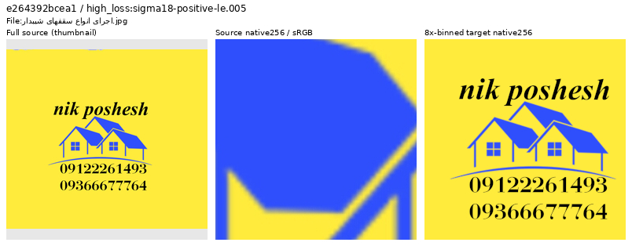
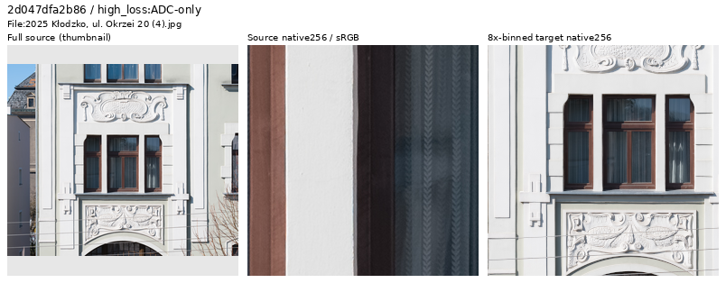
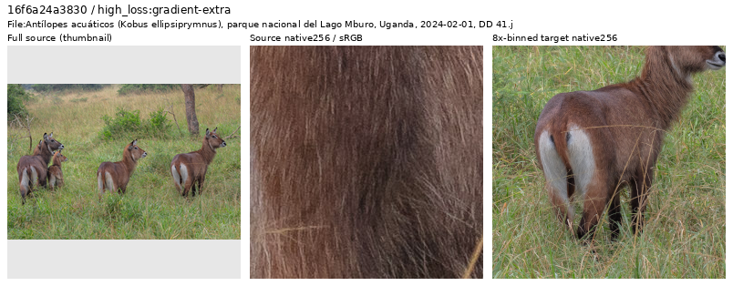
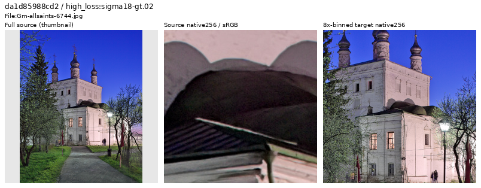

# Current Small-model source review

**The latest28-source inspection retains27 photographs and excludes one
nonphotographic roofing advertisement from the prepared next corpus.** The
future snapshot has90,786 training sources and preserves all fourteen reviewed
regions. V120/V121 continue with their original frozen inputs; this is data
cleanup, not a new model-performance result.

[Latest decisions and evidence](results/v120-source-loss-through5000-review-v1.json) ·
[All28 decisions, source links and reasons, CSV](results/v120-source-loss-through5000-decisions-v1.csv) ·
[Independent pixel/selection/cohort checks](results/v120-source-loss-through5000-verification-v1.json) ·
[Publication bindings and live-owner check](results/v120-source-loss-through5000-publication-v1.json) ·
[Future fourteen-region catalogue](../configs/low-contrast-training-rois-cleaned90786-v1.json).

## Latest nomination and inspection

A frozen prefix through update5,000 retains480 Commons diagnostic draws.
Nomination uses only updates801–5,000:352 draws, including254 draws/250 IDs
from the loader's photographic branch. That branch label does not establish
photographic content. Fifteen draws from eleven previously reviewed IDs are
skipped, leaving239 distinct eligible sources. Select six highest singleton
losses in each noise group, then four remaining sources with highest gradient
error. All five sheets were actually viewed:28 source thumbnails and56 unchanged
native256 source/target cells. Two ambiguous sources received native1024 views.

| Nomination group | Eligible sources | Selected |
| --- | ---: | ---: |
| ADC-only, shot/read both zero |28 |6 |
| Positive sigma18≤.005 |87 |6 |
| .005<sigma18≤.02 |97 |6 |
| sigma18>.02 |27 |6 |
| Remaining gradient-error candidates |Within the same239 |4 |

Here sigma18=`sqrt(.18 × shot + read)` uses training coefficients, not measured
source-camera noise. Exposure, material, camera transforms and V120's changing
weights still confound cross-case losses. These detached singleton diagnostics
are nomination cues, not additive batch-loss contributions or fixed-endpoint
scores. [Trace definitions](source-loss-diagnostics.md).

The source-review512px bin4 context is centered inside the actual traced
pre-augmentation crop. It does not replay the geometry, exposure or synthetic
noise used for that update. Strips below show full-source thumbnail → original
native256 crop → area8 native256 target. Only the thumbnail is resized.
Source pixels use ICC-to-sRGB where present; targets use linear-area2 from bin4
then sRGB display, exposure×1. Source and target columns cover different fields
of view: the native source is a centered detail from the larger target context.
[Full source/ROI/display/trace metadata](images/v120-source-loss-through5000-v1/manifest.json).

## Remove an actual digital advertisement

Uniform yellow background, blue vector roof/house shapes, typeset lettering
and phone numbers identify a standalone graphic, without a photographed scene.
This is different from a photograph of a sign, sculpture or printed physical
object. Its high loss nominated inspection; the visual content justifies removal.
The exact source ID is `e264392bcea19447f69f7d4599945de78f7e0c7c`.
A bounded exact-author-field check finds no other active source with that author;
no author-wide or title-based exclusion is applied.

Source: [اجرای خرپا شیروانی, roofing advertisement](https://commons.wikimedia.org/wiki/File:%D8%A7%D8%AC%D8%B1%D8%A7%DB%8C_%D8%A7%D9%86%D9%88%D8%A7%D8%B9_%D8%B3%D9%82%D9%81%D9%87%D8%A7%DB%8C_%D8%B4%DB%8C%D8%A8%D8%AF%D8%A7%D8%B1.jpg),
[CC BY-SA4.0](https://creativecommons.org/licenses/by-sa/4.0/).
Modified by cropping, binning, thumbnail creation and color/display conversion.
Original and cache files remain unchanged.

## Keep useful hard photographic detail

Fine curtain fabric, weak pale facade texture and weathered surfaces remain
eligible. High ADC-only loss is not a reason to remove actual woven detail.

Source: [Jacek Halicki, Kłodzko window](https://commons.wikimedia.org/wiki/File:2025_K%C5%82odzko,_ul._Okrzei_20_(4).jpg),
[CC BY-SA4.0](https://creativecommons.org/licenses/by-sa/4.0/). Same modifications.

Brown fur and fine grass provide difficult, real material with low-contrast
structure. The native hair texture and coherent binned body/grass are retained;
this does not add a new ROI quota or claim the source is noiseless.

Source: [Diego Delso, waterbuck](https://commons.wikimedia.org/wiki/File:Ant%C3%ADlopes_acu%C3%A1ticos_(Kobus_ellipsiprymnus),_parque_nacional_del_Lago_Mburo,_Uganda,_2024-02-01,_DD_41.jpg),
[CC BY-SA4.0](https://creativecommons.org/licenses/by-sa/4.0/). Same modifications.

Larger views clear two ambiguities. Saturated flowers show real petal veins,
folds, surface specks and shadow overlap; vivid color and some source grain
remain. The night church shows worn plaster/masonry, roof seams, twigs and
window mesh under colored illumination. Its dark roof is grainy, but the
inspected area8 target remains coherent. These are retained under the current
binning strategy, without claiming noiseless scenes or identifying a particular
processing algorithm.

Unchanged native1024 views: [flowers](images/v120-source-loss-through5000-v1/native1024-81a7bcc2fab8.png) ·
[night church](images/v120-source-loss-through5000-v1/native1024-da1d85988cd2.png).
Sources: [Krzysztof Golik, Primula](https://commons.wikimedia.org/wiki/File:Primula_cultivar_in_Jardins_de_la_Fontaine_in_Nimes_04.jpg),
[CC BY-SA4.0](https://creativecommons.org/licenses/by-sa/4.0/), and
[PereslavlFoto, All Saints church](https://commons.wikimedia.org/wiki/File:Gm-allsaints-6744.jpg),
[CC BY-SA3.0](https://creativecommons.org/licenses/by-sa/3.0/). Same modifications;
native1024 views are cropped and color-managed without resizing or binning.

## Prepared next corpus and verification

The coupled4×/8× manifests remove exactly that one training ID from90,787.
Every other literal row and its order, all validation/test/reserved membership,
and all source/cache pixels stay identical. The rebound catalogue keeps all14
region objects and target hashes. Actual `ReviewedPhotoROIs` construction
verifies every source/crop/target; `PhotoSamplingReference` accepts90,786 active
sources from the same90,864-ID reference, with all78 excluded-ID routes landing
on eligible sources. The changed catalogue binding correctly rejects resume;
use a new run configuration rather than mutating an existing run.

The future snapshot is prepared for subsequent quality work, with no new
training job. The current V120/V121 trials still contain the newly identified
source; their recipes, draw sequence and comparison inputs are not rewritten.
Both original source/media bytes and their machine receipts remain preserved.

All28 original JPEG SHA1 and whole-cache SHA256 checks pass. Independent integer
four-phase sums plus float64 display arithmetic rebuild5,505,024 target-preview
channel values;12 differ by one DN8 from FP32 rendering at rounding. Two larger
views overlap the prior native256 crops at393,216 exactly matching channels.
All six public PNGs are byte-identical to their actually viewed originals.
Training and all three queued-review input guards pass. No neural call, noise
observation, RAW decode or optimizer update is added by this review.

The [earlier first800 review](results/v120-current-source-loss-review-v1.json)
retained28 sources after native views and four larger checks; its
[CSV](results/v120-current-source-loss-decisions-v1.csv),
[pixel verification](results/v120-current-source-loss-review-verification-v1.json)
and [publication bindings](results/v120-current-source-loss-publication-v1.json)
remain unchanged. Useful examples include the
[radiator grille](images/v120-source-loss-first800-v1/radiator-mesh.png) and
[faint stone relief](images/v120-source-loss-first800-v1/faint-stone-relief.png).
Across the two Small-model passes,56 distinct sources were inspected:55 retained,
one withheld. The de-duplication ledger now contains1,615 IDs across explicit
prior scopes; it is neither a membership/exclusion list nor a uniform corpus
audit. Whole-corpus cleanliness and a trained-quality effect remain unproven.
