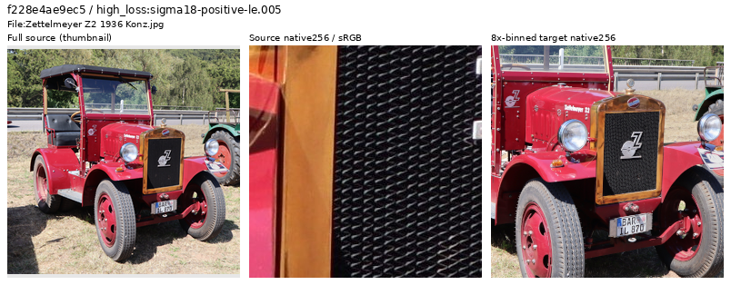
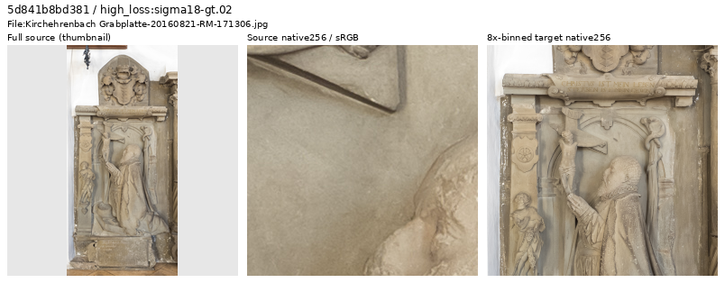
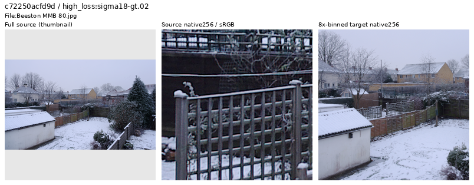
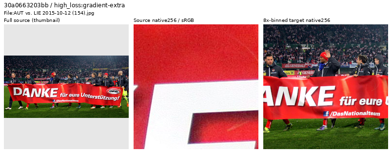

# Current Small-model losses: 28 photographic sources inspected

**All28 selected photographs remain eligible.** Actual source/native-target
inspection, followed by larger native views for four ambiguous cases, finds no
new unsuitable target in this sample. Real mesh, stone grain, faint surfaces,
organic texture and saturated painted materials account for many selected cases.
High loss alone would have removed useful hard examples. The active V120/V121
manifests and their source pixels remain unchanged.

[Decisions and evidence](results/v120-current-source-loss-review-v1.json) ·
[All28 decisions, reasons and source links, CSV](results/v120-current-source-loss-decisions-v1.csv) ·
[Independent pixel/selection checks](results/v120-current-source-loss-review-verification-v1.json) ·
[Publication bindings](results/v120-current-source-loss-publication-v1.json).

## Selection and limits

The frozen prefix covers V120 updates1–800:128 Commons diagnostic draws,
including95 distinct photographs. Six photographs already occur in the loaded
native-review ledgers, leaving89 eligible for this pass. Before viewing these
outputs, select six highest singleton losses in each declared noise group,
then four remaining photographs with the highest gradient-error term:

| Nomination group | Eligible photographs | Selected |
| --- | ---: | ---: |
| ADC-only, shot/read both zero |11 |6 |
| Positive sigma18≤.005 |34 |6 |
| .005<sigma18≤.02 |31 |6 |
| sigma18>.02 |13 |6 |
| Remaining gradient-error candidates |Within the same89 |4 |

Here sigma18=`sqrt(.18 × shot + read)` uses the declared training coefficients,
not the source camera's measured ISO/noise. Grouping reduces one obvious source
of selection bias; it does not make losses comparable across exposure, material,
camera transforms or changing model states. No fixed endpoint is scored here.
Each photograph appears once in this prefix, without repeated-source evidence.
The logger's detached FP32 singleton losses are not additive contributions to
the optimizer's batch loss. [Trace definitions](source-loss-diagnostics.md).

All five sheets were actually inspected:28 full-source thumbnails plus56
unchanged native256 source/target cells. Four sources then received unchanged
native1024 inspection. The source-review context is a centered512px bin4 region
inside the actual traced pre-augmentation crop. It does not reproduce the later
geometry, exposure or synthetic-noise observation that produced the loss.

## Useful difficult material

Each strip shows a full-source thumbnail, an original native256 source crop,
then a native256 area8 target. Only the thumbnail is resized. Source crops use
ICC-to-sRGB where present; targets use linear-area2 from the bin4 cache and
the same exposure×1 sRGB display. These are source-quality inspections, without
noisy/restored model-output panels or a new model-performance claim.
The native source and binned target cover different fields of view; the source
view is centered within the larger review context.
[Source, crop, display and trace metadata](images/v120-source-loss-first800-v1/manifest.json).

The radiator grille is genuine repeated metal structure with sharp glossy
boundaries and small fasteners. Its high loss is a useful difficult-detail cue,
not evidence of an unsuitable photograph.

Source: [Palauenc05, Zettelmeyer Z2](https://commons.wikimedia.org/wiki/File:Zettelmeyer_Z2_1936_Konz.jpg),
[CC BY-SA4.0](https://creativecommons.org/licenses/by-sa/4.0/). Modified by
cropping, binning, thumbnail creation and color/display conversion.

The sandstone memorial retains weak relief and fine surface grain in nearly
uniform material. Photographed sculpture and painted physical objects remain
useful when their source and binned target are coherent. The same review retains
faint plaster, weathered wood/window paint, stonework and leaf/branch detail.

Source: [Ermell, Kirchehrenbach memorial](https://commons.wikimedia.org/wiki/File:Kirchehrenbach_Grabplatte-20160821-RM-171306.jpg),
[CC BY-SA4.0](https://creativecommons.org/licenses/by-sa/4.0/). Same modifications.

## Larger views resolve four ambiguities

The winter scene's larger view separates snow along real fence rails, fine
branches, wood and layered gardens. The binned target retains coherent geometry.
Some native grain and strong edge contrast remain; neither alone establishes
pervasive false texture.

[Unchanged native1024 view](images/v120-source-loss-first800-v1/native1024-c72250acfd9d.png).
Source: [mattbuck, Beeston MMB80](https://commons.wikimedia.org/wiki/File:Beeston_MMB_80.jpg),
[CC BY-SA3.0](https://creativecommons.org/licenses/by-sa/3.0/). Same modifications.

The football source visibly contains grain in cloth and dark clothing. Larger
pixels also show coherent folds, seams and lettering; area8 reduces the grain
while retaining scene structure. Retain it under the current binning strategy,
without calling the source noiseless.

[Unchanged native1024 view](images/v120-source-loss-first800-v1/native1024-30a0663203bb.png).
Source: [Steindy, Austria–Liechtenstein2015](https://commons.wikimedia.org/wiki/File:AUT_vs._LIE_2015-10-12_(154).jpg),
[CC BY-SA3.0](https://creativecommons.org/licenses/by-sa/3.0/). Same modifications.

The other two larger views resolve coherent leaf clusters/twigs and distant
bridge/building structure. Ordinary distance/focus variation does not justify
removing these photographs.
[Foliage native1024](images/v120-source-loss-first800-v1/native1024-16536c5ab12c.png) ·
[Bridge/city native1024](images/v120-source-loss-first800-v1/native1024-2c5a649be198.png).
Sources: [Steffen Schmitz, Moers foliage](https://commons.wikimedia.org/wiki/File:Moers,_Kaisers_Buche,_2015-08_CN-02.jpg),
[CC BY-SA4.0](https://creativecommons.org/licenses/by-sa/4.0/), and
[Berthold Werner, Córdoba](https://commons.wikimedia.org/wiki/File:Spain_Andalusia_Cordoba_BW_2015-10-27_12-11-26.jpg),
[CC BY-SA3.0](https://creativecommons.org/licenses/by-sa/3.0/). Modified by
cropping and color/display conversion; full metadata is adjacent to each image.

## Verification and next use

Original JPEG SHA1 and complete bin4-cache SHA256 checks pass for all28 sources.
Independent integer four-phase sums and float64 display arithmetic rebuild
5,505,024 target-preview channel values. Only32 values differ from the renderer's
FP32 result, each by one DN8 at rounding. Four native1024 supplements overlap
the earlier native256 crops at786,432 exactly matching channel values. All eight
published PNGs are byte-identical to their actually inspected originals.

The bounded trace prefix still exactly matches the live log's original bytes.
Training and all three queued-review input guards pass. This review adds no
neural calls, noise observations, RAW decodes or source/membership changes.
A separate ID ledger supports de-duplicating future inspections across explicit
review scopes; it is not an exclusion list or a uniform corpus audit.

This small, biased early-training sample does not establish whole-corpus
cleanliness. Continue inspecting current-model source nominations as the run
grows, while preserving hard photographic detail. The full
[V120/V121 endpoint comparison](paired32-weak-detail-training.md), actual native
material/GFX/green-mesh review and model recommendation remain pending.
