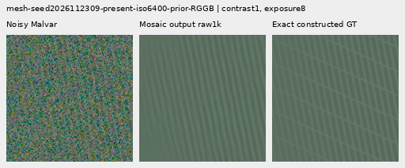
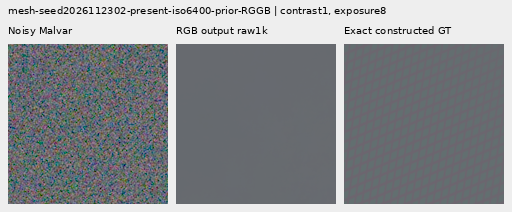

# V153 delivered spectral loss: more mesh response, mixed flat costs

Moving spectral supervision after support and demosaicing raises mean synthetic
mesh response **6.04–7.97% over the matched V152 relative-phase control**, or
**11.43–17.40% over V143**. Absolute response remains only **2.45–2.59% of
constructed GT**. Mesh whole-scene RMS improves .411–.508% versus V143.
**No convincing new real cab-fence crossings or noisy organic texture appear
in the reviewed native crops.**

The gain has costs: actual mesh-blank RMS rises .014–.114% above V143, natural
photo band response falls further, noisy-flat RMS improves less than control,
and ADC photo RMS becomes .067–.129% worse than V143. Exact quiet errors are
mostly worse than control; RGB EMA improves ISO6400 slightly but worsens ISO12800.
Delivered-mosaic supervision also improves full-field coarse slope error, with
a DC tradeoff. These narrow gains are useful for further prototypes; this is
not the requested broad fine-detail/clean-sky solution.

All three identical fresh heads finish 1,000 updates. All six fixed raw/EMA
endpoints cover 822 cases, independent audits and 84 actually viewed native
figures. Control trace, raw/EMA weights, Adam state and **all 1,644 control
prediction arrays** reproduce V152 relative phase exactly. There is no early
epoch selection. The [final evidence](results/v153-delivered-objective-final-v1.json)
preserves 26 byte-exact final receipts, ten preclaim-failure artifacts and the
unchanged thirteen preparation receipts.

## Mesh response and actual blank errors

Errors are means of per-observation RMS in unclipped camera RGB ×65535.
Response projects onto exact plane-detrended procedural texture; ideal is1.
The 256 present observations are64 related recipes across four CFAs. Added
change energy is a footprint, separate from actual target error.

| Method | Present full RMS | Response | Actual blank RMS | Blank spatial RMS | Added blank RMS |
| --- | ---: | ---: | ---: | ---: | ---: |
|V143|9.111243|0.02202090|5.523323|5.343113|0.00000000|
|Pre raw|9.084343|0.02394498|5.523011|5.342786|0.32348204|
|Pre EMA|9.088346|0.02314068|5.519997|5.339678|0.30660351|
|Mosaic raw|9.064941|0.02585339|5.529470|5.349475|0.46738378|
|Mosaic EMA|9.070948|0.02481698|5.525242|5.345109|0.43821471|
|RGB raw|9.065995|0.02583932|5.529598|5.349611|0.45695545|
|RGB EMA|9.073765|0.02453732|5.524094|5.343926|0.41348850|
|Existing periodic detail|8.586126|0.07089755|5.523328|5.343118|0.00063557|

Mosaic raw/EMA gives 7.97%/7.24% more response than its pre-support control;
RGB gives7.91%/6.04%. All four delivered endpoints improve mesh full RMS but
raise actual blank error above both their controls and V143. On256 absent
observations, mosaic raw/EMA full RMS is5.241836/5.238249, RGB5.241984/5.237382,
versus V1435.237910 and pre-control5.236600/5.234136. RGB EMA remains marginally
below V143 there; all four regress versus matched control. The native2302 crop
stays nearly flat and2309 keeps one family without the exact crossing lattice.
Existing periodic detail retains stronger selected response, with incomplete
orientations, support seams/spill and weak nonperiodic gains.

## Noisy flats and natural photographs

Each flat group has24 observations. Full-field block32 error and central crops
are distinct; one native crop does not establish broad flat safety.

|Flat test|V143|Pre raw|Pre EMA|Mosaic raw|Mosaic EMA|RGB raw|RGB EMA|
| --- | ---: | ---: | ---: | ---: | ---: | ---: | ---: |
|Native512 ISO6400 full RMS|18.546808|18.520569|18.510726|18.523260|18.513225|18.526464|18.513829|
|Native512 ISO6400 spatial RMS|18.235130|18.208396|18.198350|18.211189|18.200911|18.214455|18.201512|
|Native512 ISO6400 block32 RMS|13.440561|13.440935|13.440351|13.440875|13.440406|13.440939|13.440410|
|Native512 ISO12800 full RMS|24.071890|24.036749|24.022431|24.044884|24.030029|24.048808|24.030195|
|Native512 ISO12800 spatial RMS|23.596861|23.560951|23.546239|23.569336|23.554072|23.573335|23.554204|
|Native512 ISO12800 block32 RMS|17.932544|17.931555|17.931410|17.931030|17.930916|17.931620|17.931519|
|Older native256 ISO12800 full RMS|27.233548|27.193266|27.174987|27.202912|27.183584|27.207559|27.182713|
|Older native256 ISO12800 spatial RMS|26.017191|25.974863|25.955418|25.985257|25.964663|25.990140|25.963698|
|Older native256 ISO12800 block32 RMS|19.539875|19.538810|19.539322|19.538972|19.539302|19.539392|19.539618|

Delivered variants lower native512 full RMS .096–.181% versus V143, less than
pre-control's .141–.205%. ISO12800 full-field coarse error improves slightly,
especially with mosaic loss, while its central block32 error rises .019–.026%
above V143. Broad colored mottle persists. All48 constant ADC inputs retain
their parents exactly under all six endpoints:288 exact predictions.

Each photo group contains32 related observations. Native DCT16 luma coefficients
use the1/8–1/3 cycles/pixel annulus. Band error and response are separate to
expose attenuation.

|Photo test|V143|Pre raw|Pre EMA|Mosaic raw|Mosaic EMA|RGB raw|RGB EMA|
| --- | ---: | ---: | ---: | ---: | ---: | ---: | ---: |
|Retained512 faint full RMS|33.963754|33.961358|33.962967|33.961438|33.962842|33.961085|33.962786|
|Retained512 faint band error|0.824639|0.824550|0.824683|0.824512|0.824639|0.824517|0.824672|
|Retained512 faint band response|0.298560|0.297581|0.297225|0.297072|0.296767|0.297382|0.297002|
|Retained512 dark full RMS|29.097715|29.093227|29.093997|29.093855|29.094384|29.093401|29.094114|
|Retained512 dark band error|0.661447|0.661389|0.661425|0.661416|0.661446|0.661406|0.661441|
|Retained512 dark band response|0.531446|0.529957|0.529776|0.528981|0.528888|0.529480|0.529353|
|Organic384 faint full RMS|37.469061|37.466956|37.472034|37.468258|37.473003|37.467960|37.473484|
|Organic384 faint band error|0.924117|0.924265|0.924445|0.924277|0.924444|0.924263|0.924464|
|Organic384 faint band response|0.150701|0.149864|0.149465|0.149566|0.149203|0.149739|0.149298|
|Organic384 dark full RMS|33.685796|33.682922|33.684475|33.685045|33.686412|33.684591|33.686215|
|Organic384 dark band error|0.781612|0.781610|0.781626|0.781597|0.781612|0.781602|0.781623|
|Organic384 dark band response|0.398945|0.397692|0.397451|0.396967|0.396794|0.397297|0.397081|

All four groups' band responses fall further than their matched pre-controls.
Raw full-RMS means remain slightly below V143, but organic EMA full RMS becomes
worse than V143. Retained-faint band error improves; dark/organic results are
mixed. RGB preserves slightly more response than mosaic, without recovering
the missing feather, moth, grass, bark or bird/branch texture. Lower mean band
error is not proof of restored fine structure.

## Exact quiet regions beside strong patterns

Sixteen observations per prior are four patterns across four CFAs. Whole-scene
and exact quiet160 errors are reported separately.

| Prior | Method | Whole RMS | Quiet RMS | Quiet spatial RMS |
| --- | --- | ---: | ---: | ---: |
|ISO6400|V143|27.105631|3.898845|3.268502|
|ISO6400|Pre raw|27.026897|3.931359|3.305015|
|ISO6400|Pre EMA|27.032199|3.920584|3.292272|
|ISO6400|Mosaic raw|27.048800|3.941401|3.317387|
|ISO6400|Mosaic EMA|27.052443|3.928217|3.301810|
|ISO6400|RGB raw|27.040450|3.932401|3.307233|
|ISO6400|RGB EMA|27.046026|3.917796|3.289952|
|ISO12800|V143|36.747466|6.152652|5.341833|
|ISO12800|Pre raw|36.567995|6.178347|5.370711|
|ISO12800|Pre EMA|36.590744|6.173207|5.364909|
|ISO12800|Mosaic raw|36.551290|6.195933|5.390123|
|ISO12800|Mosaic EMA|36.578463|6.186530|5.379533|
|ISO12800|RGB raw|36.540356|6.186339|5.379674|
|ISO12800|RGB EMA|36.576072|6.176355|5.368321|

All quiet means remain above V143. Mosaic quiet RMS is .551–1.091% higher;
RGB .385–.861% higher. RGB EMA ISO6400 quiet RMS3.917796 is slightly below its
control3.920584, yet still .486% above V143; its ISO12800 quiet RMS worsens
versus control. Whole ISO12800 error improves while quiet error worsens. At40×,
broad colored blobs remain, with subtle fine-variation changes. Main real sky
stays close to parent; its independently demosaiced ISO100 reference is qualitative
and never pixelwise scored.

## ADC photographs and sloped fields

Eight ADC photo cases use two held-out Commons targets across four CFAs,
contrast .025 about channel means, shot/read0, black .03 and16-bit quantization.
Sixteen native512 slope cases cover four level/tint/slope recipes across four
CFAs. Both have exact constructed targets.

|ADC test|V143|Pre raw|Pre EMA|Mosaic raw|Mosaic EMA|RGB raw|RGB EMA|
| --- | ---: | ---: | ---: | ---: | ---: | ---: | ---: |
|Photo full RMS|18.149871|18.091100|18.095009|18.173290|18.172703|18.162996|18.162011|
|Photo band error|0.101855|0.101561|0.101598|0.102152|0.102156|0.102076|0.102078|
|Photo band response|0.968329|0.967721|0.967698|0.966259|0.966264|0.966652|0.966671|
|Sloped512 full RMS|3.771369|3.750437|3.752140|3.757595|3.758089|3.760164|3.761401|
|Sloped512 spatial RMS|3.397249|3.374485|3.376175|3.381083|3.381572|3.384330|3.385732|
|Sloped512 block32 RMS|0.574652|0.580016|0.578783|0.574116|0.573551|0.575816|0.575689|
|Sloped512 crop block32 RMS|0.088145|0.088127|0.088129|0.088128|0.088128|0.088132|0.088133|
|Sloped512 worst absolute DC|11.176981|11.169503|11.173021|11.179717|11.181631|11.175606|11.175844|

All delivered endpoints lose the pre-control's ADC photo gain: full RMS and band
error are now worse than V143, with further response attenuation. Native bark/fur
changes are subtle. [V150's roughly3.06% ADC RMS gain](objective-floor-training.md)
remains a useful separate strength.

Mosaic slope full RMS improves .352–.365% versus V143, less than pre-control's
.510–.555%, but its coarse block32 error improves .093–.192% below V143 instead
of rising .719–.933%. Worst DC becomes .024–.042% higher than V143. RGB also
reduces the control's coarse-error cost but remains .180–.203% above V143.
The fixed central native views remain smooth; full-field metrics reveal the
coarse/DC tradeoff.

## Native 100% comparisons and standing real scenes

All84 figures were actually inspected at original detail in21 unscaled sheets.
Every cell is160×160 original pixels, with identical ROI/display transforms
across methods. The [manifest](images/v153-delivered-objective-v1/manifest-v1.json)
binds source/ROI, checkpoint SHA256, conditioning, exposure, anchor and contrast.
Thirty-six triplets repeat board cells rather than add observations.

Two fixed mesh triplets per improved endpoint: **noisy → restored → exact
constructed GT**. Native512 RGGB, ROI `[176,176,160,160]`, shot .00128,
read6.5536e-6, display exposure8, contrast1; seeds end2302/2309.








Matching control examples:
[2302 raw](images/v153-delivered-objective-v1/comparison-00-pre-control-raw-step1000-triplet.png),
[2309 raw](images/v153-delivered-objective-v1/comparison-02-pre-control-raw-step1000-triplet.png),
[2302 EMA](images/v153-delivered-objective-v1/comparison-00-pre-control-EMA-step1000-triplet.png),
[2309 EMA](images/v153-delivered-objective-v1/comparison-02-pre-control-EMA-step1000-triplet.png).

ADC bark and fur triplets retain native256 contexts, ROI `[48,48,160,160]`,
display exposure 1, shared 40× contrast about target channel means, shot/read 0
and black .03. Bark: Derek Ramsey (Ram-Man), CC BY-SA2.5, source SHA1
`0ae232278265dabbdd54f52c34045a3d03323aa7`; fur: Korall, CC BY3.0,
`2b5a51667b9906eecead8f82e08c7ba11750f8c6`. Exact constructed targets,
not real-capture GT:
[bark raw](images/v153-delivered-objective-v1/comparison-42-delivered-mosaic-raw-step1000-triplet.png),
[fur raw](images/v153-delivered-objective-v1/comparison-43-delivered-mosaic-raw-step1000-triplet.png),
[bark EMA](images/v153-delivered-objective-v1/comparison-42-delivered-mosaic-EMA-step1000-triplet.png) and
[fur EMA](images/v153-delivered-objective-v1/comparison-43-delivered-mosaic-EMA-step1000-triplet.png).

The noisy [feather](images/v153-delivered-objective-v1/comparison-13.png) view uses
Alexis Lours, CC BY4.0, SHA1 `02a76fd33b5e1414a0504f0b3f0aeb03a569b6f4`,
native384, ROI `[112,112,160,160]`, exposure 14.388348 and contrast 8.
The [dark bird/branch](images/v153-delivered-objective-v1/comparison-25.png) uses
Andrew Mercer, CC BY-SA4.0, SHA1 `3e638bbb56ed80abc88939468783e3bf9b92ee77`,
native512, ROI `[176,176,160,160]`, exposure 80.995917 and contrast 1.
Both use shot .00128/read 6.5536e-6. Fine texture remains missing.

Standing DSCF3879 ISO6400/DSCF3880 ISO100 views retain
[sky](images/v153-delivered-objective-v1/comparison-05.png),
[building](images/v153-delivered-objective-v1/comparison-06.png),
[foliage](images/v153-delivered-objective-v1/comparison-07.png) and
[chain-link fence](images/v153-delivered-objective-v1/comparison-08.png), exposure 4.
DSCF3842/3835 fine cab mesh retains both windows under
[nominal left](images/v153-delivered-objective-v1/comparison-09.png),
[nominal right](images/v153-delivered-objective-v1/comparison-10.png),
[profile3879 left](images/v153-delivered-objective-v1/comparison-11.png) and
[profile3879 right](images/v153-delivered-objective-v1/comparison-12.png) priors.
Native768 contexts, left/right ROIs `[206,229,160,160]` / `[426,189,160,160]`,
exposure 16 and contrast 1. Both SOOC JPEGs stay native unboosted sRGB8.
Independent ISO100/AHD/JPEG references differ in aperture, shutter, processing
and motion: **qualitative references, not exact GT**, never pixelwise scored.
No convincing new fine cab wires appear. Protected captures, JPEGs and siblings
remain excluded from training; originals stay read-only and `/mnt/dataz` untouched.
The [quiet ROI](images/v153-delivered-objective-v1/comparison-26.png) at 40× and
[whole-edge view](images/v153-delivered-objective-v1/comparison-27.png) at 1× retain
the same coordinates across methods.

## What changed inside the learned correction

[Archived auxiliary means](results/v153-delivered-objective-v1/proposal-support.json)
give mesh support .326/.310 for mosaic raw/EMA and .323/.303 for RGB, versus
pre-control .479/.464. Pre-support coefficient RMS rises to2.635e-5/2.450e-5
for mosaic and2.616e-5/2.343e-5 for RGB, versus1.158e-5/1.049e-5. The proposal
grows while support closes. Present and absent means remain nearly identical;
this does not establish useful spatial selectivity or calibrated confidence.
The larger correction improves synthetic response with measured quiet/blank
costs. The all-RGB term does not solve natural-texture attenuation by itself.

## Three fixed objectives

All arms use `LateSpectralRelativeDetail`: 33,713 parameters in 13 tensors,
initialized identically. All 86 neural source files remain byte-identical.
The [recipe](../configs/quality-v143-delivered-objective-v153.yaml) fixes:

| Arm | Spectral error | Channels |
| --- | --- | ---: |
| Pre-control | Proposed CFA coefficient correction minus target-minus-parent coefficients | 4 |
| Delivered mosaic | Analysis of `mosaic(output − target, colors)` | 4 |
| Delivered RGB | Analysis of `pixel_unshuffle(output − target, 2)` | 12 |

`output` includes the frozen V143 parent, overlap-synthesized proposal,
data-dependent local support and fixed signed Malvar interpolation. The RGB
packing uses four spatial phases for R, then G, then B. Thus it covers errors
at unsampled colors that delivered-mosaic supervision cannot see. The existing
physical noise/camera inputs, RAW/residual relative-frequency features,
per-bin matrix bound, smooth band and local support network are unchanged.
Targets enter the training loss, never inference or the module's forward inputs.

For either delivered arm, spectral MSE is:

```text
sum(|analysis(packed_output_error)|² / frame_scale * band)
    / (band.sum() * number_of_frames * number_of_channels)
```

The original frame size, affine removal, taper and band are retained. Each
four-phase frame-noise proxy is floored at `(16 / 65535)²`. Delivered RGB repeats
the same four values for each color. This supplies **training units, not a
calibrated post-demosaic covariance, SNR or likelihood**. Four versus twelve
channels are averaged. Moving the spectral term changes gradient direction and
effective strength, including gradients through support; the losses are not
claimed to have identical gradient norms. The spectral coefficient stays .25,
as do the delivered pixel and gradient coefficients.

The original pre-control loss delegates to the existing function without changing
arithmetic. Its trace, raw/EMA states, Adam state and all 1,644 final control
predictions reproduce V152 relative phase exactly. This is a matched loss
comparison, not a new architecture or a continuation from trained head weights.

## Completed training, audits and preserved failure

All three heads use the same4,000 old cached observations/parents,882 supervised
batches and118 zero-ADC gradient batches. All1,000 AdamW/EMA clocks advance,
including momentum/weight-decay coasting on zero-gradient steps. No peak weighting
or clipping occurs. Architecture, inference, physical inputs, initialization,
geometry, domain weights, .25 spectral weight and schedule match. Moving the
spectral term changes gradient direction and effective strength; the objectives
are not claimed to have equal gradient norms. All86 neural files stay unchanged.

Twenty-seven focused tests pass in .78s: independent dense-DFT/weighted-plane
values and full adjoints for both delivered terms across four CFAs, zero/positive
scales, replicated borders and rectangular nondivisible contexts; exact old-loss
values/gradients, unsampled-color witness, support-gradient reach and invalid-site
rejection. Compatibility reproduces28 archived contexts with two evaluations
each,56 calls. Three discarded ten-update CUDA checks include genuine8+2
model/EMA/Adam/RNG restoration; all39 named tensors receive finite nonzero gradients.
Production starts fresh and finishes39 finite Adam states at1k.

The final state/array audit proves exact V152-relative control trace, raw/EMA
weights, Adam state and all1,644 endpoint arrays. Independent metrics pass54,246
scalar checks and656 Decimal reductions across6,330 rows, maximum4.55e-13;
42 real rows remain unscored. PNG/display checks cover42,470,400 RGB channels.
Peak allocated CUDA is4.15GiB in training and1.44GiB in review.

The initial reviewer retained an obsolete literal12-tensor assertion; V153 has13.
It exited before review claim, CUDA setup or any head forward. Training and its
completed state audit were retained. The corrected revision validates the actual
final checkpoint/strict CPU loads before collecting the first endpoint arrays.
Ten original failure artifacts and all v1 receipts/logs/source bytes are preserved;
v2 has separate plans, logs and completion status. No training was restarted.
The old controller overwrote its transient failed-child owner field, so that
reviewer's exact PID/create-time is unrecoverable. Its nonzero return/traceback
are preserved;12 other recorded owners are independently verified terminal.
The corrected controller now retains failed-child metadata.

Tracked head work is56 compatibility +30 discarded smoke +3,000 production
+4,932 quality evaluations = **8,018**, excluding unit tests. The failed
preclaim attempt and CPU checkpoint validation add zero head forwards. There
are zero new parent/DINO or stochastic-noise calls, original lookups or RAW
decodes; `/mnt/dataz` is unused. Captures, JPEGs, siblings and validation sources
remain excluded from training. All originals stay read-only.

The [preparation evidence](results/v153-delivered-objective-preparation-v1.json)
retains13 byte-exact receipts,18 source texts, all86 unchanged neural hashes,
checkpoint250 audit and its historical261-row active snapshot. Two mutable
review/controller source paths now point to corrected code; their original
bytes remain in the preserved failure copies and embedded preparation texts.

## Next weak-detail objective

Delivered supervision is a useful stronger mesh-response baseline, with ADC,
natural-response and quiet-region costs still compared directly. The next
matched test should examine a smooth robust penalty on delivered RGB spectral
error, to increase relative pressure on small nonzero errors while retaining
penalties in exact flat targets. Keep the current MSE arm as control and compare
noise-scaled Charbonnier variants, with explicit finite derivatives at zero.
This is a hypothesis, not a completed improvement. The existing raw-frame scale
remains a training proxy rather than calibrated RGB covariance. More pressure
alone may worsen flat errors; actual blank/quiet metrics and both real scenes
remain essential.

The [current model choices](current-model.md) retain V120 for general inference,
V143 periodic detail as an explicit option, V153's narrow response gain, the
quieter V151/V152 controls and V150's stronger ADC restoration. No new general
inference default is introduced. The broader low-contrast/dark-detail and clean-sky
goal remains active. See the
[local-time diary](../diary/2026-11-03-18-33-52-v153-final-endpoint-review.md).
