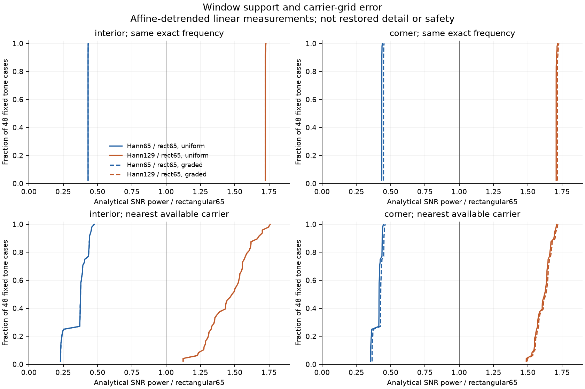

# Dense measurement support and frequency-grid error

The analytical calculation identifies a measurement change hidden inside V191's architecture test. At the same known frequency, a 65-pixel Hann window retains only **43.1–45.2%** of a rectangular65 window's phase-averaged SNR power in these prescribed cases. Enlarging Hann to129 raises that ratio to **170.7–172.8%**. This supports testing larger coherent support; it does not establish why the trained V191 regressed.

With each method's nearest available carrier, Hann65 retains **23.0–47.6%** of rectangular65 SNR power, while Hann129 retains **112.4–175.9%**. Uniform-variance interior means are **0.3606 / 1.4634** for Hann65 / Hann129; corner means are **0.4076 / 1.6129**. All 48 fixed tone cases in every position/variance condition improve on the rectangular comparator for Hann129, and all worsen for Hann65. Those counts describe this deterministic test cross, not statistical confidence or photographs.

For an unfitted, interior coherent average, `(sum(w))² / sum(w²)` gives 4,225 effective samples for rectangular65, 1,820.44 for Hann65 and 7,281.78 for Hann129. The main calculation includes weighted affine removal and exact conditional noise propagation; its frequency-grid mode separately measures deterministic mismatch. The two variance profiles are deliberately simple. Symmetric interior windows cancel their linear variance gradient in the relevant sums, so overlapping uniform/graded curves do not demonstrate robustness to general heteroscedastic camera noise.

A larger window can also spread structure into neighboring quiet regions and costs more computation. This calculation uses a single sampled phase, known deterministic tones and their nearest mathematical carriers. It tests neither a noisy frequency selector, joint-CFA reconstruction, the learned mixer, photographic texture, flat false positives, latency nor native RGB quality. The rectangular256 carrier grid represents available global-context frequency resolution, not V187's actual sparse selections. No protected photograph or approximate low-ISO reference is used. V187 remains preferred while a larger-window dense model still needs native CPU/GPU validation, training and the complete detail/flat/GFX review.

| Position | Variance | Carrier | Window | Mean ratio | Range | Above 1 |
|---|---|---|---|---:|---:|---:|
| interior | uniform | exact | Hann65 | 0.430925 | 0.430874–0.431893 | 0/48 |
| interior | uniform | exact | Hann129 | 1.723698 | 1.723498–1.727574 | 48/48 |
| interior | uniform | nearest grid | Hann65 | 0.360634 | 0.229716–0.476249 | 0/48 |
| interior | uniform | nearest grid | Hann129 | 1.463433 | 1.123812–1.758983 | 48/48 |
| interior | graded | exact | Hann65 | 0.430925 | 0.430874–0.431893 | 0/48 |
| interior | graded | exact | Hann129 | 1.723698 | 1.723498–1.727574 | 48/48 |
| interior | graded | nearest grid | Hann65 | 0.360634 | 0.229716–0.476249 | 0/48 |
| interior | graded | nearest grid | Hann129 | 1.463433 | 1.123812–1.758983 | 48/48 |
| corner | uniform | exact | Hann65 | 0.435811 | 0.435264–0.439316 | 0/48 |
| corner | uniform | exact | Hann129 | 1.707581 | 1.706763–1.718255 | 48/48 |
| corner | uniform | nearest grid | Hann65 | 0.407578 | 0.354364–0.446950 | 0/48 |
| corner | uniform | nearest grid | Hann129 | 1.612876 | 1.488647–1.710168 | 48/48 |
| corner | graded | exact | Hann65 | 0.448593 | 0.447881–0.452192 | 0/48 |
| corner | graded | exact | Hann129 | 1.716284 | 1.715495–1.726680 | 48/48 |
| corner | graded | nearest grid | Hann65 | 0.419532 | 0.364755–0.460078 | 0/48 |
| corner | graded | nearest grid | Hann129 | 1.621097 | 1.495951–1.718917 | 48/48 |

[SVG](images/v192-dense-support-v1/linear-support-CDF.svg) · [PDF](images/v192-dense-support-v1/linear-support-CDF.pdf). All 768 plotted points are checked against the audited ratios.

The test uses 48 deterministic native frequencies: twelve fixed 65-grid centers with four prescribed sub-bin offsets. Unit-amplitude cosine/sine quadratures define phase-averaged signal power. Uniform or spatially graded independent unit variance is propagated through each Hann/rectangular and weighted-affine operator. Interior and corner windows share the same fixed 256-packed-pixel geometry. Exact-frequency comparisons isolate support/taper; nearest-grid comparisons add deterministic carrier mismatch. The rectangular grid256 is only an available-frequency comparator, not V187’s actual eight selected bins. A nearest carrier uses the known analytic tone; no noisy selector is tested. Case counts are a prescribed cross, not independent replications or confidence levels.

The primary calculation uses weighted normal equations; an independent QR implementation checks all 1,152 operator cases, 12,672 real coordinates, 768 paired ratios and sixteen Decimal means. Fifteen focused CPU contracts pass. No raw photograph, reference, checkpoint, learned output, sensor-noise draw or neural forward is used. All 103 neural sources remain unchanged. This is not an improved-model report; the [V191 comparison](dense-local-spectrum-comparison.md) retains both GFX scenes and 60 native figures / 12 triplets. V187 stays preferred and V120 Small stays the general recommendation.

[Exact evidence](results/v192-dense-support-v1.json) · [Publication verification](results/v192-dense-support-publication-verification-v1.json).
