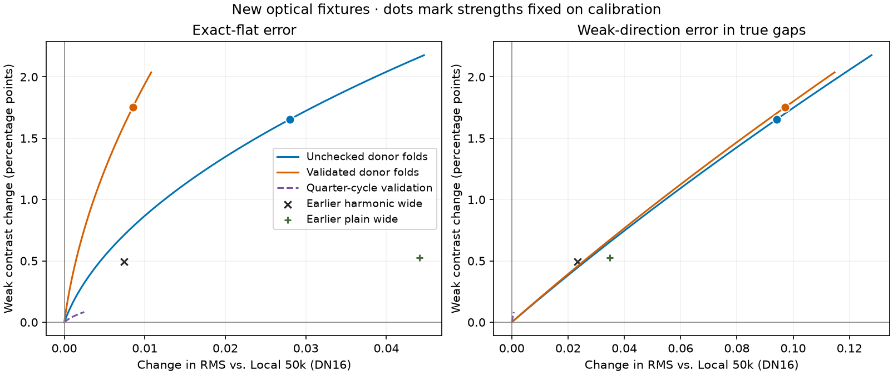
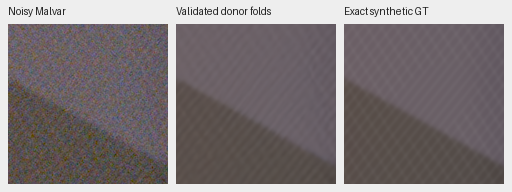
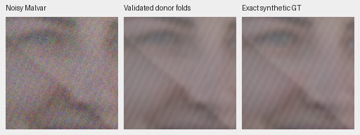

# Validating wide weak-wire nominations on reserved Bayer blocks

Validating wide Bayer proposals on reserved samples recovers **1.752 weak
contrast points** on 32 fresh wire fixtures and lowers intact paired
error by **0.409 DN16 RMS**. At equal response it lowers exact-flat error
by **0.029 DN16** versus unchecked proposals. The calibrated correction
adds **0.097 DN16** in the absent weak direction inside true gaps, above
the +0.050 calibration limit. The standing sky is pixel-identical to
Local 50k and the fine cab crossings remain incomplete.

## Method and controls

The [wider frequency search](detail-wide-phase.md) recovered weak-wire
contrast from neighboring Bayer samples but also admitted more candidates
on exact-flat regions. This follow-up asks whether a second, independent
exterior measurement can reject unsupported frequencies before the local
check and delivery.

Each 256×256 query retains the previous four recipient quadrants. For
each quadrant, the other three provide exterior samples. A fixed random
partition assigns half of the Bayer blocks in each native 8×8 cell to
each of two complementary folds. A fold proposes the two frequencies
using the earlier harmonic-aware search. A separate per-green regression
on that fold fits the phase of the weaker frequency with the dominant
frequency and its first three harmonics as nuisance terms.

The complementary fold tests the signed amplitude along that fixed phase
on its two green lattices. Both must exceed 1.15 noise standard deviations.
The variance of the signed coefficient includes the linear effect of
masked Gaussian background subtraction. Positive evidence above the
cutoff scales the amplitude deficit before the existing cap. Exchanging
folds produces a second independently checked proposal. Output averages
the two corrections. The prior 64-pixel local ring still fits the delivery
phase. The separate 32-pixel center witness still checks both local
greens before delivery.

The unchecked-fold control uses the same proposed frequencies and the
same center witness. A quarter-cycle check rotates only the phase used
for exterior validation. The no-center arm retains the exterior
validation and drops the separate center witness. In a noisy known-wire
test, replacing all samples outside the nominating fold leaves its
frequencies and votes bit-identical. Held samples support the selected phase
when either fold proposes it. The quarter-cycle check
rejects all four tested quadrants in each direction.

The correction sits above frozen Local 50k IEEE FP32 EMA, SHA256
`62f4e9ce84075c8df1a254a1889033b5787133e8c98c63e0ec3d174a94734959`.
The [earlier plain and harmonic-aware wide controls](detail-wide-phase.md)
use their original 0.64 and 0.20 strengths. The [machine publication](results/detail-crossfit-phase-v1/publication.json)
binds both implementations, checkpoints and configuration. The new
operator SHA256 is `406ed2d2bfb760552d64f85547d558c720a61f839e900265f768dc864440c1c8`.
V120 remains
the general model comparison.

## Calibration and exact-background controls

The existing 24 optical wire and 20 natural photos set a single strength
per arm under the same buffered flat, intact, weak-gap and
continuing-strand error limits. The locked strengths are **0.76**
for unchecked folds, **0.86** for validated folds and **0.02** for
validated folds without the center witness. The previous 56-photo
confirmation is a development replay. The new confirmation comprises
32 unused optical wire sources and 24 unused natural sources across two
texture regimes. There are 16 true weak gaps. The [source audit](results/detail-crossfit-phase-v1/summary.json)
checks three earlier confirmation panels, the component training and
calibration sources, the fixed 427 panel, the frozen Local 50k
manifest and 5,000 terminal observations, and 559,808 Corpus 100k
photographic visits.

An independent diagnostic generates 16 uniform, 16 smooth ramp and
16 edge-only fields with fresh shot and read noise. It uses the exact
clean field as the starting restoration to measure only added
correction energy. The phase decisions still use noisy Bayer samples.
The scores are mean linear luma RMS in DN16 over 128×128 native
centers at the calibration strengths.

| Exact underlay | Earlier harmonic wide | Unchecked folds | Validated folds |
| --- | ---: | ---: | ---: |
| Uniform | 0.170 | 0.634 | 0.00024 |
| Ramp | 0.260 | 0.760 | 0.00002 |
| Edge only | 0.262 | 1.023 | 0.225 |

The maximum edge-only addition from the validated variant is 1.631 DN16,
versus 0.470 for the earlier harmonic variant. The local and exterior
measurements can agree on residual edge structure. This diagnostic
uses a simulated sensor and an exact underlay. The natural crop errors
below use the actual Local 50k restoration.

## Fresh confirmation

All changes are relative to nominal Local 50k. Contrast is in percentage
points and errors in linear DN16 RMS.

| Correction | Weak contrast | Intact paired error | Continuing strand | Weak gap residue | Exact-flat error |
| --- | ---: | ---: | ---: | ---: | ---: |
| Earlier plain wide, 0.64 | +0.527 | −0.120 | −0.765 | +0.035 | +0.044 |
| Earlier harmonic wide, 0.20 | +0.493 | −0.121 | −0.079 | +0.023 | +0.007 |
| Unchecked folds, 0.76 | +1.655 | −0.383 | −0.304 | +0.094 | +0.028 |
| Validated folds, 0.86 | **+1.752** | **−0.409** | −0.344 | +0.097 | +0.009 |
| Quarter-cycle validation, 0.86 | +0.071 | −0.016 | −0.093 | +0.001 | +0.002 |
| Validated without center witness, 0.02 | +0.254 | −0.059 | −0.027 | +0.022 | +0.001 |
| Validated folds, full | +2.038 | −0.467 | −0.399 | +0.115 | +0.011 |
| Validated without center witness, full | +12.679 | −1.900 | −1.318 | +4.207 | +0.950 |
| V120 EMA | −0.492 | −0.653 | +2.353 | −0.246 | +1.999 |

The locked validated gain has a source-bootstrap 95% interval of
[+1.170, +2.379] points. Intact error changes by [−0.625, −0.239] DN16
and continuing-strand error by [−0.975, +0.001] DN16. Weak-gap residue
rises [+0.015, +0.199] DN16. Its +0.097 mean exceeds the +0.050 budget used
to calibrate strength. The bound on calibration was +0.0494 DN16.
On the development replay, validated and unchecked gain +1.185 and
+1.094 points. On new natural faint crops the locked validated variant
gains +0.001 points with +0.0003 DN16 paired error and +0.0014 DN16 flat
error. Stronger natural texture has near-zero contrast change with
−0.0017 DN16 paired error and +0.0028 DN16 flat error.

At retrospectively matched +2.038-point response, the held validation
lowers exact-flat error by **0.029 DN16** [−0.041, −0.018] versus
the unchecked folds. Weak-gap error changes by −0.004 DN16 and intact
paired error by −0.006 DN16, with intervals spanning zero. At the earlier
harmonic method's +0.493-point response, the validated folds lower exact
flat error by 0.006 DN16, with similar paired error and weak-gap residue.
At the locked strength, rotating the validation phase costs 1.681
contrast points [1.113, 2.295]. Removing the center witness raises
gap residue sharply at full strength even with validated exterior phase.

Among 512 stations in the locally flat wire controls, 91 pass the
center witness in at least one fold, and 28 pass both the center and
exterior witnesses. The controls have textured surroundings. Of 317
intact stations, 148 pass the center check and 146 pass both. At 83 of
those stations, the admitted frequency matches the planted weaker
fundamental within 0.02344 cycles per pixel. Thirty-four of 110 stations
overlapping exact gaps by a quarter or more pass both checks. These
are overlapping station counts. The error intervals above use
independent sources.

## Native synthetic crops

The 160×160 triplets show noisy Malvar, validated folds at the 0.86 lock
above the identified Local 50k EMA, and exact synthetic ground truth.
All use query ROI `[48,48,160,160]`, shot/read `0.00128 / 6.5536e-6`,
capture exposure 0.33, and identical transforms within a triplet.
The wire fixtures use 0.85-pixel optical blur and query offset 128.
The source boxes refer to 4× binned photos. The manifest binds the
operator, checkpoint, noise seeds and display values.

`held-005` uses Berthold Werner's *Spain Andalusia Malaga BW 2015-10-24
15-02-57*, source box `[34,116,512,512]`, display ×2. The faint pattern
above the edge is more discernible in the validated output. The target
still shows a more distinct crossing lattice. The flat control remains
smooth in the display. [Donor](https://commons.wikimedia.org/wiki/File:Spain_Andalusia_Malaga_BW_2015-10-24_15-02-57.jpg) ·
[CC BY-SA 3.0](https://creativecommons.org/licenses/by-sa/3.0/) ·
[Methods](assets/detail-crossfit-phase-v1/held-005-present.png) ·
[Flat](assets/detail-crossfit-phase-v1/held-005-flat.png).

`held-014` uses Steffen Prößdorf's *Eberspächer Luge World Cup Oberhof*,
source box `[122,12,512,512]`, display ×2. The opposite slope is still
weaker than in the exact target around the eye and cheek. This fixture
has the largest paired-error increase at the validated lock.
[Donor](https://commons.wikimedia.org/wiki/File:2022-01-14_Ebersp%C3%A4cher_Luge_World_Cup_Oberhof_1DX_0452_by_Stepro-2.jpg) ·
[CC BY-SA 4.0](https://creativecommons.org/licenses/by-sa/4.0/) ·
[Methods](assets/detail-crossfit-phase-v1/held-014-present.png) ·
[Flat](assets/detail-crossfit-phase-v1/held-014-flat.png).

The faint natural `held-044` uses kallerna's *Sea caves Cape Greco 8*,
source box `[714,456,256,256]`, query offset 0, display ×3.0303. The
restoration retains the darker water and rock edge, with fine white
water still softer than in the target. The flat center stays smooth.
[Donor](https://commons.wikimedia.org/wiki/File:Sea_caves_Cape_Greco_8.jpg) ·
[CC BY-SA 4.0](https://creativecommons.org/licenses/by-sa/4.0/) ·
[Triplet](assets/detail-crossfit-phase-v1/held-044-triplet.png) ·
[Flat](assets/detail-crossfit-phase-v1/held-044-flat.png).

## Standing GFX100S comparisons

The wide methods read the same station-aligned 256×256 slices used in
the earlier wide review. Parent restorations and display pixels come
from the cached native inputs. The manifest gives the slice and display
coordinates for every board.

The DSCF3879 ISO6400 160×160 display origins are sky `[5800,1400]`,
building `[5790,2690]`, foliage `[8890,5570]` and coarse fence
`[2240,6000]`. They use ×4 display, shot/read `0.00128 / 6.5536e-6`
and the independently demosaiced ISO100 DSCF3880 reference. The validated
sky is identical to Local 50k at both strengths. At the lock, building,
foliage and coarse fence change by 1.106, 1.565 and 4.770 DN16 linear
RGB RMS. The coarse crossings stay connected. Leaf and fine-building
changes are subtle.

The DSCF3842 ISO6400 cab uses left `[806,6489]` and right `[1026,6449]`
native 160×160 ROIs. Nominal shot/read is
`0.0014635775921166604 / 1.0715704128646712e-6`. The transferred profile
uses DSCF3879 parameters. DSCF3835 ISO100 AHD and both camera JPEGs
serve as qualitative references. Aperture, timing and moving subjects
differ across captures. At the validated lock the left/right changes
are 0.784/2.613 DN16 RGB RMS in the nominal profile and 0.496/1.497 in
the transferred profile. The brighter display shows slight changes
to existing right diagonals, with incomplete fine crossings and
similar mottling and false color. The nominal left still largely loses
the lattice.

An additional real-RAW diagnostic uses the earlier [measured exterior
frequency pairs](bayer-carrier-scale.md). On the nominal right, the ordinary
search nominates and validates those directions in 8 and 4 of 25 stations
in the native display area. Supplying each earlier peak as a frequency
hypothesis raises those counts to 22 and 20 with the same phase and
local support checks. On the transferred left, the corresponding counts
rise from 0 and 6 to 15 and 9. These admissions use the original ISO6400 mosaic and the earlier measured
frequency pairs.
Candidate selection still limits the actual cab output.

| Capture and display | Locked comparison |
| --- | --- |
| DSCF3879 ×4 | [Sky](assets/detail-crossfit-phase-v1/main-overcast-sky-main-overcast-sky-x4.png) · [Building](assets/detail-crossfit-phase-v1/main-building-detail-main-building-detail-x4.png) · [Foliage](assets/detail-crossfit-phase-v1/main-foliage-main-foliage-x4.png) · [Coarse fence](assets/detail-crossfit-phase-v1/main-chain-link-fence-main-chain-link-fence-x4.png) |
| DSCF3842 nominal | [Left ×4](assets/detail-crossfit-phase-v1/mesh-nominal-fine-green-mesh-left-x4.png) · [Right ×4](assets/detail-crossfit-phase-v1/mesh-nominal-fine-green-mesh-right-x4.png) · [Left ×16](assets/detail-crossfit-phase-v1/mesh-nominal-fine-green-mesh-left-x16.png) · [Right ×16](assets/detail-crossfit-phase-v1/mesh-nominal-fine-green-mesh-right-x16.png) |
| DSCF3842 transferred | [Left ×4](assets/detail-crossfit-phase-v1/mesh-profile3879-fine-green-mesh-left-x4.png) · [Right ×4](assets/detail-crossfit-phase-v1/mesh-profile3879-fine-green-mesh-right-x4.png) · [Left ×16](assets/detail-crossfit-phase-v1/mesh-profile3879-fine-green-mesh-left-x16.png) · [Right ×16](assets/detail-crossfit-phase-v1/mesh-profile3879-fine-green-mesh-right-x16.png) |

Full-strength examples include [sky](assets/detail-crossfit-phase-v1/full/main-overcast-sky-main-overcast-sky-x4.png),
[coarse fence](assets/detail-crossfit-phase-v1/full/main-chain-link-fence-main-chain-link-fence-x4.png)
and [transferred right cab](assets/detail-crossfit-phase-v1/full/mesh-profile3879-fine-green-mesh-right-x16.png).
The [manifest](assets/detail-crossfit-phase-v1/manifest.json) indexes
all twelve standing boards at each strength.

## Evaluation status

Numerical confirmation and native inspection are complete for the
analytical crop component. It uses the frozen parent. The 427-photo
and known/unseen measured-camera benchmarks and whole-frame runtime
are outside this study. The weak-gap limit and real fine mesh remain
unresolved. V120 remains the general recommendation.

[Machine summary](results/detail-crossfit-phase-v1/summary.json) ·
[Publication hashes](results/detail-crossfit-phase-v1/publication.json) ·
[Frozen implementation and receipts](results/detail-crossfit-phase-v1/evidence.tar.xz).
