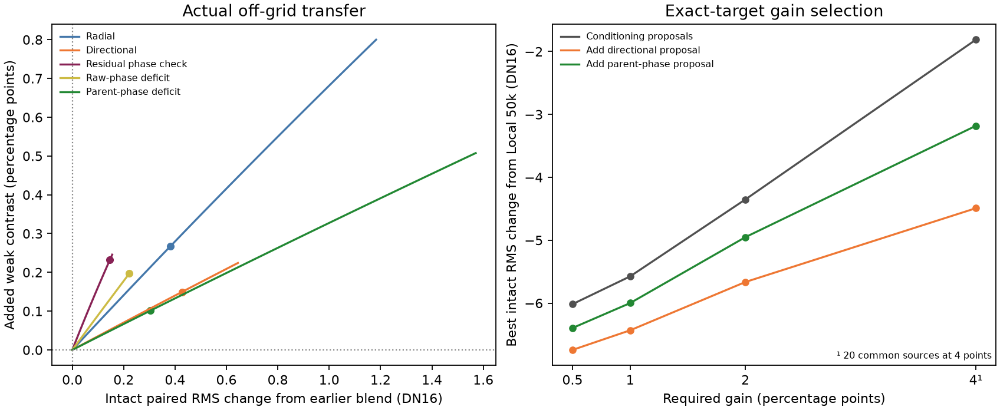
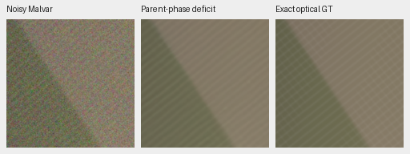
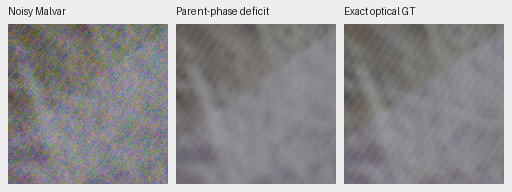

# Measuring the headroom in weak-wire proposals

The existing conditioning proposals can add at most **4.38
percentage points** of weak response on 32 off-grid wire
fixtures, even with exact targets selecting the gains. A
directional proposal from the Bayer residual raises that
ceiling by **4.60 points**. At a required gain of two points,
the expanded proposal set also lowers the best intact paired
error by **1.31 DN16** relative to the existing proposals.

The prototype uses little of that headroom at its locked strength.
The parent-phase deficit adds **0.102 wire response points**
over the earlier Bayer blend, with **0.305 DN16 more intact
paired error**. It adds **0.081 points** on faint natural
texture and **0.005 DN16** of exact-flat fine RMS. The real
fine cab crossings remain incomplete.

## Measure the proposal space with exact targets

The [Bayer blend](detail-regime-router.md) only routes the
two frozen Local 50k conditioning differences. To measure
that restriction, the oracle varies the nonnegative gains
of each proposal in each active 32-pixel station. The sharper
branch retains its two-green power cap. The present and
weak-absent roles can choose separate gains. The objective
uses the same intact-wire pixels, exact weak direction and
nuisance projection as the ordinary wire scorer. The
maximum signed response follows directly from the linear
projection coefficients and gain bounds. This is an upper
bound for those proposals without gap, flat or paired-error
constraints or any restriction to observable inputs.

| Replay | Local 50k response | Existing proposal ceiling | Ceiling with directional residual |
| --- | ---: | ---: | ---: |
| 24 retained wires | 32.377% | 34.476% | 41.212% |
| 32 off-grid wires | 19.996% | 24.378% | 28.982% |

A second oracle sets a minimum response gain per photo and
minimizes intact paired squared error within the same box of
gains. It uses a convex quadratic objective and a supporting
hyperplane lower bound with a feasible multiplier for the
response constraint. The largest distance between the fitted
RMS and the lower bound is 0.000019 DN16.

On all 32 off-grid sources, requiring at least two additional
points lowers mean intact paired error by 4.352 DN16 with the
old proposals, 5.665 DN16 with the directional proposal and
4.952 DN16 with the parent-phase proposal. At four points the
old set is feasible on 20 photos, the directional set on all
32 and the parent-phase set on 27. On the 20 common photos
the reductions are 1.812, 4.491 and 3.182 DN16. These fits
use exact clean waveforms and cover intact error only. They
show headroom for a better decision rule over both the old
and the expanded proposal sets.

The left plot shows actual measured transfer at one
strength for each method. Dots mark the joint natural and
wire calibration. The curves extend to the wire-only
strength where it is higher. The right plot uses exact
targets and per-role gains. It uses the common feasible
photos at each response requirement.

## Build proposals from measured green phase

The analytic filter uses overlapping 64-pixel native windows
at 32-pixel stride. It fits and removes an affine plane on
each physical green lattice, applies a tapered FFT and aligns
the two spectra with their exact Bayer offsets. Noise scale
comes from the conditioned shot/read model. The decoder
overlap-adds only frequencies between 0.026 and 0.242 cycles
per native pixel, with tapered ends and a 32 DN16 local luma
RMS cap. A clipping mask suppresses delivery near clipped
sites. RGB delivery is neutral in working color.

The radial and directional filters use the same averaged
green residual against Local 50k. They pool observed
cross-green power by frequency alone or by frequency and
angle. The residual phase check also requires positive
cross-green residual power. The deficit follow-up instead
pools the observed-to-residual cross-product in each
direction and estimates a bounded fractional amplitude
deficit. It applies that estimated fraction either to the
measured raw phase or to the parent phase. The parent sees
both green lattices, so its residuals supply empirical
evidence with shared dependencies. A phase audit on all four
Bayer layouts gives correlation above 0.999998 for a known
noiseless sinusoid. Correctly restored and exactly constant
synthetic inputs return zero correction.

| Frozen path or operator | SHA256 |
| --- | --- |
| Local 50k EMA and conditioning proposals | `62f4e9ce84075c8df1a254a1889033b5787133e8c98c63e0ec3d174a94734959` |
| Earlier branchwise Bayer blend EMA | `148301287cb588bff3632b22e30bdb06e8612fb126a4f8e4990ecc2b72d9d5f0` |
| Radial, directional and residual-check operator | `66acdf17da13397f0ca9c184b1425680cbe03a1116e98c2cf5ea593abc92413f` |
| Deficit operator | `acda3e68ee0d4425658f3edb2bb0ad5dc4fcbd1d8eca68d1ae59b2252fb40b92` |
| V120 Small EMA | `a9d9b6b4f974e24a6b11e5e740aab32314233a7f53c056cf37c7d2aac1c589fb` |

The composed path adds the analytic luma proposal to the
previous branchwise Bayer blend at its locked 0.575 strength,
using the same two frozen EMA experts. The new proposals
use the nominal green restoration. The off-grid Local 50k
proposal forwards took 41.90 seconds in IEEE FP32 over 32
four-role fixtures, including output writes. This is replay
time for the three frozen forwards. The component adds
analytic computation and has no full-frame timing.
[Full earlier blend provenance](detail-regime-router.md).

## Lock by quiet and gap error

Calibration uses 32 earlier natural photos in two contrast
regimes and a 12-photo subset of retained wires. The
natural limits relative to Local 50k are +0.10 DN16 each
for paired increment and present-image fine RMS and +0.05
for exact-flat fine RMS. The wire limits are +0.10 DN16
exact-flat wire RMS and +0.05 each for weak-direction gap
and exterior-only error. Each analytic arm picks the best
wire response that passes all these limits on calibration.
The locks are 0.04 radial, 0.04 directional, 0.34 residual
phase check, 0.06 raw-phase deficit and 0.14 parent phase.

The measured replays use the other 12 retained wires, the 32
off-grid wires from an earlier experiment and 48 separate
natural photos from the previous blend confirmation. Input
photos and cached pixels are disjoint across these
calibration and evaluation sets. The 32-photo wire set was
originally audited across 559,808 Corpus 100k photographic
visits. The current audit checks its separation from the
Local 50k training manifest. The deficit follow-up uses
the same previously measured panels after observing the
first comparison. Its transfer results are a follow-up on
those panels.

| Off-grid method | Weak response | Intact paired RMS | Weak-gap RMS | Exterior-only weak RMS | Exact-flat RMS |
| --- | ---: | ---: | ---: | ---: | ---: |
| Local 50k EMA | 19.996% | 195.043 | 6.755 | 8.006 | 21.437 |
| V120 Small EMA | 18.229% | 195.200 | 6.655 | 7.332 | 24.154 |
| Earlier Bayer blend | 20.111% | 195.898 | 6.866 | 8.138 | 21.385 |
| Radial residual | 20.378% | 196.279 | 6.898 | 8.196 | 21.407 |
| Directional residual | 20.261% | 196.325 | 6.884 | 8.166 | 21.468 |
| Residual phase check | 20.343% | 196.044 | 6.876 | 8.162 | 21.534 |
| Raw-phase deficit | 20.308% | 196.120 | 6.875 | 8.159 | 21.501 |
| Parent-phase deficit | 20.213% | 196.203 | 6.873 | 8.153 | 21.398 |

RMS values are DN16. The two gap measures use the 16 exact
strip and ellipse gaps. Directional pooling loses 0.117
response points versus radial at the locked strengths, with a
paired interval of −0.138 to −0.097. The parent-phase deficit
has the smallest flat increase among the new corrections. It
gains 0.102 points over the previous blend (0.082 to 0.121)
and raises intact error on all 32 off-grid sources. The
previous blend already exceeds the gap allowance there.
Parent phase adds another 0.007 DN16 weak-gap RMS and 0.015
DN16 exterior-only weak RMS above that blend.

The parent-phase strength of 0.70 from wire-only calibration
adds 0.508 response points and 1.571 DN16 intact error on the
off-grid set. It exceeds the stronger-photo paired and present
limits on calibration. On the 12 retained wires at 0.14, the
parent-phase gain is 0.227 points over the earlier blend,
with +0.243 DN16 intact error and +0.014 DN16 exact-flat RMS.

On the 48 natural photos, parent phase adds 0.081 faint
response points over the earlier blend (0.061 to 0.101),
with +0.005 DN16 flat RMS and +0.012 DN16 paired RMS.
Its overall fine flat error is 0.111 DN16 below Local 50k.
It closes most of the response shortfall on the weakest
half, from −0.067 to −0.004 points versus Local 50k. Its
stronger-texture gain is 0.059 points above the earlier
blend with +0.005 DN16 flat RMS. These small changes
leave the method experimental.

## Native exact-target examples

Each triplet uses the same native 160×160 pixels at
`[48,48,160,160]` within the `[128,128,256,256]` query.
The noisy Malvar, locked composed parent-phase restoration
and exact rendered RGB target share the camera transform
and ×2 display exposure. Both use ISO6400 shot/read
`0.00128/6.5536e-6`, linear exposure 0.33 and black 0.03.
The wires are rendered over fourfold-binned Commons photos
with clean present, exterior-only, strong-only and flat
roles and independent per-role Bayer noise.

The strip fixture uses the 512×512 field at `[20,102]`
and GRBG. It has the smallest intact-error increase,
+0.057 DN16 over the prior blend. The stronger diagonal
is visible in both restorations and the weaker crossing
remains muted. Atanu Bose Photography, CC BY-SA 4.0.
[Source](https://commons.wikimedia.org/wiki/File:Caterpillar_of_Cethosia_cyane_(Drury,1773)_%E2%80%93_Leopard_Lacewing.jpg) ·
[License](https://creativecommons.org/licenses/by-sa/4.0/) ·
[Comparison](assets/detail-directional-proposal-v1/long-06-present.png) ·
[Strong-only](assets/detail-directional-proposal-v1/long-06-absent.png) ·
[Flat](assets/detail-directional-proposal-v1/long-06-flat.png).

The smooth-dip fixture uses the field at `[48,168]` and
RGGB. It has the largest intact-error increase, +0.747
DN16. Both restorations are visibly softer than the target.
Krzysztof Ziarnek, Kenraiz, CC BY-SA 4.0.
[Source](https://commons.wikimedia.org/wiki/File:Opuntia_polyacantha_var._trichophora_kz05.jpg) ·
[License](https://creativecommons.org/licenses/by-sa/4.0/) ·
[Comparison](assets/detail-directional-proposal-v1/long-20-present.png) ·
[Strong-only](assets/detail-directional-proposal-v1/long-20-absent.png) ·
[Flat](assets/detail-directional-proposal-v1/long-20-flat.png).

## Standing GFX100S comparisons

On DSCF3879/3880 the parent-phase correction changes the
sky, building, foliage and coarse fence by 0.014, 0.473,
0.533 and 0.483 DN16 linear RGB RMS above the earlier
Bayer blend. The sky looks smooth and the coarse crossings
stay connected. Edge, foliage and color differences are
subtle in the reviewed crops.

On DSCF3842/3835 the left/right parent-phase changes above
the blend are 0.119/0.137 DN16 nominal and 0.153/0.181 DN16
transferred. The transferred right mesh still has the
clearest diagonals. At both exposures, fine crossings remain
incomplete. Neither GFX family shows a conspicuous new
ripple in the reviewed regions.

Native origins for sky, building, foliage and coarse fence
are `[5800,1400]`, `[5790,2690]`, `[8890,5570]` and
`[2240,6000]`. Cab origins are `[806,6489]` and `[1026,6449]`.
Nominal shot/read is `0.00128/6.5536e-6`. The established
transferred profile is
`0.0014635775921166604/1.0715704128646712e-6`. The ISO100
AHD and cab JPEGs are qualitative references. Aperture,
exposure time and moving subjects differ between captures.

| RAW and conditioning | Native boards |
| --- | --- |
| DSCF3879 nominal ×4 | [Sky](assets/detail-directional-proposal-v1/main-overcast-sky-main-overcast-sky-x4.png) · [Building](assets/detail-directional-proposal-v1/main-building-detail-main-building-detail-x4.png) · [Foliage](assets/detail-directional-proposal-v1/main-foliage-main-foliage-x4.png) · [Coarse fence](assets/detail-directional-proposal-v1/main-chain-link-fence-main-chain-link-fence-x4.png) |
| DSCF3842 nominal | [Left ×4](assets/detail-directional-proposal-v1/mesh-nominal-fine-green-mesh-left-x4.png) · [Right ×4](assets/detail-directional-proposal-v1/mesh-nominal-fine-green-mesh-right-x4.png) · [Left ×16](assets/detail-directional-proposal-v1/mesh-nominal-fine-green-mesh-left-x16.png) · [Right ×16](assets/detail-directional-proposal-v1/mesh-nominal-fine-green-mesh-right-x16.png) |
| DSCF3842 transferred | [Left ×4](assets/detail-directional-proposal-v1/mesh-profile3879-fine-green-mesh-left-x4.png) · [Right ×4](assets/detail-directional-proposal-v1/mesh-profile3879-fine-green-mesh-right-x4.png) · [Left ×16](assets/detail-directional-proposal-v1/mesh-profile3879-fine-green-mesh-left-x16.png) · [Right ×16](assets/detail-directional-proposal-v1/mesh-profile3879-fine-green-mesh-right-x16.png) |

Numerical and native review are complete for this analytic crop
study. The fixed 427-photo and measured-camera history covers
evaluated full models.
[Performance history](performance-history.md) ·
[Score summary](results/detail-directional-proposal-v1/summary.json) ·
[Native provenance](assets/detail-directional-proposal-v1/manifest.json) ·
[Publication hashes](results/detail-directional-proposal-v1/publication.json) ·
[Frozen sources and receipts](results/detail-directional-proposal-v1/evidence.tar.xz).
