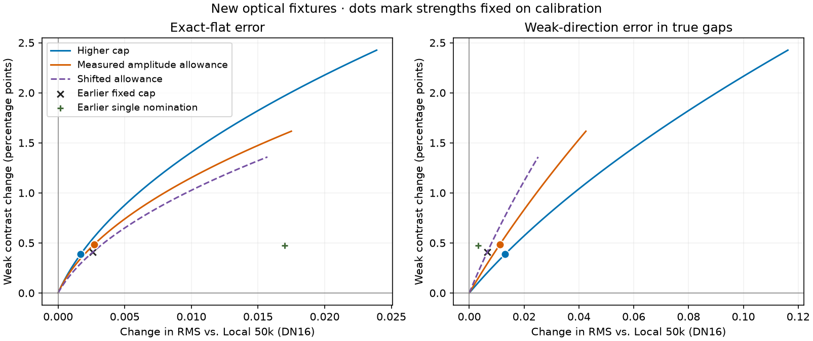
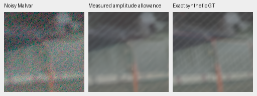
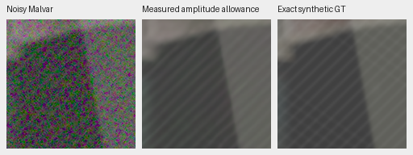

# Measuring how much weak-wire contrast to deliver

A larger correction supported by both local Bayer greens recovers **0.078**
additional weak contrast points over the fixed cap on fresh optical
fixtures. At equal response it lowers intact paired error by **0.381
DN16 RMS** versus a blanket cap increase. The nominal right cab’s
second direction has 20 usable candidates, and its local measurements
support zero additional amplitude. The fine crossings remain incomplete.

## Method

The [wide Bayer shortlist](detail-phase-shortlist.md) admitted the second
measured right-cab diagonal at 20 of 25 stations. The real fine crossings
remained incomplete. This follow-up keeps the candidate search, frequency
and phase witnesses, continuation check and delivery taper fixed. It
separates the amplitude cap from the evidence for a larger correction.

The fixed arm reproduces the previous 32 DN16 peak-luma cap. The higher-cap
arm changes it to 192 DN16 while retaining the existing controls and
shared candidate budget. The measured arm starts with the fixed
allocation. An extension requires a positive amplitude deficit on both
32-pixel center green lattices. For each lattice it uses the fitted
amplitude minus 0.75 noise standard deviations. The smaller of those
values and the 64-pixel exterior-ring amplitude limits the extended
correction. Delivery retains the existing confidence scales and
receiving-station continuation check. A shifted control moves the
fractional extra allowance by two stations on both axes. It uses the
same measured phases and applies the same total peak cap.

The implementation check reproduces the previous output to a maximum
error of `1e-16` on the deterministic intact and gap fixtures. At full
dose, the measured arm raises an intact control's delivered luma RMS
from 18.376 to 110.258 DN16. In the center of a planted gap it also
raises the small existing residual from 0.063 to 0.379 DN16. The wider
cap can therefore amplify real evidence and residual leakage. The
photographic calibration below sets the actual operating points.

## Checkpoints and coverage

The frozen parent is Local 50k IEEE FP32 EMA, SHA256
`62f4e9ce84075c8df1a254a1889033b5787133e8c98c63e0ec3d174a94734959`.
The previous guarded shortlist uses its original 0.30 strength and the
validated single nomination uses 0.86. The corrections are analytical.
V120 EMA is the general restoration comparator. The [publication](results/detail-phase-amplitude-v1/publication.json)
binds the current and earlier operators and checkpoints.

The 24 wire and 20 natural calibration subjects are retained. Each
new arm chooses one strength under the same buffered local error limits.
The independent panel contains 32 fresh wire sources, including 16
true gaps, and 24 fresh natural photos in two contrast regimes. A
previous 56-source panel is a development replay. The source audit
checks five earlier confirmation panels, the initial component
training and calibration, fixed 427-photo sources, the Local 50k
training manifest and 5,000 terminal visits, and 559,808 earlier
Corpus 100k photographic visits.

The fixed strengths are **0.16** for the higher cap and **0.30** for the
measured allowance. The [operator](results/detail-phase-amplitude-v1/publication.json)
has SHA256 `99063bb1d9946116f7d2d21823f2ef4e99bf183f99bfa000df129e513e22adc8`.

## Where the amplitude changes

The station audit counts any increase over the fixed cap larger than
0.05 DN16 in either fold, after the original center confidence and
before the spatial continuation check.

| Station group | Stations | Higher cap increases allocation | Local amplitude supports the increase |
| --- | ---: | ---: | ---: |
| Intact wire | 315 | 148 | 15 |
| True gap | 105 | 42 | 2 |
| Exterior-only weak gap | 105 | 40 | 2 |
| Strong strand only | 512 | 192 | 8 |
| Exact wire flat | 512 | 25 | 4 |

The expected weak frequency already receives a fixed allocation in 58
intact stations. Its amplitude rises at 44 with the higher cap and at 9
with the measured allowance. These counts diagnose candidate and amplitude
decisions. Inference measures phase and texture from the noisy Bayer
samples. The planted geometry is used here to classify the decisions.

The reuse of 16 uniform, 16 smooth ramp and 16 edge-only null controls
isolates false additions above an exact underlay. At the calibrated
strengths, mean added luma RMS on an isolated edge is 0.075 DN16 for the
fixed cap, 0.115 for the higher cap and 0.077 for measured allowance.
Worst additions are 0.473, 1.177 and 0.473 DN16, respectively. All
three are under 0.001 DN16 RMS on every uniform and ramp test. The
photographic panel instead uses the frozen model output as the underlay.

## Fresh source confirmation

Changes are relative to nominal Local 50k. Weak contrast is in percentage
points and errors in linear DN16 RMS.

| Method | Weak contrast | Intact paired error | Continuing strand | Weak gap residue | Exact-flat error |
| --- | ---: | ---: | ---: | ---: | ---: |
| Earlier validated single nomination, 0.86 | +0.474 | −0.001 | +0.003 | +0.003 | +0.017 |
| Fixed cap, 0.30 | +0.406 | −0.060 | 0.000 | +0.007 | +0.003 |
| Higher cap, 0.16 | +0.388 | −0.014 | −0.002 | +0.013 | +0.002 |
| Measured allowance, 0.30 | **+0.485** | **−0.081** | 0.000 | +0.011 | +0.003 |
| Shifted allowance, 0.30 | +0.408 | −0.060 | 0.000 | +0.007 | +0.003 |
| Higher cap, full | +2.426 | +0.471 | −0.014 | +0.116 | +0.024 |
| Measured allowance, full | +1.616 | −0.215 | −0.001 | +0.043 | +0.018 |
| V120 EMA | −0.664 | +0.734 | +3.515 | −0.048 | +2.208 |

At the shared 0.30 strength, the measured allowance's incremental gain
over the fixed cap is **0.078 points** [0.008, 0.177]. Intact error
changes −0.021 DN16 [−0.058, +0.001], weak-gap error changes +0.005
DN16 [0.000, +0.014], and flat error changes +0.0001 DN16. Aligning
the allowance instead of shifting it gains 0.077 points [0.008, 0.176].
On the previous panel, the fixed-control replay reproduces the earlier
scores within 0.00002 for every wire metric. The measured allowance
gains 0.596 points versus the fixed cap's 0.562 there.

At equal +1.616-point mean response, the measured allowance lowers intact
paired error by **0.381 DN16** [−0.575, −0.213] relative to the increased cap.
The weak-gap difference is −0.026 DN16 [−0.104, +0.033]. The flat error
is 0.005 DN16 higher [0.002, 0.008] at this matched response. The
fixed calibration strengths supply the prospective comparison.
On fresh natural crops, the measured allowance changes faint contrast
by +0.002 points, paired error by +0.003 DN16 and flat error by
+0.007 DN16. These are close to the fixed cap. The stronger texture
changes have similar scale.

## Native synthetic crops

Each native 160×160 triplet shows noisy Malvar, the measured allowance
at strength 0.30 above the identified Local 50k EMA, and exact synthetic
ground truth. All use `[48,48,160,160]` in the query, shot/read
`0.00128 / 6.5536e-6`, capture exposure 0.33 and identical rendering
within a triplet. The wire fixtures use blur σ 0.85 pixels and query
offset 128. The [native manifest](assets/detail-phase-amplitude-v1/manifest.json)
binds the native input, 4× binned source coordinates, conditioning and
display values.

`held-006` uses mattbuck's *Peterborough railway station MMB 21 91104*,
source box `[390,12,512,512]`, display ×2. The farther wires are muted
by the restoration, particularly across the lighter green area. This
fixture has the largest paired-error increase at the measured lock.
[Donor](https://commons.wikimedia.org/wiki/File:Peterborough_railway_station_MMB_21_91104.jpg) ·
[CC BY-SA 3.0](https://creativecommons.org/licenses/by-sa/3.0/) ·
[Methods](assets/detail-phase-amplitude-v1/held-006-present.png) ·
[Flat](assets/detail-phase-amplitude-v1/held-006-flat.png).

`held-008` uses mattbuck's *Burton-on-Trent railway station MMB 16*,
source box `[42,46,512,512]`, display ×2. The stronger diagonal stays
connected on the dark area. The fine opposing crossings remain weaker
than the target. This is the largest paired-error improvement at the
measured lock. [Donor](https://commons.wikimedia.org/wiki/File:Burton-on-Trent_railway_station_MMB_16.jpg) ·
[CC BY-SA 3.0](https://creativecommons.org/licenses/by-sa/3.0/) ·
[Methods](assets/detail-phase-amplitude-v1/held-008-present.png) ·
[Flat](assets/detail-phase-amplitude-v1/held-008-flat.png).

`held-052` uses Екатерина Борисова's *Елагин остров, служебные постройки*,
source box `[262,8,256,256]`, offset 0 and display ×3.0303. The open sky
stays smooth. Some faint foliage remains softer than the target.
[Donor](https://commons.wikimedia.org/wiki/File:%D0%95%D0%BB%D0%B0%D0%B3%D0%B8%D0%BD_%D0%BE%D1%81%D1%82%D1%80%D0%BE%D0%B2,_%D1%81%D0%BB%D1%83%D0%B6%D0%B5%D0%B1%D0%BD%D1%8B%D0%B5_%D0%BF%D0%BE%D1%81%D1%82%D1%80%D0%BE%D0%B9%D0%BA%D0%B8.jpg) ·
[CC BY-SA 4.0](https://creativecommons.org/licenses/by-sa/4.0/) ·
[Triplet](assets/detail-phase-amplitude-v1/held-052-triplet.png) ·
[Flat](assets/detail-phase-amplitude-v1/held-052-flat.png).

## Standing GFX100S comparisons

The amplitude arms and fixed control read the same station-aligned
256×256 slices as the shortlist. The frozen parent and display pixels
come from the larger cached inputs. The manifest records these coordinates.

DSCF3879 ISO6400 uses 160×160 ROIs at sky `[5800,1400]`, building
`[5790,2690]`, foliage `[8890,5570]` and coarse fence `[2240,6000]`.
Display is ×4 with shot/read `0.00128 / 6.5536e-6`. The independently
demosaiced DSCF3880 ISO100 serves as a qualitative reference.
Both arms exactly reproduce the Local 50k sky at the locked and full
strengths. The measured lock changes building, foliage and coarse fence
by 0.344, 0.891 and 1.840 DN16 RGB RMS, matching the fixed-cap figures.
The coarse fence crossings stay connected, and the higher cap at full
strength makes subtle changes to leaf edges and existing diagonal structure.

DSCF3842 ISO6400 uses native 160×160 origins left `[806,6489]` and right
`[1026,6449]`. Nominal shot/read is
`0.0014635775921166604 / 1.0715704128646712e-6`. The transferred profile
uses DSCF3879 parameters. DSCF3835 ISO100 AHD and both camera JPEGs are
qualitative references. Exposure, aperture, timing and rendering differ
among captures. At the measured lock, the nominal left/right changes
are 0.285/1.106 DN16 RGB RMS and the transferred changes are 0.217/0.784.
The full higher cap changes the nominal right by 4.972 DN16 RGB RMS.
The brighter views show minor changes to existing right diagonal
texture, while fine crossings remain incomplete and false color and
mottling look similar to nominal.

The [earlier measured RAW frequencies](bayer-carrier-scale.md) locate the
amplitude bottleneck. In the nominal right crop, the second diagonal
receives a fixed allocation at 20 of 25 stations. The higher cap expands
it at 10, and the measured rule expands it at zero. The first diagonal
has eight allocations, all expandable under the higher cap and one
supported by the measured rule. On the native nominal right output,
the second diagonal's fitted peak luma rises from **8.063 DN16** in
Local 50k to **9.149 DN16** at either the fixed or measured lock.
The higher-cap lock reaches 8.738 DN16, and its full diagnostic reaches
12.287 DN16. The fit uses both measured frequency pairs and a smooth
background on the same rendered pixels. It describes delivered amplitude.
The real optical reference is qualitative.

| Capture and display | Locked comparison |
| --- | --- |
| DSCF3879 ×4 | [Sky](assets/detail-phase-amplitude-v1/main-overcast-sky-main-overcast-sky-x4.png) · [Building](assets/detail-phase-amplitude-v1/main-building-detail-main-building-detail-x4.png) · [Foliage](assets/detail-phase-amplitude-v1/main-foliage-main-foliage-x4.png) · [Coarse fence](assets/detail-phase-amplitude-v1/main-chain-link-fence-main-chain-link-fence-x4.png) |
| DSCF3842 nominal | [Left ×4](assets/detail-phase-amplitude-v1/mesh-nominal-fine-green-mesh-left-x4.png) · [Right ×4](assets/detail-phase-amplitude-v1/mesh-nominal-fine-green-mesh-right-x4.png) · [Left ×16](assets/detail-phase-amplitude-v1/mesh-nominal-fine-green-mesh-left-x16.png) · [Right ×16](assets/detail-phase-amplitude-v1/mesh-nominal-fine-green-mesh-right-x16.png) |
| DSCF3842 transferred | [Left ×4](assets/detail-phase-amplitude-v1/mesh-profile3879-fine-green-mesh-left-x4.png) · [Right ×4](assets/detail-phase-amplitude-v1/mesh-profile3879-fine-green-mesh-right-x4.png) · [Left ×16](assets/detail-phase-amplitude-v1/mesh-profile3879-fine-green-mesh-left-x16.png) · [Right ×16](assets/detail-phase-amplitude-v1/mesh-profile3879-fine-green-mesh-right-x16.png) |

Full-strength examples include [coarse fence](assets/detail-phase-amplitude-v1/full/main-chain-link-fence-main-chain-link-fence-x4.png),
[nominal right cab](assets/detail-phase-amplitude-v1/full/mesh-nominal-fine-green-mesh-right-x16.png)
and [transferred right cab](assets/detail-phase-amplitude-v1/full/mesh-profile3879-fine-green-mesh-right-x16.png).
The manifest indexes all twelve standing boards at each strength.

## Evaluation status

The analytical comparison, independent photo scoring and both native
reviews are complete. The experiment uses frozen model weights at crop
scale. The fixed427 and known/unseen measured-camera panels and whole-frame
runtime are outside the evaluation. V120 remains the general recommendation.
The remaining problem is obtaining more reliable local amplitude evidence
on an already supported phase, especially in the fine real mesh.

[Machine summary](results/detail-phase-amplitude-v1/summary.json) ·
[Publication hashes](results/detail-phase-amplitude-v1/publication.json) ·
[Frozen implementation and receipts](results/detail-phase-amplitude-v1/evidence.tar.xz).
