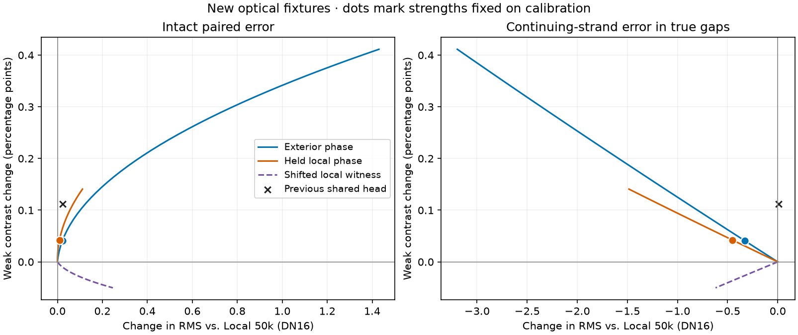
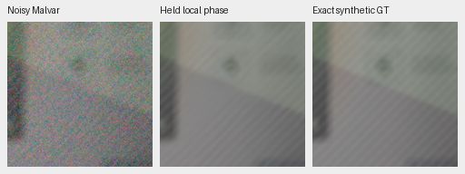
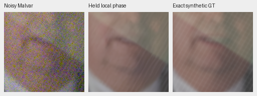

# Checking an exterior weak-wire phase on reserved Bayer samples

A local Bayer check reduced continuing-strand error by **0.452 DN16 RMS**
on 16 true gaps from a fresh set of optical wires. The locked correction
added **0.042 percentage points** of weak-wire contrast on all 32 fixtures.
Its 95% interval spans zero. The search nominated the planted weak frequency
in only **7 of 324 intact stations**. With both planted frequencies supplied,
the same operation recovered **0.636 points at full strength**, up from
0.141 with discovered frequencies. Nomination and local sensitivity both
limited recovery.

A [wider nomination follow-up](detail-wide-phase.md) raises weak-carrier
coverage and improves locked recovery on another 32 wire fixtures.
The same local check admits more exact-flat stations when the search
covers the wider context.

## Exterior proposal and local check

Each station uses a 64×64 native window at 32-pixel spacing. The outside of its
central 32×32 square fits a separate quadratic luminance background on each
green phase. A tapered cross-spectrum of the two residuals proposes a
dominant carrier from 0.040 to 0.210 cycles per pixel. After fitting and
subtracting that carrier, the search takes a second peak at least 0.032
cycles per pixel away. A joint regression estimates both quadratures and
common phase from the outside. The proposal adds only the positive
amplitude deficit for the second carrier relative to the nominal
restoration, capped at 32 DN16 peak neutral luma. The first carrier remains
in the regressions as a competing term. Window overlap tapers the delivered
field, and clipping reduces delivery.

The local variant checks the reserved central pixels. The frequency and
phase are already fixed. Both greens must independently have positive
amplitude along that phase after fitting the quadratic nuisance and the
first carrier. The smaller of the two signed signal-to-noise ratios sets
a soft gain after a 0.35 SD threshold. The shifted control moves only this
gain by two stations along each axis. All three variants deliver the same
exterior proposal shape. On a controlled two-carrier field, removing the
weak direction at the center leaves the nominated frequency, its phase,
and the amplitude proposal unchanged. The local witness falls to zero.

The nominal and learned controls use the same [frozen checkpoints](detail-shared-oracle.md#training-and-evaluation).
The nominal restoration is Local 50k IEEE FP32 EMA, SHA256
`62f4e9ce84075c8df1a254a1889033b5787133e8c98c63e0ec3d174a94734959`.
The analytical correction is composed above that output using the
[source-bound operator](results/detail-phase-routing-v1/publication.json),
SHA256 `3a4cadee2f44de8819b5adee2bb39b0cadae1e62ac5bc7a355af2e6ab2e0ffad`.
The previous shared and direct gains use their original 0.10 and 0.06 locks.
V120 EMA is the general recommendation and appears in the method comparisons.
This run fits strengths on 24 wire and 20 natural calibration captures under
the same buffered error budgets as the previous study. The locks are **0.10
exterior** and **0.30 held local**.

A fresh source-disjoint 56-photo panel has 32 wire fixtures and 24 natural
crops, split evenly into faint and stronger texture. Sixteen wire fixtures
have an exact weak-strand gap. All four roles of each fixture use independent
noise. The source audit checks both preceding component panels, the Local 50k
training manifest and last 5,000 visits, the fixed 427 sources, and 559,808
recorded photographic visits in the Corpus 100k lineage. The previous
32-wire and 24-natural confirmation is a separate development replay.

## Confirmation and frequency audit

Changes are relative to nominal Local 50k. Contrast changes are percentage
points and errors are linear DN16 RMS.

| Method | Weak contrast | Intact paired error | Continuing strand | Weak gap residue | Exact wire flat |
| --- | ---: | ---: | ---: | ---: | ---: |
| Exterior phase, 0.10 | +0.041 | +0.022 | −0.331 | +0.001 | +0.006 |
| Held local phase, 0.30 | +0.042 | +0.009 | −0.452 | +0.004 | +0.003 |
| Shifted local gains, 0.30 | −0.015 | +0.039 | −0.188 | −0.004 | +0.000 |
| Exterior phase, full | +0.411 | +1.430 | −3.197 | +0.039 | +0.280 |
| Held local phase, full | +0.141 | +0.111 | −1.484 | +0.017 | +0.011 |
| Previous shared head, 0.10 | +0.112 | +0.022 | +0.011 | −0.001 | −0.010 |
| Previous direct head, 0.06 | +0.093 | +0.084 | −0.068 | −0.002 | −0.008 |

The locked local change is [−0.005, +0.106] points for weak contrast and
[−0.756, −0.213] DN16 for continuing-strand error by source bootstrap.
Relative to shifting the witness map, aligning it increases weak contrast
0.057 points [0.014, 0.115] on the fresh panel. The reused development set
gains 0.010 points with nearly identical shifted response. In a retrospective
sweep at equal +0.141-point response, the local check lowers exact-flat error
by **0.031 DN16** versus exterior alone [−0.050, −0.015]. Intact and
continuing-strand errors also fall on average, with intervals spanning zero.
The locked local variant's natural faint response changes by +0.003 points
with +0.008 DN16 paired-increment and −0.002 DN16 flat error. Stronger
natural response changes by less than 0.001 points.

The station census finds 290 valid exterior candidates in 324 intact
stations. Only 7 of those match the planted weak fundamental within
0.02344 cycles per pixel, and the local check passes 5 of those 7.
It passes 137 intact stations overall, 43 of 102 stations whose center
overlaps an exact gap by at least one quarter, and 184 of 512 strong-only
stations. It passes a single station out of 512 exact-flat stations.
Stations within a photo share data and are counted here to diagnose the
operator. Source-level comparisons carry the uncertainty estimates.

Supplying both planted frequencies leaves phase, amplitude, and all support
checks driven by the noisy RAW. At full strength the exterior variant
gains 2.918 points and the held variant gains 0.636 points. Intact paired
error falls 0.489 and 0.116 DN16, respectively. The held and shifted versions
have nearly equal mean response when given the correct carrier. The
continuing-strand improvement from the discovered-frequency run almost
vanishes when the known weak frequency is supplied. Its earlier improvement
therefore reflects correction at other frequencies, plausibly including
structure from the continuing strand. Better exterior nomination could
recover more genuine weak detail, and a good nomination still leaves few
correct carriers with sufficiently strong local evidence.

## Native synthetic crops

Native 160×160 crops show noisy Malvar, held local phase at strength 0.30
above the identified Local 50k EMA, and exact synthetic ground truth. All
use query ROI `[48,48,160,160]`, shot/read `0.00128 / 6.5536e-6`, capture
exposure 0.33 and the same transform within each triplet. The planted wires
have optical blur σ 0.85 pixels and query offset 128. The native manifest
records the original 4× binned source box and the camera and noise data.

`held-015` uses Jacek Halicki's *2023 Endorfy Fluctus 120 PWM ARGB*, source
box `[276,166,512,512]`, display ×2. The strongest diagonal is clear below
the edge. The opposing wire remains much weaker than the target, even in the
fixture with the largest paired-error reduction at the held lock.
[Donor](https://commons.wikimedia.org/wiki/File:2023_Endorfy_Fluctus_120_PWM_ARGB_%281%29.jpg) ·
[CC BY-SA 4.0](https://creativecommons.org/licenses/by-sa/4.0/) ·
[Methods](assets/detail-phase-routing-v1/held-015-present.png) ·
[Flat](assets/detail-phase-routing-v1/held-015-flat.png).

`held-026` uses Martin Kraft's *Till Backhaus SPD*, source box
`[52,104,512,512]`, display ×2. This crop has the largest intact paired-error
increase at the held lock. The face contour and stronger lines survive,
while the weaker crossing fades well before it does in the target.
[Donor](https://commons.wikimedia.org/wiki/File:Till_Backhaus_SPD.jpg) ·
[CC BY-SA 3.0](https://creativecommons.org/licenses/by-sa/3.0/) ·
[Methods](assets/detail-phase-routing-v1/held-026-present.png) ·
[Flat](assets/detail-phase-routing-v1/held-026-flat.png).

The faint natural `held-044` crop uses Bernard Gagnon's *United Nations
Memorial Cemetery 04*, source box `[410,252,256,256]`, offset 0 and
display ×3.0303. The restored central grass remains softer than the target
in both variants. The flat replacement stays smooth.
[Donor](https://commons.wikimedia.org/wiki/File:United_Nations_Memorial_Cemetery_04.jpg) ·
[CC0](https://creativecommons.org/publicdomain/zero/1.0/) ·
[Triplet](assets/detail-phase-routing-v1/held-044-triplet.png) ·
[Flat](assets/detail-phase-routing-v1/held-044-flat.png).

## Standing GFX100S comparisons

The DSCF3879 ISO6400 query uses the independently demosaiced DSCF3880 ISO100
AHD reference. The 160×160 native origins are sky `[5800,1400]`, building
`[5790,2690]`, foliage `[8890,5570]` and coarse fence `[2240,6000]`.
All use ×4 display and shot/read `0.00128 / 6.5536e-6`. The local check
returns the nominal sky exactly, versus 1.965 DN16 RGB RMS from the full
exterior correction. At the lock it changes building, foliage and fence by
0.897, 1.326 and 1.163 DN16 RGB RMS. The coarse intersections stay connected
and the wires and leaf edges look very close to nominal. The ISO100
building has finer structures than either correction.

The DSCF3842 ISO6400 cab query uses left `[806,6489]` and right
`[1026,6449]` native 160×160 ROIs. The DSCF3835 ISO100 AHD rendering and
both straight-out-of-camera JPEGs are qualitative references because capture
conditions and rendering differ. Nominal shot/read is
`0.0014635775921166604 / 1.0715704128646712e-6`. The transferred profile uses
the main frame's noise values. The full held correction changes the left
and right cab by 0.041/1.202 DN16 RGB RMS under nominal conditioning and
0.769/2.184 under the transferred profile. The left remains nearly flat
between the pole and diagonal cables under nominal conditioning. The
transferred right retains soft diagonal sections but few linked crossings.
At ×16 the exterior-only correction changes existing texture and reveals
some waviness. Neither exposure shows clear new lattice continuity or a
distinct change in color artifacts.

| Capture and display | Locked comparison |
| --- | --- |
| DSCF3879 ×4 | [Sky](assets/detail-phase-routing-v1/main-overcast-sky-main-overcast-sky-x4.png) · [Building](assets/detail-phase-routing-v1/main-building-detail-main-building-detail-x4.png) · [Foliage](assets/detail-phase-routing-v1/main-foliage-main-foliage-x4.png) · [Coarse fence](assets/detail-phase-routing-v1/main-chain-link-fence-main-chain-link-fence-x4.png) |
| DSCF3842 nominal | [Left ×4](assets/detail-phase-routing-v1/mesh-nominal-fine-green-mesh-left-x4.png) · [Right ×4](assets/detail-phase-routing-v1/mesh-nominal-fine-green-mesh-right-x4.png) · [Left ×16](assets/detail-phase-routing-v1/mesh-nominal-fine-green-mesh-left-x16.png) · [Right ×16](assets/detail-phase-routing-v1/mesh-nominal-fine-green-mesh-right-x16.png) |
| DSCF3842 transferred | [Left ×4](assets/detail-phase-routing-v1/mesh-profile3879-fine-green-mesh-left-x4.png) · [Right ×4](assets/detail-phase-routing-v1/mesh-profile3879-fine-green-mesh-right-x4.png) · [Left ×16](assets/detail-phase-routing-v1/mesh-profile3879-fine-green-mesh-left-x16.png) · [Right ×16](assets/detail-phase-routing-v1/mesh-profile3879-fine-green-mesh-right-x16.png) |

The [full-strength sky](assets/detail-phase-routing-v1/full/main-overcast-sky-main-overcast-sky-x4.png),
[coarse fence](assets/detail-phase-routing-v1/full/main-chain-link-fence-main-chain-link-fence-x4.png),
and [transferred right cab](assets/detail-phase-routing-v1/full/mesh-profile3879-fine-green-mesh-right-x16.png)
are examples from the diagnostic set. The manifest records all twelve boards
at both strengths.

## Scope

The analytical crop comparison, exact frequency diagnostic and native
review are complete. The experiment trains no weights. The full427 and
known/unseen camera benchmarks are outside this scope. The general
recommendation remains V120.

[Machine summary](results/detail-phase-routing-v1/summary.json) ·
[Native manifest](assets/detail-phase-routing-v1/manifest.json) ·
[Publication hashes](results/detail-phase-routing-v1/publication.json) ·
[Frozen implementation and receipts](results/detail-phase-routing-v1/evidence.tar.xz).
