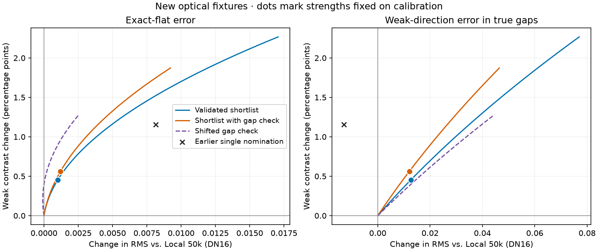
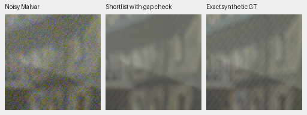
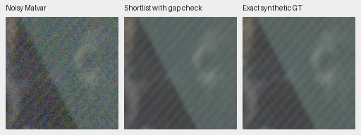

# Multiple wide Bayer hypotheses and a local continuation check

A three-candidate search raises verified coverage of the second measured
diagonal in the nominal right cab from **4 to 20 of 25 stations**. Fine
crossings remain incomplete in the native outputs. On 32 new optical
fixtures, the guarded shortlist recovers **0.562 weak contrast points**
with **+0.012 DN16** weak-gap residue. The earlier single-nomination
method gains 1.153 points and lowers weak-gap residue by 0.013 DN16
on the same fixtures.

An [amplitude follow-up](detail-phase-amplitude.md) preserves the same
search and gap check. It recovers slightly more weak detail on another
fresh panel. The local evidence for a larger second-direction correction
in the real nominal right cab remains insufficient.

## Method

The [reserved-fold phase experiment](detail-crossfit-phase.md) found that
supplying earlier measured cab frequencies increased the number of stations
passing its local and exterior checks. The automatic search nominated at
most one secondary carrier per quadrant. It also exceeded its weak-gap
error budget on fresh optical fixtures. This follow-up gives it more
frequencies to consider and measures whether the local signal supports
continuation into each receiving station.

The 256×256 query uses the earlier four recipient quadrants and complementary
Bayer folds. Each fold nominates a dominant frequency and deflates its first
four Fourier terms. It retains up to three secondary frequencies separated
by 0.016 cycles per pixel, with the earlier angle exclusion around the
dominant direction. A joint fit includes the dominant harmonics and all
three secondary carriers. The other fold checks each nominated phase
against its two greens. Both standardized signed coefficients must exceed
1.55 standard deviations. The wider search uses this stricter cutoff to
limit incidental acceptance across the additional hypotheses.

Each candidate retains the 64-pixel local fit and the 32-pixel center
witness. The unchecked shortlist combines eligible corrections under a
shared 32 DN16 peak neutral-luma cap at each station. The matching
continuation arm compares the local amplitude against absence and against a
75%-strength continuation of the exterior amplitude. The signed
likelihood difference downweights candidates that lack support at the
receiver. Overlapping stations with compatible frequency also contribute
to that downweighting. A matching receiver can limit leakage from an
adjacent station even when it would emit zero correction itself. A
shifted-witness intervention moves only the continuation estimates by
two stations in each direction. Both new arms average the complementary
donor folds.

The implementation check reconstructs a planted weaker direction after
replacing all reserved Bayer samples. On a separate planted gap, it reduces
added luma RMS from 0.273 to 0.063 DN16 at the center. The caps apply
before interpolation in both arms. This constructed case is an operator
check. The independent photographic comparison measures whether the
same effect transfers.

## Checkpoints, strength and source coverage

All corrections use the same frozen Local 50k IEEE FP32 EMA,
SHA256 `62f4e9ce84075c8df1a254a1889033b5787133e8c98c63e0ec3d174a94734959`.
The validated single-nomination comparator retains its 0.86 strength.
The projected phase operators are analytical and use frozen weights.
The complete paths and hashes are in the [publication manifest](results/detail-phase-shortlist-v1/publication.json).
V120 EMA is the general model comparator.

The 24 wire and 20 natural calibration sources are the same as in the
earlier studies. They set correction strength under the same buffered
limits. The new confirmation includes 32 wire backgrounds and 24
natural photos, evenly split into faint and stronger texture. Sixteen
wire fixtures have an exact weak-strand gap. The previous 56-source
confirmation supplies a development replay. The source audit checks
the four preceding confirmation panels, initial component training
and calibration, fixed 427 sources, the Local 50k training manifest
and tail, and 559,808 visits in the Corpus 100k training lineage.

The calibration strengths are **0.20 for the shortlist** and **0.30
for the shortlist with the continuation check**. The operator SHA256
is `24717ea7d69bb8ab0ed66061cffc0e0f365e90cdb86d23e413f26a5a2e3991df`.
The shortlist couples three changes from the earlier single nomination
in its frequency search, joint fit, and validation threshold. The two
shortlist arms isolate the continuation check.

## False detail on exact test fields

The earlier 48 synthetic null controls supply 16 uniforms, 16 smooth
ramps, and 16 isolated edges, with independent Bayer noise per field.
An exact clean underlay isolates the added correction. At the fixed
strengths, the continuation arm adds 0.00003 DN16 mean luma RMS on the
uniforms and zero on the ramps. On isolated edges it adds 0.075 DN16
on average and 0.473 DN16 at worst, versus 0.225 and 1.631 for the
single-nomination control. The unchecked shortlist's mean and worst
edge additions are 0.066 and 0.381 DN16 at its lower strength.

## Fresh source confirmation

Changes are relative to nominal Local 50k. Weak contrast is in percentage
points and errors in linear DN16 RMS.

| Method | Weak contrast | Intact paired error | Continuing strand | Weak gap residue | Exact-flat error |
| --- | ---: | ---: | ---: | ---: | ---: |
| Validated single nomination, 0.86 | +1.153 | −0.176 | −0.002 | −0.013 | +0.008 |
| Shortlist, 0.20 | +0.453 | −0.080 | −0.003 | +0.013 | +0.001 |
| Shortlist with continuation, 0.30 | **+0.562** | −0.102 | −0.003 | +0.012 | +0.001 |
| Shifted continuation, 0.30 | +0.381 | −0.068 | 0.000 | +0.012 | 0.000 |
| Shortlist, full | +2.267 | −0.336 | −0.013 | +0.077 | +0.017 |
| Shortlist with continuation, full | +1.873 | −0.296 | −0.009 | +0.046 | +0.009 |
| V120 EMA | −0.798 | +0.370 | +2.645 | +0.143 | +1.836 |

At the calibrated strength, the continuation arm's weak gain has a 95%
source-bootstrap interval of [+0.374, +0.768] points. Intact paired
error falls [−0.158, −0.050] DN16 and change in weak gap residue spans
[−0.027, +0.048] DN16. The mean remains below the +0.050 calibration
budget. On these same sources the earlier single nomination recovers
more weak contrast and has lower weak residue in gaps. On the reused
development panel, the continuation arm adds 0.719 contrast points
with 0.040 DN16 weak gap residue, versus 1.752 and 0.097 for the earlier
method. The more conservative operation therefore trades away some of
the prior recovery on both panels.

At retrospectively matched +1.873 points, the continuation check lowers
weak gap error by 0.015 DN16 [−0.054, +0.021] and raises exterior-only weak
residue by 0.018 DN16 [+0.006, +0.034] versus the same shortlist. Exact-flat
and intact error differences have intervals spanning zero. Aligning the
continuation evidence instead of shifting it adds 0.181 contrast points
[+0.108, +0.261] at the lock. Natural faint contrast moves +0.003 points
with +0.006 DN16 paired error and +0.002 DN16 flat error. Changes in the
stronger-texture set are smaller.

The shortlist finds an eligible weak frequency at 91 of 312 intact
stations within 0.02344 cycles per pixel of the planted fundamental.
Its own first-ranked candidate covers 66 of those stations. Ninety
retain a continuation value above 0.25. On 110 partially overlapping
true-gap stations, a weak candidate passes both the center and outer
checks at 15 stations and all 15 retain continuation above 0.25.
The guard mainly scales delivery in these cases. These are overlapping
station diagnostics. The uncertainty intervals above resample photos.

## Native synthetic crops

The native 160×160 triplets show noisy Malvar, the shortlist with
continuation at strength 0.30 above frozen Local 50k EMA, and exact
synthetic ground truth. The query ROI is `[48,48,160,160]`. All use
shot/read `0.00128 / 6.5536e-6`, capture exposure 0.33 and the same render
transform within each triplet. Wire optics use blur σ 0.85 and query offset
128. The [native manifest](assets/detail-phase-shortlist-v1/manifest.json)
binds the exact source crops, model, phase, noise and display settings.

`held-002` uses Tomasz Górny's *Rybna pałac DSC 6709*, 4× binned box
`[190,56,512,512]`, display ×2. The weaker direction stays faint near the
roof and windows. This is the largest intact paired error increase at the
guarded lock. [Donor](https://commons.wikimedia.org/wiki/File:Rybna_pa%C5%82ac_DSC_6709.jpg) ·
[CC BY-SA 3.0](https://creativecommons.org/licenses/by-sa/3.0/) ·
[Methods](assets/detail-phase-shortlist-v1/held-002-present.png) ·
[Flat](assets/detail-phase-shortlist-v1/held-002-flat.png).

`held-024` uses Neoclassicism Enthusiast's *Grave of the George Assan
and Petre Petrini Family in the Bellu Cemetery*, 4× binned box
`[116,26,512,512]`, display ×2. The continuing diagonal stays distinct
across the dark edge. Weak opposite crossings visible in the target
are difficult to see in either restoration. This is the largest paired
error improvement at the guarded lock.
[Donor](https://commons.wikimedia.org/wiki/File:Grave_of_the_George_Assan_and_Petre_Petrini_Family_in_the_Bellu_Cemetery_in_Bucharest,_Romania_%2811%29.jpg) ·
[CC0](https://creativecommons.org/publicdomain/zero/1.0/) ·
[Methods](assets/detail-phase-shortlist-v1/held-024-present.png) ·
[Flat](assets/detail-phase-shortlist-v1/held-024-flat.png).

`held-034` uses ermell's *Bamberg-6128401*, box `[94,428,256,256]`,
query offset 0 and display ×3.0303. The flat center stays smooth and
the present crop retains window edges. The faint wall texture is still
softer than the exact target. [Donor](https://commons.wikimedia.org/wiki/File:Bamberg-6128401.jpg) ·
[CC BY-SA 3.0](https://creativecommons.org/licenses/by-sa/3.0/) ·
[Triplet](assets/detail-phase-shortlist-v1/held-034-triplet.png) ·
[Flat](assets/detail-phase-shortlist-v1/held-034-flat.png).

## Standing GFX100S comparisons

The new and previous phase operators read the same 256×256 slices aligned
to the 32-pixel station lattice. The frozen parent and display inputs use
the earlier cached RAWs. The manifest records each native slice.

DSCF3879 ISO6400 uses native 160×160 origins sky `[5800,1400]`,
building `[5790,2690]`, foliage `[8890,5570]` and coarse fence
`[2240,6000]`. The display is ×4 with shot/read `0.00128 / 6.5536e-6`.
DSCF3880 ISO100 AHD is an independent qualitative rendering. Both
shortlists reproduce the parent sky exactly at the lock and full dose.
At the guarded lock, building, foliage and coarse fence change by
0.344, 0.891 and 1.840 DN16 linear RGB RMS. The coarse lattice stays
connected, and building and foliage look close to the prior renderings.

DSCF3842 ISO6400 uses left `[806,6489]` and right `[1026,6449]` native
origins, with nominal shot/read `0.0014635775921166604 / 1.0715704128646712e-6`
and the transferred DSCF3879 profile. The references are both camera JPEGs
and DSCF3835 ISO100 AHD. Aperture, timing and rendering differ across
captures. At the guarded lock, left/right changes are 0.285/1.097
DN16 RGB RMS nominal and 0.217/0.784 transferred. At full strength,
nominal changes reach 0.950/3.655 DN16. Subtle changes to right diagonal
texture are visible at ×16. Fine crossings remain incomplete and
mottling and false color look similar to Local 50k.

The earlier measured second diagonal passes the independent exterior
and center checks at **20 of 25 stations** with a positive deficit and
a continuation score above 0.25. The single search admits it at 4.
The first diagonal remains at 8. With transferred conditioning the
second direction rises from 4 to 21, while first-direction coverage moves from 8 to 7. On the left, the second direction
rises from 6 to 9 with either profile. These are [earlier measured
RAW frequencies](bayer-carrier-scale.md), identified within 0.009
cycles per native pixel. The counts measure eligibility. The rendered
right crops still lack convincingly rebuilt crossings.

| Capture and display | Locked comparison |
| --- | --- |
| DSCF3879 ×4 | [Sky](assets/detail-phase-shortlist-v1/main-overcast-sky-main-overcast-sky-x4.png) · [Building](assets/detail-phase-shortlist-v1/main-building-detail-main-building-detail-x4.png) · [Foliage](assets/detail-phase-shortlist-v1/main-foliage-main-foliage-x4.png) · [Coarse fence](assets/detail-phase-shortlist-v1/main-chain-link-fence-main-chain-link-fence-x4.png) |
| DSCF3842 nominal | [Left ×4](assets/detail-phase-shortlist-v1/mesh-nominal-fine-green-mesh-left-x4.png) · [Right ×4](assets/detail-phase-shortlist-v1/mesh-nominal-fine-green-mesh-right-x4.png) · [Left ×16](assets/detail-phase-shortlist-v1/mesh-nominal-fine-green-mesh-left-x16.png) · [Right ×16](assets/detail-phase-shortlist-v1/mesh-nominal-fine-green-mesh-right-x16.png) |
| DSCF3842 transferred | [Left ×4](assets/detail-phase-shortlist-v1/mesh-profile3879-fine-green-mesh-left-x4.png) · [Right ×4](assets/detail-phase-shortlist-v1/mesh-profile3879-fine-green-mesh-right-x4.png) · [Left ×16](assets/detail-phase-shortlist-v1/mesh-profile3879-fine-green-mesh-left-x16.png) · [Right ×16](assets/detail-phase-shortlist-v1/mesh-profile3879-fine-green-mesh-right-x16.png) |

Full-strength examples include [coarse fence](assets/detail-phase-shortlist-v1/full/main-chain-link-fence-main-chain-link-fence-x4.png),
[nominal right cab](assets/detail-phase-shortlist-v1/full/mesh-nominal-fine-green-mesh-right-x16.png)
and [transferred right cab](assets/detail-phase-shortlist-v1/full/mesh-profile3879-fine-green-mesh-right-x16.png).
The manifest indexes all twelve boards at each strength.

## Evaluation status

Calibration, numerical confirmation and native quality review are complete
for this analytical crop experiment. It uses frozen weights. Whole-frame
runtime, fixed427 and known/unseen measured-camera benchmarks are outside
the study. V120 remains the general recommendation. The broader search
improves measured cab candidate coverage, while the earlier single
nomination recovers more contrast at its calibrated operating point.
The remaining question is whether additional independently validated
candidates can improve local amplitude delivery where the single
nomination leaves an observable deficit.

[Machine summary](results/detail-phase-shortlist-v1/summary.json) ·
[Publication hashes](results/detail-phase-shortlist-v1/publication.json) ·
[Frozen implementation and receipts](results/detail-phase-shortlist-v1/evidence.tar.xz).
