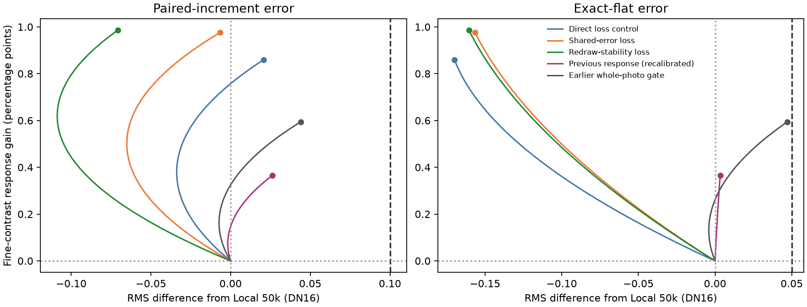
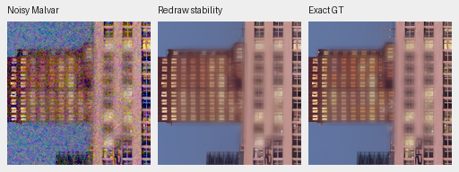
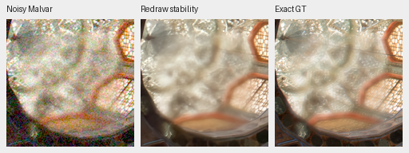

# Training a weak-detail gate across independent noise draws

The redraw-stability head recovers **0.986 percentage points**
more fine contrast than Local 50k on 48 new ISO6400 photos.
Exact-flat fine RMS falls **0.161 DN16**, and paired increment
RMS falls **0.071 DN16** with an interval spanning zero. All
three new heads stay within the calibration error limits on
this holdout. The original loss achieves much of the improvement
when trained on the same faint replay. At its matched response,
the redraw-stability loss further reduces paired error.

The faintest half gains less contrast with the redraw-stability
head than with the direct-loss control. The stability head
reduces weak-direction residue in planted gaps and also loses
intact wire contrast. Fine real cab crossings remain incomplete.

## Separate reproducible error from draw-sensitive error

The previous signed-response head improved faint contrast and
crossed its paired error limit on transfer. Its fine-increment
loss penalizes coherent off-target structure and draw-sensitive
error together. This experiment applies extra pressure to each
part in a matched training arm.

For each crop, draw the same present, attenuated and exact-flat
scenes twice. Noise is independent across both draws and all
three roles. For each draw, compute the delivered present-minus-
attenuated fine-band error. Project out the exact weak target
direction so the extra loss only acts on off-target error. The
shared-error arm penalizes the mean of those residuals across the
two draws. The redraw-stability arm penalizes half their
difference. The ordinary signed-response loss remains in all
three arms. The squared energies of the mean and half
difference sum to the mean squared error of the two draws.
The squared mean retains some noise with only two captures.

All arms start from the same signed-response EMA and reuse its
normalization. The proposals are the same Local 50k EMA
conditioning differences at 0.90× and 1.15× the nominal
variance. Inference uses the existing two-green support cap,
bounded camera-neutral proposal and 32-pixel interpolated gain
grid. Each arm predicts from one Bayer exposure at inference.
The extra training term uses a fixed weight of 1.5 on the
off-target squared-error change from the frozen parent.
Metrics use the existing 96×96 scored area and the DCT band
from 1/8 to 1/3 cycles per native pixel. The preflight checks
that the quadratic training objective matches direct delivery,
and that duplicate captures reduce to the earlier single-draw
scoring rule.

The training replay uses 512 additional freely licensed photos
with one 256×256 query each, two redraws and a 0.16–0.40 weak
contrast mix. Three physical noise profiles and per-photo
exposure variation cover the earlier training range. The
32-photo calibration and 48-photo holdout use 0.22 weak
contrast and ISO6400 conditioning. They share neither photos
nor cache identities with each other, the direct gate
training sets, the earlier gate evaluation sources, or the
fixed full427 panel. The audit checks the Local 50k manifest
and retained terminal observations and the complete Corpus
100k photo visit traces. V120 Small is evaluated on the same
mosaics. The earlier whole-image rule uses a shared held-out
exterior observation for both draws. The local heads and
V120 read only the individual query mosaic and conditioning.

Calibration picks the sharper and smoother strengths from
the same grid for all head arms and the earlier signed head.
It maximizes the signed fine response with +0.10 DN16 paired
increment, +0.10 DN16 present and +0.05 DN16 exact-flat RMS
limits relative to Local 50k. The prior signed head is also
shown at its earlier fixed strength. Held scoring averages
the two draws within each photo and resamples photos for
uncertainty.

Each arm completed 1,400 AdamW updates at batch 48, learning
rate 0.0005 and EMA decay 0.993. The frozen forward and
statistics collection took 594.26 seconds. The matched fit
took 16.20 seconds total across the three arms. Per arm there
are 3,072 distinct native role examples and 403,200 role
visits. The files retain raw, EMA and optimizer states.
Evaluation uses EMA, IEEE FP32 and the existing exact reuse
of the local DINO encoding across conditioning settings.
There is no new inference timing in this crop study.

| Composed path | File SHA256 | Locked sharper/smoother scales |
| --- | --- | --- |
| Local 50k EMA parent | `62f4e9ce84075c8df1a254a1889033b5787133e8c98c63e0ec3d174a94734959` | Nominal |
| Previous signed-response EMA and initialization | `3985cb043cf184248de0ff45e35c52a967514e2afb73a424ff7e02cec576eef4` | 0.65/0 on this calibration, 0.75/0 originally |
| Direct loss control | `7729ab9663097b4e56eff2bbc96d3d7dba778cc0517bf3d9115879723ded1212` | 0.45/1 |
| Shared-error loss | `4762192c647ef4db1fdde94332fefa154860bfe72aa52feef762d70e1f902502` | 0.70/0.75 |
| Redraw-stability loss | `9d4582e74ee4a97555309d030b4048a8f58d1030a09781ec354cc46ebc638576` | 0.95/0.75 |
| V120 Small EMA | `a9d9b6b4f974e24a6b11e5e740aab32314233a7f53c056cf37c7d2aac1c589fb` | Nominal |

The direct gate study trained on milder attenuation than this
replay. All three new locks use the smoother branch, whereas
the two settings of the previous head deliver only the sharper
branch. The calibration parent response is 61.937%. The direct,
shared-error and redraw-stability locks recover 62.649%,
62.707% and 62.667%. All three reduce flat RMS on calibration.

## Held faint photos

Fine response measures the restored increment projected onto
the exact present-minus-attenuated fine detail. Increment,
present and flat columns are fine-band luma RMS in DN16. The
last two columns decompose off-target increment error into the
mean and half-difference of the two captures.

| Method | Fine response | Increment | Present | Exact-flat | Off-target mean | Off-target redraw |
| --- | ---: | ---: | ---: | ---: | ---: | ---: |
| Local 50k EMA | 63.215% | 160.814 | 145.930 | 4.391 | 97.723 | 72.788 |
| V120 Small EMA | 63.031% | 162.137 | 148.125 | 5.496 | 99.003 | 73.106 |
| Earlier whole-photo gate | 63.809% | 160.858 | 145.841 | 4.438 | 98.413 | 74.249 |
| Previous signed response, original strength | 63.636% | 160.852 | 145.899 | 4.395 | 98.280 | 73.769 |
| Previous signed response, recalibrated | 63.580% | 160.840 | 145.897 | 4.395 | 98.200 | 73.634 |
| Direct loss control | 64.074% | 160.835 | 145.813 | **4.221** | 98.728 | 74.892 |
| Shared-error loss | 64.191% | 160.807 | 145.734 | 4.235 | 98.813 | 75.045 |
| Redraw-stability loss | **64.200%** | **160.743** | **145.684** | 4.231 | 98.839 | 74.921 |

The dots show the locked strengths, and the curves rescale each
blend retrospectively. Dashed lines mark the calibration error
limits. For redraw stability versus Local 50k, the paired
photo-bootstrap intervals are +0.566 to +1.393 response points,
−0.345 to +0.221 DN16 increment RMS and −0.234 to −0.102 DN16
flat RMS. Present error falls 0.246 DN16 (−0.414 to −0.080).
The target-aligned part of the increment error falls from
104.944 to 102.255 DN16. Both off-target components rise. The
worst per-photo increase is 2.121 DN16 on the paired increment
and 7.961 DN16 on the off-target redraw term.

At the direct-loss control's +0.859-point response, the
redraw-stability head lowers pair error by 0.113 DN16
(−0.230 to −0.010) and present error by 0.122 DN16 (−0.194
to −0.052). Flat error is 0.021 DN16 higher (0.005 to 0.037).
Off-target redraw RMS falls 0.265 DN16, with an interval from
−0.704 to +0.128. The shared-error head lowers present error by
0.076 DN16 at that response. Its paired and off-target differences
span zero. At the earlier whole-photo gate's +0.594-point
response, redraw stability lowers increment and flat errors
by 0.153 and 0.164 DN16. Those strength matches are retrospective
diagnostics. The locked arms and the original rule use calibration
strengths fixed before the held replay.

On the 24 photos with the weakest exact increments, the direct
control, shared-error and redraw-stability gains are 0.887,
0.495 and 0.376 points. For redraw stability the paired error
drops 0.174 DN16 in this half. On the stronger half its gain
is 1.041 points. The extra loss trades some of the weakest
response for lower pair error.

### Checks on stronger texture and thin wires

The earlier 48-photo, stronger-contrast crops test transfer to
a different signal range. Eight source IDs also occur in the
fixed 427-photo panel. With no strength changes, redraw
stability gains 0.106 points over the 98.737% Local 50k response,
lowers exact-flat RMS by 0.164 DN16 and raises increment RMS
by 0.529 DN16. The increment limit transfers on faint crops
and is exceeded on this stronger replay.

On 24 retained planted-wire fixtures, the direct control gains
0.194 weak-response points over Local 50k. Shared-error and
redraw stability lose 0.159 and 0.382 points. Redraw stability
lowers intact paired error by 1.131 DN16, weak-direction gap
RMS by 0.127 DN16, exterior-only weak RMS by 0.120 DN16 and
exact-flat fine RMS by 0.087 DN16. This is quieter wire
delivery with attenuated intact weak contrast.

## Native exact-target triplets

Every panel is 160×160 native pixels at `[48,48,160,160]`
in its transformed 256×256 query. Within each board the
noisy Malvar, locked redraw-stability EMA and exact synthetic
GT use the first draw's camera transform and the same 3.0303×
display exposure. Both queries use linear exposure 0.33 and
ISO6400 shot/read `0.00128/6.5536e-6`. The pair error changes
below combine both independent draws.

The Berlin query starts at `[184,514]` after D4 `[3,true]`,
with GBRG. The paired error rises 2.121 DN16, the largest
increase on the holdout. Small rooftop lines and some window
structure are still muted. Belappetit, CC BY-SA 3.0.
[Source](https://commons.wikimedia.org/wiki/File:Berlin_potsdamer_platz.jpg) ·
[License](https://creativecommons.org/licenses/by-sa/3.0/) ·
[All methods](assets/detail-redraw-gate-v1/held-007-present.png) ·
[Flat control](assets/detail-redraw-gate-v1/held-007-flat.png).

The ceiling query starts at `[38,362]` after D4 `[3,true]`,
with GRBG. The paired error falls 1.684 DN16, the largest
decrease. The bordering ornament stays soft and the central
changes are subtle. مانفی, CC BY-SA 4.0.
[Source](https://commons.wikimedia.org/wiki/File:Hasht_behesht_palace_1.JPG) ·
[License](https://creativecommons.org/licenses/by-sa/4.0/) ·
[All methods](assets/detail-redraw-gate-v1/held-030-present.png) ·
[Flat control](assets/detail-redraw-gate-v1/held-030-flat.png).

## Standing GFX100S comparisons

On DSCF3879/3880, the redraw-stability head changes the sky,
building, foliage and coarse fence by 0.260, 1.971, 7.493 and
8.827 DN16 linear RGB RMS above Local 50k. The sky still looks
smooth at the fixed display exposure. Building changes are
subtle. Some leaf edges and already resolved coarse strands
gain definition, with connected coarse crossings. The crops
show no conspicuous new color ripple or blotches.

On DSCF3842/3835, the redraw-stability head changes the
nominal left and right crops by 0.379 and 1.818 DN16. The
transferred profile reveals more diagonal segments in all
variants. Relative to Local 50k, the redraw-stability changes
are 2.981 and 1.528 DN16. On the transferred right the new
heads change contrast less than the previous signed head.
Individual segments remain visible and fine crossings are
still incomplete. Most of the nominal mesh remains indistinct.

The fixed native sky, building, foliage and coarse fence
origins are `[5800,1400]`, `[5790,2690]`, `[8890,5570]` and
`[2240,6000]`. Cab origins are `[806,6489]` and `[1026,6449]`.
Each panel is 160×160 native pixels. Nominal shot/read is
`0.00128/6.5536e-6`, and the transferred profile is
`0.0014635775921166604/1.0715704128646712e-6`. The ISO100
AHD views and both cab camera JPEGs are qualitative references.
Aperture, exposure time and moving subjects differ between
the RAW captures.

| RAW and conditioning | Native boards |
| --- | --- |
| DSCF3879 nominal ×4 | [Sky](assets/detail-redraw-gate-v1/main-overcast-sky-main-overcast-sky-x4.png) · [Building](assets/detail-redraw-gate-v1/main-building-detail-main-building-detail-x4.png) · [Foliage](assets/detail-redraw-gate-v1/main-foliage-main-foliage-x4.png) · [Coarse fence](assets/detail-redraw-gate-v1/main-chain-link-fence-main-chain-link-fence-x4.png) |
| DSCF3842 nominal | [Left ×4](assets/detail-redraw-gate-v1/mesh-nominal-fine-green-mesh-left-x4.png) · [Right ×4](assets/detail-redraw-gate-v1/mesh-nominal-fine-green-mesh-right-x4.png) · [Left ×16](assets/detail-redraw-gate-v1/mesh-nominal-fine-green-mesh-left-x16.png) · [Right ×16](assets/detail-redraw-gate-v1/mesh-nominal-fine-green-mesh-right-x16.png) |
| DSCF3842 transferred | [Left ×4](assets/detail-redraw-gate-v1/mesh-profile3879-fine-green-mesh-left-x4.png) · [Right ×4](assets/detail-redraw-gate-v1/mesh-profile3879-fine-green-mesh-right-x4.png) · [Left ×16](assets/detail-redraw-gate-v1/mesh-profile3879-fine-green-mesh-left-x16.png) · [Right ×16](assets/detail-redraw-gate-v1/mesh-profile3879-fine-green-mesh-right-x16.png) |

Training, numerical evaluation and native viewing are complete
for the crop component `detail-redraw-gate-v1`. The fixed
427-photo and measured-camera full-model PSNR history still
covers the evaluated full models. The crop study leaves
whole-frame performance and quality unmeasured for these gates.
[Performance history](performance-history.md) ·
[Source-bound summary](results/detail-redraw-gate-v1/summary.json) ·
[Native provenance](assets/detail-redraw-gate-v1/manifest.json) ·
[Publication hashes](results/detail-redraw-gate-v1/publication.json) ·
[Head checkpoints, sources and frozen receipts](results/detail-redraw-gate-v1/evidence.tar.xz).
