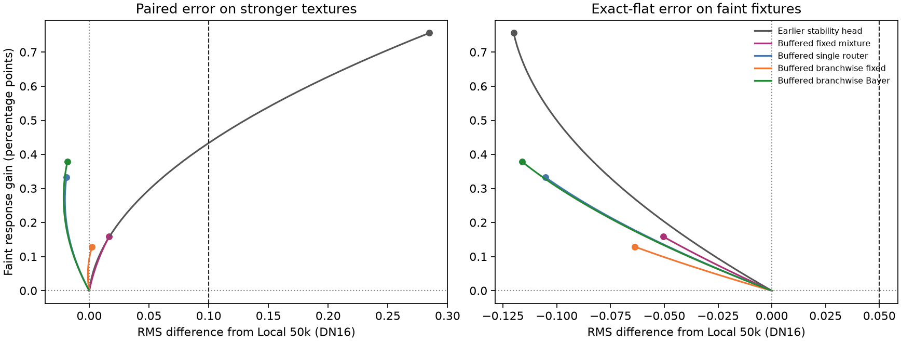
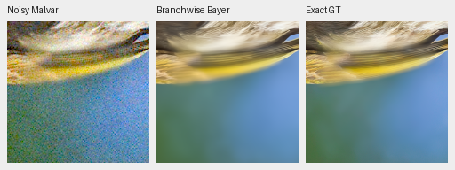
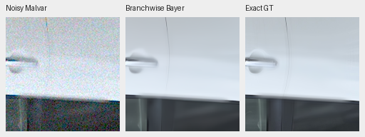

# Bayer-dependent weak-detail gains across contrast levels

One fixed policy with separate Bayer gates for sharpening and
smoothing recovers **0.379 percentage points** more faint
contrast than Local 50k on 48 new ISO6400 photos. Fine error
in exact-flat cores falls **0.116 DN16**, and the mean paired,
present-image and exact-flat errors stay within the calibration
limits on both faint and stronger textures. A calibrated fixed
blend recovers 0.159 points. The gain changes sign on the
weakest half and the planted wires. The real fine cab mesh
still has incomplete crossings.

The follow-up measures the exact-target gain ceiling of the two
proposals and adds a directional Bayer residual. It lowers the
attainable intact error at equal response. The locked analytic
rule uses little of that headroom.
[Weak-wire proposal headroom](detail-directional-proposal.md).

## Mix the frozen outputs at the gain stations

The previous Local 50k gain heads traded contrast against
paired error. The direct head kept more contrast on weak
wires. Training against repeated noise draws improved some
faint natural crops, while its stronger-texture replay
exceeded the paired-error limit. The present study holds
both heads and their proposals fixed. [Previous redraw study](detail-redraw-gate.md).

Each 32-pixel station mixes nominal Local 50k, the direct
gate and the redraw-stability gate with nonnegative weights
that sum to one. The experts use their earlier locked
sharper/smoother strengths of 0.45/1 and 0.95/0.75. Their
candidate fields are the bounded camera-neutral Local 50k
differences at 0.90× and 1.15× variance. The original
positive green cross-power cap still applies to each
sharper station. The learned router uses normalized local
Bayer and reconstruction descriptors, including eight
signed proposal correlations from the two green lattices.
The single router picks one mixture for both branches.
The branchwise router picks separate mixtures. Both have
matched constant versions. Interpolation takes place after
mixing the gains. All features are available from one RAW
and the original three conditioning forwards. The Bayer
measurements are empirical features from those same inputs.

Each arm trains on the retained exact quadratic delivery
coefficients from 512 weak training photos with two
draws and 768 stronger training photos with one draw. The
present contrast range is 0.16–0.40 on the weak set and
0.52–0.98 on the stronger set. The weak objective
rewards aligned response and penalizes paired and
absolute fine error. The stronger objective emphasizes
paired risk and adds a penalty on positive per-pair risk
changes. Each update samples 24 photos from each set.
The four arms run 1,200 AdamW updates each with learning
rate 0.001 and EMA decay 0.993. Each arm sees 5,376 distinct
role examples and 259,200 role visits. The two single-mixture
arms take 6.42 seconds total to fit on CPU. The two branchwise
arms take 5.71 seconds total. These are optimizer times using
retained coefficients. The base and experts use EMA weights
with checked IEEE FP32 proposal forwards. All mixer files
retain raw, EMA and optimizer states. The comparison uses EMA
mixers.

| Component | File SHA256 |
| --- | --- |
| Local 50k EMA parent | `62f4e9ce84075c8df1a254a1889033b5787133e8c98c63e0ec3d174a94734959` |
| Direct-loss EMA expert | `7729ab9663097b4e56eff2bbc96d3d7dba778cc0517bf3d9115879723ded1212` |
| Redraw-stability EMA expert | `9d4582e74ee4a97555309d030b4048a8f58d1030a09781ec354cc46ebc638576` |
| Learned constant mixture | `9e3635c2e52b7d50edd5331c02519c3e8eec64259e9e88b92102d85a482c35bc` |
| Single Bayer router | `e812bd1aebcd364442c579c8fc9b3a3569d4c2e9e0649e0ea66a6bf24c8f17f5` |
| Learned branchwise constant | `d684fb2461fde9b962ccc4553a2389120f4a2b3ea7e498f7655e55ae9eb02d83` |
| Branchwise Bayer router | `148301287cb588bff3632b22e30bdb06e8612fb126a4f8e4990ecc2b72d9d5f0` |
| V120 Small EMA | `a9d9b6b4f974e24a6b11e5e740aab32314233a7f53c056cf37c7d2aac1c589fb` |

## One calibration across both regimes

All panels use a native 256×256 query and fixed ISO6400
conditioning. Each source has a faint pair at contrast
scales 0.22/0 and a stronger pair at 0.78/0.06, plus an
independent noisy exact-flat crop for each regime. The
geometry and camera parameters match across regimes. All
six role seeds are independent. V120 reads the same mosaics.
The 32 calibration, 48 first held and 48 new confirmation
photos have disjoint sources and cached pixels. The audit
covers both mixer-training sets, the Local 50k manifest and
5,000 terminal crop observations, the recorded 559,808 Corpus
100k photo visits and the fixed full427 roster. Preflight
agreement between coefficient scoring and delivered RGB
is within 9.2e−6 in the measured DN16 RMS and response units.

The first calibration chooses one common blend scale
to maximize faint response under the existing error limits
in both regimes. Relative to Local 50k these are +0.10 DN16
paired increment RMS, +0.10 present RMS and +0.05 exact-flat
RMS. An additional fixed control searches the entire grid of
convex mixtures of nominal, direct and stability deliveries.

The single Bayer router locks at 0.725 and the fixed control
at 0.25 direct and 0.05 stability. On the first 48 held photos,
the router gains 0.414 faint response points and lowers flat
RMS by 0.164 DN16. The fixed blend gains 0.183 points and
lowers flat RMS by 0.079 DN16. The router raises increment
error by 0.102 DN16 faint and 0.113 stronger, above the
0.10 limit. Rolling only the router's input descriptors
lowers its faint gain from 0.414 to 0.185 points.

After that first transfer, the follow-up trains the
branchwise arms on the same existing training data. It
adds a buffer to the original calibration, with each
paired mean RMS increase plus 1.282 paired standard errors
required to fit the existing limit. The standard error uses
a first-order estimate for the difference of RMS values
across photos. This is a nominal one-sided 90% allowance
on each metric. The original calibration photos and limits
are reused. The resulting scale is 0.50 for the single
router and 0.575 for the branchwise router. Calibration
selects the branchwise arm for native review. In a
retrospective rescore on the first held photos, scaling
the single router to 0.50 keeps a 0.285-point faint gain
with +0.044 and +0.063 DN16 paired error across the two
regimes.

## Independent confirmation

The table gives changes from Local 50k on the untouched
confirmation set. Fine response measures projection onto
the exact clean increment. All RMS scores use the 96×96
core and the fine DCT band from 1/8 to 1/3 cycles per native
pixel. Local 50k recovers 68.743% and 95.022% of true fine
contrast in the faint and stronger panels.

| Method | Faint response (points) | Faint increment (DN16) | Faint exact-flat (DN16) | Stronger response (points) | Stronger increment (DN16) | Stronger exact-flat (DN16) |
| --- | ---: | ---: | ---: | ---: | ---: | ---: |
| V120 Small EMA | +0.841 | +1.358 | +1.054 | +0.078 | +1.827 | +0.726 |
| Earlier direct head, original strength | +0.690 | +0.167 | −0.141 | +0.121 | +0.172 | −0.274 |
| Earlier stability head, original strength | +0.756 | +0.054 | −0.120 | +0.205 | +0.285 | −0.271 |
| Single Bayer router, original strength | +0.483 | −0.053 | −0.132 | +0.057 | −0.007 | −0.232 |
| Buffered calibrated constant blend | +0.159 | −0.005 | −0.050 | +0.031 | +0.017 | −0.079 |
| Buffered learned constant blend | +0.141 | −0.017 | −0.042 | +0.032 | +0.014 | −0.069 |
| Buffered single Bayer router | +0.333 | −0.065 | −0.105 | +0.039 | −0.019 | −0.172 |
| Buffered branchwise constant | +0.129 | −0.043 | −0.064 | +0.035 | +0.002 | −0.103 |
| **Buffered branchwise Bayer router** | **+0.379** | **−0.064** | **−0.116** | **+0.044** | **−0.018** | **−0.194** |

Dots mark locked strengths. The curves rescale those methods
retrospectively and the dashed lines mark the measured error
limits. The unbuffered single router also passes the mean
limits on this second set. Its first transfer establishes
the failure case for the original strength.

The branchwise router's photo-bootstrap interval is +0.191
to +0.558 points for faint response. Flat error changes by
−0.163 to −0.075 DN16 on faint and −0.351 to −0.079 DN16
on stronger textures. Faint and stronger paired RMS
differences span zero. The largest faint per-photo increment
penalty is 0.603 DN16. The branchwise gain over the buffered
constant blend is 0.220 points (0.089 to 0.347) with 0.066
DN16 less faint flat error. At equal faint response, paired
error is 0.042 DN16 lower (−0.075 to −0.014 for the difference).
Compared with the buffered single router, the branchwise
gain is 0.046 points at the two locked strengths. At equal
faint response their pair errors agree within 0.0023 DN16
across the paired interval.

Rolling the branchwise descriptors while keeping the
proposals, trained expert weights and scale fixed loses
0.253 faint response points (0.096 to 0.409). The spatial
alignment of those inputs matters on the new set. On the
24 sources with the weakest exact increment, the branchwise
router loses 0.067 points versus Local 50k while paired RMS
falls 0.262 DN16. The fixed blend gains 0.066 points in
this half.

On 24 retained planted-wire controls the branchwise router
loses 0.178 weak response points. Intact increment, weak
gap and exterior-only weak RMS fall by 0.586, 0.064 and
0.063 DN16 respectively. Exact-flat fine wire RMS falls
0.072 DN16. Real and planted wire results point to continued
attenuation of thin detail.

## Native exact-target triplets

Each native 160×160 crop is at `[48,48,160,160]` in the
transformed 256×256 query. The noisy Malvar, locked branchwise
EMA and exact GT use the same camera transform and display
exposure of 3.0303×. Both captures use shot/read
`0.00128/6.5536e-6` and linear exposure 0.33. The two examples
show the largest paired-error increase and decrease on the
faint confirmation set.

The honeyeater query starts at `[364,240]` after D4
`[2,false]`, with RGGB. The paired error rises 0.603
DN16. The blurred background stays smooth and the faint
individual feather lines still look soft. Charles J. Sharp,
CC BY-SA 4.0.
[Source](https://commons.wikimedia.org/wiki/File:Western_wattled-honeyeater_(Foulehaio_procerior)_on_octopus_tree_(Heptapleurum_actinophyllum)_Colo-I-Suva.jpg) ·
[License](https://creativecommons.org/licenses/by-sa/4.0/) ·
[Faint](assets/detail-regime-router-v1/confirm-020-faint.png) ·
[Flat](assets/detail-regime-router-v1/confirm-020-flat.png) ·
[Stronger](assets/detail-regime-router-v1/confirm-020-stronger.png).

The car-door query starts at `[726,242]` after D4
`[2,true]`, with BGGR. The paired error falls 1.440
DN16. The edge and dark reflections are close to Local 50k
in the native view. TTTNIS, CC0.
[Source](https://commons.wikimedia.org/wiki/File:2017-2022_Suzuki_Xbee.jpg) ·
[License](https://creativecommons.org/publicdomain/zero/1.0/) ·
[Faint](assets/detail-regime-router-v1/confirm-021-faint.png) ·
[Flat](assets/detail-regime-router-v1/confirm-021-flat.png) ·
[Stronger](assets/detail-regime-router-v1/confirm-021-stronger.png).

## Standing GFX100S comparisons

The branchwise router changes the DSCF3879 sky, building,
foliage and coarse fence by 0.153, 1.009, 1.558 and 1.735
DN16 linear RGB RMS. The sky looks smooth. Edge and leaf
differences are subtle and the coarse crossings stay
connected. There is no conspicuous new ripple or false
color in the reviewed crops.

For DSCF3842/3835 the nominal left/right changes are
0.210/1.069 DN16 and transferred changes are 0.579/0.542
DN16. The transferred profile retains more of the diagonal
segments in all variants. Fine crossings remain incomplete
at both display exposures and the left mesh is weak away
from the post.

Native origins for sky, building, foliage and coarse fence
are `[5800,1400]`, `[5790,2690]`, `[8890,5570]` and
`[2240,6000]`. Cab origins are `[806,6489]` and `[1026,6449]`.
Nominal shot/read is `0.00128/6.5536e-6`. The established
transferred profile is
`0.0014635775921166604/1.0715704128646712e-6`. ISO100 AHD
and the cab camera JPEGs are qualitative references.
Aperture, exposure time and moving subjects differ across RAWs.

| RAW and conditioning | Native boards |
| --- | --- |
| DSCF3879 nominal ×4 | [Sky](assets/detail-regime-router-v1/main-overcast-sky-main-overcast-sky-x4.png) · [Building](assets/detail-regime-router-v1/main-building-detail-main-building-detail-x4.png) · [Foliage](assets/detail-regime-router-v1/main-foliage-main-foliage-x4.png) · [Coarse fence](assets/detail-regime-router-v1/main-chain-link-fence-main-chain-link-fence-x4.png) |
| DSCF3842 nominal | [Left ×4](assets/detail-regime-router-v1/mesh-nominal-fine-green-mesh-left-x4.png) · [Right ×4](assets/detail-regime-router-v1/mesh-nominal-fine-green-mesh-right-x4.png) · [Left ×16](assets/detail-regime-router-v1/mesh-nominal-fine-green-mesh-left-x16.png) · [Right ×16](assets/detail-regime-router-v1/mesh-nominal-fine-green-mesh-right-x16.png) |
| DSCF3842 transferred | [Left ×4](assets/detail-regime-router-v1/mesh-profile3879-fine-green-mesh-left-x4.png) · [Right ×4](assets/detail-regime-router-v1/mesh-profile3879-fine-green-mesh-right-x4.png) · [Left ×16](assets/detail-regime-router-v1/mesh-profile3879-fine-green-mesh-left-x16.png) · [Right ×16](assets/detail-regime-router-v1/mesh-profile3879-fine-green-mesh-right-x16.png) |

Training, numerical evaluation and native visual review are
complete for experimental crop component
`detail-regime-router-v1`. Whole-frame inference timing and
the fixed 427-photo and measured-camera PSNR panels remain
unmeasured for these mixtures. The chart compares completed
full-model panels.
[Performance history](performance-history.md) ·
[Score and training summary](results/detail-regime-router-v1/summary.json) ·
[Native provenance](assets/detail-regime-router-v1/manifest.json) ·
[Publication hashes](results/detail-regime-router-v1/publication.json) ·
[Checkpoints, sources and frozen receipts](results/detail-regime-router-v1/evidence.tar.xz).
