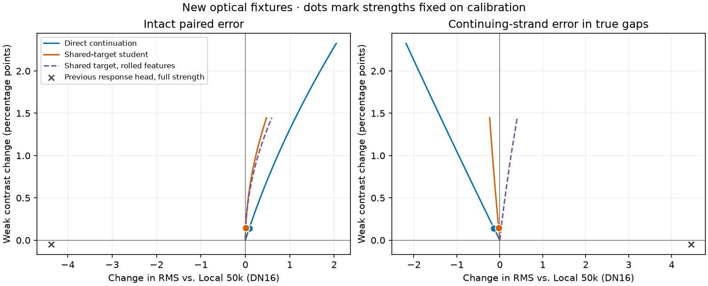
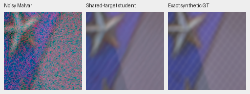
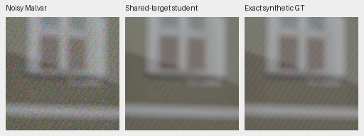

# Learning weak-wire gains with a continuing-strand control

The shared-target head adds **0.145 weak-wire contrast points** on 32 new optical
fixtures at the strength fixed on calibration. It lowers weak-direction residue
in true gaps by **0.018 DN16 RMS** and wire-flat error by **0.009 DN16 RMS**.
Direct optimization recovers **0.140 points** and better preserves the stronger
strand through a gap. Both heads slightly reduce natural faint contrast.
The native overcast sky stays smooth and the coarse fence stays connected.
The fine green cab crossings remain incomplete.

A [reserved Bayer phase follow-up](detail-phase-routing.md) holds phase
fixed and checks local measurements before delivery. It preserves more of
the continuing strand on a fresh set. The exterior search seldom nominates
the weaker direction, and overall weak contrast improves less than here.

## Shared gains and exact targets

Local 50k EMA supplies the nominal answer and three unchanged correction
proposals from the [preceding wire study](detail-wire-gate.md). These are the
0.90× and 1.15× variance differences and a directional measured-green residual.
The head predicts gains on a 32-pixel station grid. Bilinear interpolation and
measured caps bound the delivered proposals. In the teacher fit one normalized
gain map serves the intact, exterior-only and strong-only views of each scene.
Each view retains its own measured cap. The weak strand outside a gap can
inform the gains while the clean continuing strand inside a gap provides a
separate error target.

A box-constrained quadratic fit rewards intact paired accuracy, low
weak-direction error in gaps and exterior-only areas, low absolute error and
preservation of the continuing strand. It requires two contrast points per
photo, capped at 90% of the best available response. Using the preceding study's
40 evaluated wires as a diagnostic, shared gains allow a mean ceiling of
**8.008 points** versus 9.820 with independently chosen view gains. All 40
permit +2 points. At that response the shared fit improves intact paired error
by 3.362 DN16 and continuing-strand error by 7.293 DN16. All 20 true gaps
improve on the continuing strand. Weak-direction gap error falls 0.238 DN16 and
total gap error rises 1.432 DN16. The separate flat receives zero correction in
this exact-target test. These numbers describe proposal capacity given access
to the clean target.

## Training and evaluation

| Component | Checkpoint SHA256 |
| --- | --- |
| Frozen Local 50k EMA | `62f4e9ce84075c8df1a254a1889033b5787133e8c98c63e0ec3d174a94734959` |
| Previous response head, EMA initialization | `106155fcde17cb37ce72b4f099a3c05890d2c70c5b67215727628ccd26ec446a` |
| Direct continuation | `d8627cdaa36c494f91fec1fa6112911baf6f60fa23c3b6aca64fc03429a3ef22` |
| Shared-target student | `a8cda8e1ae095e2e3d1c2a202f48d5288ff80efdb2685b4d99aa13a344c1448a` |
| Recommended V120 comparison, EMA | `a9d9b6b4f974e24a6b11e5e740aab32314233a7f53c056cf37c7d2aac1c589fb` |

Both heads start from the previous directional EMA and reuse its 384 wire and
96 natural source photos. Three frozen IEEE FP32 proposal forwards on each of
192 strip and ellipse training fixtures add exact continuing-strand loss
coefficients. The teacher reaches the full two-point target on 379 of 384
training fixtures. Both heads retain the signed-response loss and add
the same continuing-strand loss, weighted to penalize increases in error.
The shared-target student adds a loss on delivered native fine-band luma and
paired weak contrast, with a smaller term on station gains. Each head sees
1,920 distinct role inputs over 1,600 matched AdamW updates, with 24 wire and
12 natural source photos per update and 230,400 role visits per arm.
The coefficient pass took 314.65 s, the target fit 9.10 s and the two joint
optimizer runs 54.54 s wall time. Evaluation uses EMA head weights. The
checkpoints retain raw weights and optimizer state too.

The existing calibration set has 24 wire and 20 natural photos. Calibration
maximizes mean wire contrast with a one-sided 90% normal buffer for the
intact, true-gap weak and continuing strands, exterior-only, flat and natural
error limits. The new continuing-strand budget is +0.10 DN16. The selected
strengths are **0.06 direct** and **0.10 shared-target**. The shared head's
buffered continuing-strand error was +0.097 DN16 on calibration.

The new confirmation comprises 32 wire sources and 24 natural sources,
split evenly between faint and stronger texture, with 16 exact wire gaps.
These captures were fixed before scoring. The audit checks their sources
against prior component splits, the fixed 427 photo panel, the Local 50k
training manifest and tail, and 559,808 photographic visits in the frozen
Corpus 100k lineage. Measured phase and gain inputs come from each noisy
image at inference. The clean fit supplies training targets only.
The reused 40-wire and 32-natural set is a separate development replay.

## Confirmation

Changes are relative to Local 50k. Contrast is measured in percentage points
and all errors in linear DN16 RMS. The first two rows use the fixed calibration
strengths. The full-strength rows show the measured recovery and error tradeoff.

| Head | Weak contrast | Intact paired error | Continuing strand in true gaps | Weak residue in true gaps | Exterior-only weak residue | Exact wire flat |
| --- | ---: | ---: | ---: | ---: | ---: | ---: |
| Direct continuation, 0.06 | +0.140 | +0.088 | −0.135 | −0.003 | +0.006 | −0.007 |
| Shared-target student, 0.10 | +0.145 | +0.008 | −0.027 | −0.018 | +0.001 | −0.009 |
| Direct continuation, full | +2.325 | +2.047 | −2.183 | −0.029 | +0.142 | −0.081 |
| Shared-target student, full | +1.447 | +0.478 | −0.236 | −0.172 | +0.044 | −0.050 |
| Previous response head, full | −0.050 | −4.371 | +4.450 | −0.524 | −0.473 | −0.083 |
| V120 EMA | −0.618 | +0.271 | +2.235 | −0.168 | +0.417 | +1.427 |

The photo-bootstrap 95% intervals for locked direct and shared contrast gains
are [+0.092, +0.189] and [+0.090, +0.201] points. The shared head's intact
paired error interval is [−0.025, +0.043] DN16 and continuing-strand error
interval is [−0.072, +0.014] DN16. On the reused development set, shared and
direct gains are +0.107 and +0.116 points. Direct intact error rises 0.114 DN16
there, above calibration's +0.10 mean budget. On the new faint natural crops
the locked shared head removes 0.026 DN16 flat error and 0.052 DN16
paired-increment error and loses 0.039 contrast points. The direct head loses
0.022 points. Stronger natural crops change less than 0.003 contrast points
at either lock.

At the same +1.447 points in a retrospective strength sweep, shared-target
training lowers intact paired error by **0.651 DN16** and weak-gap error by
**0.148 DN16** relative to direct continuation. Continuing-strand error is
**1.138 DN16 higher** than direct continuation at that response. The same
intact/continuing tradeoff recurs on the reused panel. Rolling the station
features across spatial locations barely changes the new wires' mean response
at the shared lock (−0.00013 points for aligned minus rolled). Alignment lowers
wire-flat error by 0.025 DN16. The gain therefore has limited evidence of
correct localization from the station features.

## Native confirmation crops

Each triplet presents noisy Malvar, the locked shared-target student and
exact synthetic ground truth. Tiles are native 160×160 at query ROI
`[48,48,160,160]`. Within each triplet the same camera-to-display transform
and exposure apply. The checkpoint is the shared-target EMA identified above,
composed with the Local 50k EMA and the three stated proposals. All three have
shot/read `0.00128 / 6.5536e-6` with capture exposure 0.33. The planted wires
use optical blur σ 0.85 native pixels. The source boxes, Bayer phases and
per-role seeds are preserved in the [native manifest](assets/detail-shared-oracle-v1/manifest.json)
and [capture receipts](results/detail-shared-oracle-v1/evidence.tar.xz).

`held-015` uses Rama's *Musée de l'Armée*, source box `[0,186,512,512]`
in the 4× binned donor, query offset 128, display ×2. One diagonal is easy
to see across the purple area, while the finer opposing structure remains
weaker than the target. This is the largest paired-error reduction among
the locked student's wires. [Donor](https://commons.wikimedia.org/wiki/File:Musee-de-lArmee-IMG_1071.jpg) ·
[CC BY-SA 2.0 FR](https://creativecommons.org/licenses/by-sa/2.0/fr/deed.en) ·
[Methods](assets/detail-shared-oracle-v1/held-015-present.png) ·
[Flat](assets/detail-shared-oracle-v1/held-015-flat.png).

`held-022` uses Stephan van Helden's *D-4-71-115-32 Wohnhaus*, source
box `[90,294,512,512]`, query offset 128, display ×2. The window and sill
survive, and suppression of the weak crossing above the sill is visible.
This is the largest paired-error increase among the locked student's wires.
[Donor](https://commons.wikimedia.org/wiki/File:D-4-71-115-32_Wohnhaus.jpg) ·
[CC BY-SA 4.0](https://creativecommons.org/licenses/by-sa/4.0/) ·
[Methods](assets/detail-shared-oracle-v1/held-022-present.png) ·
[Flat](assets/detail-shared-oracle-v1/held-022-flat.png) ·
[Full strength](assets/detail-shared-oracle-v1/full/held-022-present.png).

`held-040` shows the largest paired-error reduction on the faint natural
set. Source is Jan Ainali's *Jens Liljestrand 01*, box `[136,94,256,256]`,
query offset 0, display ×3.0303. The forehead and eyebrow remain softer
than the clean target. The flat replacement stays smooth through its interior.
[Donor](https://commons.wikimedia.org/wiki/File:Jens_Liljestrand_01.JPG) ·
[CC BY-SA 3.0](https://creativecommons.org/licenses/by-sa/3.0/) ·
[Triplet](assets/detail-shared-oracle-v1/held-040-triplet.png) ·
[Flat](assets/detail-shared-oracle-v1/held-040-flat.png).

## Standing GFX100S comparisons

The main DSCF3879 ISO6400 frame uses DSCF3880 ISO100 AHD as its independently
demosaiced reference. The native origins are sky `[5800,1400]`, building
`[5790,2690]`, foliage `[8890,5570]` and coarse fence `[2240,6000]`.
All use ×4 display and shot/read `0.00128 / 6.5536e-6`.
The locked shared output changes sky by 0.038 DN16 linear RGB RMS and the
coarse fence by 0.139 DN16. At full strength those changes rise to 0.379 and
1.388 DN16. The sky stays smooth. The coarse crossings remain connected and
building wires and leaves look nearly identical at the locks. Fine building
structure visible in the low-ISO reference remains softer.

The cab comparison uses DSCF3842 ISO6400 and DSCF3835 ISO100, with both
camera JPEGs and the ISO100 AHD view. The left ROI starts at `[806,6489]`
and the right at `[1026,6449]`, both 160×160. The native cab shot/read is
`0.0014635775921166604 / 1.0715704128646712e-6`. The transferred DSCF3879
profile uses the main frame values above. The shared lock changes the
nominal cab crops by 0.132/0.268 DN16 RGB RMS and the transferred pair by
0.739/0.888 DN16. At full strength the transferred changes are 7.390/8.881
DN16. The brighter display exposes changes to existing diagonal texture and
mottling, with little visible change to false color. The left lattice still
largely disappears with nominal conditioning. The right shows segments under
both profiles and remains much less continuous than the low-ISO references.
Aperture, timing and moving subjects differ across exposures. The ISO100
images and camera JPEGs serve as qualitative references.

| Capture and display | Locked comparison |
| --- | --- |
| DSCF3879 ×4 | [Sky](assets/detail-shared-oracle-v1/main-overcast-sky-main-overcast-sky-x4.png) · [Building](assets/detail-shared-oracle-v1/main-building-detail-main-building-detail-x4.png) · [Foliage](assets/detail-shared-oracle-v1/main-foliage-main-foliage-x4.png) · [Coarse fence](assets/detail-shared-oracle-v1/main-chain-link-fence-main-chain-link-fence-x4.png) |
| DSCF3842 nominal | [Left ×4](assets/detail-shared-oracle-v1/mesh-nominal-fine-green-mesh-left-x4.png) · [Right ×4](assets/detail-shared-oracle-v1/mesh-nominal-fine-green-mesh-right-x4.png) · [Left ×16](assets/detail-shared-oracle-v1/mesh-nominal-fine-green-mesh-left-x16.png) · [Right ×16](assets/detail-shared-oracle-v1/mesh-nominal-fine-green-mesh-right-x16.png) |
| DSCF3842 transferred | [Left ×4](assets/detail-shared-oracle-v1/mesh-profile3879-fine-green-mesh-left-x4.png) · [Right ×4](assets/detail-shared-oracle-v1/mesh-profile3879-fine-green-mesh-right-x4.png) · [Left ×16](assets/detail-shared-oracle-v1/mesh-profile3879-fine-green-mesh-left-x16.png) · [Right ×16](assets/detail-shared-oracle-v1/mesh-profile3879-fine-green-mesh-right-x16.png) |

Full-strength examples include [sky](assets/detail-shared-oracle-v1/full/main-overcast-sky-main-overcast-sky-x4.png),
[coarse fence](assets/detail-shared-oracle-v1/full/main-chain-link-fence-main-chain-link-fence-x4.png),
and transferred cab at ×16 [left](assets/detail-shared-oracle-v1/full/mesh-profile3879-fine-green-mesh-left-x16.png) and
[right](assets/detail-shared-oracle-v1/full/mesh-profile3879-fine-green-mesh-right-x16.png).
The manifest indexes all twelve native boards at each strength.

## Scope

Training, confirmation scoring and native image review are complete for the
scoped crop component `detail-shared-oracle-v1`. The full427 photo and
known/unseen camera benchmarks and inference timing were outside this scope.
This study supplies no entry to the full-model PSNR chart. V120 remains the
general recommendation. The current follow-up question is whether true-target
and continuing-strand gains can be allocated per region with independently
measurable support, given how little the wire response changes when station
features are rolled.

[Machine summary](results/detail-shared-oracle-v1/summary.json) ·
[Native manifest](assets/detail-shared-oracle-v1/manifest.json) ·
[Publication hashes](results/detail-shared-oracle-v1/publication.json) ·
[Checkpoints, frozen sources and receipts](results/detail-shared-oracle-v1/evidence.tar.xz).
