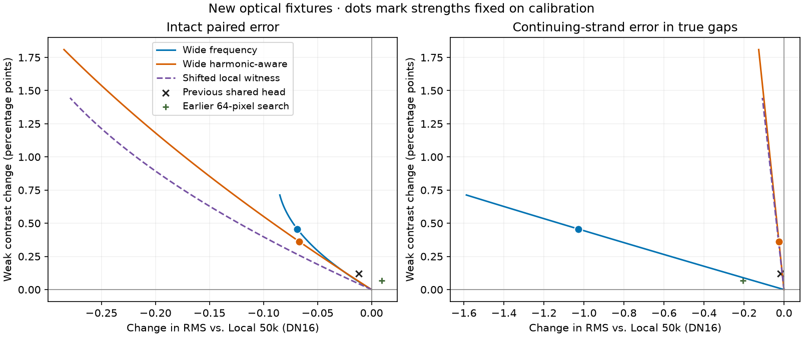
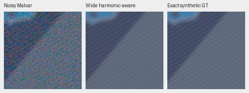
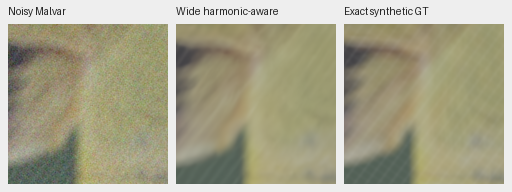

# Wider Bayer context for weak-wire frequency nomination

On 32 new optical wire fixtures, a wider Bayer search adds **0.456**
weak contrast points and lowers continuing-strand error by **1.027 DN16**.
The harmonic-aware variant adds **0.362** points at lower exact-flat
cost, and gains just 0.032 points with nominations from the wrong photo.
The real coarse fence and sky remain visually close to Local 50k. Fine
cab crossings remain incomplete.

A [reserved-fold follow-up](detail-crossfit-phase.md) reduces the wider
search's exact-flat error at equal response and recovers over one contrast
point on new fixtures. The weak residue in true gaps still exceeds
the calibration limit.

## Scope and method

The [64-pixel phase study](detail-phase-routing.md) found that a correct
frequency helps the local Bayer check recover faint strands. Its second
frequency was rarely the planted weak direction. This follow-up tests a
wider Bayer frequency search while keeping the previous local phase fit,
reserved-center evidence, amplitude cap and delivery unchanged.

For each 128×128 recipient quadrant of the 256×256 query, frequency
nomination reads the three other quadrants. It subtracts a low-pass
background using only donor pixels and computes a tapered cross-spectrum
of the two Bayer greens with their physical offsets. The plain wide
version takes a second peak after removing the first frequency.
The harmonic-aware version ranks peaks by power relative to their
neighborhood, fits the first frequency and its first three harmonics
in each donor green, and requires the second direction to differ by at
least 24° from the first. It searches 0.040–0.210 cycles per pixel.
A noisy two-wire test recovers the known weaker frequency and verifies
that replacing an entire recipient quadrant leaves its two nominations
and supporting scores bit-identical.

The 64×64 ring outside a reserved 32×32 center fixes phase and RAW
amplitude. The deficit is the excess of that amplitude over the
nominal restoration’s projection in the center. Both center greens
must support the nominated phase before adding any of the deficit. The same
wide harmonic nomination and local phase fit supply the exterior-only
control. A second control rolls the local witness map by two stations
on both axes. The wrong-photo test transfers only the two frequencies
and exterior votes of a different source, by matching fixture role.
The recipient mosaic and the procedure for fitting phase, amplitude
and the local witness stay fixed. The experiment measures context and delivery at the scale of a
single 256-pixel crop.

All corrections sit above the Local 50k IEEE FP32 EMA, SHA256
`62f4e9ce84075c8df1a254a1889033b5787133e8c98c63e0ec3d174a94734959`.
The [previous analytical search](detail-phase-routing.md) and
[shared-target EMA head](detail-shared-oracle.md) retain their original
locks. The recommended V120 EMA is the general model comparison.
The correction is analytical and uses frozen weights. The [operator](results/detail-wide-phase-v1/publication.json)
has SHA256 `438420dab89e1408fc8ea8bfdaaa8458b0d9056b7116e81e77fcbbd2b6907c8a`.
The manifests also bind the frozen local operator and all checkpoints.

The same 24 wire and 20 natural sources calibrate the strength of
each method with the prior buffered limits on paired error, flats,
gap residue and continuing-strand error. The confirmation panel
contains 32 previously unused optical wire fixtures, including 16
true weak gaps, and 24 unused natural crops split equally by contrast.
The audit checks both preceding confirmation sets, the original calibration
and training sources, the fixed 427-photo panel, the Local 50k manifest
and 5,000 terminal observations, and 559,808 photographic visits in the
Corpus 100k lineage. The earlier 56-source confirmation is a development
replay.

## Fresh confirmation

The calibrated gains are 0.64 for plain wide, 0.20 for harmonic-aware wide,
and zero for wide delivery without the local check. All changes below are
relative to nominal Local 50k. Contrast is in percentage points and errors
are in linear DN16 RMS.

| Method | Weak contrast | Intact paired error | Continuing strand | Weak gap residue | Exact wire flat |
| --- | ---: | ---: | ---: | ---: | ---: |
| Earlier 64-pixel search, 0.30 | +0.069 | +0.009 | −0.205 | +0.001 | +0.000 |
| Earlier shared-target head, 0.10 | +0.122 | −0.012 | −0.018 | −0.008 | −0.006 |
| Plain wide, 0.64 | **+0.456** | −0.069 | −1.027 | +0.018 | +0.048 |
| Harmonic-aware wide, 0.20 | **+0.362** | −0.067 | −0.025 | +0.019 | +0.012 |
| Harmonic-aware, shifted witness, 0.20 | +0.289 | −0.074 | −0.022 | +0.025 | +0.013 |
| Harmonic-aware, wrong-photo nominations, 0.20 | +0.032 | +0.003 | −0.002 | 0.000 | +0.009 |
| Harmonic-aware wide, full | +1.809 | −0.285 | −0.126 | +0.115 | +0.125 |
| Harmonic-aware without local check, full | +10.301 | −0.982 | −0.171 | +2.156 | +5.445 |
| V120 EMA | −1.287 | +0.555 | +1.568 | +0.258 | +1.715 |

Source-bootstrap 95% intervals for the locked weak gains are
[+0.171, +0.791] plain wide and [+0.218, +0.517] harmonic-aware.
The harmonic-aware lock lowers intact error [−0.109, −0.029] DN16
and increases weak residue in gaps [+0.003, +0.038] DN16.
The plain lock reduces continuing-strand error [−2.068, −0.218] DN16
and changes weak residue [−0.005, +0.046]. Its exact flat penalty
is larger at the compared locks. The harmonic-aware variant changes
faint natural contrast by +0.001 points with near-zero paired error.
Plain wide loses 0.023 points on faint natural crops and adds 0.017 DN16
paired error. On the reused development panel, gains for plain wide
and harmonic-aware wide are +0.579 and +0.451 points.

Swapping frequencies and confidence votes for those of another photo
costs 0.330 contrast points [0.173, 0.501] and adds 0.070 DN16 intact
paired error compared with aligned harmonic context. Rolling the local
witness costs 0.073 points [−0.016, +0.170]. The comparison supports
correctly matched wider frequency information, with weaker evidence
for the placement of the current local witness. Removing the witness
entirely admits far more measured weak contrast and raises both gap
and exact-flat error sharply.

| Station-level nomination result | Earlier 64-pixel | Plain wide | Harmonic-aware wide |
| --- | ---: | ---: | ---: |
| Weak nomination on 323 intact stations | 15 | 62 | 159 |
| Weak nomination passes the local check | 10 | 32 | 76 |
| Strong or harmonic nomination in the weak slot | 44 | 25 | 1 |
| Local check passes on 512 exact-flat stations | 1 | 45 | 48 |

A frequency counts as a match within 0.02344 cycles per pixel of the
planted fundamental or its sign reflection. These overlapping station
counts diagnose decisions. Source-level intervals quantify output effects.
The harmonic-aware arm finds more true weak directions and less often
targets the strong family. It changes peak ranking, deflation and angle
exclusion together. Their individual contributions remain unmeasured.
Both wide searches accept more stations on exact flats. The calibrated
strengths limit the measured output error from those activations.

## Native synthetic crops

Each native 160×160 triplet shows noisy Malvar, harmonic-aware wide
at the 0.20 lock above the identified Local 50k EMA, and exact synthetic
ground truth. The query ROI is `[48,48,160,160]`. All use shot/read
`0.00128 / 6.5536e-6`, capture exposure 0.33, and identical display
transforms within the triplet. The wires use blur σ 0.85 native pixels.
The hashes, Bayer phase, noise seed and 4× binned source coordinates
are bound in the [crop manifest](assets/detail-wide-phase-v1/manifest.json).

`held-023` uses Fernando Losada Rodríguez's *Rúa Tui.001 - A Coruña*,
source box `[16,118,512,512]`, query offset 128, display ×2. The strong
diagonal is continuous across the contrast step. The faint crossing stays
less distinct than in the exact target even in this favorable case.
[Donor](https://commons.wikimedia.org/wiki/File:R%C3%BAa_Tui.001_-_A_Coru%C3%B1a.jpg) ·
[CC BY-SA 4.0](https://creativecommons.org/licenses/by-sa/4.0/) ·
[Methods](assets/detail-wide-phase-v1/held-023-present.png) ·
[Flat](assets/detail-wide-phase-v1/held-023-flat.png).

`held-030` uses Didier Descouens's *Cephonodes kingii*, source box
`[200,102,512,512]`, query offset 128, display ×2. The weak slope in
the yellow area remains hard to see. The locked variant increases
paired error here despite the mean reduction.
[Donor](https://commons.wikimedia.org/wiki/File:Cephonodes_kingii_MHNT_CUT_2010_0_138_Cambridge_Park,_New_South_Wales_Australia_female_dorsal.jpg) ·
[CC BY-SA 4.0](https://creativecommons.org/licenses/by-sa/4.0/) ·
[Methods](assets/detail-wide-phase-v1/held-030-present.png) ·
[Flat](assets/detail-wide-phase-v1/held-030-flat.png).

`held-044` uses Crisco 1492's *Amplang from Kotabaru*, source box
`[254,8,256,256]`, offset 0, display ×3.0303. The restoration is
smoother than the target in the yellow detail. The flat replacement
stays visibly smooth. [Donor](https://commons.wikimedia.org/wiki/File:Amplang_from_Kotabaru,_South_Kalimantan_2015-05-23_01.jpg) ·
[CC BY-SA 4.0](https://creativecommons.org/licenses/by-sa/4.0/) ·
[Triplet](assets/detail-wide-phase-v1/held-044-triplet.png) ·
[Flat](assets/detail-wide-phase-v1/held-044-flat.png).

## Standing GFX100S comparisons

For these larger cached RAW inputs, the new operator reads a 256×256 native
slice around each established display ROI. The slice is aligned to the
existing 32-pixel station lattice. The parent and earlier comparisons
use their cached larger inputs. The exact window for each board is in
the manifest. Capture files and render transforms are the standing ones.

On DSCF3879 ISO6400 the 160×160 origins are sky `[5800,1400]`, building
`[5790,2690]`, foliage `[8890,5570]` and coarse fence `[2240,6000]`.
Display is ×4 with shot/read `0.00128 / 6.5536e-6`. The independently
demosaiced ISO100 DSCF3880 is a qualitative reference. The locked
plain and harmonic-aware wide changes to sky are 0.491 and 0.223 DN16
RGB RMS. Both remain visibly smooth. The coarse fence changes by 3.577
and 1.118 DN16 and the crossings remain connected. The leaf edges and
fine building features look close to Local 50k.

On DSCF3842 ISO6400, native origins are left `[806,6489]` and right
`[1026,6449]`. Nominal shot/read is
`0.0014635775921166604 / 1.0715704128646712e-6`. The transferred profile
uses the DSCF3879 parameters above. Boards show both camera JPEGs and
DSCF3835 ISO100 AHD as qualitative references. Aperture, exposure time,
moving subjects and rendering differ across images. At the harmonic-aware
lock the transferred changes are 0.213 and 0.435 DN16 RGB RMS on left
and right. At full strength they rise to 1.064 and 2.175 DN16. The
nominal left remains mostly smooth by the post. Under transferred
conditioning, both wide variants make subtle changes to existing right
diagonals. Fine crossings remain incomplete. The ×16 boards show
similar mottling and false color to Local 50k.

| Capture and display | Locked comparison |
| --- | --- |
| DSCF3879 ×4 | [Sky](assets/detail-wide-phase-v1/main-overcast-sky-main-overcast-sky-x4.png) · [Building](assets/detail-wide-phase-v1/main-building-detail-main-building-detail-x4.png) · [Foliage](assets/detail-wide-phase-v1/main-foliage-main-foliage-x4.png) · [Coarse fence](assets/detail-wide-phase-v1/main-chain-link-fence-main-chain-link-fence-x4.png) |
| DSCF3842 nominal | [Left ×4](assets/detail-wide-phase-v1/mesh-nominal-fine-green-mesh-left-x4.png) · [Right ×4](assets/detail-wide-phase-v1/mesh-nominal-fine-green-mesh-right-x4.png) · [Left ×16](assets/detail-wide-phase-v1/mesh-nominal-fine-green-mesh-left-x16.png) · [Right ×16](assets/detail-wide-phase-v1/mesh-nominal-fine-green-mesh-right-x16.png) |
| DSCF3842 transferred | [Left ×4](assets/detail-wide-phase-v1/mesh-profile3879-fine-green-mesh-left-x4.png) · [Right ×4](assets/detail-wide-phase-v1/mesh-profile3879-fine-green-mesh-right-x4.png) · [Left ×16](assets/detail-wide-phase-v1/mesh-profile3879-fine-green-mesh-left-x16.png) · [Right ×16](assets/detail-wide-phase-v1/mesh-profile3879-fine-green-mesh-right-x16.png) |

Full-strength examples show the [sky](assets/detail-wide-phase-v1/full/main-overcast-sky-main-overcast-sky-x4.png),
[coarse fence](assets/detail-wide-phase-v1/full/main-chain-link-fence-main-chain-link-fence-x4.png)
and [transferred right cab](assets/detail-wide-phase-v1/full/mesh-profile3879-fine-green-mesh-right-x16.png).
The manifest indexes all twelve boards at each strength.

## Evaluation status

The analytical comparison, numerical confirmation and native review
are complete. The 427-photo and known/unseen measured-camera benchmarks
and whole-frame runtime are outside this crop study. The change remains
experimental and the general recommendation is V120. The two wide arms
show that correctly nominated exterior frequencies can improve weak
recovery. The observed flat admissions and residual gap leakage motivate
measuring how much of that advantage survives a separate wide-context
validation split.

[Machine summary](results/detail-wide-phase-v1/summary.json) ·
[Publication hashes](results/detail-wide-phase-v1/publication.json) ·
[Frozen implementation and receipts](results/detail-wide-phase-v1/evidence.tar.xz).
