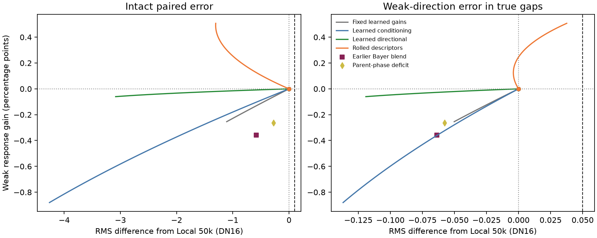
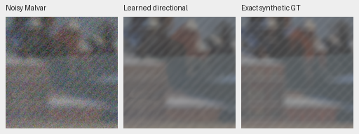
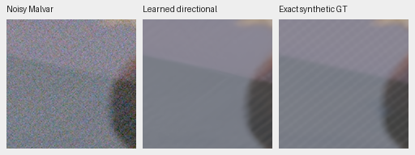

# Training weak-wire gains with exact gap controls

Both training objectives select **zero added correction** on
calibration. Increasing the signed wire loss makes the learned
directional branch useful within the full-strength head. On 40
new optical wire fixtures it contributes **1.107 response
points** in an omission test. The full composite remains
**0.060 points below Local 50k** and raises continuing-strand
error in exact gaps. It also loses fine contrast on new natural
photos.

The proposal space has measurable headroom on those same
optical fixtures. With exact targets selecting the gains, the
directional proposal makes a two-point contrast gain feasible
on **40 of 40 photos**, up from **25 of 40** with the conditioning
proposals alone.

The [shared-target and continuing-wire follow-up](detail-shared-oracle.md)
adds explicit protection for the continuing strand. Small nonzero strengths
transfer to 32 new wire fixtures, with different intact and gap tradeoffs.

## Setup and objective

The frozen Local 50k EMA supplies the nominal result and the
same camera-neutral conditioning differences at 0.90× and 1.15×
variance. The third proposal is the directional Bayer residual
from the preceding exact-target study. Its absolute phase comes
from measured green residuals. The original positive cross-green
cap remains on the sharper conditioning branch. Each proposal is
bounded and multiplied by bilinearly interpolated gains on a
32-pixel native grid. [Proposal definitions and earlier results](detail-directional-proposal.md).

The fixed control learns three scalar gains plus the common
sharpening cap. Two learned gates have identical pointwise and
3×3 station layers. Their input combines local Bayer statistics,
camera noise, proposal powers and signed proposal correlations on
both measured green lattices. The conditioning arm receives the
same descriptors as the directional arm and delivers only the two
conditioning proposals. They start with shared initial tensors.
One 3×3 station layer sees the immediate neighboring stations. The
rolled-descriptor intervention moves those inputs at inference
while retaining the original proposal fields and gain caps.

Each observation has four roles. Wire roles contain both
directions, an exterior-only weak direction, strong-only and an
exact-flat core. Natural roles contain the selected detail contrast,
two independent draws of the reduced-contrast image and an exact
flat. All roles use separate noise seeds. Each model predicts its
gain from one noisy Bayer view. Exact targets, known wire geometry
and gap masks enter only the training coefficients and scoring.

The loss uses the delivered samples. The wire pair measures the
present-minus-strong-only increment after removing nuisance
background and stronger-wire terms in the intact footprint.
It penalizes squared paired error and rewards signed projection
onto the exact weak increment. Additional quadratic terms penalize
weak-direction error in true gaps and the exterior-only role's
difference from strong-only. Absolute fine-band RMS on every role
and an extra penalty on increases in flat and weak-gap error
limit off-target energy. The natural replay applies the same
paired signed and absolute fine-band terms, with the lower
response weight. The coefficient audit compares Gram-based
changes against full bilinearly interpolated native output.

The training set includes 384 wire photos and 96 natural photos
with disjoint source identities and cached pixels. It varies
camera patterns, camera transforms, exposure, shot/read variance,
off-grid phases, crossed periods, widths, strip and ellipse gaps,
smooth dips and contrast steps. Training wire blur is a finite
Gaussian with σ 0.55 or 0.85 native pixels. Held and calibration
wire blur is σ 0.85. Intact and gap regions are conservatively
eroded by the filter support. Calibration has 24 separate wire
and 20 separate natural photos. The new held set has 40 wire and
32 natural photos. The natural pair contrast scales are 0.22/0
and 0.78/0.06. Calibrated and held captures use ISO6400 with
shot/read `0.00128/6.5536e-6` and exposure 0.33. The full427
roster and previous component studies' source identities were
excluded. The source audit checks calibration and held photos
against the Local 50k manifest and its retained terminal
observations, and 559,808 recorded Corpus 100k photo visits.

All three arms train for 1,400 AdamW updates with learning rate
0.00065 and EMA decay 0.993, using 24 wire and 12 natural
photos per minibatch with the same sampled source indices. Each
arm sees 1,920 distinct native role examples and 201,600 role
visits. The delivered wire signed-response weight is 0.9 and
natural signed-response weight is 0.35. Checkpoints retain raw,
EMA and optimizer states. Evaluation uses EMA and IEEE FP32
frozen restoration.

One calibration scale per arm maximizes mean signed wire response
within the error limits relative to Local 50k. The calibration
uses a nominal one-sided 90% uncertainty allowance. The mean
increase plus 1.282 paired standard errors must fit +0.10 DN16
intact increment and wire-flat RMS, +0.05 DN16 weak-gap and
exterior-only RMS, and the previous paired, present and flat
limits on both natural regimes. Full-strength scores are
diagnostics and the other panels use the same calibration lock.

The first calibration selected zero strength for all three
arms because their full-strength wire response was below
Local 50k. Before viewing the new held outputs, a follow-up
raised only the wire signed-response weight from 0.9 to 5.4.
It uses the same initialization, examples, sampled indices,
natural weight, gap and flat losses, and calibration limits.
The three follow-up arms again select zero. All six endpoints
below have numerical and native reviews.

Data collection stopped after 448 saved sources. It resumed
from the committed chunks and completed 480. The recorded
preparation time is **at least 793.20 s**, excluding work
between the final recorded checkpoint and the interruption.
The first three-arm optimizer pass took 21.77 s and the
response-weighted pass 47.47 s. The latter shared the GPU
with held capture. These times describe preparation and
optimization. Whole-frame inference timing is unmeasured.

| Frozen base or learned component | File SHA256 |
| --- | --- |
| Local 50k EMA | `62f4e9ce84075c8df1a254a1889033b5787133e8c98c63e0ec3d174a94734959` |
| V120 Small EMA | `a9d9b6b4f974e24a6b11e5e740aab32314233a7f53c056cf37c7d2aac1c589fb` |
| Initial fixed gains | `715cb23bb593810c329fd98574db1954bfad9e5ae800d84968f76a0e46a6a95b` |
| Initial learned conditioning | `009cf8c1407b649328d83a66693039573d5b3d83bfb62c3b6513bfccb99c0fc8` |
| Initial learned directional | `68c1de04130693b6745fb4633e380faa392df81cd09147d18ea0f26dade9b861` |
| Higher-weight fixed gains | `7cd367d9fd5ffeb39edcb74183d83a5ad358f10094a362e386134070dd666086` |
| Higher-weight learned conditioning | `cce34c61616c0e607fa9c44d006a10fb409cc2aa44ec4ff58091645d8a28b7c0` |
| Higher-weight learned directional | `106155fcde17cb37ce72b4f099a3c05890d2c70c5b67215727628ccd26ec446a` |

The checkpoint is an EMA gain head composed above Local 50k
with the shared three-conditioning forwards and the measured
directional proposal. The earlier Bayer blend and the
parent-phase deficit are frozen comparators at their own
previous strengths. [Earlier blend](detail-regime-router.md) ·
[Parent-phase deficit](detail-directional-proposal.md).

## Held optical wires and natural detail

The 40 held wire sources give 22.747% mean weak response,
158.553 DN16 intact paired RMS and 19.075 DN16 wire-flat
RMS for Local 50k. The 20 exact strip and ellipse gaps
supply the separate weak-direction, continuing-wire and
exterior-only metrics. The table gives changes from the
parent. Learned values are full-strength diagnostics.
The selected strength for each is zero.

| Method | Weak response (points) | Intact RMS | Weak-gap RMS | Continuing RMS | Exterior-only weak RMS | Flat RMS |
| --- | ---: | ---: | ---: | ---: | ---: | ---: |
| Earlier Bayer blend | −0.357 | −0.584 | −0.064 | +0.821 | −0.133 | −0.042 |
| Earlier parent-phase deficit | −0.263 | −0.276 | −0.058 | +0.526 | −0.116 | −0.029 |
| Initial fixed gains | −0.267 | −1.140 | −0.052 | +1.035 | −0.138 | +0.020 |
| Initial learned conditioning | −1.452 | −5.215 | −0.202 | +5.154 | −0.585 | −0.057 |
| Initial learned directional | −1.407 | −5.203 | −0.191 | +5.017 | −0.508 | −0.057 |
| Higher-weight fixed gains | −0.254 | −1.109 | −0.050 | +1.009 | −0.135 | +0.023 |
| Higher-weight learned conditioning | −0.880 | −4.263 | −0.137 | +3.784 | −0.397 | −0.057 |
| Higher-weight learned directional | −0.060 | −3.085 | −0.119 | +3.925 | −0.489 | −0.057 |

RMS is in DN16. For the higher-weight directional head, the
paired photo-bootstrap intervals versus Local 50k are
−0.753 to +0.684 response points, −4.100 to −2.050 DN16
intact RMS and +2.177 to +5.814 DN16 continuing-wire RMS.
The improvement in aggregate intact error comes with weaker
detail on the first objective and higher continuing-strand
error on both. For the higher-weight head, the intact
response changes by −0.076 points in the present role and
+0.015 points in the signed absent-role contribution.

The mean present-role directional gain increases from
0.00033 to 0.172 under the higher weight. Removing only
that branch, with all other learned gains fixed, costs
1.107 points of response at full strength and lowers intact
RMS by 1.369 DN16. The directional branch also contributes
0.070 DN16 of additional weak-gap error. The higher weight
recovers much of the contrast lost by the smoother branch,
with little net change relative to the frozen parent.

The dots on the curves mark the zero calibration locks.
Moving the higher-weight head's descriptors by four
stations in both axes gives +0.507 response points on
the new optical wires at full strength. Its flat RMS rises
0.161 DN16, above the +0.10 limit. The same intervention
loses 0.480 points on the earlier 32 off-grid fixtures.
This spatial intervention is diagnostic. It shows that
the learned placement can trade away response.

At full strength on the 32 earlier off-grid wires the
higher-weight directional arm loses 1.076 response points,
lowers intact RMS 3.931 DN16 and raises continuing error
6.364 DN16. On the 16 new faint natural photos, it loses
2.696 fine-response points. Flat RMS falls 0.317 DN16 and
present-image fine RMS rises 0.647 DN16. On the 16 stronger
photos, response loses 0.066 points and present fine RMS
rises 0.117 DN16. The zero-strength policy preserves the
nominal output in both regimes.

### Exact-target comparison on the same optical wires

The bounded oracle from the earlier proposal study uses
the same bilinear gain stations and intact wire scorer.
It is allowed to see the true target and set gains
separately in the present and absent roles. The conditioning
basis can add up to a mean 2.915 response points. The
directional basis raises that ceiling to 9.820 points.
On the 25 common feasible sources, requiring two extra
points lowers the best intact error by 3.462 DN16 for
conditioning and 5.344 DN16 for the expanded basis.
All 40 are feasible at two points with the expanded basis.
These are intact-only, exact-target fits. They quantify
proposal capacity while leaving the real gain-selection
and gap-control problem open.
[Earlier exact-target comparison](detail-directional-proposal.md).

## Native exact-target comparisons

The native triplets show noisy Malvar, the higher-weight
directional EMA at **full diagnostic strength**, and exact
synthetic GT. Every tile is a 160×160 crop at
`[48,48,160,160]` in the 256×256 query. Wire queries are
at `[128,128,256,256]` in the source field. Both wire
examples use σ 0.85 blur, display exposure ×2,
shot/read `0.00128/6.5536e-6`, capture exposure 0.33
and black 0.03. The unaltered-parent locked comparisons
are also in the native manifest.

The field starts at `[498,196]` in the source, with RGGB.
Paired error falls 8.657 DN16, the largest drop. The
stronger diagonal is visible in both restorations and
the finer crossing is still muted. Kora27, CC BY-SA 4.0.
[Source](https://commons.wikimedia.org/wiki/File:Kresty-Gef%C3%A4ngnis_in_St._Petersburg_2H1A3220OB.jpg) ·
[Comparison](assets/detail-wire-gate-v1/response-priority/held-016-present.png) ·
[Flat control](assets/detail-wire-gate-v1/response-priority/held-016-flat.png).

The field starts at `[202,40]`, with GBRG. Paired error
rises 5.628 DN16, the largest increase. The finer strands
stay soft near the edge. Alexis Lours, CC BY 4.0.
[Source](https://commons.wikimedia.org/wiki/File:Little_Grebe_Gennevilliers.jpg) ·
[Comparison](assets/detail-wire-gate-v1/response-priority/held-019-present.png) ·
[Flat control](assets/detail-wire-gate-v1/response-priority/held-019-flat.png).

On the RGGB faint natural example, query `[214,348,256,256]`
at display exposure ×3.0303, the button lettering and the
surrounding fine texture stay soft. Its paired error drops
3.215 DN16, the largest reduction on the faint panel.
Mister rf, CC BY-SA 4.0.
[Source](https://commons.wikimedia.org/wiki/File:American_M26.jpg) ·
[Triplet](assets/detail-wire-gate-v1/response-priority/held-042-triplet.png) ·
[Comparison](assets/detail-wire-gate-v1/response-priority/held-042-present.png).

## Standing GFX100S comparisons

The evaluated calibration locks reproduce Local 50k in
both RAW families. At full diagnostic strength, the
higher-weight directional head changes the main DSCF3879
sky, building, foliage and coarse fence by 0.379, 4.357,
5.311 and 2.828 DN16 RGB RMS relative to Local 50k. The sky
remains smooth and the coarse crossings stay connected.
Some existing foliage and edge details are softer.

On the DSCF3842 fine mesh, full-strength left and right
changes are 1.301/2.729 DN16 nominal and 6.571/6.021 DN16
with the transferred conditioning. The transferred right
still shows the clearest fine diagonals. There is no clear
gain in crossing continuity in either ROI. The left mesh
remains weak away from the post.

Native origins for sky, building, foliage and coarse fence
are `[5800,1400]`, `[5790,2690]`, `[8890,5570]` and
`[2240,6000]`. Cab origins are `[806,6489]` and `[1026,6449]`.
Nominal shot/read is `0.00128/6.5536e-6`, and transferred
shot/read is `0.0014635775921166604/1.0715704128646712e-6`.
The independent ISO100 AHD results and both cab camera JPEGs
are qualitative references. Aperture, exposure time and
moving subjects differ between the RAW captures.

| Full-strength RAW and conditioning | Native boards |
| --- | --- |
| DSCF3879 nominal ×4 | [Sky](assets/detail-wire-gate-v1/response-priority/main-overcast-sky-main-overcast-sky-x4.png) · [Building](assets/detail-wire-gate-v1/response-priority/main-building-detail-main-building-detail-x4.png) · [Foliage](assets/detail-wire-gate-v1/response-priority/main-foliage-main-foliage-x4.png) · [Coarse fence](assets/detail-wire-gate-v1/response-priority/main-chain-link-fence-main-chain-link-fence-x4.png) |
| DSCF3842 nominal | [Left ×4](assets/detail-wire-gate-v1/response-priority/mesh-nominal-fine-green-mesh-left-x4.png) · [Right ×4](assets/detail-wire-gate-v1/response-priority/mesh-nominal-fine-green-mesh-right-x4.png) · [Left ×16](assets/detail-wire-gate-v1/response-priority/mesh-nominal-fine-green-mesh-left-x16.png) · [Right ×16](assets/detail-wire-gate-v1/response-priority/mesh-nominal-fine-green-mesh-right-x16.png) |
| DSCF3842 transferred | [Left ×4](assets/detail-wire-gate-v1/response-priority/mesh-profile3879-fine-green-mesh-left-x4.png) · [Right ×4](assets/detail-wire-gate-v1/response-priority/mesh-profile3879-fine-green-mesh-right-x4.png) · [Left ×16](assets/detail-wire-gate-v1/response-priority/mesh-profile3879-fine-green-mesh-left-x16.png) · [Right ×16](assets/detail-wire-gate-v1/response-priority/mesh-profile3879-fine-green-mesh-right-x16.png) |

Training, numerical evaluation and native visual review are
complete for crop component `detail-wire-gate-v1`. The fixed
427-photo and measured-camera panels are unmeasured for these
gain heads. The history chart covers comparable full-model
evaluations.
[Performance history](performance-history.md) ·
[Bound summary](results/detail-wire-gate-v1/summary.json) ·
[Native provenance](assets/detail-wire-gate-v1/manifest.json) ·
[Publication hashes](results/detail-wire-gate-v1/publication.json) ·
[Frozen checkpoints, sources and machine receipts](results/detail-wire-gate-v1/evidence.tar.xz).
