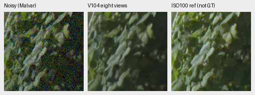
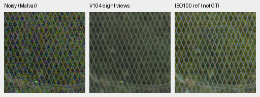

# Eight-view restoration of the complete GFX frame

**The V104 eight-view export is complete and reviewed at native scale.**
Both outputs contain the full 101.996MP image as 16-bit RGB TIFFs. The six
standing regions compare V104 single/eight-view, current V112 and the stronger
RawNIND pre-upsampled reference. Single/eight-view changes look small; fine
foliage and saturated-sign structure remain soft. V112 remains the default.

[Original execution, file hashes, integrity checks and native provenance](results/v104-dihedral8-fullframe-review-v1.json) ·
[Measured context gains and full-panel evaluation](dihedral-quality.md).

## Native full-frame comparison

Every restored cell is decoded from its method's complete linear-camera-RGB16
export. This gives all four methods the same clipping/rounding history. A common
float64 WB/matrix/sRGB transform and display exposure ×4 (+2EV) apply throughout.
The noisy Malvar and ISO100 reference displays use the retained float arrays.
All crops are 160×160 sensor pixels, with no resizing, interpolation, warping,
per-method exposure adjustment or additional neural inference.


[Sky/building comparison](images/v104-dihedral8-fullframe/comparison-0.png) ·
[Saturated sign/platform comparison](images/v104-dihedral8-fullframe/comparison-2.png) ·
[Source coordinates, checkpoint hashes, conditioning and display settings](images/v104-dihedral8-fullframe/manifest.json).

The learned variants retain thinner, more continuous fence strands than the
pre-upsampled RawNIND reference. Their building and foliage differences are
small; this review does not establish broad superiority or solve fine detail.
The scene's separately exposed DSCF3880 ISO100 f/5.6 reference is sharper and
differs in aperture, exposure and moving subjects from DSCF3879 ISO6400 f/1.7.
It is a qualitative reference, **not exact GT**, and receives no pixelwise score.

Noisy → **V104 eight views, full-frame RGB16** → separate ISO100 reference:





[Foliage metadata](images/v104-dihedral8-fullframe/foliage.json) ·
[Fence metadata](images/v104-dihedral8-fullframe/chain-link-fence.json).
All six triplets are retained in the manifest. These RGB16-derived crops are
separate from the earlier [unquantized-context comparisons](dihedral-quality.md#standing-gfx-scene)
and [V112 full-frame gallery](gfx-qualitative.md).

## Actual files and verification

Both TIFFs are 8746×11662×3, uint16, with 16 bits per sample and explicit color
space tags. File hashes were rechecked and both files reopened:

```text
/mnt/external/demosaic/V104-dihedral8-full-GFX-20261023-v1/
  V104-dihedral8-linear.tiff   linear camera RGB
  V104-dihedral8-srgb.tiff     sRGB preview at exposure ×1
```

The sRGB TIFF is the ordinary exposure-×1 CLI preview; the native boards above
use +2EV decoded from the camera-RGB TIFF. Sampled color-consistency checks cover
33 full-width rows and 1,152,084 unclipped camera-pixel channels. Every checked
sRGB16 value lies within its interval derived from camera-RGB16 quantization,
the recorded float32 rendering allowance and final sRGB16 rounding. Another
2,454 channels at clipped camera pixels are excluded from that check.

This verifies sampled consistency between the two encoded files. The original
full float32 prediction was not retained, so it does not bound inference error
against an unquantized full-frame array. The receipt records the exact intervals
and sample coordinates.

All 36 comparison cells were actually viewed and read back exactly. An
independent Torch64 rendering of all 24 restored cells matches the NumPy64 PNG
pixels bit-exactly. All six native triplets match the corresponding viewed cells.
No new RAW decode, CUDA work, model forward or optimizer update occurred during
this review. Original files and machine receipts remain unchanged.

## Inference observation

The original export records 885.93s for tiled inference/blending and 890.55s for
the CLI's measured end-to-end interval, using FP32, tile 512, overlap 64 and
batch 4. It evaluates eight views for each of 520 tiles; recorded peak CUDA
allocation is 10.34GB. These are observations from this completed run, rather
than a controlled cross-method timing comparison. The 100MP/10s goal is open.

The original frozen V104 checkpoint is
`8a3a7d94f2b1465cbdddbeec201fb37a2f69b12c74f9298527a94e3a7bbf6300`.
Noise conditioning remains shot .0014635775921166604 and read variance
.0000010715704128646712. The [full photo/camera/texture/color panels and independent
audit](dihedral-quality.md) are complete, reaching37.04376dB on full 427 with higher
camera means and a remaining ADC color tail. These measurements and native
examples establish the broader gain and limits of the policy.
