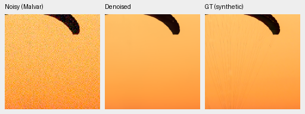
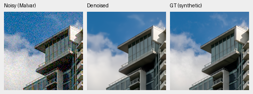
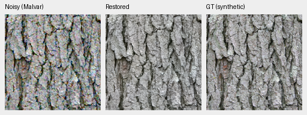
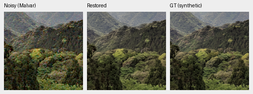
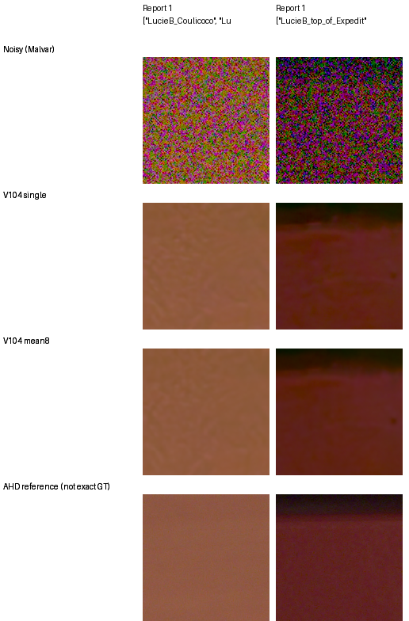
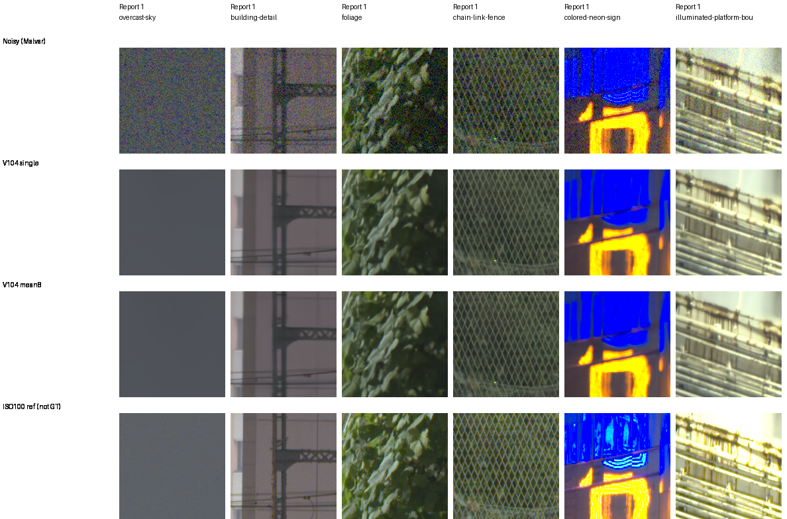

# Optional eight-view restoration

The [current V114 fixed24 pilot](results/v114-dihedral8-pilot-running-v1.json)
is running with exact saved inputs and reused V112/V104/RawNIND controls. Its
independent metrics and native review are pending. The completed measurements
below retain their explicit older checkpoints.

**V112 weights also benefit from eight views on the fixed material
panel:** all twelve cases improve, with mean+.54335/.27285/.07936dB for
ADC/ISO100/ISO12800. Both selected adverse camera crops and four selected color
cases improve over V112 single. [New native material/GFX comparisons and limits](v112-eight-view.md).
Fine real detail remains soft; full V112 eight-view panels/frame are unmeasured.

**Eight-view V104 reaches 37.04376dB on the complete 427-photo panel**, with every
source mean improving over single-view V104. Known/unseen camera means also
improve. It uses the original weights and exact sensor rotations/reflections,
requiring eight evaluations per tile. Its ADC color tail remains worse than
V112's, and fine high-noise detail stays weak. V114 is now the general learned
baseline; eight views are a measured V104 higher-PSNR option with explicit
tradeoffs. V114 eight-view quality is unmeasured.

Add `--self-ensemble dihedral8` to `demosaic infer`, `demosaic benchmark`,
`demosaic quality` or
[`scripts/export_raw_dng.py`](../scripts/export_raw_dng.py). The ordinary default
is `none`. Output receipts record the policy and model views per tile. The
reported quality uses `--precision float32`; reduced-precision quality has not
been measured for this policy. The [complete 102MP GFX export is now reviewed](dihedral-fullframe.md),
with native foliage/fence and other regions, two RGB16 files and a recorded
885.93s inference/blending interval. The pilot comparisons below use fixed
256/512-pixel contexts. All five full numerical panels and their independent
metric audit are now complete.

[Scores, sources, weights, independent audit and implementation checks](results/v104-dihedral8-pilot-v1.json).
The original final20k checkpoint is `/mnt/external/demosaic/models/v104-final20000.pt`,
SHA256 `8a3a7d94f2b1465cbdddbeec201fb37a2f69b12c74f9298527a94e3a7bbf6300`.
No weights, noise coefficients or target-dependent gains were fitted.

## Complete primary results

| Method | Photo sRGB PSNR | Known CFA PSNR | Unseen CFA PSNR | Worst ADC bias, DN16 |
| --- | ---: | ---: | ---: | ---: |
| V104 single | 36.80085 | 54.26606 | 53.91700 | 1,218.06 |
| V112 single | 36.90238 | 54.26914 | 53.95378 | **50.89** |
| V104 eight views | **37.04376** | **54.33283** | **53.99412** | 420.90 |

Eight views gain .24291dB over V104 on 427 sources, source-bootstrap 95% interval
[.23543,.25064], with 427/427 source means increasing. Known/unseen gains over
V104 are .06677/.07712dB, with 4/4 and 5/5 scene means increasing. Relative to
V112, the respective mean gains are .14138/.06369/.04034dB. Source/scene
intervals describe fixed evaluation units, not training-seed uncertainty.

[Full-panel sources, independent reductions, color/detail data and provenance](results/v104-dihedral8-full-quality-primary-v1.json) ·
[Actual full-panel native viewing](results/v104-dihedral8-full-quality-native-view-v1.json).
Some scenes remain below the stronger RawNIND reference; broad qualitative
superiority remains unachieved. V112 has lower ADC/noisy-color tails and slightly
stronger 16-pixel weak-detail recovery. At 18% gray /2% contrast /ISO12800,
eight-view gains are .00297/.09545/.63945 for 4/8/16-pixel carriers: the finest
carrier is still nearly absent.

Two native 160-pixel triplets from the completed full panel, noisy → restored →
exact synthetic GT. Both use RGGB, the ISO12800 prior, shot .00256/read variance
.0000262144, shared WB/matrix, exposure ×1 and ROI [48,48,160,160] in native 256
contexts. Pixels are never resized:

[First source/weights/conditioning/display metadata](images/v104-dihedral8-full-quality/crop-5fa4178602bc1406.json) ·
[Second metadata](images/v104-dihedral8-full-quality/crop-e2066017cc3680b3.json).
Coarse edges are preserved; faint lines in the orange field and fine cloud
texture remain smoothed. These examples supplement the fixed material and
real-camera observations below.

## Fixed photographic panel

Four previously selected, held-out sources, three conditions, RGGB, original
256-pixel observations and 240-pixel scoring interiors. All twelve sRGB PSNRs
improve; mean chroma and gradient errors fall in every condition.

| Condition | V104 single | V104 eight views | Change, dB |
| --- | ---: | ---: | ---: |
| ADC-only | 39.49290 | 40.06104 | +.56814 |
| ISO100 prior | 40.80493 | 41.09810 | +.29317 |
| ISO12800 prior | 33.49300 | 33.57486 | +.08187 |

These four-source means describe this fixed material panel, not the full 427-photo
photo panel, all four CFAs, or training-seed uncertainty. The separate
[V112 trained-model report](v112-quality.md) retains its own gains.

Noisy Malvar → **V104 eight views** → exact synthetic GT. Both examples use
160-pixel crops at ROI [48,48,160,160] within their original 256-pixel contexts, the
ISO100 prior (shot .00002/read variance .0000000016), WB=[2,1,1.5], the shared
matrix in the manifests and display exposure ×1. Pixels are never resized.

[ISO100 before/after board and source/ROI/noise/display metadata](images/v104-dihedral8-pilot/iso100-prior/manifest.json) ·
[ADC board](images/v104-dihedral8-pilot/adc-only/comparison.png) ·
[ISO12800 board](images/v104-dihedral8-pilot/iso12800-prior/comparison.png).
Fine white feathers and hairs remain smoothed, especially at high noise.

## Adverse real-camera crops

The two original V104-adverse Canon M100 crops, original input-only noise
profiles and 448-pixel measured-CFA scoring interiors are unchanged.
Independently demosaiced AHD RGB is auxiliary, **not exact GT**.

| Selected crop | V104 single | V104 eight views | RawNIND pre-upsampled |
| --- | ---: | ---: | ---: |
| Coulicoco | 56.98928 | 57.30272 | 58.98999 |
| top_of_Expedit | 60.67192 | 60.93926 | 62.07481 |

Eight views gain .31344/.26734dB, but both remain below the stronger released
RawNIND reference. Broad colored blotches remain. These are two selected
crop results, not complete camera-panel or scene means.
[Source/ROI/conditioning/display metadata](images/v104-dihedral8-pilot/camera/manifest.json).
All cells are 160-pixel crops with shared +2EV. The RawNIND numbers reuse the earlier
[audited same-crop comparison](v111-early-quality.md#complete-development-camera-panels);
no new reference inference was run.

## Standing GFX scene

All six fixed sky/building/foliage/fence/sign/platform regions use native 160
sensor-pixel crops from 512-pixel contexts and common +2EV display.
DSCF3879 ISO6400 is the input; DSCF3880 ISO100 f/5.6 is an independently
captured qualitative reference, **not GT**. Aperture, exposure and moving
subjects differ. Single/eight-view changes look small: fence/building geometry
remains coherent, while foliage and saturated-light detail remain soft.
[Complete crop and transform metadata](images/v104-dihedral8-pilot/gfx/manifest.json).
The [complete-frame eight-view comparison](dihedral-fullframe.md) now adds all
six regions from the actual RGB16 export, alongside V104/V112 single-view and
stronger RawNIND. The [main GFX gallery](gfx-qualitative.md) retains V112's
unquantized full-frame crop comparisons separately.

## Implementation and verification

Full sensor mosaics, spatial variances and the 2×2 CFA color tile receive the
same exact rotations/reflections. WB/matrix and physical noise conditioning
retain their camera meanings. Each prediction returns to the original
coordinates, then receives an equal float64 mean before float32 tile blending
and RGB16 export. No interpolation, new noise draw or fitted correction occurs.
Only the current view and accumulated sum persist; eight full-image outputs
are not retained during tiled inference.

NumPy64 independently reconstructs all 20 saved means exactly and rebuilds
photo/camera PSNR, chroma and gradient scores; maximum PSNR discrepancy is
under .000004dB. All 20 identity views exactly replay the retained original
V104 floats. SSIM and masked highlight/shadow metrics retain their original
implementation. All 80 distinct native cells were actually viewed.

## Full comparison and independent audit complete

The full comparison now uses the public photo, prepared-camera, texture and
color evaluators with `self_ensemble="dihedral8"`. Checkpoint labels and receipts
record the policy; reference methods keep their original single-view inference.
Color caches match the inference policy as well as the weights, so single-view
predictions cannot stand in for eight-view results.

| Panel | Averaged observations |
| --- | ---: |
| 427 photos + 16 procedural sources, 7 conditions × 4 CFAs | 12,404 |
| Known-camera crops | 72 |
| Unseen-camera crops | 90 |
| Weak carriers and neutral flats | 448 |
| Analytic colors | 1,176 |
| Total | 14,190 |

These require 113,520 per-image model-view evaluations. The frozen run retains
every averaged prediction and records input fingerprints, view hashes and an
independent NumPy64 reconstruction of each mean. The photographic observations
also replay the preserved single-view observation code exactly. Existing
single-view/reference results remain the controls.

The evaluation started after the exact eight-view full-GFX process and original
V111/V112 workflow completed successfully. All five numerical panels completed
under the frozen resource limits. Independent metric reconstruction and the
full-panel photo examples above are complete.
[Original plan, CPU proof and launch receipt](results/v104-dihedral8-full-quality-queued-v1.json).

The independent score audit finished after the full evaluation. It
regenerates the original input fingerprints, rehashes saved means and rebuilds
photo PSNR/detail, measured-CFA, carrier/flat and analytic-color metrics in
NumPy64. Source-weighted changes against the original V104 results and scene
comparisons against the stronger RawNIND pre-upsampled reference use existing
control measurements. Neural-module calls are forbidden during the audit.
Full photo replay uses the original CUDA RNG after evaluation finishes.

Its actual CPU fixtures agree with saved PSNR within .000004dB and reproduce
their inputs exactly. The new context replay also reproduces all 112 existing
texture batches and recovers the published V104 photo/known/unseen means.
Those fixtures were followed by the full 14,190-observation audit. Maximum
independent rendered-PSNR difference is .000203dB; color fields agree exactly
and carrier fields within 1.1e-13. SSIM and masked photo metrics retain the public
Torch implementation. Original machine receipts remain unchanged.
[Audit scope, proofs and exact process dependency](results/v104-dihedral8-audit-queued-v1.json).

Thirty-seven targeted operator tests pass, including single-view references,
measured-CFA scoring and cache-policy separation. Real-weight CPU engineering
checks complete 24 model/encoder forwards over two photo observations and one
camera crop; each streamed mean agrees exactly with the independent NumPy64
calculation. These small CPU fixtures verify execution, not full-panel quality.

The earlier pilot integration checks show that the production helper exactly
reproduces four genuine-weight pilot cases,
with 40 actual CPU forwards including tiled RGB16 write/read. A small actual
GB10/CPU 128-pixel check agrees within 1.79e-7 camera units, with identical rounded
PSNR. It overlaps training and provides no throughput measurement. Thirty-two
focused tests cover four CFA layouts, non-square/signed data, odd-sized tile
blending, native RGB16, CLI wiring and real DNG/hot-pixel/darktable export in
both policy modes.

The first geometry fixture omitted its intended above-white range; the first
renderer used a destination outside the frozen evaluator's output root; and
the first GPU validator failed to reset device-specific noise tables after
moving a previously used CPU model. Their sources/logs remain preserved.
Corrected checks pass without changing the pilot scores or model weights.

The full 427-photo, complete camera and analytic color/weak-texture panels are
complete and independently checked. The complete 102MP export
and native review are finished, with their own [file/timing evidence](dihedral-fullframe.md).
The V111/V112 and subsequent Tiny/Small comparisons are complete;
[V114 is now the general baseline](v114-v115-quality.md). All original
checkpoints, observations and sources remain unchanged.

Photo attribution: [Derek Ramsey, bark](https://commons.wikimedia.org/wiki/File:Kentucky_Coffee-tree_Gymnocladus_dioicus_3264px.jpg),
[CC BY-SA 2.5](https://creativecommons.org/licenses/by-sa/2.5/);
[Serebit, snowy egret](https://commons.wikimedia.org/wiki/File:Snowy_egret_in_profile.jpg),
[CC BY-SA 4.0](https://creativecommons.org/licenses/by-sa/4.0/);
[Grendelkhan, canopy](https://commons.wikimedia.org/wiki/File:Forest_covered_hills_on_Yakushima.jpg),
[CC BY-SA 4.0](https://creativecommons.org/licenses/by-sa/4.0/);
[Korall, raccoon](https://commons.wikimedia.org/wiki/File:Racoon_clinging_to_a_tree.JPG),
[CC BY 3.0](https://creativecommons.org/licenses/by/3.0/).
Modifications: original 8× binning/cropping, synthetic noise, restoration and
shared display conversion.
