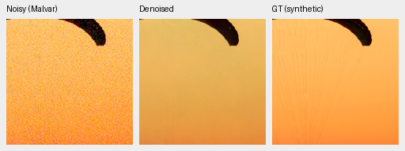
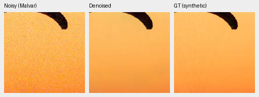
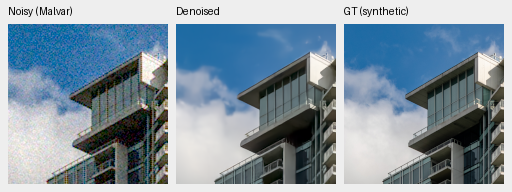
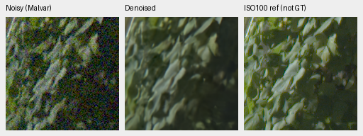
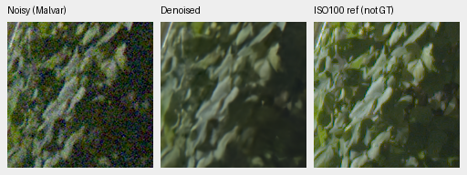
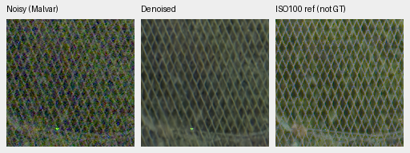
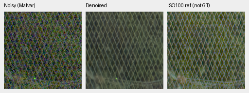
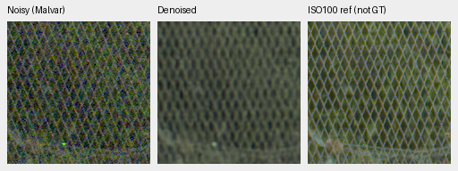

# DINOv3 ConvNeXt pyramid: completed 10,000-update review

ConvNeXt reaches **35.54954 dB** on 427 synthetic-noise photos, effectively tied
with no-context (35.55039). It gains .02492 dB on known-camera measured CFA and
loses .03866 dB on unseen cameras relative to that control. Fine texture remains
soft, and the [mature saturated-flat diagnostic](mature-color-flat-review.md)
finds large selected color errors despite neutral flats looking clean.
**No promotion: V43 stays the README working reference.**

[Complete results, provenance, audits and 120 native crop receipts](results/dino-convnext-pyramid-v58-10k-review.json).
[Architecture](dino-convnext-pyramid.md), [first1k review](dino-convnext-pyramid-v58-1k-review.md),
[original no-context/S/B10k review](fresh-dino-capacity-10k-review.md).

## Fixed comparison and complete boundary

Seed 48, batch 16, native 256px, LR 1e-4, 100-update warmup and the original 10,000-update
schedule (final LR 1e-5). Whole model/EMA/AdamW/Python/Torch/CUDA RNG resumes at 1k
and 3k preserve the planned schedule. All 403 logged domain/input/target
observations match all three original arms. Unlogged batches are not separately
hashed. Commons 40,170 / native 128 / paired 32 with 25/25/50 sampling,4×→geometry/PSF→area2,
original 8× validation, verified Gaussian initializer and physical/native/
middle-skip FP32 policy remain fixed. The new 66,934-row training corpus is not used.

The genuine frozen ConvNeXt-Tiny four-stage pyramid replaces ViT context.
Backbone, injection locations and projection capacity differ together; this is
not an isolated foundation-feature comparison. One seed under the original
nondeterministic CUDA policy does not establish a universal architecture effect.

Candidate source 797cfc8, training bundle
`aabce806f78f312b98d814c94537d23c54231e6ae1cbaab959176ab6d52d37c6`.
All 91 model / 91 EMA tensors and 89 AdamW states are finite; counters equal 10,000,
with full RNG retained. Learned EMA gate norms are .03627/.05854/.10481.
No input adapter, LoRA, expanded-paired data or new ADC policy is combined here.

| Checkpoint/reference | SHA256 |
| --- | --- |
| No context | `0df4ff404c38b8f4b42f6451486e91c97631544b1c817c126f371195942f3af4` |
| Frozen ViT-S | `ae74bc17012c85d5253f24da4dbaaec4486ed430aa143d852442754288d56bad` |
| Frozen ViT-B | `dcf3e96591d7ede1890482f874b0233a1ba9516bb9e31a042e5efa82e242ced1` |
| ConvNeXt pyramid | `cc1fb5e6d3e0d042c95495dd7bf1bd07c900cb6f7e3b61541f78c9e08098fea3` |
| RawNIND global CFA-LS | `c1f7de3de24cb12f4803ee65e11cfb467e9a5b80c3cb7126746ef026106c15e0` |
| RawNIND channel CFA-LS | `c1f7de3de24cb12f4803ee65e11cfb467e9a5b80c3cb7126746ef026106c15e0` |

## Paired real and synthetic-noise photos

| Panel | Model | Measured-CFA PSNR | AHD RGB PSNR | AHD SSIM |
| --- | --- | ---: | ---: | ---: |
| Known | No context | 54.19996 | 40.00884 | 0.931271 |
| Known | Frozen ViT-S | 54.21198 | 40.06452 | 0.931928 |
| Known | Frozen ViT-B | 54.19850 | 39.97406 | 0.930968 |
| Known | ConvNeXt pyramid | 54.22488 | 40.02138 | 0.931460 |
| Known | RawNIND global CFA-LS | 54.06860 | 39.67805 | 0.928811 |
| Known | RawNIND channel CFA-LS | 54.08474 | 39.71710 | 0.928831 |
| Unseen | No context | 53.83974 | 38.55027 | 0.921084 |
| Unseen | Frozen ViT-S | 53.78590 | 38.47549 | 0.921142 |
| Unseen | Frozen ViT-B | 53.77763 | 38.53874 | 0.920906 |
| Unseen | ConvNeXt pyramid | 53.80108 | 38.59689 | 0.921469 |
| Unseen | RawNIND global CFA-LS | 53.56220 | 38.14484 | 0.918380 |
| Unseen | RawNIND channel CFA-LS | 53.76822 | 38.56191 | 0.922127 |

Known4 covers 8 pairs / 72 crops; unseen5 covers 10 pairs / 90 crops. Registered low-noise
measured CFA is primary. Independently demosaiced LibRaw AHD RGB is auxiliary,
**not exact RGB GT**. RawNIND uses publisher ADC normalization with global or
channel gains fitted only from observed noisy CFA. Protected-final 16-scene
scoring remains closed.

| Model | 427-photo PSNR | SSIM | 16-procedural PSNR | SSIM |
| --- | ---: | ---: | ---: | ---: |
| No context | 35.55039 | 0.961097 | 34.01121 | 0.970106 |
| Frozen ViT-S | 35.40609 | 0.960561 | 33.90517 | 0.970858 |
| Frozen ViT-B | 35.48886 | 0.960941 | 34.10212 | 0.970409 |
| ConvNeXt pyramid | 35.54954 | 0.961229 | 34.15831 | 0.970347 |
| RawNIND global CFA-LS | 26.69578 | 0.790028 | 24.97426 | 0.720411 |
| RawNIND channel CFA-LS | 26.68357 | 0.789899 | 24.98568 | 0.720500 |

| Difference, dB [95% source interval] | Known primary | Unseen primary | Photo sRGB | Procedural sRGB |
| --- | --- | --- | --- | --- |
| ConvNeXt − No context | +0.02492 [+0.01499, +0.03484] | -0.03866 [-0.07574, -0.00626] | -0.00086 [-0.04552, +0.03194] | +0.14710 [-0.21430, +0.61130] |
| ConvNeXt − Frozen ViT-S | +0.01290 [-0.04067, +0.08478] | +0.01518 [-0.03089, +0.06027] | +0.14345 [+0.11920, +0.16614] | +0.25314 [-0.03068, +0.68041] |
| ConvNeXt − Frozen ViT-B | +0.02638 [+0.01031, +0.03744] | +0.02345 [-0.01915, +0.06792] | +0.06068 [+0.03053, +0.09049] | +0.05620 [-0.29818, +0.49778] |
| ConvNeXt − RawNIND channel CFA-LS | +0.14014 [-0.25741, +0.47220] | +0.03287 [-0.26249, +0.31695] | +8.86596 [+8.69562, +9.04998] | +9.17263 [+8.04458, +10.08130] |

Intervals use 1,000 paired source/scene bootstrap draws, seed 42. They quantify
variation across these evaluation sources, not training-repeat uncertainty.
Large synthetic gains over RawNIND coexist with uncertain paired-real margins;
they do not establish the requested broad real-photo qualitative superiority.

## Native exact-GT crops

Each panel is native 160×160 at the 8×-binned evaluation resolution; no resizing.
Noisy Malvar → denoised → exact simulated target. Shared tileROI[48,48,160,160],
RGGB, ISO12800 protocol prior (shot=.00256/read variance=.0000262144), ADC16/
black.03, WB[2,1,1.5], recorded matrix and display exposure×1. All sources, cache
identities, checkpoint hashes and conditioning records are in each receipt.
PNGs are 8-bit previews; statistics use unquantized predictions.

Building edges clean with softened cloud wisps. Selected photographic fabric orange is closer to GT than older late no-context/S crops, but fine cords are missing and the independent saturated uniform-field diagnostic still fails. No claim of repaired general color fidelity.

Sources: [Roy Egloff](https://commons.wikimedia.org/wiki/File:CH.VD.Villeneuve_2007-08-25_Vertigo-Swiss-Riviera_2392_3x2-R_4K.jpg)
and [Dietmar Rabich](https://commons.wikimedia.org/wiki/File:Vancouver_(BC,_Canada),_Coal_Harbour_Seaside_Park,_Blick_in_den_Himmel_--_2022_--_2158.jpg),
[CC BY-SA4.0](https://creativecommons.org/licenses/by-sa/4.0/). Modified by binning,
cropping, noise simulation and restoration; previews retain that license.
Paired scenes: Benoit Brummer and Christophe De Vleeschouwer,
[RawNIND](https://doi.org/10.14428/DVN/DEQCIM); individual credits in receipts.

### Fabric: exact simulated GT

No context

ConvNeXt pyramid

RawNIND channel CFA-LS

### Building and sky: exact simulated GT

No context

ConvNeXt pyramid

RawNIND channel CFA-LS

## Weak texture and neutral fields

The separate analytic panel has 2,240 cases: 384 carrier and 64 neutral-field
observations per method for four networks and Malvar. Groups use four CFAs × four
draws; ADC-only duplicate draws are not independent evidence. Selected
ISO12800-prior group means follow; level/contrast/period identify the fields.

| Field level/contrast/period | Model | In-phase gain | Linear-sRGB RMSE |
| --- | --- | ---: | ---: |
| 0.01/0.1/8 | No context | 0.006747 | 0.000758 |
| 0.01/0.1/8 | Frozen ViT-S | 0.010966 | 0.000753 |
| 0.01/0.1/8 | Frozen ViT-B | 0.013135 | 0.000758 |
| 0.01/0.1/8 | ConvNeXt pyramid | 0.011817 | 0.000750 |
| 0.01/0.1/8 | malvar | 1.029130 | 0.009907 |
| 0.18/0.02/16 | No context | 0.380523 | 0.002160 |
| 0.18/0.02/16 | Frozen ViT-S | 0.297953 | 0.002254 |
| 0.18/0.02/16 | Frozen ViT-B | 0.193598 | 0.002473 |
| 0.18/0.02/16 | ConvNeXt pyramid | 0.527192 | 0.001905 |
| 0.18/0.02/16 | malvar | 0.991767 | 0.027133 |
| Flat 0.18 | No context | — | 0.001077 |
| Flat 0.18 | Frozen ViT-S | — | 0.001056 |
| Flat 0.18 | Frozen ViT-B | — | 0.001071 |
| Flat 0.18 | ConvNeXt pyramid | — | 0.001009 |
| Flat 0.18 | malvar | — | 0.027119 |

Dark carrier is almost erased; brighter weak carrier is faint and far below true amplitude. Neutral flat is smooth with mild broad residual variation; neutral success does not establish saturated-color accuracy.
The separate [colored-flat review](mature-color-flat-review.md) is essential:
neutral-field success misses the mature warm/cyclic-GBR failures.

## Standing GFX and additional cameras

Cached DSCF3879 ISO6400 and DSCF3880 ISO100 are used read-only. Full 102 MP outputs
provide the standing four native 160px regions, WB[1.513245,1,2.215232] and shared
display×4 (+2EV). Haar-estimated conditioning: shot=.0014635775921166604,
read variance=1.0715704128646712e-6. The captures are 3m38s apart, with different
aperture/exposure and moving subjects. ISO100 f/5.6 is a separate qualitative
reference, **not GT**, and is never a pixelwise score or fitted output target.

Sky is smooth. Building truss/edges have softened transitions and lost small detail. Foliage is strongly smoothed and some leaves merge. Fence mesh is visible but smoother/lower contrast than independent ISO100 reference. Aperture/exposure/motion differ: ISO100 is not GT; no real pixelwise score or broad winner.

### GFX foliage: separate ISO100 reference

No context

ConvNeXt pyramid

RawNIND channel CFA-LS

### GFX chain-link-fence: separate ISO100 reference

No context

ConvNeXt pyramid

RawNIND channel CFA-LS

All 48 new triplets viewed. Q2 dark diagonal texture remains smooth in all four models and both RawNIND baselines, with no decisive model distinction. Sony aircraft panel grain is reduced; thin seams/reflection and already-soft window edges remain soft, broadly similar across four models. GF50R stone fine texture is less blurred in all four than RawNIND; stone color is similar among four. These six ROIs / three captures have no GT, and do not establish broad superiority.
The gallery retains both RawNIND comparators for each method and ROI. Their
third panels are explicitly labeled comparators, not GT. Crops use the saved
512px contexts and metadata rather than decoding cold RAWs.

## Full-frame integrity and measured speed

All 12 full 101.996 MP RGB16 TIFFs (linear and sRGB for six methods) pass complete
hash, dimensions, RGB/uint16 tag and more-than256-code checks. All 35 retained
F32 contexts pass checks. This verifies encoding/artifact integrity; only the
selected native crops were visually reviewed, not every full-frame pixel.

| Method | One full-frame inference, seconds | Peak CUDA GB |
| --- | ---: | ---: |
| No context | 30.72 | 2.646 |
| Frozen ViT-S | 33.47 | 2.691 |
| Frozen ViT-B | 36.67 | 2.691 |
| ConvNeXt pyramid | 34.66 | 2.893 |
| RawNIND global CFA-LS | 17.64 | 2.348 |
| RawNIND channel CFA-LS | 17.37 | 2.348 |

Native 512px tiles, 64px overlap, batch 4, neural FP16 / physical FP32. These are one-pass
inference timings in a shared-machine workflow, excluding RAW decoding and
TIFF encoding, rather than a repeated speed sweep. ConvNeXt remains above the
10-second goal; V42 hidden autocast is not enabled in this controlled recipe.

## Independent checks and visual review scope

All 113,094 synthetic/paired case rows and 432 comparison intervals independently
rebuild with maximum arithmetic discrepancy 1.42e-14. All 100,528 original control
cases replay exactly, including every neural, RawNIND and classical metric and
nullable-support mask. All 120 native PNGs pass checksum/geometry/coordinate/
transform checks; noisy/reference panels agree across methods. Reused restored
panels also agree between both three-camera comparator triplets.

The visual review actually opened 61 new PNGs. Another 39 previously viewed
control files match whole-PNG SHA256. The 20 older GFX control triplets have
changed header text, but every pixel of all three 160×160 image panels is byte
identical to the previously viewed publication; those exact native panels are
reused with explicit provenance. This is not a claim of 120 newly opened PNGs.
No synthetic flat/photo result substitutes for a real-reference or full-frame
visual claim. Complete audit drivers and receipts are linked above.

## Complete native crop gallery

| Panel / source | Native triplets |
| --- | --- |
| known / 2pilesofplates | [No context](images/fresh-dino-10k-none-known-2pilesofplates.png), [Frozen ViT-S](images/fresh-dino-10k-S-known-2pilesofplates.png), [Frozen ViT-B](images/fresh-dino-10k-B-known-2pilesofplates.png), [ConvNeXt pyramid](images/convnext-v58-10k-V58-known-2pilesofplates.png), [RawNIND global CFA-LS](images/fresh-dino-10k-raw-global-known-2pilesofplates.png), [RawNIND channel CFA-LS](images/fresh-dino-10k-raw-channel-known-2pilesofplates.png) |
| known / 7D-1 | [No context](images/fresh-dino-10k-none-known-7D-1.png), [Frozen ViT-S](images/fresh-dino-10k-S-known-7D-1.png), [Frozen ViT-B](images/fresh-dino-10k-B-known-7D-1.png), [ConvNeXt pyramid](images/convnext-v58-10k-V58-known-7D-1.png), [RawNIND global CFA-LS](images/fresh-dino-10k-raw-global-known-7D-1.png), [RawNIND channel CFA-LS](images/fresh-dino-10k-raw-channel-known-7D-1.png) |
| unseen / LucieB_3apples | [No context](images/fresh-dino-10k-none-unseen-LucieB_3apples.png), [Frozen ViT-S](images/fresh-dino-10k-S-unseen-LucieB_3apples.png), [Frozen ViT-B](images/fresh-dino-10k-B-unseen-LucieB_3apples.png), [ConvNeXt pyramid](images/convnext-v58-10k-V58-unseen-LucieB_3apples.png), [RawNIND global CFA-LS](images/fresh-dino-10k-raw-global-unseen-LucieB_3apples.png), [RawNIND channel CFA-LS](images/fresh-dino-10k-raw-channel-unseen-LucieB_3apples.png) |
| unseen / LucieB_Coulicoco | [No context](images/fresh-dino-10k-none-unseen-LucieB_Coulicoco.png), [Frozen ViT-S](images/fresh-dino-10k-S-unseen-LucieB_Coulicoco.png), [Frozen ViT-B](images/fresh-dino-10k-B-unseen-LucieB_Coulicoco.png), [ConvNeXt pyramid](images/convnext-v58-10k-V58-unseen-LucieB_Coulicoco.png), [RawNIND global CFA-LS](images/fresh-dino-10k-raw-global-unseen-LucieB_Coulicoco.png), [RawNIND channel CFA-LS](images/fresh-dino-10k-raw-channel-unseen-LucieB_Coulicoco.png) |
| full427 / 0014aa4e075b1827f91ef8a02069e1e318f040ba | [No context](images/fresh-dino-10k-none-full427-0014aa4e.png), [Frozen ViT-S](images/fresh-dino-10k-S-full427-0014aa4e.png), [Frozen ViT-B](images/fresh-dino-10k-B-full427-0014aa4e.png), [ConvNeXt pyramid](images/convnext-v58-10k-V58-full427-0014aa4e.png), [RawNIND global CFA-LS](images/fresh-dino-10k-raw-global-full427-0014aa4e.png), [RawNIND channel CFA-LS](images/fresh-dino-10k-raw-channel-full427-0014aa4e.png) |
| full427 / 002fc6eeadf637e81d5a327f117b79abb86becd9 | [No context](images/fresh-dino-10k-none-full427-002fc6ee.png), [Frozen ViT-S](images/fresh-dino-10k-S-full427-002fc6ee.png), [Frozen ViT-B](images/fresh-dino-10k-B-full427-002fc6ee.png), [ConvNeXt pyramid](images/convnext-v58-10k-V58-full427-002fc6ee.png), [RawNIND global CFA-LS](images/fresh-dino-10k-raw-global-full427-002fc6ee.png), [RawNIND channel CFA-LS](images/fresh-dino-10k-raw-channel-full427-002fc6ee.png) |
| analytic / carrier-l0.01-c0.1-p8-draw0 | [No context](images/fresh-dino-10k-none-analytic-carrier-l0.01-c0.1-p8-draw0.png), [Frozen ViT-S](images/fresh-dino-10k-S-analytic-carrier-l0.01-c0.1-p8-draw0.png), [Frozen ViT-B](images/fresh-dino-10k-B-analytic-carrier-l0.01-c0.1-p8-draw0.png), [ConvNeXt pyramid](images/convnext-v58-10k-V58-analytic-carrier-l0-01-c0-1-p8-draw0.png) |
| analytic / carrier-l0.18-c0.02-p16-draw0 | [No context](images/fresh-dino-10k-none-analytic-carrier-l0.18-c0.02-p16-draw0.png), [Frozen ViT-S](images/fresh-dino-10k-S-analytic-carrier-l0.18-c0.02-p16-draw0.png), [Frozen ViT-B](images/fresh-dino-10k-B-analytic-carrier-l0.18-c0.02-p16-draw0.png), [ConvNeXt pyramid](images/convnext-v58-10k-V58-analytic-carrier-l0-18-c0-02-p16-draw0.png) |
| analytic / flat-l0.18-draw0 | [No context](images/fresh-dino-10k-none-analytic-flat-l0.18-draw0.png), [Frozen ViT-S](images/fresh-dino-10k-S-analytic-flat-l0.18-draw0.png), [Frozen ViT-B](images/fresh-dino-10k-B-analytic-flat-l0.18-draw0.png), [ConvNeXt pyramid](images/convnext-v58-10k-V58-analytic-flat-l0-18-draw0.png) |
| gfx / overcast-sky | [No context](images/convnext-v58-10k-none-gfx-overcast-sky.png), [Frozen ViT-S](images/convnext-v58-10k-S-gfx-overcast-sky.png), [Frozen ViT-B](images/convnext-v58-10k-B-gfx-overcast-sky.png), [ConvNeXt pyramid](images/convnext-v58-10k-V58-gfx-overcast-sky.png), [RawNIND global CFA-LS](images/convnext-v58-10k-raw-global-gfx-overcast-sky.png), [RawNIND channel CFA-LS](images/convnext-v58-10k-raw-channel-gfx-overcast-sky.png) |
| gfx / building-detail | [No context](images/convnext-v58-10k-none-gfx-building-detail.png), [Frozen ViT-S](images/convnext-v58-10k-S-gfx-building-detail.png), [Frozen ViT-B](images/convnext-v58-10k-B-gfx-building-detail.png), [ConvNeXt pyramid](images/convnext-v58-10k-V58-gfx-building-detail.png), [RawNIND global CFA-LS](images/convnext-v58-10k-raw-global-gfx-building-detail.png), [RawNIND channel CFA-LS](images/convnext-v58-10k-raw-channel-gfx-building-detail.png) |
| gfx / foliage | [No context](images/convnext-v58-10k-none-gfx-foliage.png), [Frozen ViT-S](images/convnext-v58-10k-S-gfx-foliage.png), [Frozen ViT-B](images/convnext-v58-10k-B-gfx-foliage.png), [ConvNeXt pyramid](images/convnext-v58-10k-V58-gfx-foliage.png), [RawNIND global CFA-LS](images/convnext-v58-10k-raw-global-gfx-foliage.png), [RawNIND channel CFA-LS](images/convnext-v58-10k-raw-channel-gfx-foliage.png) |
| gfx / chain-link-fence | [No context](images/convnext-v58-10k-none-gfx-chain-link-fence.png), [Frozen ViT-S](images/convnext-v58-10k-S-gfx-chain-link-fence.png), [Frozen ViT-B](images/convnext-v58-10k-B-gfx-chain-link-fence.png), [ConvNeXt pyramid](images/convnext-v58-10k-V58-gfx-chain-link-fence.png), [RawNIND global CFA-LS](images/convnext-v58-10k-raw-global-gfx-chain-link-fence.png), [RawNIND channel CFA-LS](images/convnext-v58-10k-raw-channel-gfx-chain-link-fence.png) |
| three-camera / LEICA Q2-upper-left-raw-global | [No context](images/convnext-v58-10k-none-three-camera-LEICA-Q2-upper-left-raw-global.png), [Frozen ViT-S](images/convnext-v58-10k-S-three-camera-LEICA-Q2-upper-left-raw-global.png), [Frozen ViT-B](images/convnext-v58-10k-B-three-camera-LEICA-Q2-upper-left-raw-global.png), [ConvNeXt pyramid](images/convnext-v58-10k-V58-three-camera-LEICA-Q2-upper-left-raw-global.png) |
| three-camera / LEICA Q2-upper-left-raw-channel | [No context](images/convnext-v58-10k-none-three-camera-LEICA-Q2-upper-left-raw-channel.png), [Frozen ViT-S](images/convnext-v58-10k-S-three-camera-LEICA-Q2-upper-left-raw-channel.png), [Frozen ViT-B](images/convnext-v58-10k-B-three-camera-LEICA-Q2-upper-left-raw-channel.png), [ConvNeXt pyramid](images/convnext-v58-10k-V58-three-camera-LEICA-Q2-upper-left-raw-channel.png) |
| three-camera / LEICA Q2-lower-right-raw-global | [No context](images/convnext-v58-10k-none-three-camera-LEICA-Q2-lower-right-raw-global.png), [Frozen ViT-S](images/convnext-v58-10k-S-three-camera-LEICA-Q2-lower-right-raw-global.png), [Frozen ViT-B](images/convnext-v58-10k-B-three-camera-LEICA-Q2-lower-right-raw-global.png), [ConvNeXt pyramid](images/convnext-v58-10k-V58-three-camera-LEICA-Q2-lower-right-raw-global.png) |
| three-camera / LEICA Q2-lower-right-raw-channel | [No context](images/convnext-v58-10k-none-three-camera-LEICA-Q2-lower-right-raw-channel.png), [Frozen ViT-S](images/convnext-v58-10k-S-three-camera-LEICA-Q2-lower-right-raw-channel.png), [Frozen ViT-B](images/convnext-v58-10k-B-three-camera-LEICA-Q2-lower-right-raw-channel.png), [ConvNeXt pyramid](images/convnext-v58-10k-V58-three-camera-LEICA-Q2-lower-right-raw-channel.png) |
| three-camera / ILCE-7RM2-upper-left-raw-global | [No context](images/convnext-v58-10k-none-three-camera-ILCE-7RM2-upper-left-raw-global.png), [Frozen ViT-S](images/convnext-v58-10k-S-three-camera-ILCE-7RM2-upper-left-raw-global.png), [Frozen ViT-B](images/convnext-v58-10k-B-three-camera-ILCE-7RM2-upper-left-raw-global.png), [ConvNeXt pyramid](images/convnext-v58-10k-V58-three-camera-ILCE-7RM2-upper-left-raw-global.png) |
| three-camera / ILCE-7RM2-upper-left-raw-channel | [No context](images/convnext-v58-10k-none-three-camera-ILCE-7RM2-upper-left-raw-channel.png), [Frozen ViT-S](images/convnext-v58-10k-S-three-camera-ILCE-7RM2-upper-left-raw-channel.png), [Frozen ViT-B](images/convnext-v58-10k-B-three-camera-ILCE-7RM2-upper-left-raw-channel.png), [ConvNeXt pyramid](images/convnext-v58-10k-V58-three-camera-ILCE-7RM2-upper-left-raw-channel.png) |
| three-camera / ILCE-7RM2-lower-right-raw-global | [No context](images/convnext-v58-10k-none-three-camera-ILCE-7RM2-lower-right-raw-global.png), [Frozen ViT-S](images/convnext-v58-10k-S-three-camera-ILCE-7RM2-lower-right-raw-global.png), [Frozen ViT-B](images/convnext-v58-10k-B-three-camera-ILCE-7RM2-lower-right-raw-global.png), [ConvNeXt pyramid](images/convnext-v58-10k-V58-three-camera-ILCE-7RM2-lower-right-raw-global.png) |
| three-camera / ILCE-7RM2-lower-right-raw-channel | [No context](images/convnext-v58-10k-none-three-camera-ILCE-7RM2-lower-right-raw-channel.png), [Frozen ViT-S](images/convnext-v58-10k-S-three-camera-ILCE-7RM2-lower-right-raw-channel.png), [Frozen ViT-B](images/convnext-v58-10k-B-three-camera-ILCE-7RM2-lower-right-raw-channel.png), [ConvNeXt pyramid](images/convnext-v58-10k-V58-three-camera-ILCE-7RM2-lower-right-raw-channel.png) |
| three-camera / GFX 50R-upper-left-raw-global | [No context](images/convnext-v58-10k-none-three-camera-GFX-50R-upper-left-raw-global.png), [Frozen ViT-S](images/convnext-v58-10k-S-three-camera-GFX-50R-upper-left-raw-global.png), [Frozen ViT-B](images/convnext-v58-10k-B-three-camera-GFX-50R-upper-left-raw-global.png), [ConvNeXt pyramid](images/convnext-v58-10k-V58-three-camera-GFX-50R-upper-left-raw-global.png) |
| three-camera / GFX 50R-upper-left-raw-channel | [No context](images/convnext-v58-10k-none-three-camera-GFX-50R-upper-left-raw-channel.png), [Frozen ViT-S](images/convnext-v58-10k-S-three-camera-GFX-50R-upper-left-raw-channel.png), [Frozen ViT-B](images/convnext-v58-10k-B-three-camera-GFX-50R-upper-left-raw-channel.png), [ConvNeXt pyramid](images/convnext-v58-10k-V58-three-camera-GFX-50R-upper-left-raw-channel.png) |
| three-camera / GFX 50R-lower-right-raw-global | [No context](images/convnext-v58-10k-none-three-camera-GFX-50R-lower-right-raw-global.png), [Frozen ViT-S](images/convnext-v58-10k-S-three-camera-GFX-50R-lower-right-raw-global.png), [Frozen ViT-B](images/convnext-v58-10k-B-three-camera-GFX-50R-lower-right-raw-global.png), [ConvNeXt pyramid](images/convnext-v58-10k-V58-three-camera-GFX-50R-lower-right-raw-global.png) |
| three-camera / GFX 50R-lower-right-raw-channel | [No context](images/convnext-v58-10k-none-three-camera-GFX-50R-lower-right-raw-channel.png), [Frozen ViT-S](images/convnext-v58-10k-S-three-camera-GFX-50R-lower-right-raw-channel.png), [Frozen ViT-B](images/convnext-v58-10k-B-three-camera-GFX-50R-lower-right-raw-channel.png), [ConvNeXt pyramid](images/convnext-v58-10k-V58-three-camera-GFX-50R-lower-right-raw-channel.png) |
