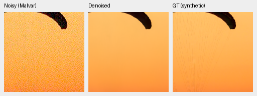
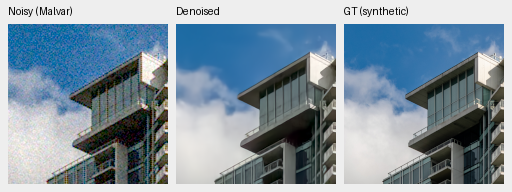
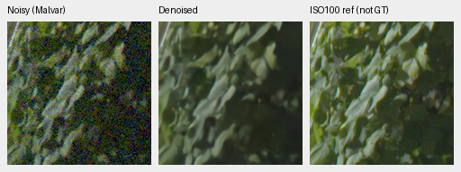
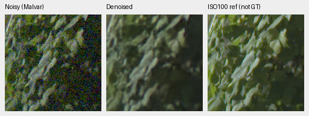
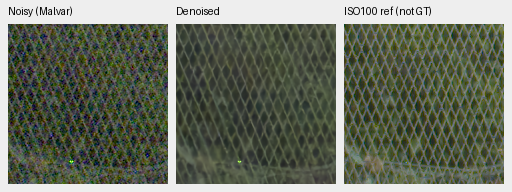
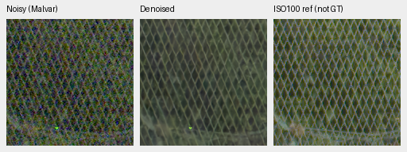
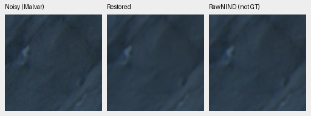
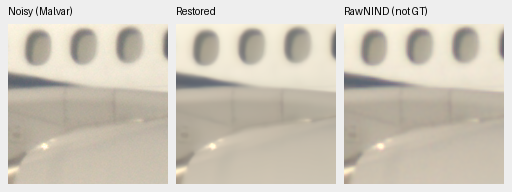
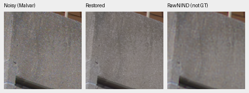

# DINOv3 ConvNeXt pyramid: first 1,000-update review

The early result is mixed. ConvNeXt reaches **34.55768 dB** on 427 synthetic-noise
photos: 0.04024 dB below no-context, 0.08443 above ViT-S and close to ViT-B.
Known-camera primary improves 0.10783 dB over no-context, while unseen primary
falls 0.10475. Weak-carrier gains and neutral-flat residuals improve slightly at
the displayed settings, but fine fabric texture and real-photo detail remain
soft. **Continue the original 10,000-update schedule without promotion.** V43
stays the README working reference; first 1,000 does not establish convergence.

[Complete scores, provenance and 120 native crop receipts](results/dino-convnext-pyramid-v58-1k-review.json).
[Architecture and genuine CPU/CUDA checks](dino-convnext-pyramid.md).
[Completed original10k comparison](fresh-dino-capacity-10k-review.md).

## Fixed comparison

All four begin from the same verified Gaussian RGB restoration weights, with
zero measurement/context heads and common CNN initialization. Seed 48, batch 16,
native 256px patches, LR1e-4/warmup 100 / planned 10,000 and exactly 1,000 AdamW updates.
Commons 40,170 / native 128 / original paired 32, 25/25/50 mix,4×→geometry/PSF→area2,
physical/native/middle-skip FP32 policy and original 8× validation are fixed.
All 41 logged input/target batches match each original arm. Genuine frozen
ConvNeXt-Tiny replaces ViT context with a four-stage feature pyramid and three
zero-gated CNN injections. Backbone, fusion and projection capacity differ
jointly; this is not an isolated feature-quality or capacity ablation.

Frozen source 797cfc8; training source bundle
`aabce806f78f312b98d814c94537d23c54231e6ae1cbaab959176ab6d52d37c6`.
Candidate whole-state SHA256
`afc0806d0c99a38bed33364bbf93ab94302080e4d78e1da044a2b782a97c7dfa`.
All 91 model / 91 EMA tensors, 89 AdamW states and logged losses/gradient norms are
finite; counters equal 1,000. Full Python/Torch/CUDA RNG is retained. The encoder
uses the verified genuine revision 10d30274b4d445111e2d5bf75ac93bbd94db274b.
No input adapter, LoRA, weak-source, ADC or corpus intervention is combined here.
New Commons arrivals stay outside this trial's frozen data.

| Panel | Model | Measured-CFA PSNR | AHD RGB PSNR | AHD SSIM |
| --- | --- | ---: | ---: | ---: |
| Known | No context | 54.17774 | 39.81197 | 0.929875 |
| Known | Frozen ViT-S | 54.12663 | 39.75493 | 0.928851 |
| Known | Frozen ViT-B | 54.15941 | 39.86447 | 0.930075 |
| Known | ConvNeXt pyramid | 54.28558 | 39.90222 | 0.929767 |
| Known | RawNIND global CFA-LS | 54.06860 | 39.67805 | 0.928811 |
| Known | RawNIND channel CFA-LS | 54.08474 | 39.71710 | 0.928831 |
| Unseen | No context | 53.65522 | 38.02854 | 0.914100 |
| Unseen | Frozen ViT-S | 53.39479 | 37.81912 | 0.914504 |
| Unseen | Frozen ViT-B | 53.38600 | 37.97445 | 0.914981 |
| Unseen | ConvNeXt pyramid | 53.55048 | 38.16913 | 0.914657 |
| Unseen | RawNIND global CFA-LS | 53.56220 | 38.14484 | 0.918380 |
| Unseen | RawNIND channel CFA-LS | 53.76822 | 38.56191 | 0.922127 |

Known4 has 8 pairs/72 crops; unseen5 has 10 pairs/90 crops. Registered low-noise
measured CFA is primary. Independent LibRaw AHD RGB is auxiliary, **not exact
RGB GT**. Both RawNIND variants use publisher global-ADC normalization and
observed-CFA-only gain calibration. Protected-final 16-scene scoring stays closed.

| Model | 427-photo PSNR | SSIM | 16-procedural PSNR | SSIM |
| --- | ---: | ---: | ---: | ---: |
| No context | 34.59792 | 0.953346 | 32.98414 | 0.960873 |
| Frozen ViT-S | 34.47325 | 0.952648 | 33.05082 | 0.957839 |
| Frozen ViT-B | 34.55073 | 0.953021 | 33.03041 | 0.959794 |
| ConvNeXt pyramid | 34.55768 | 0.952849 | 32.87390 | 0.957872 |
| RawNIND global CFA-LS | 26.69578 | 0.790028 | 24.97426 | 0.720411 |
| RawNIND channel CFA-LS | 26.68357 | 0.789899 | 24.98568 | 0.720500 |

| Difference, dB [95% source interval] | Known primary | Unseen primary | Photo sRGB | Procedural sRGB |
| --- | --- | --- | --- | --- |
| ConvNeXt − No context | +0.10783 [+0.04273, +0.18973] | -0.10475 [-0.17935, -0.03298] | -0.04024 [-0.05350, -0.02620] | -0.11024 [-0.34989, +0.16265] |
| ConvNeXt − Frozen ViT-S | +0.15894 [+0.10902, +0.18864] | +0.15568 [+0.11295, +0.19390] | +0.08443 [+0.06482, +0.10572] | -0.17693 [-0.36163, -0.00770] |
| ConvNeXt − Frozen ViT-B | +0.12616 [+0.08632, +0.16308] | +0.16448 [+0.06093, +0.24139] | +0.00695 [-0.01393, +0.03061] | -0.15652 [-0.33970, +0.02019] |
| ConvNeXt − RawNIND channel CFA-LS | +0.20084 [-0.23302, +0.63469] | -0.21774 [-0.50958, +0.11762] | +7.87411 [+7.72095, +8.02115] | +7.88822 [+7.44835, +8.34496] |

Nine methods × 443 sources × 7 conditions × 4 CFAs = 111,636 synthetic cases,
plus 648 known and 810 unseen real cases. The independent saved-score audit
rebuilt all 113,094 rows and 432 paired comparison intervals, with maximum
arithmetic discrepancy 1.42e-14. All 99,232 old synthetic control cases and 1,296
old paired cases replay exactly, including all 37,212 old neural synthetic
cases and 62,830 classical/RawNIND cases across panels. All nullable support
matches. Evaluation-source intervals use 1,000 paired bootstrap resamples,
seed 42; they do not quantify training-repeat uncertainty. One seed under the
original nondeterministic CUDA policy does not establish a universal effect.

## Native exact-GT comparisons

Noisy Malvar → restored → exact simulated clean target. Each panel is native
160×160 at the 8×-binned evaluation resolution; no resizing. Shared evaluation-tile
ROI[48,48,160,160], RGGB/ISO12800 prior, `shot=.00256`, `read=.0000262144`,
ADC16/black.03, display×1, WB[2,1,1.5] and fixed camera matrix. Source/cache,
validation-index/seed, checkpoint, noise and transform records are in each crop
receipt. PNGs are 8-bit previews; scores use unquantized outputs.

All four learned models remove grain but lose the fine fabric cords. No gross late10k-style color shift appears at this first 1,000 crop; V58 fabric color looks close to the others, with similarly smooth texture. V58 building edges clean, cloud texture softened; no decisive fine-detail gain over no-context/S/B. Both RawNIND variants have softer/color-fringed building outlines. Synthetic GT exact for these generated observations.

Sources: [Roy Egloff](https://commons.wikimedia.org/wiki/File:CH.VD.Villeneuve_2007-08-25_Vertigo-Swiss-Riviera_2392_3x2-R_4K.jpg)
and [Dietmar Rabich](https://commons.wikimedia.org/wiki/File:Vancouver_(BC,_Canada),_Coal_Harbour_Seaside_Park,_Blick_in_den_Himmel_--_2022_--_2158.jpg),
[CC BY-SA4.0](https://creativecommons.org/licenses/by-sa/4.0/). Modified by binning,
crop, simulated noise, restoration and rendering; previews retain that license.
Paired scenes: Benoit Brummer and Christophe De Vleeschouwer,
[RawNIND](https://doi.org/10.14428/DVN/DEQCIM); per-scene credits in receipts.

### Fabric: exact simulated GT

No context

ConvNeXt pyramid

RawNIND channel CFA-LS

### Building and sky: exact simulated GT

No context

ConvNeXt pyramid

RawNIND channel CFA-LS

## Weak texture and flat fields

Matched 384 CPU-seeded carriers plus 64 neutral-flat observations, evaluated in
CUDA FP16 for the four networks and Malvar: 2,240 cases. Each group has 16 cases
(four CFAs ×four draws); ADC-only duplicate draws are not independent evidence.

At level .01 / contrast .1 / period 8 under ISO12800 noise, carrier gain is
.01212/.00181/.02084/**.02351** for no-context/S/B/ConvNeXt versus 1.02913 for
Malvar: all learned models almost erase this dark structure. At
level .18 / contrast .02 / period 16, gains are .16760/.10147/.12035/**.19024** versus
.99177. ConvNeXt's noncarrierRMS is .001236 versus no-context .001383 and
Malvar .027126. Slightly more carrier recovery coexists with heavy attenuation.

Neutral level .18 flat-field linearRMSE is .001652/.001570/.001522/**.001475**;
relative bandRMS .003475/.003060/.003239/**.002919**. Malvar is .027119/.059389.
These are residual-energy diagnostics, not a complete hallucination detector,
and neutral fields do not validate saturated colors.

Dark carrier almost removed in all four models. Brighter weak carrier has faint residual broad bands, strongly attenuated relative to analytic GT; V58/none retain slightly more measured carrier gain than S/B but none approaches true amplitude. Neutral flats look clean with mild residual low-frequency variation; this does not rule out other false detail or color failures.

## Standing GFX and additional cameras

Full 102 MP DSCF3879 ISO6400 f/1.7 → restored → separate DSCF3880 ISO100 f/5.6.
Both RAFs come from the local cache; this scene and siblings stay outside
training. Native 160px foliage[8890,5570], fence[2240,6000] (reference x2241),
sky[5800,1400], building[5790,2690] (reference x5791). Shared +2 EV/WB/matrix and
input-only `shot=.0014635775921166604`, `read=.0000010715704128646712`.
Time 3m38s/aperture/moving subjects differ: **ISO100 is a qualitative reference,
not GT**. No warping, reference gain fitting or pixelwise GFX reference score.
Captures by the project owner.

All four learned models remove strong grain and retain more continuous fence strands than both RawNIND variants. Sky smooth; building bracket/truss and fine foliage remain softened. V58 foliage/fence broadly similar to the other learned methods, without a decisive detail gain. RawNIND foliage blotchier and mesh crossings less separated. ISO100 f/5.6 aperture/time/motion differences limit reference interpretation.

### GFX foliage: separate ISO100 reference

No context

ConvNeXt pyramid

RawNIND channel CFA-LS

### GFX chain-link-fence: separate ISO100 reference

No context

ConvNeXt pyramid

RawNIND channel CFA-LS

Locally cached Leica Q2, Sony a7R II and GFX50R examples use identical fixed 512px
contexts and two native 160px ROIs per camera. Noisy → restored → RawNIND on the
same noisy capture. The third panel is a comparator, **not GT**; there is no
clean reference or pixelwise score. Both global/channel calibration variants
are retained in the complete gallery, with source/ROI/WB/matrix/input-only noise
and display exposure in the receipts. Captures by the project owner.

All four learned models have similar soft Q2 rock/shadow structure and Sony wall/windows. Some low-contrast texture is smoothed; neither method is a clean reference. GFX50R concrete seams are sharper than both RawNIND variants, with stronger residual/coherent surface variation that cannot be assigned to true detail without GT. No decisive V58 improvement across the three cameras or broad real-quality claim.

LEICA Q2

ILCE-7RM2

GFX 50R

| Full 102 MP single observation | Restoration seconds | Peak allocated CUDA GB |
| --- | ---: | ---: |
| No context | 27.74 | 2.646 |
| Frozen ViT-S | 33.96 | 2.691 |
| Frozen ViT-B | 37.33 | 2.691 |
| ConvNeXt pyramid | 34.31 | 2.893 |
| RawNIND global CFA-LS | 17.50 | 2.348 |
| RawNIND channel CFA-LS | 17.33 | 2.348 |

Tile 512 / overlap 64 / batch 4, 520 tiles; learned CNN/DINO FP16 with FP32 physical/
refinement, RawNIND IEEE FP32. Times exclude loading/decoding/rendering/encoding.
Peak allocation includes the loaded comparators. These shared-machine single
observations are not a repeated speed comparison or a 10-second result.

All 120 native PNGs were actually viewed and verify hashes, native dimensions
and shared noisy/reference pixels and transforms. Both RawNIND comparator
triplets also share the exact same restored panel for each camera/ROI/model.
All 35 saved float contexts verify SHA/dtype/shape/finiteness. All 12 complete
8746×11662×3 RGB16 TIFFs verify full SHA/size/dtype/16-bit tags/sampled >256 codes
and sRGB ICC tags. Integrity checks do not constitute visual inspection of every
full-frame pixel. Files remain in the recorded `/mnt/external/demosaic/evaluation/`
directories. The complete original schedule and broader quality/speed goals
remain unfinished.

## Complete native gallery

| Panel / source | Native triplets |
| --- | --- |
| known / 2pilesofplates | [No context](images/convnext-v58-1k-none-known-2pilesofplates.png), [Frozen ViT-S](images/convnext-v58-1k-S-known-2pilesofplates.png), [Frozen ViT-B](images/convnext-v58-1k-B-known-2pilesofplates.png), [ConvNeXt pyramid](images/convnext-v58-1k-V58-known-2pilesofplates.png), [RawNIND global CFA-LS](images/convnext-v58-1k-raw-global-known-2pilesofplates.png), [RawNIND channel CFA-LS](images/convnext-v58-1k-raw-channel-known-2pilesofplates.png) |
| known / 7D-1 | [No context](images/convnext-v58-1k-none-known-7D-1.png), [Frozen ViT-S](images/convnext-v58-1k-S-known-7D-1.png), [Frozen ViT-B](images/convnext-v58-1k-B-known-7D-1.png), [ConvNeXt pyramid](images/convnext-v58-1k-V58-known-7D-1.png), [RawNIND global CFA-LS](images/convnext-v58-1k-raw-global-known-7D-1.png), [RawNIND channel CFA-LS](images/convnext-v58-1k-raw-channel-known-7D-1.png) |
| unseen / LucieB_3apples | [No context](images/convnext-v58-1k-none-unseen-LucieB_3apples.png), [Frozen ViT-S](images/convnext-v58-1k-S-unseen-LucieB_3apples.png), [Frozen ViT-B](images/convnext-v58-1k-B-unseen-LucieB_3apples.png), [ConvNeXt pyramid](images/convnext-v58-1k-V58-unseen-LucieB_3apples.png), [RawNIND global CFA-LS](images/convnext-v58-1k-raw-global-unseen-LucieB_3apples.png), [RawNIND channel CFA-LS](images/convnext-v58-1k-raw-channel-unseen-LucieB_3apples.png) |
| unseen / LucieB_Coulicoco | [No context](images/convnext-v58-1k-none-unseen-LucieB_Coulicoco.png), [Frozen ViT-S](images/convnext-v58-1k-S-unseen-LucieB_Coulicoco.png), [Frozen ViT-B](images/convnext-v58-1k-B-unseen-LucieB_Coulicoco.png), [ConvNeXt pyramid](images/convnext-v58-1k-V58-unseen-LucieB_Coulicoco.png), [RawNIND global CFA-LS](images/convnext-v58-1k-raw-global-unseen-LucieB_Coulicoco.png), [RawNIND channel CFA-LS](images/convnext-v58-1k-raw-channel-unseen-LucieB_Coulicoco.png) |
| full427 / 0014aa4e075b1827f91ef8a02069e1e318f040ba | [No context](images/convnext-v58-1k-none-full427-0014aa4e.png), [Frozen ViT-S](images/convnext-v58-1k-S-full427-0014aa4e.png), [Frozen ViT-B](images/convnext-v58-1k-B-full427-0014aa4e.png), [ConvNeXt pyramid](images/convnext-v58-1k-V58-full427-0014aa4e.png), [RawNIND global CFA-LS](images/convnext-v58-1k-raw-global-full427-0014aa4e.png), [RawNIND channel CFA-LS](images/convnext-v58-1k-raw-channel-full427-0014aa4e.png) |
| full427 / 002fc6eeadf637e81d5a327f117b79abb86becd9 | [No context](images/convnext-v58-1k-none-full427-002fc6ee.png), [Frozen ViT-S](images/convnext-v58-1k-S-full427-002fc6ee.png), [Frozen ViT-B](images/convnext-v58-1k-B-full427-002fc6ee.png), [ConvNeXt pyramid](images/convnext-v58-1k-V58-full427-002fc6ee.png), [RawNIND global CFA-LS](images/convnext-v58-1k-raw-global-full427-002fc6ee.png), [RawNIND channel CFA-LS](images/convnext-v58-1k-raw-channel-full427-002fc6ee.png) |
| analytic / carrier-l0.01-c0.1-p8-draw0 | [No context](images/convnext-v58-1k-none-analytic-carrier-l0-01-c0-1-p8-draw0.png), [Frozen ViT-S](images/convnext-v58-1k-S-analytic-carrier-l0-01-c0-1-p8-draw0.png), [Frozen ViT-B](images/convnext-v58-1k-B-analytic-carrier-l0-01-c0-1-p8-draw0.png), [ConvNeXt pyramid](images/convnext-v58-1k-V58-analytic-carrier-l0-01-c0-1-p8-draw0.png) |
| analytic / carrier-l0.18-c0.02-p16-draw0 | [No context](images/convnext-v58-1k-none-analytic-carrier-l0-18-c0-02-p16-draw0.png), [Frozen ViT-S](images/convnext-v58-1k-S-analytic-carrier-l0-18-c0-02-p16-draw0.png), [Frozen ViT-B](images/convnext-v58-1k-B-analytic-carrier-l0-18-c0-02-p16-draw0.png), [ConvNeXt pyramid](images/convnext-v58-1k-V58-analytic-carrier-l0-18-c0-02-p16-draw0.png) |
| analytic / flat-l0.18-draw0 | [No context](images/convnext-v58-1k-none-analytic-flat-l0-18-draw0.png), [Frozen ViT-S](images/convnext-v58-1k-S-analytic-flat-l0-18-draw0.png), [Frozen ViT-B](images/convnext-v58-1k-B-analytic-flat-l0-18-draw0.png), [ConvNeXt pyramid](images/convnext-v58-1k-V58-analytic-flat-l0-18-draw0.png) |
| gfx / overcast-sky | [No context](images/convnext-v58-1k-none-gfx-overcast-sky.png), [Frozen ViT-S](images/convnext-v58-1k-S-gfx-overcast-sky.png), [Frozen ViT-B](images/convnext-v58-1k-B-gfx-overcast-sky.png), [ConvNeXt pyramid](images/convnext-v58-1k-V58-gfx-overcast-sky.png), [RawNIND global CFA-LS](images/convnext-v58-1k-raw-global-gfx-overcast-sky.png), [RawNIND channel CFA-LS](images/convnext-v58-1k-raw-channel-gfx-overcast-sky.png) |
| gfx / building-detail | [No context](images/convnext-v58-1k-none-gfx-building-detail.png), [Frozen ViT-S](images/convnext-v58-1k-S-gfx-building-detail.png), [Frozen ViT-B](images/convnext-v58-1k-B-gfx-building-detail.png), [ConvNeXt pyramid](images/convnext-v58-1k-V58-gfx-building-detail.png), [RawNIND global CFA-LS](images/convnext-v58-1k-raw-global-gfx-building-detail.png), [RawNIND channel CFA-LS](images/convnext-v58-1k-raw-channel-gfx-building-detail.png) |
| gfx / foliage | [No context](images/convnext-v58-1k-none-gfx-foliage.png), [Frozen ViT-S](images/convnext-v58-1k-S-gfx-foliage.png), [Frozen ViT-B](images/convnext-v58-1k-B-gfx-foliage.png), [ConvNeXt pyramid](images/convnext-v58-1k-V58-gfx-foliage.png), [RawNIND global CFA-LS](images/convnext-v58-1k-raw-global-gfx-foliage.png), [RawNIND channel CFA-LS](images/convnext-v58-1k-raw-channel-gfx-foliage.png) |
| gfx / chain-link-fence | [No context](images/convnext-v58-1k-none-gfx-chain-link-fence.png), [Frozen ViT-S](images/convnext-v58-1k-S-gfx-chain-link-fence.png), [Frozen ViT-B](images/convnext-v58-1k-B-gfx-chain-link-fence.png), [ConvNeXt pyramid](images/convnext-v58-1k-V58-gfx-chain-link-fence.png), [RawNIND global CFA-LS](images/convnext-v58-1k-raw-global-gfx-chain-link-fence.png), [RawNIND channel CFA-LS](images/convnext-v58-1k-raw-channel-gfx-chain-link-fence.png) |
| three-camera / LEICA Q2-upper-left-raw-global | [No context](images/convnext-v58-1k-none-three-camera-LEICA-Q2-upper-left-raw-global.png), [Frozen ViT-S](images/convnext-v58-1k-S-three-camera-LEICA-Q2-upper-left-raw-global.png), [Frozen ViT-B](images/convnext-v58-1k-B-three-camera-LEICA-Q2-upper-left-raw-global.png), [ConvNeXt pyramid](images/convnext-v58-1k-V58-three-camera-LEICA-Q2-upper-left-raw-global.png) |
| three-camera / LEICA Q2-upper-left-raw-channel | [No context](images/convnext-v58-1k-none-three-camera-LEICA-Q2-upper-left-raw-channel.png), [Frozen ViT-S](images/convnext-v58-1k-S-three-camera-LEICA-Q2-upper-left-raw-channel.png), [Frozen ViT-B](images/convnext-v58-1k-B-three-camera-LEICA-Q2-upper-left-raw-channel.png), [ConvNeXt pyramid](images/convnext-v58-1k-V58-three-camera-LEICA-Q2-upper-left-raw-channel.png) |
| three-camera / LEICA Q2-lower-right-raw-global | [No context](images/convnext-v58-1k-none-three-camera-LEICA-Q2-lower-right-raw-global.png), [Frozen ViT-S](images/convnext-v58-1k-S-three-camera-LEICA-Q2-lower-right-raw-global.png), [Frozen ViT-B](images/convnext-v58-1k-B-three-camera-LEICA-Q2-lower-right-raw-global.png), [ConvNeXt pyramid](images/convnext-v58-1k-V58-three-camera-LEICA-Q2-lower-right-raw-global.png) |
| three-camera / LEICA Q2-lower-right-raw-channel | [No context](images/convnext-v58-1k-none-three-camera-LEICA-Q2-lower-right-raw-channel.png), [Frozen ViT-S](images/convnext-v58-1k-S-three-camera-LEICA-Q2-lower-right-raw-channel.png), [Frozen ViT-B](images/convnext-v58-1k-B-three-camera-LEICA-Q2-lower-right-raw-channel.png), [ConvNeXt pyramid](images/convnext-v58-1k-V58-three-camera-LEICA-Q2-lower-right-raw-channel.png) |
| three-camera / ILCE-7RM2-upper-left-raw-global | [No context](images/convnext-v58-1k-none-three-camera-ILCE-7RM2-upper-left-raw-global.png), [Frozen ViT-S](images/convnext-v58-1k-S-three-camera-ILCE-7RM2-upper-left-raw-global.png), [Frozen ViT-B](images/convnext-v58-1k-B-three-camera-ILCE-7RM2-upper-left-raw-global.png), [ConvNeXt pyramid](images/convnext-v58-1k-V58-three-camera-ILCE-7RM2-upper-left-raw-global.png) |
| three-camera / ILCE-7RM2-upper-left-raw-channel | [No context](images/convnext-v58-1k-none-three-camera-ILCE-7RM2-upper-left-raw-channel.png), [Frozen ViT-S](images/convnext-v58-1k-S-three-camera-ILCE-7RM2-upper-left-raw-channel.png), [Frozen ViT-B](images/convnext-v58-1k-B-three-camera-ILCE-7RM2-upper-left-raw-channel.png), [ConvNeXt pyramid](images/convnext-v58-1k-V58-three-camera-ILCE-7RM2-upper-left-raw-channel.png) |
| three-camera / ILCE-7RM2-lower-right-raw-global | [No context](images/convnext-v58-1k-none-three-camera-ILCE-7RM2-lower-right-raw-global.png), [Frozen ViT-S](images/convnext-v58-1k-S-three-camera-ILCE-7RM2-lower-right-raw-global.png), [Frozen ViT-B](images/convnext-v58-1k-B-three-camera-ILCE-7RM2-lower-right-raw-global.png), [ConvNeXt pyramid](images/convnext-v58-1k-V58-three-camera-ILCE-7RM2-lower-right-raw-global.png) |
| three-camera / ILCE-7RM2-lower-right-raw-channel | [No context](images/convnext-v58-1k-none-three-camera-ILCE-7RM2-lower-right-raw-channel.png), [Frozen ViT-S](images/convnext-v58-1k-S-three-camera-ILCE-7RM2-lower-right-raw-channel.png), [Frozen ViT-B](images/convnext-v58-1k-B-three-camera-ILCE-7RM2-lower-right-raw-channel.png), [ConvNeXt pyramid](images/convnext-v58-1k-V58-three-camera-ILCE-7RM2-lower-right-raw-channel.png) |
| three-camera / GFX 50R-upper-left-raw-global | [No context](images/convnext-v58-1k-none-three-camera-GFX-50R-upper-left-raw-global.png), [Frozen ViT-S](images/convnext-v58-1k-S-three-camera-GFX-50R-upper-left-raw-global.png), [Frozen ViT-B](images/convnext-v58-1k-B-three-camera-GFX-50R-upper-left-raw-global.png), [ConvNeXt pyramid](images/convnext-v58-1k-V58-three-camera-GFX-50R-upper-left-raw-global.png) |
| three-camera / GFX 50R-upper-left-raw-channel | [No context](images/convnext-v58-1k-none-three-camera-GFX-50R-upper-left-raw-channel.png), [Frozen ViT-S](images/convnext-v58-1k-S-three-camera-GFX-50R-upper-left-raw-channel.png), [Frozen ViT-B](images/convnext-v58-1k-B-three-camera-GFX-50R-upper-left-raw-channel.png), [ConvNeXt pyramid](images/convnext-v58-1k-V58-three-camera-GFX-50R-upper-left-raw-channel.png) |
| three-camera / GFX 50R-lower-right-raw-global | [No context](images/convnext-v58-1k-none-three-camera-GFX-50R-lower-right-raw-global.png), [Frozen ViT-S](images/convnext-v58-1k-S-three-camera-GFX-50R-lower-right-raw-global.png), [Frozen ViT-B](images/convnext-v58-1k-B-three-camera-GFX-50R-lower-right-raw-global.png), [ConvNeXt pyramid](images/convnext-v58-1k-V58-three-camera-GFX-50R-lower-right-raw-global.png) |
| three-camera / GFX 50R-lower-right-raw-channel | [No context](images/convnext-v58-1k-none-three-camera-GFX-50R-lower-right-raw-channel.png), [Frozen ViT-S](images/convnext-v58-1k-S-three-camera-GFX-50R-lower-right-raw-channel.png), [Frozen ViT-B](images/convnext-v58-1k-B-three-camera-GFX-50R-lower-right-raw-channel.png), [ConvNeXt pyramid](images/convnext-v58-1k-V58-three-camera-GFX-50R-lower-right-raw-channel.png) |
