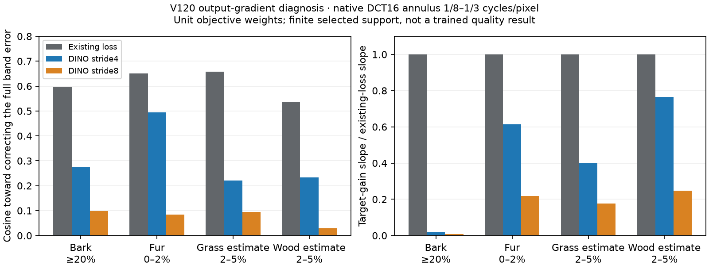

# Frozen early DINO feature supervision

**The completed V1281,000-update pilot finds no useful gain at weight.1.**
Mean shadow/ordinary sRGB changes are−.00040/−.00014dB against V126, with no
clear new detail recovery in actually viewed native/GFX comparisons.
[Completed results, triplets and remaining weaknesses](v128-feature-pilot-quality.md).
The [current general model remains V120 Small](current-model.md).

[GramSR, April2026](https://arxiv.org/abs/2604.25457) uses DINOv3 visual
conditioning and a feature-correlation loss for diffusion super-resolution.
This motivates investigating feature supervision here. Our experiment instead
compares corresponding early ConvNeXt feature locations in a deterministic
RAW restoration model; it does not reproduce GramSR or import its code/weights.

## What the retained-output probe measured

Four native256 contexts reuse saved V120/V117 RGGB/ISO12800-prior outputs.
The reference selects sixteen-pixel blocks within the central160×160 region
and the DCT annulus1/8–1/3 cycles/pixel. Bark uses96 blocks at≥20% contrast,
fur7 at0–2%, grass3 and wood9 at2–5%. Grass/wood use low-noise, binned RAW
reference estimates; only the Commons bark/fur targets are exact synthetic GT.
These four cases and one noise draw do not establish broad photographic behavior.

Twenty-six new CPU encoder forwards measure stride4/8 spatial feature MSE,
RGB output gradients, controlled attenuation/wrong-phase/equal-energy
orthogonal detail, and two finite differences. There are zero new restoration
forwards, noise draws, RAW decodes or optimizer updates in this diagnostic.
The encoder stays frozen and retains its official hash; Torch RNG is unchanged.
Feature inputs use native pixels, the same WB/matrix, clipped sRGB and ImageNet
normalization, without resizing or spatial pooling.

| V120 selected support | Retained true-band gain | Existing-loss correction cosine | DINO stride4 cosine | Stride4 target-gain slope / existing |
| --- | ---: | ---: | ---: | ---: |
| Bark,≥20% | .9634 | .5968 | .2751 | .0213 |
| Fur,0–2% | .2801 | .6511 | .4950 | .6151 |
| Grass estimate,2–5% | .5677 | .6571 | .2207 | .4009 |
| Wood estimate,2–5% | .5758 | .5358 | .2337 | .7664 |

Both feature stages favour correcting the selected faint-detail errors and
assign more loss to the controlled wrong-phase/orthogonal textures than to
half-amplitude real detail. Stride4 has better gradient alignment than stride8,
but **both have weaker full-band error alignment than the existing loss**.
The unit-weight slope ratios above motivate a small additional weight, not a
replacement objective. They compare explicitly different loss supports/reductions
(native256 features versus central160 reconstruction) and are not general
gradient-norm ratios. Output-gradient direction does not predict a neural
parameter update or a trained quality gain.

An independent mirrored-FFT/`math.fsum` audit passes16 control checks,
48 saved feature losses and392 projection fields. Both saved finite-difference
checks pass the prospective5% symmetric tolerance: errors.165%/.347%.
[Full evidence and source bindings](results/dino-feature-supervision-probe-v1/result.json)
· [CSV](results/dino-feature-supervision-probe-v1/V120-gradients.csv)
· [Standalone SVG](results/dino-feature-supervision-probe-v1/feature-gradient-diagnostic.svg).
The successful collection is in
`.cache/current-quality-20261023-v1/dino-feature-supervision-probe-v3/`.
Earlier preparation failures remain preserved and spent no encoder calls.

These are the **existing V120 single-draw outputs**, not V128 results.
Cells are unchanged160×160 native crops: noisy → V120 → exact synthetic GT.
Both use ROI`[48,48,160,160]`, exposure1, RGGB, shot.00256,
read2.62144e−5,16-bit ADC and black.03. Checkpoint SHA256:
`a9d9b6b4f974e24a6b11e5e740aab32314233a7f53c056cf37c7d2aac1c589fb`.

Actual native inspection confirms the motivating contrast: bark structure is
coherent; faint fur is substantially softer than GT.
Sources: [Derek Ramsey](https://commons.wikimedia.org/wiki/File:Kentucky_Coffee-tree_Gymnocladus_dioicus_3264px.jpg),
[CC BY-SA2.5](https://creativecommons.org/licenses/by-sa/2.5/), and
[Korall](https://commons.wikimedia.org/wiki/File:Racoon_clinging_to_a_tree.JPG),
[CC BY3.0](https://creativecommons.org/licenses/by/3.0/), modified by binning,
simulation and reconstruction.
[Bark metadata](images/conditional-noise-response-v1/V120-bark-single.json)
· [Fur metadata](images/conditional-noise-response-v1/V120-raccoon-fur-single.json).

## V128 matched training pilot

[Recipe](../configs/quality-v120-dino-feature-pilot-v128.yaml) adds weight.1
`frozen-convnext-stage0-spatial-mse-v1` to V126's existing reconstruction loss.
It uses the same frozen encoder instance, running only its first stage for
prediction and detached target. No new inference tensors or encoder instance
are introduced. Paired RAW and validation keep their existing losses.
The default weight is zero. Incompatible weight/policy continuation is rejected
before model construction. The source-loss trace remains the base reconstruction
diagnostic, while training logs include the feature term.

The V120 parent,90,783-source cleaned corpus,23-region bank at fraction.5,
seed70, native256/B16/BF16, one noise view, zero optical blur,
paired32/native128, LR1e−5 and100-step warmup match the **already completed
V1261000-update control**. All1000 clean and prepared noisy-batch hashes must
match its saved receipt. V126 training and inference are reused.

Actual CPU128/B1 and CUDA256/B16 checks each passed16 fresh updates and a
two-update resume, including rejected changed-weight/policy resumes,
91 exact parent/resume restoration tensors,89 finite Adam states/gradient
checks, frozen official DINO identity and all18 matching input hashes.
Each check made18 full encoder and48 first-stage calls; the extra30 are the
two feature evaluations on15 non-paired batches. CUDA peak was7.04GB.
The1000-update production run completed after starting freshly from V120.

A later shared-memory drop triggered the32GB runtime guard after399 updates.
The emergency checkpoint contains all399 model/EMA/Adam updates. The explicit
continuation resumed at400, with91 model tensors,89 Adam states, frozen encoder
and CPU/CUDA/Python RNG checked before the first new forward. It performed only
the remaining601 updates under the original8h absolute deadline; discarded
checks and the original prefix are reused. All original failures/checkpoints
remain preserved. [Actual resumption receipt](results/v128-memory-guard-resumption-v1.json).

Verified production counts are477 Commons,262 native and261 paired batches,
1000 optimizer updates plus64 validation forwards,1064 full encoder calls and
1478 additional first-stage calls. Budgets are36 discarded check updates plus
1000 production updates,30minutes per check and8hours production, without
automatic retries or budget resets. The launch floor is52GiB:
16GiB CUDA cap+4GiB host allowance+32GiB available reserve.

Training plan/status:
`.cache/current-quality-20261023-v1/dino-feature-training-recovery-v1/run/`.
The successful candidate-only quality queue is
`.cache/current-quality-20261023-v1/dino-feature-quality-pilot-v1/queue-v3/`.
It retained the original absolute wait deadline; two earlier queues exited with
zero candidate restorations. Its86 new restorations cover
64 retained shadow conditions,16 ordinary material inputs,4 main-GFX contexts
and2 extra-mesh profiles. It reused completed V126/V120 predictions, with no
new noise/RAW work. Independent scoring and actual native inspection are complete.
The extra fence uses **DSCF3842 ISO6400 / DSCF3835 ISO100 f/5.6**, including
both camera JPEGs; the main platform scene remains DSCF3879/3880.
Those real references differ in capture conditions and are not exact GT.
