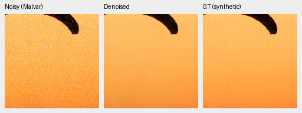
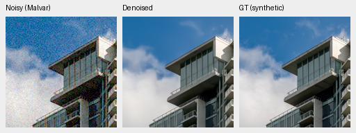
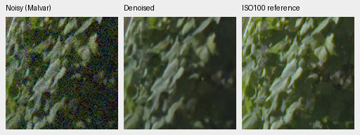
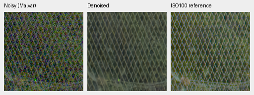
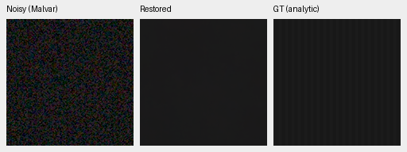
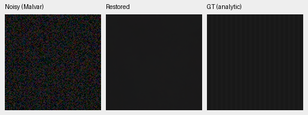
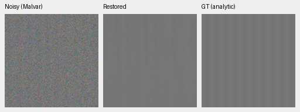
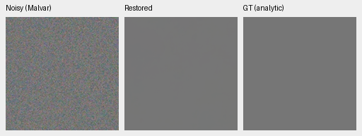
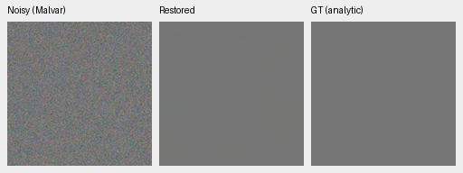

# DINO input adaptation: V56 first 1,000-step review

**Stop at this gate; no promotion.** V56 loses 0.12579 dB on 427 natural
photos and 0.07023 dB on known-camera measured CFA versus matched V54 at the
same step. Unseen primary is slightly higher with an interval crossing zero.
Procedural PSNR falls while SSIM rises. Native review does not establish the
requested detail improvement. Keep the input adapter default-off and V43
step 2,000 as the README reference.
[Complete results, hashes and 46 native triplets](results/dino-input-v56-review.json).

This is one seed and a 1,000-step gate on the original planned 4,000-step
schedule. Complete model/EMA/AdamW/Python/Torch/CUDA RNG state is retained.
There is no convergence or universal architectural failure claim. A same-seed
replay of the original control is the next check on procedural repeatability;
evaluation-source intervals do not estimate optimization or training-seed variance.

The subsequent [unchanged-source control replay](control-replay-v57-review.md)
also changes photo/known means without an intervention. Its descriptive
V56−replay differences are−0.08233dB photo/−0.01077dB known primary; these are
not a new matched training trial or a causal correction. V56 stays unpromoted.

## Controlled change and engineering evidence

V56 adds only the identity-initialized 6,531-parameter RGB input adapter before
frozen DINOv3. It learns through the encoder without updating pretrained weights;
there is no teacher, feature loss or changed physical reconstruction. The
existing post-token projection/gate and native CNN stay in place.
[Implementation and genuine-parent validation](dino-input-adaptation.md).

Both arms start the identical retained V43 step 2,000 EMA, fresh AdamW/EMA,
seed 52, batch 16, LR 3e-5, 100 warmup updates and 4,000 planned updates.
Original full-resolution/precision, Commons40170/native128/paired83, domain
mix, 4× → geometry/PSF → final area 2× training and original 8× validation remain
fixed. The paired corpus stays opt-in after its full-schedule review. Weak
textures remain off. The control is immutable **V54 step 1,000**.

All 41 logged input hashes match. Final Python, Torch and CUDA RNG states also
match. Those facts do not establish identical floating-point optimization:
independent CUDA first-batch losses differ by about 2.5e-7. Preflight initial
FP32/BF16/FP16 outputs are exact with a zero input adapter, two discarded genuine
updates demonstrate gradients, and the 483-test CUDA-enabled suite passes.
The actual trained model and EMA have finite nonzero input-head weights; EMA
head-weight norm is 0.0160603. The complete state and optimizer counts verify.

Checkpoint SHA256:

- V54: `975d47ffbd0cedc6ba2fa307d96265f1f3406d96bbeed6657bc32b44b37346d1`.
- V56: `c5ef701593bdfe98f9c3e43537fb9d6fea64f6f7b3c982e14bdcd3b5fa649218`.
- Shared parent: `0d74cf31fb1c7e3f97fc692c855a2ca0ee3ebf562b454e4f8b135c28fc0aa5c5`.

## Development scores

| Panel | Model | Measured-CFA PSNR | AHD RGB PSNR | AHD SSIM |
| --- | --- | ---: | ---: | ---: |
| Known4 | V54 matched control | 54.30450 | 40.09109 | 0.931471 |
| Known4 | V56 input adapter | 54.23426 | 40.01320 | 0.931351 |
| Known4 | RawNIND global CFA-LS | 54.06860 | 39.67805 | 0.928811 |
| Known4 | RawNIND channel CFA-LS | 54.08474 | 39.71710 | 0.928831 |
| Unseen5 | V54 matched control | 53.64388 | 38.30980 | 0.917275 |
| Unseen5 | V56 input adapter | 53.66400 | 38.36456 | 0.918371 |
| Unseen5 | RawNIND global CFA-LS | 53.56220 | 38.14484 | 0.918380 |
| Unseen5 | RawNIND channel CFA-LS | 53.76822 | 38.56191 | 0.922127 |

Known4 has 8 pairs/72 crops; unseen5 has 10 pairs/90 crops. Primary scores
use registered low-noise measured CFA. Independently demosaiced AHD RGB is
auxiliary, **not exact GT**. RawNIND uses publisher normalization and observed-CFA
global/channel gains without reference fitting. Protected-final scoring stays closed.

| Model | 427-photo PSNR | SSIM | 16-procedural PSNR | SSIM |
| --- | ---: | ---: | ---: | ---: |
| V54 matched control | 35.050344 | 0.957604 | 33.894886 | 0.967828 |
| V56 input adapter | 34.924556 | 0.956801 | 33.545514 | 0.968560 |
| RawNIND global CFA-LS | 26.695781 | 0.790028 | 24.974265 | 0.720411 |
| RawNIND channel CFA-LS | 26.683573 | 0.789899 | 24.985678 | 0.720500 |

| V56 − V54 | dB [95% source-bootstrap interval] |
| --- | ---: |
| Known primary | -0.070233 [-0.113987, -0.041735] |
| Unseen primary | +0.020123 [-0.042450, +0.075682] |
| 427-photo sRGB | -0.125789 [-0.179239, -0.086208] |
| 16-procedural sRGB | -0.349372 [-0.704129, -0.066103] |

All 86,828 synthetic-suite method cases recompute. All 62,020 classical/RawNIND
and 12,404 V54 neural cases replay their original first-gate metrics exactly.
These intervals describe source variation, not training-seed uncertainty.

## Coherent weak response and flat controls

The same CPU-seeded 384 carriers and 64 flats give 1,344 method cases with
both neural methods in GPU FP16/physical FP32 and a CPU Malvar baseline.
Signed in-phase gain at linear level 0.18, 2% peak contrast, ISO12800 prior,
averaged across four CFA layouts × four draws (1 is exact recovery):

| Carrier period | V54 | V56 |
| --- | ---: | ---: |
| 4 px | 0.003321 | 0.002225 |
| 8 px | 0.012818 | 0.016778 |
| 16 px | 0.354515 | 0.312214 |

The 8 px gain rises but stays small; 4 px and 16 px gains decline. This does
not demonstrate a general texture benefit. Full quadrature, channel variation,
DC and noncarrier energy accompany each case in the receipt.

High-noise flats, same 16 layout/draw observations per row:

| Level | Model | Mean abs RGB DC bias | Linear RGB RMSE | Spatial luma RMS | Relative band RMS | Relative peak contrast |
| --- | --- | ---: | ---: | ---: | ---: | ---: |
| 0.01 | V54 matched control | 0.00012554 | 0.00028371 | 0.00015454 | 0.00953459 | 0.00282128 |
| 0.01 | V56 input adapter | 0.00009893 | 0.00027476 | 0.00015321 | 0.00900575 | 0.00260425 |
| 0.18 | V54 matched control | 0.00044539 | 0.00092428 | 0.00052062 | 0.00175613 | 0.00054739 |
| 0.18 | V56 input adapter | 0.00026849 | 0.00084717 | 0.00053928 | 0.00160150 | 0.00052539 |

RGB bias/RMSE and luma band energy fall, while total spatial luma RMS at level
0.18 rises. This is not a blanket flat-noise improvement. Band/peak use luma
over [1/48, 0.22] cycles/pixel and can miss chromatic periodic errors; these
metrics are not a complete false-detail detector.

The 448 Malvar cases replay exactly from V55's diagnostic. V54 analytic neural
FP16 results are **not bit-exact across these independent runs**: maximum change
in RGB RMSE is 6.81e-7 and in signed carrier gain 0.0002345. The cause is not
isolated. This report uses the newly recomputed matched control and does not
claim exact neural replay for this analytic suite.

## Native comparisons

All panels are native 160×160 with no resizing. Synthetic photos and analytic
targets use ROI [48,48,160,160], RGGB/ISO12800 prior shot=0.00256/
read=0.0000262144, WB [2,1,1.5], recorded fixed matrix and display ×1. They have
exact clean synthetic targets; metrics use unquantized predictions and PNGs
are 8-bit display copies. Analytic examples use level 0.01/10% contrast/period 8,
level 0.18/2%/period 16, and a flat level 0.18.

GFX DSCF3879 ISO6400 → restored → separate DSCF3880 ISO100 f/5.6, shared +2 EV.
Foliage ROI [8890,5570,160,160]; fence [2240,6000,160,160] (reference x=2241).
Sky/building are also archived. Input-only shot=0.0014635775921166604/
read=0.0000010715704128646712. Aperture, time and motion differ: ISO100 is a
qualitative reference, **not GT**, with no warping or pixelwise score.

### Exact synthetic GT: 0014aa4e

### Exact synthetic GT: 002fc6ee

### Separate ISO100 reference: foliage

### Separate ISO100 reference: chain-link-fence

### Exact analytic GT: carrier-l0.01-c0.1-p8-draw0

### Exact analytic GT: carrier-l0.18-c0.02-p16-draw0

### Exact analytic GT: flat-l0.18-draw0

Both neural outputs remain close: fabric strands are largely lost, leaves waxy and building detail soft. V56 does not visibly strengthen fence wires; channel-RawNIND retains a colored grid. Both analytic carrier examples remain attenuated; fixed-display flats show no obvious new structure. This 8-bit view does not exclude small false detail. The ISO100 capture is independently sharper and differs in optics and time; it is not exact GT.

Thirty-six PNGs were visually inspected: both neural arms/channel-RawNIND on
ten standard subjects plus all six neural analytic examples. All 46 PNGs
verify hashes, native geometry, metadata and byte-identical noisy/reference
panels. Global-RawNIND variants are verified without separate visual judgments.
Eight full 8746×11662×3 RGB16 TIFFs verify SHA/bytes/dtype/16-bit tags, more than
256 sampled codes, and sRGB ICC where applicable. Single shared-machine timing
observations: 0:dino-paired-expanded-b16-v54:step-1000: 33.48s; 1:dino-input-adapter-b16-v56:step-1000: 33.73s; RawNIND:CFA-LS: 17.46s; RawNIND:CFA-channel: 17.34s. These are not repeated speed measurements.
Broad real-photo superiority, SOTA and 100 MP/10 s remain unproven.

Sources: [Roy Egloff](https://commons.wikimedia.org/wiki/File:CH.VD.Villeneuve_2007-08-25_Vertigo-Swiss-Riviera_2392_3x2-R_4K.jpg)
and [Dietmar Rabich](https://commons.wikimedia.org/wiki/File:Vancouver_(BC,_Canada),_Coal_Harbour_Seaside_Park,_Blick_in_den_Himmel_--_2022_--_2158.jpg),
[CC BY-SA 4.0](https://creativecommons.org/licenses/by-sa/4.0/); modified by binning,
crop, simulated noise, restoration and rendering. Paired sources: Benoit Brummer/
Christophe De Vleeschouwer, [RawNIND](https://doi.org/10.14428/DVN/DEQCIM), per-scene
permissions in receipts. GFX by the project owner. Analytic targets generated locally.
