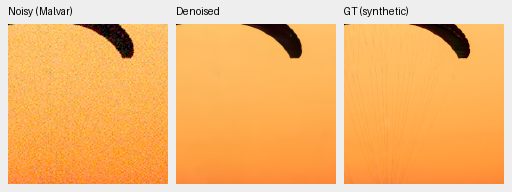
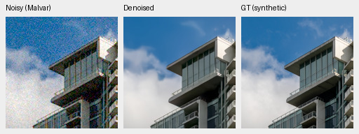
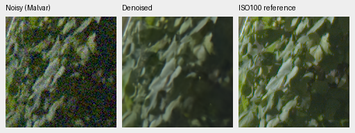
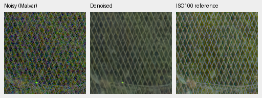

# First trained DINO Q/V adapter review

Current architecture and recommendations: [current model guide](current-model.md).
The versioned study below retains its measured results and original protocol.

**Stop V49 at its first1000 gate; do not promote rank4 adaptation.**
Unseen primary and photographic PSNR fall versus V47 with negative
evaluation-source intervals. Known primary is nearly unchanged; procedural
PSNR also falls but its interval includes zero. A slight photographic SSIM
increase does not offset these losses. This rejects this recipe at this gate,
not low-rank adaptation generally. V43 step2000 was the photographic comparator for this study.

[Complete matched comparison and20 native triplets](results/dino-lora-v49-review.json).
The [V49 trial](dino-lora-v49-trial.md) adds73,728 parameters across24 rank4
DINO query/value projections. The original21,596,544 foundation parameters stay
frozen. All71 common portable tensors and initial predictions are exact at the
parent. No CNN resolution, physical features, camera metadata, precision policy
or training source changes. This tests context adaptation, not fresh DINO
presence/absence and not an assumed foundation-model benefit.

Both arms start at V43 first1000 EMA, fresh AdamW/EMA, seed50, B16,
LR3e-5/planned3000, stopping at1000. All41 logged input/target batches match;
both optimizer histories reach1000. New LoRA EMA tensors are nonzero. Old and
new training source bundles match exactly. New Commons pixels remain excluded.
Default rank0 retains the earlier path.

| Panel | Model | Measured-CFA PSNR | AHD RGB PSNR | AHD SSIM |
| --- | --- | ---: | ---: | ---: |
| Known4 | V47 frozen DINO | 54.25486 | 40.01602 | 0.930912 |
| Known4 | V49 rank4 Q/V | 54.25254 | 40.02078 | 0.930832 |
| Unseen5 | V47 frozen DINO | 53.73204 | 38.49569 | 0.920479 |
| Unseen5 | V49 rank4 Q/V | 53.68175 | 38.45658 | 0.919986 |

V49−V47 primary PSNR: known **-0.00232 [-0.01185, +0.00664]**;
unseen **-0.05029 [-0.06923, -0.03303]** dB. Known4 has8 pairs/72 crops,
unseen5 has10 pairs/90 crops, balanced within source scenes. Registered
low-noise measured CFA is primary. Independent AHD RGB is auxiliary,
**not exact RGB GT**. Protected-final model scoring stays untouched.

| Model | 427-photo PSNR | SSIM | 16-procedural PSNR | SSIM |
| --- | ---: | ---: | ---: | ---: |
| V47 frozen DINO | 34.91128 | 0.956664 | 33.56462 | 0.965209 |
| V49 rank4 Q/V | 34.89338 | 0.956738 | 33.32101 | 0.964669 |

V49−V47 photo **-0.01790 [-0.03223, -0.00264]** dB;
procedural **-0.24361 [-0.65227, +0.00789]** dB. Brackets are95%
evaluation-source bootstrap intervals from one training seed; they do not
measure training-seed variability. There are443 sources, seven conditions/four
CFAs and62,020 combined cases across two neural/three classical methods.

Only V49 is recomputed. Cached V47 reuse checks exact protocol/data/render/
metric metadata and complete evaluator source identity. All24 known/30 unseen
classical pair summaries and37,212 individual classical synthetic records are
exact. Each original case file/report/checkpoint hash remains in the receipt.
This avoids a second training control while preserving its original measurements.
It does not claim bitwise re-execution of old neural predictions.

V43 step2000 is the separately trained photographic study comparator:
known54.23332, unseen53.80606 primary; photo34.89934/.957126,
procedural33.28537/.966604. Its original optimizer history/seed differ; see its
[review](native-corpus-2k-review.md), not a causal optimizer-equivalent comparison.

V47 SHA256 `ebfe1cc8af4a2dbfd83105b82da81b782c46007282a4de50a0be0215ab5238c4`.
V49 SHA256 `91814131b0b1c6aae1f14d7b10aed773f6521fed4885b75190429a04d77f6df5`.
Training/evaluator source, exact checkpoint/data snapshots, source/ROI/noise/
display identities and all crop PNG hashes are recorded. All models use the
pinned genuine DINO revision. LoRA original weights are verified unchanged in
the [actual-batch preflight](results/dino-lora-v49-preflight.json).

## Native exact-GT crops

Noisy Malvar → restored → exact synthetic GT; native160×160 per panel, no
resizing. Shared ROI[48,48,160,160], RGGB/ISO12800 prior `shot=.00256`,
`read=.0000262144`, display×1, WB[2,1,1.5], fixed protocol camera matrix.
Noisy and reference panel bytes/metadata verify identical. PNGs are8-bit previews;
metrics use unquantized predictions.

Sources: [Roy Egloff](https://commons.wikimedia.org/wiki/File:CH.VD.Villeneuve_2007-08-25_Vertigo-Swiss-Riviera_2392_3x2-R_4K.jpg)
and [Dietmar Rabich](https://commons.wikimedia.org/wiki/File:Vancouver_(BC,_Canada),_Coal_Harbour_Seaside_Park,_Blick_in_den_Himmel_--_2022_--_2158.jpg),
[CC BY-SA4.0](https://creativecommons.org/licenses/by-sa/4.0/). Modified by binning,
cropping, simulated noise, restoration and rendering; previews retain that
license. Paired images: Benoit Brummer and Christophe De Vleeschouwer,
[RawNIND](https://doi.org/10.14428/DVN/DEQCIM), per-scene credits in source receipts.
GFX images by the project owner.

## Standing real GFX test

Full102MP DSCF3879 ISO6400 → restored → separate DSCF3880 ISO100 f/5.6.
Native160px foliage[8890,5570], fence[2240,6000] (reference x2241), sky/building
also included. Shared+2EV/WB/matrix; input-only `shot=.0014635775921166604`,
`read=.0000010715704128646712`. Time/aperture/motion differ; the last panel is a
qualitative reference, **not GT**. No reference gain fitting/warping or pixelwise
GFX reference score.

Native inspection finds no decisive gain: the same fine fabric strands remain
smoothed, building detail looks close, and GFX leaves and fence wires remain
soft compared with the separate ISO100 capture. Neither the global measurements
nor these examples establish the requested qualitative margin over RawNIND.

All20 triplets verify source/ROI/noise/display metadata, dimensions and matched
noisy/reference panel bytes. Both complete8746×11662×3 RGB16 TIFFs verify full
SHA/size/dtype/dimensions/16-bit tags and>256 sampled codes; sRGB carries ICC.
GFX restoration took35.10s, a successive shared-machine observation with512px tiles,64px
overlap,batch4, excluding decode/load/render/encoding. It is not a repeated speed
comparison or a10-second claim. Complete outputs remain under
`/mnt/external/demosaic/evaluation/gfx-3879-3880-dino-lora-v49-1k-full/`.

## Actual trained weak-signal precision

[Native analytic CUDA checks](results/dino-lora-v49-trained-weak-detail.json)
exercise V47, V49 and the current V43 step2000 checkpoint, with genuine DINO and
FP16 neural/FP32 physical output. Five64px analytic cases at all four CFAs cover
shadow/midgray flats, a native-code ramp, a one-code midgray wave and a four-code
shadow wave. ADC16/black.03, zero shot/read, identity WB/matrix,8px border.
All outputs are finite FP32 and respond to a one-code input offset; native ramps
retain807/816/805 distinct rounded16-bit codes for V47/V49/V43. These checks
show weak-signal execution and code variation, not unbiased16-bit accuracy or
superior reconstruction. Full-source/checkpoint hashes and exact responses
remain in the receipt.
