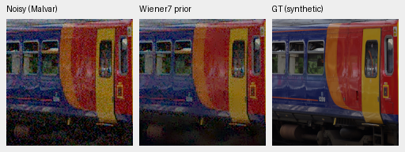
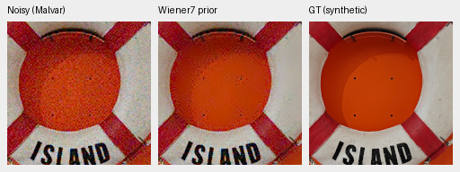

# Frozen DINO preview sensitivity: training-only diagnostic

The fixed phase-wise Wiener7 preview does **not** consistently recover cleaner
DINO features. It improves early-layer agreement under high noise, while the
middle layer gets worse in shadows. Keep the production noisy-Malvar preview;
this diagnostic supports no restoration-quality claim or architecture promotion.
[Complete data, source/weight hashes and native crop provenance](results/dino-preview-training16-diagnostic.json).

Uniformly sample16 eligible **training** photographs from the frozen40170-source
Commons training split, seed20261016. Each source supplies one source-keyed
512×512 ROI in its linear4×-binned uint16 cache, then exact area2 to256×256.
No geometry, output-selected crop or exposure adjustment is fitted. Four fixed
sensor/exposure conditions and all four CFAs give256 cases. The exact clean
synthetic target and its independently Malvar-demosaiced CFA are diagnostic
references only; the tested preview uses observed CFA and supplied shot/read
priors through the existing variance map. No protected-final scoring.

Use genuine frozen DINOv3 ViT-S revision
`114c1379950215c8b35dfcd4e90a5c251dde0d32`,
weights SHA256`4610ad75edef83e75afdebf162d148dc628045ea6cbb83d67d4708c709c4f91d`.
The production `DinoContext.forward` supplies native256 patch features via a
pre-hook before its adapter/gate: exact WB/matrix/sRGB/ImageNet preprocessing,
hidden layers4/8/12. CPU FP32, two threads, local-only approved weight cache;
CUDA never initializes. No full restoration model or trained checkpoint enters.

The table measures cosine agreement with exact clean-RGB patch features after
subtracting each channel's spatial mean per image. This removes the common
spatial DC component; uncentered cosine and relative Euclidean errors, and a
separate clean-Malvar reference comparison, are in the JSON. Higher cosine is
closer feature agreement, **not PSNR or perceptual restoration quality**.

| Condition | Layer | Clean Malvar | Noisy Malvar | Wiener7 Malvar | Wiener−noisy [95% source interval] |
| --- | ---: | ---: | ---: | ---: | ---: |
| adc-only | 4 | 0.94945 | 0.94945 | 0.94945 | +0.00000 [+0.00000, +0.00000] |
| adc-only | 8 | 0.91240 | 0.91240 | 0.91240 | +0.00000 [+0.00000, +0.00000] |
| adc-only | 12 | 0.94535 | 0.94536 | 0.94536 | +0.00000 [+0.00000, +0.00000] |
| iso100-prior | 4 | 0.94945 | 0.94067 | 0.94296 | +0.00228 [+0.00041, +0.00453] |
| iso100-prior | 8 | 0.91240 | 0.90360 | 0.90459 | +0.00098 [-0.00051, +0.00275] |
| iso100-prior | 12 | 0.94535 | 0.94264 | 0.94265 | +0.00000 [-0.00053, +0.00054] |
| iso12800-prior | 4 | 0.94945 | 0.80116 | 0.81863 | +0.01747 [+0.00405, +0.03058] |
| iso12800-prior | 8 | 0.91240 | 0.76570 | 0.75691 | -0.00879 [-0.01838, +0.00035] |
| iso12800-prior | 12 | 0.94535 | 0.86861 | 0.86570 | -0.00291 [-0.01256, +0.00717] |
| shadows | 4 | 0.96411 | 0.77931 | 0.80347 | +0.02416 [+0.00633, +0.04146] |
| shadows | 8 | 0.93282 | 0.74841 | 0.73482 | -0.01358 [-0.02456, -0.00338] |
| shadows | 12 | 0.95659 | 0.85135 | 0.84695 | -0.00440 [-0.01540, +0.00555] |

Paired4000-resample intervals group all four CFA layouts within each source.
Only16 sources, one ROI/noise draw per case and one fixed filtering policy;
these are exploratory feature-distance intervals, not training-seed uncertainty
or corrected multiple-comparison claims. ADC-only previews are exact no-ops for
Wiener because supplied variance is zero. Clean-Malvar agreement also shows a
demosaicing-related feature floor even without sensor noise.

At ISO12800, layer4 centered cosine improves+.01747[+.00405,+.03058], but layer8
changes−.00879[−.01838,+.00035] and layer12−.00291[−.01256,+.00717]. In shadows,
layer8 changes−.01358[−.02456,−.00338]. Lower input noise alone does not establish
more useful context. This does not explain the complete trained DINO/no-context
gap, nor rule out other preview policies. A model-quality claim would require
matched training and the standing full/native/real-photo review.

## Native input examples

The first two sampled sources, preselected before inference: native160×160
panels, ROI[48,48,160,160], RGGB, ISO12800 prior shot=.00256/read=.0000262144,
WB[2,1,1.5], shared protocol matrix/display×1. No resizing. Noisy Malvar → fixed
Wiener7 prior → exact synthetic clean target. The middle panel is a fixed preview
prior, **not a learned denoiser**. No GFX model output changes in this experiment.



Source: [File:Stoke-on-Trent railway station MMB 04 153319.jpg](https://commons.wikimedia.org/wiki/File:Stoke-on-Trent_railway_station_MMB_04_153319.jpg), mattbuck (category), [CC BY-SA 3.0](https://creativecommons.org/licenses/by-sa/3.0). Modified by linear binning, crop, synthetic sensor noise, fixed Wiener filtering and rendering.



Source: [File:German Maritime Museum exhibition 04.jpg](https://commons.wikimedia.org/wiki/File:German_Maritime_Museum_exhibition_04.jpg), Anastasiya Lvova, [CC BY-SA 4.0](https://creativecommons.org/licenses/by-sa/4.0). Modified by linear binning, crop, synthetic sensor noise, fixed Wiener filtering and rendering.


The native examples show visible noise reduction in flat color regions while
leaving substantial texture/noise ambiguity and softened detail. Both PNGs were
visually inspected at their saved pixel size. Two targeted tests verify feature
amplitude/spatial-DC interpretation and grouping CFA cases within source for
uncertainty; both pass. The actual genuine-weight256-case run verifies finite
features, source/cache hashes and unchanged production source bytes.

Reproduce from the repository root after sourcing `scripts/env.sh`:

```bash
CUDA_VISIBLE_DEVICES='' HF_HUB_OFFLINE=1 TRANSFORMERS_OFFLINE=1 \
  uv run --no-sync python scripts/diagnose_dino_preview.py \
  --output /mnt/external/demosaic/benchmarks/dino-preview-training16-replay
```
