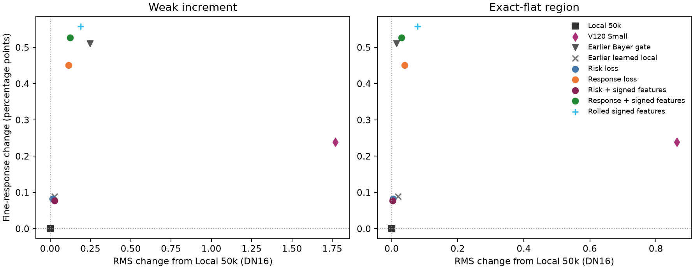
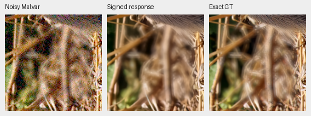
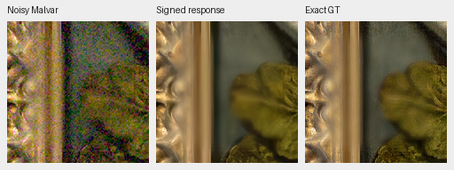

# Training for weak fine-contrast recovery

Adding a signed response term to the delivered-image loss recovers
more weak detail from the same Local 50k proposals. On 40 held
ISO6400 photographs recaptured with faint texture, the strongest
calibrated head increases fine response by **0.526 percentage
points** over Local 50k. Paired fine-increment error rises
**0.124 DN16** and exact-flat fine RMS rises **0.030 DN16**. At
the earlier whole-photo gate's response, the new head reduces
increment error by **0.131 DN16**, with a **0.014 DN16** higher
mean flat error. Native GFX crops show an unchanged overcast sky
and incomplete fine fence crossings. The head remains experimental.

The next matched run uses 512 further photos with two noise draws
and weaker contrast. Its redraw-stability head gains 0.986 points
while lowering exact-flat RMS on 48 new photos. It loses intact
wire contrast and fine cab crossings remain incomplete.
[Weak-detail training across redraws](detail-redraw-gate.md).

## Train against the delivered fine band

The [previous gate study](scene-detail-selector.md) found a gap
between learned blend weights and weights selected with access to
exact targets. Its learned objective used constant weights in
training stations, followed by bilinear interpolation at delivery.
Here the interpolated weights enter the training loss directly.

The proposals are the same bounded camera-neutral fine-band
differences from Local 50k EMA at 0.90× and 1.15× noise
conditioning, with nominal RAW, geometry and noise held fixed.
The head estimates a sharper and a smoother gain on a 32-pixel
grid. Each sharper weight remains capped by the two-green
positive-power check, and the local proposal is capped at
24 DN16 RMS. After interpolation, a 16-pixel DCT
measures the fine band from 1/8 to 1/3 cycles per native pixel
within the 96×96 scored region. The data collector saves the
quadratic error coefficients and the linear signed projection
for the gain of each station. The numerical audit reproduces
the direct pixel-space delivery and DCT calculation.

Four heads start from the earlier local EMA. Two use the
earlier local measurements. Two also use eight signed
features. These are the two proposal correlations with the
parent and the RAW-minus-parent residual on each measured
green lattice, normalized by the proposal and noise scale.
The residual and proposal are derived from the same observation.
Their value is assessed against separate photos and exact
targets. A held intervention moves the signed features across
the query while holding the other inputs and the head fixed.

For each feature set, one loss minimizes fine error in the
present, attenuated and exact-flat views and the paired
increment. The other adds a reward for the signed projection
of the recovered increment onto the true detail. It applies
a fixed response weight of 0.65 inside the paired objective.
Positive quiet-region error also receives an extra penalty.
All four variants use the same input examples, initial
prediction, sampled indices, loss normalizers and training
budget.

## Source and checkpoint coverage

The direct-supervision set uses 768 different photos from the
cleaned training manifest, each with one native 256×256 query.
Natural, attenuated and flat roles are captured independently at
matched camera and exposure settings. The noise mixture covers
three profiles from ISO1600 to ISO12800. Global D4 precedes
sensor sampling. This fine-tune starts from the previous gate
trained on 1,600 other photos. The Local 50k restoration stays
frozen.

The 48-photo ISO6400 test uses new crops and Bayer draws. It is
source-disjoint from both gate training sets and the earlier
calibration, transfer and planted-wire panels. Eight source IDs
also appear in the fixed full-model 427-photo benchmark.
Their new crops enter the full 48-photo result and are removed
in a separate 40-photo sensitivity check. The source audit also
checks the complete recorded Corpus 100k photographic visit
history and the Local 50k manifest and retained terminal
observations. V120 Small EMA is evaluated on the same Bayer
arrays.

The optimizer completed 1,400 AdamW updates per arm with a
batch of 48 sources, learning rate 0.0005 and EMA decay 0.993.
Each arm saw 2,304 distinct role examples and 201,600 role visits.
Frozen forwards and statistics preparation took 457.83 seconds.
The four-arm fit took 23.30 seconds in total. Evaluation uses
EMA weights. The four checkpoint files retain raw, EMA and
optimizer states. IEEE FP32 proposal inference reuses the local
DINO encoding across the three conditioning settings, as checked
in the earlier study. This run measures training and preparation
time. Its crop study provides no new inference timing.

| Checkpoint | File SHA256 |
| --- | --- |
| Local 50k frozen parent EMA | `62f4e9ce84075c8df1a254a1889033b5787133e8c98c63e0ec3d174a94734959` |
| Earlier local gate initialization | `5933c4f8e1e93501f0ca04753c929a9308697b9455e0d7b506336ea9dea925c2` |
| Exact risk | `3604610ddf8597676df7b55c6c3db5b93cba5fa63dd9c36ae1dcaa3ff97674e8` |
| Response | `d3781de2f15512dd669225ebc56b2b6b47d26d6a893230d0266999fa8570dc52` |
| Signed exact risk | `a4cbe190755f0105341168ff1f43a750de723d8b04d1005cdcb2684afdb509ee` |
| Signed response | `3985cb043cf184248de0ff45e35c52a967514e2afb73a424ff7e02cec576eef4` |
| V120 Small EMA | `a9d9b6b4f974e24a6b11e5e740aab32314233a7f53c056cf37c7d2aac1c589fb` |

The variance conditioning pair and frozen Local 50k parent
form the complete composed restoration. A separate 32-photo
calibration reuses the previous limits of +0.05 DN16 exact-flat
RMS, +0.10 paired increment RMS and +0.10 present-image RMS
relative to nominal Local 50k. The two exact-risk heads lock
sharper/smoother scales at 1/0. The two response heads lock at
0.75/0. Local 50k recovers 67.963% of exact fine contrast on
calibration. The locked exact-risk and signed-response arms
recover 68.039% and 68.472%. Coefficient validation in the
audit agrees with direct delivery within 5.2e−6, and changing
red/blue Bayer samples leaves the isolated signed features
unchanged when the parent and proposal are held constant.

## Held crops and faint recapture

The first 48-photo replay used contrast scales from 0.52 to
0.98. The parent already recovers 98.737% of the paired
contrast. The locked signed-response head gains 0.102 points
and adds 0.455 DN16 of increment RMS and 0.019 DN16 of
exact-flat RMS. Outside the existing 427-photo panel, the
40-photo difference is +0.117 points with +0.456 DN16
increment RMS. The source audit checks the complete 559,808
recorded Corpus 100k photo visits, the Local 50k training
manifest and its 5,000 retained terminal crop observations.

After seeing the near ceiling on the broad replay, we recaptured
those 40 photos outside the full-model panel at the older 0.22
weak texture strength. Capture geometry, D4 transform, Bayer
pattern, noise parameters and exposure stay fixed. Each role
uses a new independent noise draw. The checkpoint, calibration
and strengths were already locked. The recapture tests a weaker
condition on the same photo IDs.

Fine response is the signed delivered present-minus-absent
projection relative to the exact increment. Increment and flat
errors are luma RMS in DN16 over the scored fine band. The
exact-flat observation still has independent Bayer noise.

| Method | Fine response | Increment RMS | Present RMS | Exact-flat RMS |
| --- | ---: | ---: | ---: | ---: |
| Local 50k EMA | 71.955% | 124.566 | 112.339 | 4.040 |
| V120 Small EMA | 72.194% | 126.336 | 114.225 | 4.904 |
| Earlier whole-photo Bayer gate | 72.465% | 124.814 | 112.337 | 4.055 |
| Earlier learned local gate | 72.043% | 124.593 | 112.337 | 4.059 |
| Exact risk | 72.037% | 124.581 | 112.333 | 4.045 |
| Response | 72.405% | 124.681 | 112.353 | 4.080 |
| Signed exact risk | 72.031% | 124.594 | 112.347 | 4.043 |
| **Signed response** | **72.481%** | **124.690** | **112.334** | **4.070** |
| Signed response with signed features rolled | 72.513% | 124.756 | 112.343 | 4.118 |

Paired photo-bootstrap intervals for the signed-response gain
over Local 50k are +0.214 to +0.904 points and +0.007 to +0.070
DN16 flat RMS. The increment mean crosses its +0.10 calibration
limit. The paired increment interval spans −0.045 to +0.303 DN16
and the flat mean stays below +0.05. Compared with the response
arm using the earlier features, signed features add 0.076 points
(0.027 to 0.130) and lower flat RMS by 0.009 DN16 (−0.035 to
+0.011). Spatially rolling only the signed features adds 0.048
DN16 flat RMS and 0.066 DN16 increment RMS at the locked strength,
with little change in response.

Scaling signed response down to the earlier Bayer gate's 72.465%
response gives 0.131 DN16 lower increment RMS (−0.261 to −0.014)
and 0.014 DN16 higher flat RMS (−0.122 to +0.176). A separate
retrospective comparison caps increment error at +0.10 DN16,
flat error at +0.05 and present-image error at +0.10. On the
sampled uniform scales, the signed head gains 0.463 points and
the earlier gate gains 0.260 points.
These matched comparisons use the recapture outcomes to choose
strengths and are diagnostics.

The earlier 32-photo transfer panel also gains 0.502 points
over Local 50k with +0.155 DN16 increment and +0.004 DN16 flat
RMS. At the same response on those familiar sources, the
earlier Bayer gate has essentially the same increment error and
0.023 DN16 less flat error. On the separate 24 retained wire
fixtures, signed response gains 0.133 points over Local 50k.
Intact paired RMS rises 0.273 DN16. Exact-flat fine RMS is
unchanged to 0.001 DN16, and weak-direction gap and exterior-only
errors rise by 0.026 and 0.036 DN16 respectively. The wire
results give limited evidence for recovering individual
crossings safely.

## Native exact-target triplets

The boards show noisy Malvar, the locked signed-response
restoration and exact synthetic GT. Each panel is a native
160×160 crop at `[48,48,160,160]` of the transformed 256×256
query listed below. Both use GRBG, shot/read
`0.00128/6.5536e-6`, linear exposure 0.33 and the same
3.0303× display exposure and sRGB transform. The two examples
are the largest paired increment decrease and increase versus
Local 50k. Native review shows subtle changes. The signed head
retains slightly clearer grass edges in the first crop, while
fine detail in the darker parts of the second crop is still
muted. The rendered flat interiors look similar to Local 50k.

The query starts at `[296,456]` after D4 `[3,true]`.
Paired error falls 0.713 DN16. Charles J. Sharp, CC BY-SA 4.0.
[Source](https://commons.wikimedia.org/wiki/File:Cape_ground_squirrel_(Xerus_inauris)_male_1.jpg) ·
[License](https://creativecommons.org/licenses/by-sa/4.0/) ·
[All methods](assets/direct-detail-response-v1/direct-0010-present.png) ·
[Flat control](assets/direct-detail-response-v1/direct-0010-flat.png).

The query starts at `[150,448]` after D4 `[3,false]`.
Paired error rises 2.035 DN16. Wikimedia upload by GoldenArtists,
marked public domain.
[Source](https://commons.wikimedia.org/wiki/File:Le_Cardon_rose_-_Juan_Sanchez_Cotan.jpg) ·
[All methods](assets/direct-detail-response-v1/direct-0022-present.png) ·
[Flat control](assets/direct-detail-response-v1/direct-0022-flat.png).

## Standing GFX100S comparisons

On the DSCF3879/3880 scene, the locked signed-response result is
pixel-identical to Local 50k in the native sky crop. Building,
foliage and coarse fence change by 1.186, 5.989 and 7.605 DN16
linear RGB RMS. Some leaf edges and already resolved coarse
strands gain subtle definition. The coarse crossings remain
connected. Inspection shows no new conspicuous chroma ripple
or splotches in these crops.

For DSCF3842/3835, the nominal left/right changes are
0.031/0.188 DN16. The transferred noise profile already reveals
more diagonals in Local 50k, especially on the right. The new
head changes these crops by 2.446/4.223 DN16. At ×16, the right
has slightly stronger short segments and the left stays weak
away from the post. Crossings remain incomplete in both.
The nominal crops still suppress most of the fine lattice.

Origins in native RAW coordinates are `[5800,1400]`,
`[5790,2690]`, `[8890,5570]` and `[2240,6000]` for sky,
building, foliage and coarse fence. Cab origins are
`[806,6489]` and `[1026,6449]`. Nominal shot/read is
`0.00128/6.5536e-6`. The fixed transferred profile is
`0.0014635775921166604/1.0715704128646712e-6`. All panels
use the same native coordinates and fixed display transform
within each row. Both cab camera JPEGs and independent ISO100
AHD views are qualitative references. Aperture, exposure time
and moving subjects differ between the RAW captures.

| RAW and conditioning | Native boards |
| --- | --- |
| DSCF3879 nominal ×4 | [Sky](assets/direct-detail-response-v1/main-overcast-sky-main-overcast-sky-x4.png) · [Building](assets/direct-detail-response-v1/main-building-detail-main-building-detail-x4.png) · [Foliage](assets/direct-detail-response-v1/main-foliage-main-foliage-x4.png) · [Coarse fence](assets/direct-detail-response-v1/main-chain-link-fence-main-chain-link-fence-x4.png) |
| DSCF3842 nominal | [Left ×4](assets/direct-detail-response-v1/mesh-nominal-fine-green-mesh-left-x4.png) · [Right ×4](assets/direct-detail-response-v1/mesh-nominal-fine-green-mesh-right-x4.png) · [Left ×16](assets/direct-detail-response-v1/mesh-nominal-fine-green-mesh-left-x16.png) · [Right ×16](assets/direct-detail-response-v1/mesh-nominal-fine-green-mesh-right-x16.png) |
| DSCF3842 transferred | [Left ×4](assets/direct-detail-response-v1/mesh-profile3879-fine-green-mesh-left-x4.png) · [Right ×4](assets/direct-detail-response-v1/mesh-profile3879-fine-green-mesh-right-x4.png) · [Left ×16](assets/direct-detail-response-v1/mesh-profile3879-fine-green-mesh-left-x16.png) · [Right ×16](assets/direct-detail-response-v1/mesh-profile3879-fine-green-mesh-right-x16.png) |

Training, numeric evaluation and native visual review are
complete for component experiment `direct-detail-response-v1`.
Whole-frame inference and fixed 427-photo and measured-camera
PSNR are outside this crop study. The history chart retains
the comparable full-model evaluations.
[Performance history](performance-history.md) ·
[Score and training summary](results/direct-detail-response-v1/summary.json) ·
[Native provenance](assets/direct-detail-response-v1/manifest.json) ·
[Publication hashes](results/direct-detail-response-v1/publication.json) ·
[Head checkpoints, sources and frozen receipts](results/direct-detail-response-v1/evidence.tar.xz).
