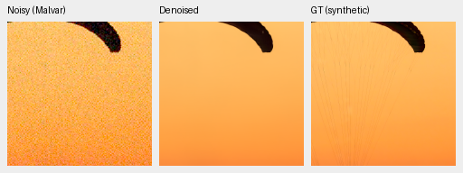
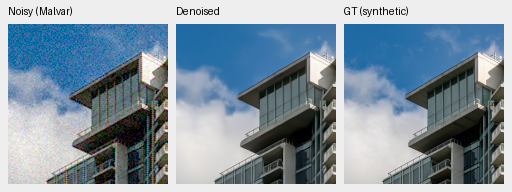
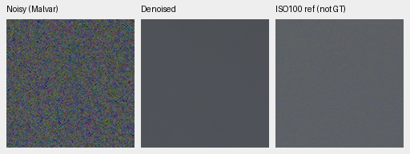
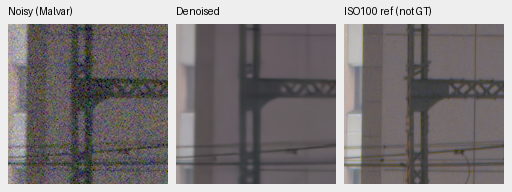
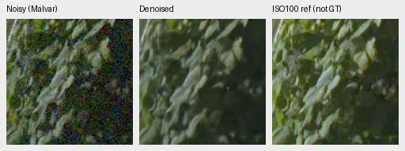
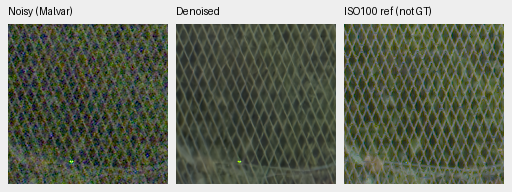
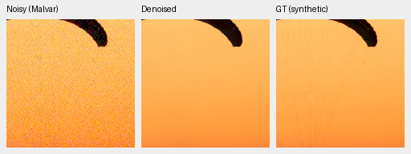
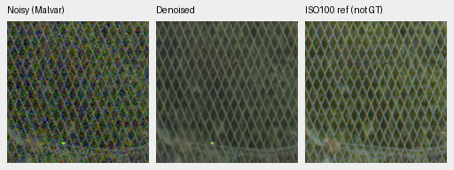

# V80/V81: completed original4k bank-context review

Current architecture and recommendations: [current model guide](current-model.md).
The versioned study below retains its measured results and original protocol.

The bank context adds **+0.03017dB**
full427 rendered PSNR over the matched control, source95% interval
[+0.02652, +0.03364]. Both arms fail the fixed known4/unseen5 measured-CFA
improvement requirements, and both weak-carrier gain gates fail.
**Neither model is promoted or extended; V43 was the reference for this experiment.**
Fine paraglider cords and neon-wave detail remain unresolved.

[Complete results, source/checkpoint bindings, all groups and native-view decision](results/directional-bank-original4k-complete-v1.json).
[Publication/pixel/source audit](results/directional-bank-original4k-publication-v1.json).
[Fixed experiment and original criteria](directional-bank-v80-v81.md).

Both fresh arms completed their original4000 schedules from the genuine V63
original20k EMA, seed51, B16/native256/BF16/channels-last. Common LR1e-5,
directional multiplier20 and zero interval weight remain fixed. Each arm draws
64,000 examples. Both use strict deterministic execution, sensor-valid camera
supervision, Commons84,867/native128/paired32 and4×→geometry/PSF→area2.
The prepared private150 extension stays inactive. All176 sampled inputs,
161 logged domains/LRs, common/local/DINO initialization and final Python/CPU/
CUDA RNG match between the two current arms. The24,543-parameter bank is the
configured intervention. These checks and this single seed do not prove
convergence or training-repeat reliability.

All10 review stages and CPU scalar/array audits finished after exact owned
training-process exit. Primary panels freshly evaluate both final EMAs and V63
in FP32. The full suite has75,396 fresh records:432 known,540 unseen and74,424
photo/procedural rows. Historical V43/RawNIND results require the fixed source/
protocol/coverage and classical-control witnesses. All108 primary comparisons,
81 sensitivity comparisons,84 carrier/flat groups and54 hue groups are retained.
All eight final native boards were actually viewed at original resolution:
**81 source triplets /125 unchanged160px cells**, including four extra palettes.

## Photographic scores and their limits

Means balance427 sources over seven conditions and four CFAs. Paired source/
scene-bootstrap95% intervals use1000 resamples, seed42; they do not estimate
training-seed uncertainty. The complete16-source procedural panel is separate.

| Model | Photo sRGB PSNR | Change from fresh parent [95% source interval], dB | Photo SSIM |
| --- | --- | --- | --- |
| V80-original4000 | 36.21129 | +0.27832 [+0.20044, +0.38265] | 0.964099307 |
| V81-original4000 | 36.24146 | +0.30849 [+0.23013, +0.41422] | 0.964158903 |
| V63-parent | 35.93298 | reference | 0.963289824 |

Matched bank−control SSIM changes
+0.000059596.
The matched positive photographic interval and camera-loss ceilings pass; the
analytic weak-detail requirements do not. Parent gains jointly change the RAW
head, sensor-valid supervision, optimizer/horizon and corpus history; they do
not isolate the effect of adding a directional head.

Condition rows are descriptive means, without new per-condition intervals.

| Photo condition | Control−parent rendered PSNR, dB | Bank−parent rendered PSNR, dB |
| --- | --- | --- |
| adc-only | +0.24213 | +0.33287 |
| iso100-prior | +0.46775 | +0.52771 |
| iso1600-prior | +0.35018 | +0.37254 |
| iso12800-prior | +0.17169 | +0.17386 |
| shadows | +0.01959 | +0.02079 |
| highlights | +0.36625 | +0.39312 |
| legacy-noise | +0.33060 | +0.33852 |

Canonical camera-linear photo PSNR remains adverse:
41.35986dB parent versus39.28508/39.32963dB control/bank, changes
−2.07477/−2.03023dB, source95% intervals
[-2.19024, -1.94396]/
[-2.14539, -1.89913]. The highlight condition changes
-17.29851/-17.30346dB. Evaluation preserves
reference-white clipping before inverse camera transport; these arms train on
sensor-valid targets. This convention limits interpretation and does not justify
hiding or replacing the unfavorable scores. Procedural16 rendered gains are
+0.82092/
+0.85106dB; canonical camera-linear changes are
-1.35334/
-1.32045dB. All per-condition means are retained in the registry.

The source sensitivities preserve the small matched photo gain:

| Photographic sources | Control−parent, dB | Bank−parent, dB | Bank−control [95% source interval], dB |
| --- | --- | --- | --- |
| 427 | +0.27832 | +0.30849 | +0.03017 [+0.02652, +0.03364] |
| 418 | +0.27984 | +0.30995 | +0.03011 [+0.02649, +0.03355] |
| 416 | +0.28030 | +0.31019 | +0.02989 [+0.02644, +0.03348] |

The independent audit reaggregates215,208 raw metric values and81 comparisons.
Related-series ancestry and unknown aliases remain limitations; these exclusions
do not establish complete scene independence.

## Real cameras and working baselines

| Model | Known4 change from parent [95% scene interval], dB | Unseen5 change from parent [95% scene interval], dB |
| --- | --- | --- |
| V80-original4000 | -0.01829 [-0.07282, +0.03696] | -0.02289 [-0.04069, -0.00365] |
| V81-original4000 | -0.01233 [-0.07152, +0.04687] | -0.00817 [-0.02416, +0.00842] |

Each panel requires at least+.05dB with a positive lower bound. Both arms fail
both panels. Matched bank−control changes are+.00597dB known and+.01472dB unseen;
the known interval crosses zero and the unseen interval is positive. Those small
relative gains do not meet the absolute parent-based eligibility requirements.

The retained working/baseline means, with their input-only gain calibration
and source/protocol witnesses, are:

| Baseline | Photo rendered PSNR | Known4 measured-CFA PSNR | Unseen5 measured-CFA PSNR |
| --- | --- | --- | --- |
| V43-working | 34.89933 | 54.23334 | 53.80629 |
| RawNIND-global | 26.69578 | 54.06860 | 53.56220 |
| RawNIND-channel | 26.68357 | 54.08474 | 53.76822 |

The synthetic RawNIND gap is large. The real-camera comparisons with
RawNIND-channel have scene intervals crossing zero on both panels; they do not
prove broad real superiority. The actual [known](images/directional-bank-known-all-methods-native.png) and
[unseen](images/directional-bank-unseen-all-methods-native.png) boards compare both arms, V63, V43 and RawNIND.
The low-noise AHD RGB is an independent auxiliary reference, not exact RGB GT;
measured CFA remains the primary camera score. All three current checkpoints
look close in the four fixed camera ROIs. Plate variation stays softened and
isolated chart points remain. RawNIND has softer/fringed chart/illustration
boundaries; these few regions do not establish whole-image superiority.

On [cached GFX3879/3880](images/directional-bank-gfx-all-methods-native.png), sky noise is strongly reduced.
The current arms, V63 and V43 look close in building, foliage and fence detail.
Their fence diamonds stay more continuous than RawNIND's broken/checkered
pattern. Foliage remains soft compared with ISO100, whose f/5.6 aperture,
exposure and moving subjects differ from the ISO6400 capture. This is a
qualitative reference, not a pixelwise scoring target. No original HDD photo
was needed for this review.

## Weak structure, flat fields and highlights

The two predeclared high-noise cases require bank−control mean signed in-phase
gain of at least.05 each, with matched flat spatial-luma RMS at most1.25×control.
Each mean contains four Bayer layouts and four draws (16 cases); these analytic
cases are descriptive, not photographic confidence intervals.

| Level/contrast/period | Control signed gain | Bank signed gain | Gain change | Flat RMS ratio |
| --- | --- | --- | --- | --- |
| 0.01/0.1/8 | 0.00020847 | 0.00027910 | +0.00007062 | 0.997342 |
| 0.18/0.02/16 | 0.29495481 | 0.29846161 | +0.00350679 | 0.992878 |

Both gain gates fail while both flat-RMS ceilings pass. The dark carrier is
almost entirely suppressed; the bright carrier retains only a weak modulation.
The [native analytic board](images/directional-bank-analytic-all-methods-native.png) agrees with those results.
All24 carrier configurations and four flat configurations for both arms and
Malvar are preserved, including quadrature, noncarrier error and ranges.

A material adverse case is ADC-only level.01/contrast.02/period4: mean signed
gain falls from0.796460 to0.467075
(change-0.329385).
The largest positive carrier change is only
+0.015227.
The ADC-only level.18 flat RMS ratio is1.17539; high-noise ratios are.99734/.99288.
This is a tradeoff across the complete panel, rather than reliable weak-detail
recovery.

All1176 hue observations/3528 fresh predictions and54 aggregate groups passed
the separate raw-array/metric/rendering audit. Below, values are mean maximum
absolute channel-mean error / mean centered camera-RGB RMS in the high-noise condition:

| Saturation/peak | Control | Bank | V63 parent |
| --- | --- | --- | --- |
| 0/0.18 | 0.00081348 / 0.00044870 | 0.00080682 / 0.00044526 | 0.00073790 / 0.00045348 |
| 0.98/0.02 | 0.00013167 / 0.00015931 | 0.00013052 / 0.00015947 | 0.00011977 / 0.00016074 |
| 0.98/0.18 | 0.00034185 / 0.00047046 | 0.00034967 / 0.00047155 | 0.00039867 / 0.00049250 |
| 0.98/0.9 | 0.00107172 / 0.00155735 | 0.00114843 / 0.00158881 | 0.00573934 / 0.00183866 |

Bright saturated fields improve markedly over the parent in some color errors.
Bank is not uniformly better than control: saturated.9 mean bias is.00114843
versus.00107172; gray.9 mean-bias change is+.00039511. Saturated.9 ADC-only mean
bias also rises by.00011397. The [hue](images/directional-bank-hue-all-methods-native.png) and
[four extra palettes](images/directional-bank-hue-extra-all-methods-native.png) show reduced parent mottling
in both new arms, with small bank/control display differences. The full54-group
table is retained. One observation per cell, one WB/camera, three brightnesses
and two saturations plus gray limit generalization; descriptive quantiles are
not confidence intervals.

The [highlight board](images/directional-bank-highlights-all-methods-native.png) retains the unresolved fine
cyan/blue neon-wave deficit in all three predictions. Broad platform/sign
geometry stays similar, without an obvious new bank-specific fringe in these
fixed views. ISO100 AHD is independent, not exact GT, so no pixelwise real-image
highlight quality score is invented.

## Native report crops

The following PNGs are copied byte-for-byte from the completed source triplets.
Each panel is native160×160; no crop pixels are resized. Two synthetic-GT
triplets are included for each final checkpoint, plus all four fixed GFX regions.
The synthetic target is defined at the original8×-binned evaluation resolution.
The within256 context ROI is[48,48,160,160], with cache contexts
[189,3,256,256] and[195,89,256,256]. Shared RGGB, WB[2,1,1.5],
camera matrix diagonal1.1176470588/off-diagonal−.0588235294, ADC16 and display
exposure are retained; complete source/checkpoint/noise/reference metadata and
copyright attribution are in the registry. RGB8 is only the preview; scores use
unquantized FP32 predictions. Noise dictionaries specify the shot coefficient
and read variance.

The [all-method photo board](images/directional-bank-full427-all-methods-native.png) also includes V63/V43.
Fine canopy cords are largely absent in every restored example, and cloud wisps
are softened. These shared deficits remain relevant despite the photographic
mean gains. No obvious new bank-specific failure was seen within the fixed
125-cell preview set; the adverse numerical carrier regression is reported
above, and this finite set cannot rule out failures elsewhere.

### V80-original4000

Checkpoint SHA256: `6cd2295b945c38c95855dd6c7bb44380f12a6f48d56329d2103ec0793a66c2d9`.

Source/ROI: `[237, 51, 160, 160]`; noise/conditioning: `{"exposure": 1.0, "name": "iso12800-prior", "read": 2.62144e-05, "shot": 0.00256}`; display exposure ×1.0.

Source [File:CH.VD.Villeneuve 2007-08-25 Vertigo-Swiss-Riviera 2392 3x2-R 4K.jpg](https://commons.wikimedia.org/wiki/File:CH.VD.Villeneuve_2007-08-25_Vertigo-Swiss-Riviera_2392_3x2-R_4K.jpg), Roy Egloff; [CC BY-SA 4.0](https://creativecommons.org/licenses/by-sa/4.0). Binned, cropped, simulated noise and restoration.

Source/ROI: `[243, 137, 160, 160]`; noise/conditioning: `{"exposure": 1.0, "name": "iso12800-prior", "read": 2.62144e-05, "shot": 0.00256}`; display exposure ×1.0.

Source [File:Vancouver (BC, Canada), Coal Harbour Seaside Park, Blick in den Himmel -- 2022 -- 2158.jpg](https://commons.wikimedia.org/wiki/File:Vancouver_(BC,_Canada),_Coal_Harbour_Seaside_Park,_Blick_in_den_Himmel_--_2022_--_2158.jpg), Dietmar Rabich; [CC BY-SA 4.0](https://creativecommons.org/licenses/by-sa/4.0). Binned, cropped, simulated noise and restoration.

Source/ROI: `{"context_green_correlation": null, "name": "overcast-sky", "noisy_xy": [5800, 1400], "reference_xy": [5800, 1400], "selection_method": "Same sensor coordinates; sky has no fixed registration landmarks", "size": 160}`; noise/conditioning: `{"read": 1.0715704128646712e-06, "shot": 0.0014635775921166604}`; display exposure ×4.

DSCF3879 ISO6400 and independently demosaiced DSCF3880 ISO100 differ in aperture, exposure time and moving subjects. The ISO100 image is a qualitative reference, not a pixelwise scoring target.

Source/ROI: `{"context_green_correlation": 0.6824449896812439, "name": "building-detail", "noisy_xy": [5790, 2690], "reference_xy": [5791, 2690], "selection_method": "Maximum normalized green correlation in input/reference 512px contexts; integer offsets only, no output-dependent selection", "size": 160}`; noise/conditioning: `{"read": 1.0715704128646712e-06, "shot": 0.0014635775921166604}`; display exposure ×4.

DSCF3879 ISO6400 and independently demosaiced DSCF3880 ISO100 differ in aperture, exposure time and moving subjects. The ISO100 image is a qualitative reference, not a pixelwise scoring target.

Source/ROI: `{"context_green_correlation": 0.9597686529159546, "name": "foliage", "noisy_xy": [8890, 5570], "reference_xy": [8890, 5570], "selection_method": "Maximum normalized green correlation in input/reference 512px contexts; integer offsets only, no output-dependent selection", "size": 160}`; noise/conditioning: `{"read": 1.0715704128646712e-06, "shot": 0.0014635775921166604}`; display exposure ×4.

DSCF3879 ISO6400 and independently demosaiced DSCF3880 ISO100 differ in aperture, exposure time and moving subjects. The ISO100 image is a qualitative reference, not a pixelwise scoring target.

Source/ROI: `{"context_green_correlation": 0.9550720453262329, "name": "chain-link-fence", "noisy_xy": [2240, 6000], "reference_xy": [2241, 6000], "selection_method": "Maximum normalized green correlation in input/reference 512px contexts; integer offsets only, no output-dependent selection", "size": 160}`; noise/conditioning: `{"read": 1.0715704128646712e-06, "shot": 0.0014635775921166604}`; display exposure ×4.

DSCF3879 ISO6400 and independently demosaiced DSCF3880 ISO100 differ in aperture, exposure time and moving subjects. The ISO100 image is a qualitative reference, not a pixelwise scoring target.

### V81-original4000

Checkpoint SHA256: `d05c1774a25164de0ce00b8210109c6d63930b14161f985c1c344bd4839eab42`.

Source/ROI: `[237, 51, 160, 160]`; noise/conditioning: `{"exposure": 1.0, "name": "iso12800-prior", "read": 2.62144e-05, "shot": 0.00256}`; display exposure ×1.0.

Source [File:CH.VD.Villeneuve 2007-08-25 Vertigo-Swiss-Riviera 2392 3x2-R 4K.jpg](https://commons.wikimedia.org/wiki/File:CH.VD.Villeneuve_2007-08-25_Vertigo-Swiss-Riviera_2392_3x2-R_4K.jpg), Roy Egloff; [CC BY-SA 4.0](https://creativecommons.org/licenses/by-sa/4.0). Binned, cropped, simulated noise and restoration.

Source/ROI: `[243, 137, 160, 160]`; noise/conditioning: `{"exposure": 1.0, "name": "iso12800-prior", "read": 2.62144e-05, "shot": 0.00256}`; display exposure ×1.0.

Source [File:Vancouver (BC, Canada), Coal Harbour Seaside Park, Blick in den Himmel -- 2022 -- 2158.jpg](https://commons.wikimedia.org/wiki/File:Vancouver_(BC,_Canada),_Coal_Harbour_Seaside_Park,_Blick_in_den_Himmel_--_2022_--_2158.jpg), Dietmar Rabich; [CC BY-SA 4.0](https://creativecommons.org/licenses/by-sa/4.0). Binned, cropped, simulated noise and restoration.

Source/ROI: `{"context_green_correlation": null, "name": "overcast-sky", "noisy_xy": [5800, 1400], "reference_xy": [5800, 1400], "selection_method": "Same sensor coordinates; sky has no fixed registration landmarks", "size": 160}`; noise/conditioning: `{"read": 1.0715704128646712e-06, "shot": 0.0014635775921166604}`; display exposure ×4.

DSCF3879 ISO6400 and independently demosaiced DSCF3880 ISO100 differ in aperture, exposure time and moving subjects. The ISO100 image is a qualitative reference, not a pixelwise scoring target.

Source/ROI: `{"context_green_correlation": 0.6824449896812439, "name": "building-detail", "noisy_xy": [5790, 2690], "reference_xy": [5791, 2690], "selection_method": "Maximum normalized green correlation in input/reference 512px contexts; integer offsets only, no output-dependent selection", "size": 160}`; noise/conditioning: `{"read": 1.0715704128646712e-06, "shot": 0.0014635775921166604}`; display exposure ×4.

DSCF3879 ISO6400 and independently demosaiced DSCF3880 ISO100 differ in aperture, exposure time and moving subjects. The ISO100 image is a qualitative reference, not a pixelwise scoring target.

Source/ROI: `{"context_green_correlation": 0.9597686529159546, "name": "foliage", "noisy_xy": [8890, 5570], "reference_xy": [8890, 5570], "selection_method": "Maximum normalized green correlation in input/reference 512px contexts; integer offsets only, no output-dependent selection", "size": 160}`; noise/conditioning: `{"read": 1.0715704128646712e-06, "shot": 0.0014635775921166604}`; display exposure ×4.

DSCF3879 ISO6400 and independently demosaiced DSCF3880 ISO100 differ in aperture, exposure time and moving subjects. The ISO100 image is a qualitative reference, not a pixelwise scoring target.

Source/ROI: `{"context_green_correlation": 0.9550720453262329, "name": "chain-link-fence", "noisy_xy": [2240, 6000], "reference_xy": [2241, 6000], "selection_method": "Maximum normalized green correlation in input/reference 512px contexts; integer offsets only, no output-dependent selection", "size": 160}`; noise/conditioning: `{"read": 1.0715704128646712e-06, "shot": 0.0014635775921166604}`; display exposure ×4.

DSCF3879 ISO6400 and independently demosaiced DSCF3880 ISO100 differ in aperture, exposure time and moving subjects. The ISO100 image is a qualitative reference, not a pixelwise scoring target.

## Decision and remaining objective

This original4k study is closed with both arms ineligible under the original
criteria. No budget is extended, no threshold is changed and no model is
promoted. V43 README pixels and the model default were unchanged during this study. No new
full101.996MP run,16bit export, cold/warm speed claim or protected-final score
is made for these ineligible checkpoints. SOTA, broad real superiority and the
100MP/10s target remain unproven or unmet. A future experiment must have its
own hypothesis, controls and fixed budget.
