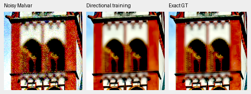
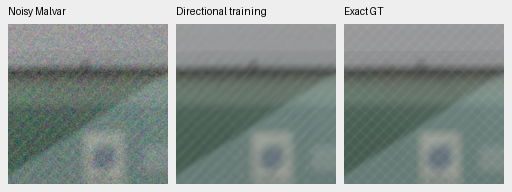

# Directional gap supervision for weak wires

At matched total correction inside held-out ISO6400 wire gaps, the directional
router recovers **0.44 percentage points** more intact weak-wire response than
the spatial gap-loss control. Intact weak-band error falls **0.43 DN16**.
Error in the missing direction rises **0.066 DN16** inside the gaps. On
independent natural photographs at matched added flat-region RMS, response
rises **0.30 points** and fine-increment error rises **0.10 DN16**. The
nominal right cab crop retains stronger existing diagonals, with the fine
intersections still incomplete.
[Machine results](results/directional-gap-training-v1/publication.json) ·
[Frozen drivers and receipts](results/directional-gap-training-v1/evidence.tar.xz) ·
[Native provenance](images/directional-gap-training-v1/manifest.json).

## Matched training and numerical review

The EMA artifact is
`cfc53ece231049d84e75bfc345076e412ba63adad481ca90db50104361990f74`.
The experiment freezes the local scene 20k EMA
`b892a08c8ebbccb05c000e4f42d1f86c3a7d1d5870721ccd6e1c8fe9e82c3889`
and the Bayer phase EMA
`069de3a3d3f18ab0f32cf9b242daa1fb859d03762086ee27244557aced803e54`.
Each of three small routers sees the same 448 sources and six shuffled
epochs, with 672 updates, 2,688 source visits and 8,064 role queries per
router. Training takes 15.96 s across all three heads. Building the masked
projections takes 24.73 s separately. The whole-gap control reproduces
the earlier raw and EMA tensors bit for bit.

The unchanged base losses retain absolute, paired and flat-region terms.
The weak-gap arm projects paired and absolute gap error onto the weak
frequencies after removing affine and strong-wave components. The
directional arm also scores absolute strong-band gap error and paired intact
weak-band error. Exact gap labels and frequencies enter the supervised losses
and measurements. Native inference uses only the RAW-derived features.
The weak-only loss changes little when matched for total gap correction.
[Prior mixture](phase-correction-mixture.md) ·
[Directional attribution and projection checks](local-phase-envelope.md).

| Independent ISO6400 wire check | Weak response | Intact weak-band RMS, DN16 | Gap weak-band RMS, DN16 | Added gap RMS, DN16 |
| --- | ---: | ---: | ---: | ---: |
| Matched local 20k | 33.413% | 84.771 | 7.087 | 0 |
| V120 | 31.605% | 86.701 | 7.179 | 25.077 |
| Corpus 100k | 33.657% | 84.945 | 7.198 | 16.700 |
| Previous conditional | 39.854% | 79.336 | 7.104 | 20.713 |
| Whole gap | 38.019% | 80.905 | 7.037 | 15.699 |
| Weak gap | 38.302% | 80.687 | 7.037 | 17.058 |
| Whole gap, strength matched | 39.888% | 79.415 | 7.020 | 22.069 |
| Directional | 40.331% | 78.981 | 7.087 | 22.252 |

The 24 independent ISO6400 wire cases include 12 actual gaps. The
source-paired gain versus the strength-matched control spans **+0.110 to
+0.770 response points**. The increase in missing weak-band error spans
**+0.014 to +0.125 DN16**. The total intact error also rises 0.292 DN16.
Against the previous conditional EMA, the directional arm gains 0.478
response points and lowers absolute gap RMS by 0.385 DN16. The 95% interval
for the difference in weak-band gap error includes zero.

The photographic check uses 48 held-out photos and 16 separate
calibration photos, with matching correction strength estimated on
the latter. The 95% intervals for response gain and increased
fine-increment RMS span +0.270 to +0.331 points and +0.054 to +0.148 DN16.
The directional flat increment above the matched local parent is 0.721 DN16.
The exact and real native views were inspected. This crop-level component
study has no fixed427 or measured-camera panel score.
[Comparable model history](performance-history.md).

## Native exact-target comparisons

Each cell is 160 × 160 unchanged pixels at `[48,48,160,160]` inside
the query. Both use ISO6400 shot/read `0.00128/6.5536e-6`, 16-bit ADC,
black 0.03 and the directional EMA in the middle.

**Limburg Cathedral**, Berthold Werner, public domain. BGGR source query
`[22,250,256,256]`, acquisition exposure 0.33, display ×3.0303 and
contrast ×2. Bricks and fine molding remain diffuse.
[Source](https://commons.wikimedia.org/wiki/File:Limburger_Dom_BW_1.jpg) ·
[All methods](images/directional-gap-training-v1/exact/001-iso6400-independent-comparison.png).

**St Valentin railway**, RGGB query `[128,128,256,256]` inside the
reference field `[376,16,512,512]`. Display ×2 and contrast ×1.
The visible partial wires remain soft near the exact gap.
[Source and capture recipe](phase-correction-mixture.md#exact-native-crops) ·
[All methods](images/directional-gap-training-v1/exact/012-iso6400-comparison.png) ·
[Continuous contrast dip](images/directional-gap-training-v1/exact/014-iso6400-comparison.png).

## Standing GFX100S comparisons

The DSCF3879 sky stays smooth at ×4 and the coarse fence remains
coherent. Thin building lines and foliage remain soft. In DSCF3842 at
×16, the nominal profile leaves the left lattice faint and mottled.
Existing right diagonals strengthen. The transferred profile resembles
the previous conditional router, with incomplete crossings. Nominal
shot/read are `0.00128/6.5536e-6`; transferred shot/read are
`0.0014635775921166604/1.0715704128646712e-6`. ISO100 AHD and the
original cab JPEGs are qualitative references acquired under different
aperture, exposure time and subject motion.

[Sky](images/directional-gap-training-v1/standing/main-overcast-sky-main-overcast-sky.png) ·
[Building](images/directional-gap-training-v1/standing/main-building-detail-main-building-detail.png) ·
[Foliage](images/directional-gap-training-v1/standing/main-foliage-main-foliage.png) ·
[Coarse fence](images/directional-gap-training-v1/standing/main-chain-link-fence-main-chain-link-fence.png).

| Cab profile | Native left and right crops |
| --- | --- |
| Nominal | [Left](images/directional-gap-training-v1/standing/mesh-nominal-fine-green-mesh-left.png) · [Right](images/directional-gap-training-v1/standing/mesh-nominal-fine-green-mesh-right.png) |
| Transferred | [Left](images/directional-gap-training-v1/standing/mesh-profile3879-fine-green-mesh-left.png) · [Right](images/directional-gap-training-v1/standing/mesh-profile3879-fine-green-mesh-right.png) |
