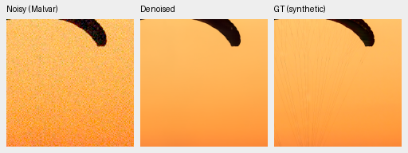
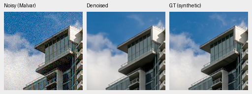
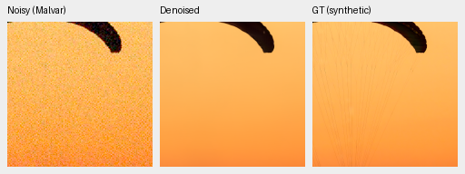
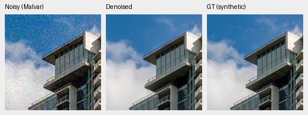

# Final4k directional study: partial native review

This page retains the earlier camera/native interim. The
[completed full4k review](directional-interval-original4k-review.md) now includes
all primary/color/analytic/highlight/GFX results and all81 triplets/125 cells.

Both final arms still lose the canopy's fine cords in the two fixed photographic
examples. Building detail looks close to the genuine parent and V43. Both
completed camera panels now fail the original numerical criteria. The
selected known/unseen camera crops also show modest differences, without an
obvious broad detail recovery. This is a partial review: full427 scores,
color/analytic/highlight and standing GFX review remain pending. **V43 stays the
working reference; neither new model is promoted.**

[Source, checkpoint, crop, display and actual-view receipts](results/directional-interval-native-interim-v1.json).
[Complete original training budgets](directional-interval-original4k-training.md).
[Fixed eligibility criteria](directional-interval-v78-v79.md).

The live evaluator already saved these fixed crops while processing the
remaining photographs. CPU composition uses those PNGs and the completed camera
panels, adding matched retained V43 and camera RawNIND references. It does not
run inference, draw noise, select new cases or change the live review. All three
boards were actually viewed at original resolution: **28 source triplets / 40
native160px cells**. Every cell was reopened and compared with its original
source pixels after viewing. Later complete boards must be checked against these
identities before reusing this partial review.

## Two exact-GT triplets per final checkpoint

Each PNG shows noisy Malvar → restored → exact synthetic GT. Each panel is a
native160×160 slice without resizing, at the original 8×-binned evaluation
resolution. These are RGB8 sRGB previews of fresh IEEE FP32 predictions, using
the actual full427 CUDA observations. They do not substitute older CPU-noise
fixtures or establish full-photo performance.

V78 control, interval weight0, SHA256
`26e43921d2f4f46b39d9385c8399699f9fe1f0294f34efa4e6da0d4ad9baa7c4`:

V79 interval weight0.1, SHA256
`2f3e567e4bca7bf308f79d5e613d791d612e7d950c0cd64c9c21ac548aa1f11f`:

Shared RGGB, shot.00256/read variance.0000262144, WB[2,1,1.5], simulated
exposure1 and display×1/0EV. The camera-to-sRGB matrix has diagonal1.1176470588
and off-diagonal−.0588235294. Native256 cache contexts are [189,3,256,256] and
[195,89,256,256]; displayed cache ROIs are [237,51,160,160] and
[243,137,160,160], respectively. The within-context ROI is [48,48,160,160].
Coordinates, noise and transforms are identical across methods. The registry
retains full source IDs, cache hashes, checkpoint hashes and PNG metadata.

Sources: [Swiss Riviera, Roy Egloff](https://commons.wikimedia.org/wiki/File:CH.VD.Villeneuve_2007-08-25_Vertigo-Swiss-Riviera_2392_3x2-R_4K.jpg)
and [Vancouver, Dietmar Rabich](https://commons.wikimedia.org/wiki/File:Vancouver_(BC,_Canada),_Coal_Harbour_Seaside_Park,_Blick_in_den_Himmel_--_2022_--_2158.jpg),
[CC BY-SA4.0](https://creativecommons.org/licenses/by-sa/4.0/), modified by binning,
cropping, simulated noise and restoration.

The [matched photo board](images/directional-interval-interim-full427-native.png)
also includes freshly evaluated genuine V63 and retained V43. Both new arms
produce a smooth orange canopy rather than recovering its fine lines. Building
edges remain similar; these two selected examples cannot establish an aggregate
gain or rule out failures elsewhere.

## Registered camera references

Both complete fresh six-method panels pass independent coverage, observation,
protocol, nullable-support and summary-arithmetic checks:432 known and540 unseen
rows. [Camera statistics and source receipts](results/directional-camera-interim-statistics-v1.json).
The scene-balanced measured-CFA PSNR changes relative to fresh V63 are:

| Model | Known4 change [95% interval], dB | Unseen5 change [95% interval], dB |
| --- | --- | --- |
| V78 original4000 | −.01121 [−.07108,+.04866] | −.00443 [−.02538,+.01348] |
| V79 original4000 | −.01714 [−.07923,+.04495] | −.00444 [−.02455,+.01716] |

The fixed requirement is at least+.05dB with a positive scene-bootstrap lower
bound on **each** panel. Both arms fail both panel criteria. This already rules
out full-frame eligibility under that protocol, while the remaining photo/color/
native review still must finish. No threshold is changed and no budget extended.
Matched V79−V78 is−.00593dB known and−.00000318dB unseen; both scene intervals
cross zero. These1,000-resample intervals use seed42 and describe evaluation
scene variation, not training-seed or GPU-process uncertainty. The full primary
statistics will be reconciled with these18 camera comparison rows when ready.

The [known-camera board](images/directional-interval-interim-known-native.png)
and [unseen-camera board](images/directional-interval-interim-unseen-native.png)
compare both new arms, fresh V63, retained RawNIND channel calibration and V43.
Their final panels are independently demosaiced AHD references, **not exact RGB
GT**. Original scene/registered-crop identities, noise conditioning, WB/matrix,
display exposure and method-specific calibration are retained in the receipts.

Dark folded/wood-like detail remains smooth in the known examples; isolated
points remain in the chart. The unseen apple texture is strongly smoothed and
the illustrated colored boundary stays soft. RawNIND has different, often softer
boundaries. These are observations on the fixed cases, not pixelwise RGB scores,
camera-wide superiority or a completed model-eligibility decision.

Full source/scene statistics and all remaining native panels still apply. The
original single-trajectory GPU variation and canonical camera-target caveat
remain in force. No new full102MP restoration, 16-bit export or speed result
follows from this partial review.
