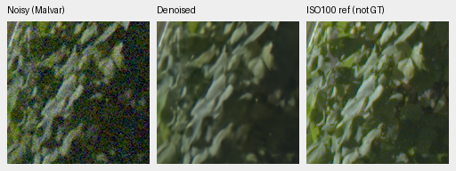
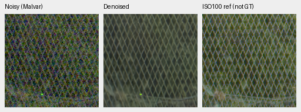
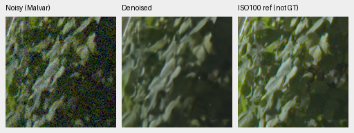
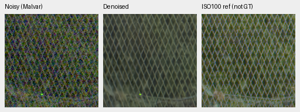

# V78/V79: completed original4k directional/interval review

V78/V79 improve full427-photo rendered PSNR by **.27801/.27640dB** over the fresh
genuine V63 parent, but both fail the original known/unseen camera requirements.
The matched interval loss does not improve photographic PSNR. Fine cords remain
missing and the standing GFX crops stay close to the parent. **Neither model is
promoted or extended; V43 stays the working reference.** All numerical, color,
analytic/highlight and native review is complete.

[Complete source, checkpoint, score, native-view and decision registry](results/directional-interval-original4k-complete-v1.json).
[Complete primary scores, fixed criteria, source sensitivities and GFX views](results/directional-primary-and-GFX-interim-v1.json).
[Complete original training budgets](directional-interval-original4k-training.md).
[Fixed eligibility criteria](directional-interval-v78-v79.md).

The fixed primary panels contain75,396 fresh score rows and108 audited
comparisons:432 known-camera,540 unseen-camera and74,424 photo/procedural records.
The numerical checker applies the original unrounded criteria. Photo, camera
and GFX boards with matched V63/V43/RawNIND references have now been actually
viewed: **81 source triplets / 125 native160px cells across eight final boards**.
The68 early cells are revalidated after all producers exited by exact source/ROI/
noise/display, case/method/checkpoint and all three original pixel parts; their
final board PNG bytes are also identical. The57 remaining cells were actually
viewed after exit. Every final cell matches its original160px source slice.
The [publication audit](results/directional-interval-complete-publication-v1.json)
checks4,343 file/SHA bindings, all125 final cells, exact public PNG copies and
unchanged README reference pixels. Historical input files are hash-bound;
their full ancestral mutable software histories are outside this closure audit.

## Complete primary numerical results

Each photo mean balances427 sources over seven noise/exposure conditions and
four CFAs. Source-bootstrap95% intervals use1,000 resamples, seed42. They do
not estimate training-seed or GPU-process uncertainty.

| Model | Photo sRGB PSNR | Change from parent [95% interval], dB | Photo SSIM |
| --- | ---: | --- | ---: |
| Fresh genuine V63 original20k |35.93298| reference |.963289824|
| V78 original4000 |36.21099|+.27801 [.19987,.38367]|.964092896|
| V79 original4000 |36.20938|+.27640 [.19831,.38115]|.964076719|

Matched V79−V78 photo PSNR is−.00161444dB,95% interval
[−.00315721,−.00050685]; SSIM changes−.00001618. The fixed positive photographic
interval requirement fails. This small single-trajectory result does not prove
that the loss universally harms restoration or isolate procedural GPU variation.
The earlier first-step base-loss difference remains part of the interpretation.

Canonical camera-linear photo PSNR falls from41.35986dB in the parent to
39.28530/39.28770dB:−2.07456/−2.07216dB, with entirely negative source intervals.
The highlight condition alone loses17.29930/17.29068dB. Evaluation retains its
original reference-white clipping before inverse camera transport, while these
arms train with sensor-valid supervision. That convention matters, but does not
justify hiding or replacing these unfavorable scores.

Rendered photo changes for V78/V79 by condition are ADC+.23910/+.22687,
ISO100+.46804/+.46635, ISO1600+.35033/+.34799, ISO12800+.17168/+.17035,
shadows+.01964/+.01763, highlights+.36638/+.37610 and original noise
+.33092/+.32951dB. These are descriptive condition means without new intervals.
The separate16 procedural sources gain.82018/.82817dB rendered PSNR while
losing1.35303/1.34162dB canonical camera-linear PSNR.

Fixed418/416-source sensitivities retain positive own-parent rendered gains:
V78+.27957/+.28004dB and V79+.27792/+.27840dB. Matched interval effects remain
negative with negative source intervals. The independent sensitivity audit
reaggregates215,208 raw metric values and checks81 comparisons; maximum source
difference0 and comparison difference3.55e-15. Related-series ancestry and
unknown aliases remain; these checks do not establish complete scene independence.

Own-parent gains jointly change architecture, sensor-valid supervision, fresh
optimizer/horizon and corpus history. They do not isolate a directional-branch
effect. The matched arms nominally vary interval weight, with the documented
single-trajectory execution limitation. Both completed4k budgets remain fixed.

## Two exact-GT triplets per final checkpoint

Each PNG shows noisy Malvar → restored → exact synthetic GT. Each panel is a
native160×160 slice without resizing, at the original 8×-binned evaluation
resolution. These are RGB8 sRGB previews of fresh IEEE FP32 predictions, using
the actual full427 CUDA observations. The six early source triplets match the
completed summary exactly. These selected crops alone do not establish aggregate
performance or substitute older CPU-noise fixtures.

V78 control, interval weight0, SHA256
`26e43921d2f4f46b39d9385c8399699f9fe1f0294f34efa4e6da0d4ad9baa7c4`:

V79 interval weight0.1, SHA256
`2f3e567e4bca7bf308f79d5e613d791d612e7d950c0cd64c9c21ac548aa1f11f`:

Shared RGGB, shot.00256/read variance.0000262144, WB[2,1,1.5], simulated
exposure1 and display×1/0EV. The camera-to-sRGB matrix has diagonal1.1176470588
and off-diagonal−.0588235294. Native256 cache contexts are [189,3,256,256] and
[195,89,256,256]; displayed cache ROIs are [237,51,160,160] and
[243,137,160,160], respectively. The within-context ROI is [48,48,160,160].
Coordinates, noise and transforms are identical across methods. The registry
retains full source IDs, cache hashes, checkpoint hashes and PNG metadata.

Sources: [Swiss Riviera, Roy Egloff](https://commons.wikimedia.org/wiki/File:CH.VD.Villeneuve_2007-08-25_Vertigo-Swiss-Riviera_2392_3x2-R_4K.jpg)
and [Vancouver, Dietmar Rabich](https://commons.wikimedia.org/wiki/File:Vancouver_(BC,_Canada),_Coal_Harbour_Seaside_Park,_Blick_in_den_Himmel_--_2022_--_2158.jpg),
[CC BY-SA4.0](https://creativecommons.org/licenses/by-sa/4.0/), modified by binning,
cropping, simulated noise and restoration.

The [matched photo board](images/directional-interval-interim-full427-native.png)
also includes freshly evaluated genuine V63 and retained V43. Both new arms
produce a smooth orange canopy rather than recovering its fine lines. Building
edges remain similar; these two selected examples cannot establish an aggregate
gain or rule out failures elsewhere.

## Registered camera references

Both complete fresh six-method panels pass independent coverage, observation,
protocol, nullable-support and summary-arithmetic checks:432 known and540 unseen
rows. [Camera statistics and source receipts](results/directional-camera-interim-statistics-v1.json).
The scene-balanced measured-CFA PSNR changes relative to fresh V63 are:

| Model | Known4 change [95% interval], dB | Unseen5 change [95% interval], dB |
| --- | --- | --- |
| V78 original4000 | −.01121 [−.07108,+.04866] | −.00443 [−.02538,+.01348] |
| V79 original4000 | −.01714 [−.07923,+.04495] | −.00444 [−.02455,+.01716] |

The fixed requirement is at least+.05dB with a positive scene-bootstrap lower
bound on **each** panel. Both arms fail both panel criteria. This already rules
out full-frame eligibility under that protocol. Complete color/native review
does not override this failure. No threshold is changed and no budget extended.
Matched V79−V78 is−.00593dB known and−.00000318dB unseen; both scene intervals
cross zero. These1,000-resample intervals use seed42 and describe evaluation
scene variation, not training-seed or GPU-process uncertainty. All18 earlier
camera comparisons match the completed primary statistics exactly.

The [known-camera board](images/directional-interval-interim-known-native.png)
and [unseen-camera board](images/directional-interval-interim-unseen-native.png)
compare both new arms, fresh V63, retained RawNIND channel calibration and V43.
Their final panels are independently demosaiced AHD references, **not exact RGB
GT**. Original scene/registered-crop identities, noise conditioning, WB/matrix,
display exposure and method-specific calibration are retained in the receipts.

Dark folded/wood-like detail remains smooth in the known examples; isolated
points remain in the chart. The unseen apple texture is strongly smoothed and
the illustrated colored boundary stays soft. RawNIND has different, often softer
boundaries. These are observations on the fixed cases, not pixelwise RGB scores,
camera-wide superiority. The complete decision remains no promotion.

## Standing GFX sky, building, foliage and fence

The [complete matched GFX board](images/directional-interval-interim-gfx-native.png)
compares fresh B4/native512 IEEE FP32 contexts with the genuine parent and
retained V43/RawNIND. All20 triplets/28 cells were actually viewed at original
resolution. The existing packed observations and independent reference arrays
match the retained comparators exactly; no new RAW decoding or source drive read.

V78 foliage and fence, noisy → restored → separate ISO100 reference:

V79, identical sensor regions and display:

Cached DSCF3879 ISO6400/f1.7/1/240s and DSCF3880 ISO100/f5.6/3s differ in aperture,
time and motion; the latter is an independently demosaiced qualitative
reference, **not GT**. Common display×4/+2EV, shot.0014635775921166604, read
variance1.0715704128646712e-6 and WB[1.5132450331,1,2.2152317881]. Noisy/reference
160px origins are foliage[8890,5570]/[8890,5570] and fence[2240,6000]/[2241,6000].
Sky/building, full matrices, context extents, source/checkpoint hashes and exact
PNG rectangles are retained in the receipts. All standing captures/siblings
remain excluded from training.

Both arms retain gray sky, soft building/foliage and coherent fence lines close
to parent/V43; an isolated bright fence point persists. RawNIND shows more
structured mesh and residual grain/color artifacts. No clear broad new detail
advantage is visible over the parent. The sharper-aperture low-ISO reference
does not provide an exact pixelwise scoring target.

## Color, weak texture and illuminated boundaries

The fixed147-color × two-condition × four-CFA panel has1,176 observations and
3,528 fresh F32 predictions including the genuine parent. At high noise/peak.9,
mean maximum-channel bias / per-case camera-RGB RMSE over96 hue/CFA cases:

| Saturation | V78 bias / RMSE | V79 bias / RMSE | Parent bias / RMSE |
| ---: | --- | --- | --- |
|.50|.002157 / .002549|.002098 / .002549|.014350 / .010289|
|.98|.001008 / .001744|.001020 / .001733|.005739 / .004512|

Both new arms reduce these bright uniform-field biases. The
[base hue board](images/directional-interval-complete-hue-native.png) and
[four predeclared extra palettes](images/directional-interval-complete-hue-extra-native.png)
show close, largely uniform neutral/orange/pink/magenta fields without a new
obvious large color failure. These descriptive grid means are not photographic
confidence intervals or proof of texture recovery.

The [analytic native board](images/directional-interval-complete-analytic-native.png)
still loses weak detail. Dark level.01/contrast.1/period8 high-noise in-phase
gain is.000422/−.000032 in V78/V79 versus1.02913 in Malvar: nearly erased.
Noncarrier RMS is.000209/.000210 versus.009905. At level.18/contrast.02/period16,
gain is.30244/.28616 versus.99177 in Malvar; noncarrier RMS is.001045/.001018
versus.027126. Lower noise does not compensate for missing signal, and the
interval arm does not repair these fixed weak carriers. Malvar remains much
noisier; these diagnostics do not rank whole-photo quality.

The [neon/platform board](images/directional-interval-complete-highlights-native.png)
uses identical cached CPU FP32 inputs for both arms and the genuine parent.
Both new arms suppress bright wave-like detail inside the blue sign relative
to the parent; orange/blue interiors and platform boundaries remain simplified
or soft. The independent ISO100/AHD reference is not GT, and its exposure/time/
LED state can differ. The parent comparison uses the same high-ISO observation;
no exact real RGB score is assigned. This is an additional visible detail
limitation rather than an interval-loss success.

## Verification and final decision

Independent saved-array arithmetic reproduces21,168 hue metric fields within
4.44e-16. All54 hue groups/648 descriptive fields agree within1.74e-18. Analytic
coverage checks1,344 cases/84 groups/2,256 scalar fields within2.22e-16. Source
sensitivities and primary coverage are separately audited as above. All81 native
triplets/125 cells retain original pixels and correct exact/independent reference
labels. Training, evaluator, CPU closure, reference-supplement and execution-probe
owners/children have exited successfully. Frozen source/input guards still pass.

Both arms completed the original4,000 updates/64,000 example draws. Their99
model/99 EMA/97 AdamW states remain finite; genuine initialization, all176 sampled
observations,161 logged domains/LRs/hashes and final RNG agree. This does not
establish convergence, equality of every unlogged tensor or bitwise CUDA
training. The [actual original-input execution replay](directional-firststep-execution.md)
now demonstrates first-batch profile-dependent prediction/gradient variation;
strict execution matches all99 output/auxiliary/clipped-gradient tensors within
and across two processes. It does not isolate the historical loss difference's
cause or establish long-run training reproducibility. No default changes here.

Both original camera gates fail. The matched interval photo-benefit gate also
fails, and fine cords/weak carriers/blue-sign detail remain deficient. **Close
this study without extension or promotion.** V43 remains the README reference;
no new full102MP restoration, RGB16 export, timing or protected-final score is
produced. State-of-the-art quality, decisive broad real-photo superiority and
the100MP/10s target remain unmet/unproven; the overall project goal stays active.

