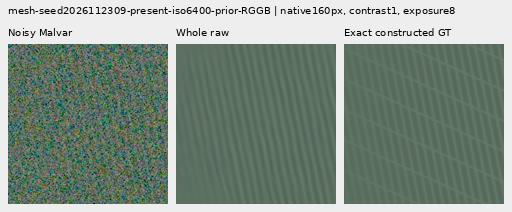
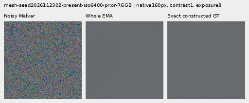
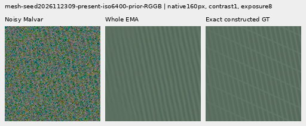
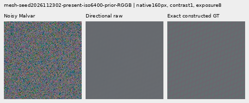
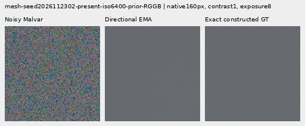
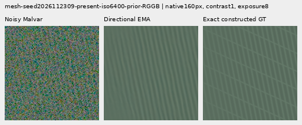
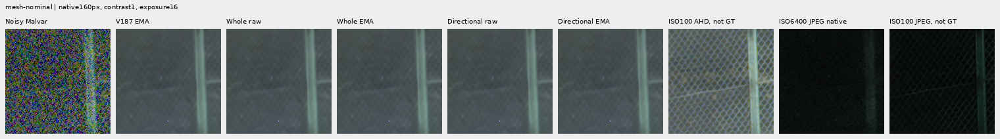
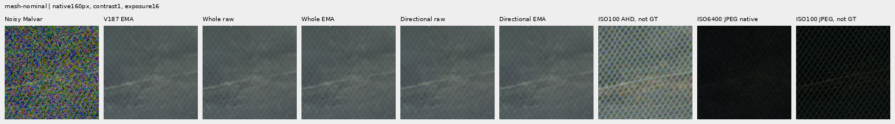

# Matched response pressure from V187 EMA (V195)

**Whole-response EMA is a useful stronger-response option:** mean constructed-mesh response rises **4.02% relative to V187 EMA**, from **5.359% to 5.575% of exact GT amplitude**. Quiet spatial RMS rises **0.334–0.376%**, worsening **30/32** quiet inputs. Real fine cab crossings and broad flat-field mottle remain unresolved. Keep this measured response gain and its cost alongside the quieter V187 option; V120 Small remains the general recommendation.

The directional variant is **0.80% raw / 1.11% EMA lower in mesh response** than its matched whole-response control. Its quiet spatial RMS is **0.038–0.078% lower**, improving 30/32 inputs in each state, but both directional EMA quiet means remain above V187. Balancing angular response pressure alone has not produced the requested fine-detail/clean-flat combination.

[Five-state native viewer](images/v195-directional-response-v1/native-viewer.html) · [Full source/ROI/noise/checkpoint manifest](images/v195-directional-response-v1/manifest-v1.json) · [All 122 metric rows  / 732 numeric cells](results/v195-directional-response-v1/metrics-table-v1.csv) · [Final evidence](results/v195-response-final-v1.json).

## Controlled change

Both arms start from the same completed V187 EMA full model, with its trained 508-parameter readout and all 189 inherited V183 EMA tensors frozen. They use identical fresh head Adam/EMA clocks 0, seeds, 1,000 cached rows, 900 noisy updates, 3,600 images, 100 ADC skips, domain weights, LR schedule, clipping and all nine previous terms/masks. No neural source changes occur. This is a new matched stage from trained weights; old Adam moments and uninterrupted old EMA history are not claimed.

Whole control adds 0.25 domain-weight coherent response to the existing 0.25, for total 0.50. Directional retains the original 0.25 and adds 0.25 times the mean response penalty in eight Fourier regions. Equal nominal added weights do not imply equal gradient norms. Targets enter only after inference. [Loss math, CPU/GPU admission and preparation](directional-pair-response.md) · [Completed training/state audit](results/v195-response-training-completed-v1.json).

## Measured tradeoff

RMS values below are camera-RGB DN16. Higher response/gain means more target-aligned modulation; lower error means less error. Each row uses identical cases across all methods. Mesh rows include 256 present or 256 absent inputs; quiet rows 16 each; fresh-flat rows 24 noisy inputs per ISO. Each photographic cohort/variant has 32 inputs.

| Metric | Cases | V183 EMA | V187 EMA | Whole raw | Whole EMA | Directional raw | Directional EMA |
| --- | ---: | ---: | ---: | ---: | ---: | ---: | ---: |
| Mesh response (% GT) ↑ | 256 | 4.43900551 | 5.35911027 | 5.38577019 | 5.57480435 | 5.34294841 | 5.51301341 |
| Mesh full RMS ↓ | 256 | 8.87658208 | 8.77626519 | 8.76672776 | 8.74994784 | 8.77184197 | 8.75655268 |
| Present-case blank RMS ↓ | 256 | 5.61243198 | 5.61352478 | 5.61392926 | 5.61460516 | 5.61378328 | 5.61429337 |
| Absent-case full RMS ↓ | 256 | 5.30864483 | 5.31014343 | 5.31066407 | 5.31117581 | 5.31051231 | 5.3109169 |
| Quiet spatial RMS, ISO6400 ↓ | 16 | 3.46222047 | 3.47664374 | 3.47686358 | 3.48972317 | 3.47555365 | 3.48701701 |
| Quiet spatial RMS, ISO12800 ↓ | 16 | 5.5949994 | 5.62164923 | 5.62673995 | 5.64043344 | 5.62436776 | 5.63609475 |
| Fresh flat full RMS, ISO6400 ↓ | 24 | 18.6119521 | 18.61468 | 18.6155989 | 18.6164384 | 18.6153417 | 18.6160168 |
| Fresh flat full RMS, ISO12800 ↓ | 24 | 24.181174 | 24.1857465 | 24.1874114 | 24.1891129 | 24.1868991 | 24.1882688 |
| Fresh flat block32 RMS, ISO6400 ↓ | 24 | 13.4337585 | 13.4337869 | 13.4337924 | 13.4338005 | 13.4337911 | 13.4338002 |
| Fresh flat block32 RMS, ISO12800 ↓ | 24 | 17.9217798 | 17.9217305 | 17.9216865 | 17.9216853 | 17.9216932 | 17.9216975 |
| Retained photo faint band gain ↑ | 32 | 0.297015316 | 0.298461921 | 0.29852267 | 0.298812854 | 0.298447102 | 0.298706663 |
| Retained photo dark band gain ↑ | 32 | 0.528282161 | 0.529753504 | 0.529688522 | 0.530045786 | 0.529620263 | 0.529948418 |
| Organic photo faint band gain ↑ | 32 | 0.148382301 | 0.148564768 | 0.148609058 | 0.148652643 | 0.148595446 | 0.148633242 |
| Organic photo dark band gain ↑ | 32 | 0.395579733 | 0.395914385 | 0.395951307 | 0.396009713 | 0.395931255 | 0.395982806 |

Whole EMA raises response on 177/256 present inputs and lowers mean present full RMS 0.300%, improving 154/256. Its present-case blank RMS rises 0.01925% on all 256, and absent-case RMS rises 0.01944% on all 256. Fresh noisy-flat full RMS rises 0.00945–0.01392% on all 48; block32 mean changes are mixed and below 0.0003%. Thus the new response gain comes with small, widespread off-signal costs.

All four Whole EMA photographic band-response means rise, by 0.024–0.118% relative; 124/128 individual responses rise. All four relative band-error means also worsen, by 0.00258–0.00594%. The native bird, butterfly and wood crops stay soft. A response increase is not a guarantee of a lower reconstruction error or newly recovered crossings.

Raw Whole is closer to V187's quiet/response balance: mesh response +0.497% versus the shared V187 EMA donor, with quiet spatial RMS +0.0063%  / +0.0906%. Directional raw has mesh response −0.302%, quiet spatial RMS −0.0314%  / +0.0484%. Directional EMA raises mesh response 2.872% over the donor, with quiet spatial RMS +0.2984%  / +0.2570%. Its fresh-flat means and absent errors are slightly lower than matched Whole EMA but still above V187. These alternatives retain different tradeoffs; no flat-safety improvement over V187 is established.

Earlier useful implementations and their native panels remain available in the [V193 comparison/viewer](large-dense-spectrum-comparison.md) and [current model guide](current-model.md). The new gallery reuses V187 as its immediate baseline instead of copying every historical column.

## The weak crossing direction

The same two predeclared V194 examples receive independent Fourier/spatial checks. These are nearest-recipe-normal spectral regions after full-context affine removal; envelope, harmonic and intersection leakage remains. They are not isolated wire-family amplitudes or population confidence intervals. [Full regional records](results/v195-directional-response-v1/directional-breakdown-result-v1.json).

| Example | State | Whole (% GT) | Region A (% GT) | Region B (% GT) |
| --- | --- | ---: | ---: | ---: |
| 2026112302 | V187 EMA | 5.1222526 | 6.4775008 | 3.7102210 |
| 2026112302 | Whole raw | 5.5733318 | 7.0775542 | 4.0060845 |
| 2026112302 | Whole EMA | 6.0830978 | 7.7759249 | 4.3193437 |
| 2026112302 | Directional raw | 5.3371759 | 6.7627597 | 3.8518619 |
| 2026112302 | Directional EMA | 5.8040491 | 7.4051546 | 4.1358593 |
| 2026112309 | V187 EMA | 79.2443248 | 4.8230067 | 91.6903348 |
| 2026112309 | Whole raw | 77.8884290 | 4.8463774 | 90.1037743 |
| 2026112309 | Whole EMA | 79.5137222 | 4.8213863 | 92.0050560 |
| 2026112309 | Directional raw | 77.6757985 | 4.8493435 | 89.8550880 |
| 2026112309 | Directional EMA | 79.1808188 | 4.8261957 | 91.6156746 |

For 2302 the two regions carry about 51.03%  / 48.97% of GT energy. Whole EMA improves both relative to V187, though the actual grid remains very weak. For 2309 the weaker region A carries only 14.33% of energy; it stays around 4.82% of GT while dominant B is about 92%. Whole EMA's whole score rises while its weak-region response falls slightly. Directional EMA changes that weak response only from 4.8230% to 4.8262% of GT, without convincing new visible crossings. Its whole response is slightly below V187 on this example.

The weak 2309 component has a coarser fundamental (period 27.69 native pixels), below the unchanged 1/16 center-frequency band. The diagnostic regions also contain other content. This points to a measurement/basis limitation worth testing; it does not prove the cause of all missing structure. Loss pressure has not added a new measured frequency.

## Native 100% crops

All cells are 160×160 native pixels. For the two mesh examples below, source is a cached 512px RGGB constructed scene, ROI `[176,176,160,160]`, shot 0.00128/read6.5536e−6, display exposure 8 (+3 EV), contrast 1. The noise draw, coordinates, WB/matrix and display transform are identical across methods; crop pixels are never resized. Checkpoint and module hashes below distinguish raw and EMA states.

**Whole raw: noisy → restored → exact constructed GT.**

**Whole EMA: noisy → restored → exact constructed GT.**

**Directional raw: noisy → restored → exact constructed GT.**

**Directional EMA: noisy → restored → exact constructed GT.**

The held-out GFX main scene uses DSCF3879 ISO6400 with DSCF3880 ISO100 f/5.6 as an independent qualitative reference. Sky remains smooth at exposure 4; building and foliage detail stay soft, and coarse fence geometry remains clear. The cab scene uses DSCF3842 ISO6400 with DSCF3835 ISO100 f/5.6 and both SOOC JPEGs. Both 160px ROIs and both noise profiles are included at exposure 16. Aperture, exposure time and moving subjects differ: **ISO100/AHD/JPEG references are qualitative, not exact GT**. Neither new arm shows convincing new fine cab crossings.

Stress displays expose broad color mottle and false fine structure in absent meshes, gray fields and quiet portions of step/bar/striped scenes. These remain in all new states. The full gallery contains 72 native figures, including 24 noisy/restored/GT triplets; all were inspected in 18 original-detail sheets. ADC-only bark, fur and planes remain unchanged.

## Reproduction and evidence

| State | Source checkpoint SHA256 | Module-state SHA256 |
| --- | --- | --- |
| Whole raw | `b6e6e98e680176b6e6b751be83e82fd6ec092719969d21fd31df557fa47b664a` | `023025c92b03d0e32fd108fb93b47b5844ff70a27a8e1830085c75dd464296d0` |
| Whole EMA | `b6e6e98e680176b6e6b751be83e82fd6ec092719969d21fd31df557fa47b664a` | `1ebf98a696494e7bf8f9dacc4cdda92f795c1615b1073497879b8fd410e6305e` |
| Directional raw | `1b4c7d9e35f8a6a9b7672f01ba17814fc28144f2279b0b8a5fca235440b7bb67` | `b7706be4bbff39f58b303b4cd16fb8eb79287cf19ede4df39e1228a0c65a5052` |
| Directional EMA | `1b4c7d9e35f8a6a9b7672f01ba17814fc28144f2279b0b8a5fca235440b7bb67` | `39e229912f04a4078a96e17bc279e3d8883d78291b535732fdd237d712cb08e6` |

The [checkpoint manifest](images/v195-directional-response-v1/manifest-v1.json) also binds all four strict full-state exports and the V187 EMA donor. Every export has 193 state tensors; the trained head has 508 parameters in four tensors. The archive records the donor's 900 updates, the fresh new head Adam clock and the additional 900 updates separately.

Both complete training traces and ten checkpoints pass the independent audit (3,780 inherited tensor comparisons). The four final states cover 3,288 evaluation rows, with exact V183/V169 replays, 288 ADC outputs, 144 native RGB and 144 wave encodings, 107,544,576 checked native addition channels and 556 independent Decimal summary means. All 732 current-table cells retain their source values. Eight regional projections pass 96 independent sector checks. Browser verification checks 480 actual 160px captures / 36,864,000 RGB channels, 96 matched raw/EMA pairs, state-specific hashes, flip controls and navigation.

No new source/noise draws, parent/DINO inference, RAW decode or original/dataz access occur. Both GFX families, JPEGs and siblings remain outside training. Input datasets, parent arrays, older reports and all historical comparison pixels are reused in place. Operational preparation/rendering corrections are preserved in the [timestamped diary](../diary/2026-11-08-13-31-36-response-pressure-quality.md) and machine evidence; the successful prediction pass runs once.
