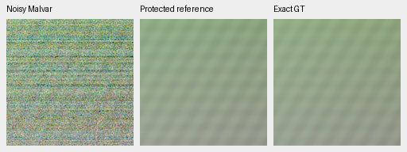
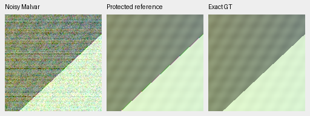

# Recovering weak detail with distant RAW row references

In a synthetic sensor with read noise shared across rows, separate
smooth RAW strips give the local estimator enough evidence to
recover weak texture. With fully shared read variance, weak
horizontal response rises from **10.06% to 98.19%** with zero
false accepts on 96 smooth and 96 off-grid edge controls. The
gain depends on a usable distant reference. If all strips contain
a real stripe, the same correction transfers it into the query.
Rejecting narrow spectral peaks reduces that failure and leaves
some false bands. [Sources, results and native crops](results/distant-row-reference-v1/publication.json).

## Same local RAW, varied distant reference

The comparison reuses the exact noisy queries and source scenes
from the [shared-readout panel](withheld-row-noise.md). The 48
source seeds cover four Bayer layouts and two independent noise
draws each. The two ISO6400 simulations put 50% or 100% of the
read variance in one Gaussian offset per native sensor row.
Three independent synthetic strips, each 256 native pixels wide,
sit outside the query and share those offsets. They have separate
Poisson and white-read draws. The three conditions use smooth
strips, a true horizontal stripe in one strip, or the same true
stripe across all three.

Each strip fits a per-color plane to account for brightness and
gradient. It then averages the residual along each readout row.
The central fit subtracts a shrunk median row estimate across
the strips before running the same split and fixed score cutoff.
The protected method omits narrow spectral peaks from that
estimate when their power exceeds 8.5 times the expected row
power. A separate oracle supplies the true simulated row offsets
to measure remaining headroom.
[Frozen design](results/distant-row-reference-v1/plan.json).

The query fit still discovers both wave frequencies from its own
disjoint groups of rows. The distant strips supply a nuisance
estimate. The experiment supplies strip locations, row sharing
and its variance. Real training or deployment would need a way
to verify and select those supports. Row splitting alone cannot
reject a common error introduced upstream by the same biased
distant estimate.

## Fully shared read variance

Response is signed projection onto the true weak waveform on
the measured Bayer samples. Each false count uses 96 independent
noise draws clustered within 48 source seeds. The same cutoff of
2 applies to both held-out checks in every arm.

| Distant observation | Validation input | Smooth false accepts | Edge false accepts | Horizontal weak response | Weak horizontal response beside edge |
| --- | --- | ---: | ---: | ---: | ---: |
| None | Raw row split | 0/96 | 0/96 | 10.06% | 5.68% |
| Smooth | Median estimate | 0/96 | 0/96 | 98.19% | 81.20% |
| Smooth | Protected estimate | 1/96 | 1/96 | 97.15% | 80.72% |
| One striped strip | Median estimate | 0/96 | 0/96 | 86.54% | 70.67% |
| Three striped strips | Median estimate | 96/96 | 94/96 | 40.49% | 35.01% |
| Three striped strips | Protected estimate | 17/96 | 5/96 | 89.29% | 81.75% |
| Exact simulated offsets | Oracle | 0/96 | 0/96 | 97.78% | 83.12% |

Using clean distant strips, the median estimate also reduces
the combined weak/strong increment error for horizontal texture
from **62.08 to 7.92 DN16**. The paired source interval for the
reduction is 51.95–56.32 DN16. Under coherent striped references,
the median leaves **107.87 DN16** of false periodic RMS on smooth
controls. The spectral protection lowers it to **5.90 DN16**.
Its worst retained smooth false correction still shows strong
horizontal bands even after removing the planted stripe bin.

At 50% sharing, the smooth-strip median raises horizontal
response from 37.28% to 97.05% with zero smooth or edge false
accepts. When all strips contain the stripe, spectral protection
reduces smooth false accepts from 96 to 3 and edge false accepts
from 94 to 0, with 90.76% horizontal response.
[All 2,880 matched groups and source-level intervals](results/distant-row-reference-v1/summary.json).

## Native comparisons

Every triplet uses native ROI `[0,0,160,160]` and shows noisy
Malvar, the protected fit through Malvar, and exact clean RGB.
There is no neural checkpoint in this analytical comparison.
The fixed rendering uses exposure ×16, identity white balance
and matrix, and sRGB. The shown 100%-shared simulation uses
shot/read `0.00128 / 6.5536e-6`, ADC16, black 0.03, and the
original Bayer samples in every comparison.
[Per-crop provenance and actual viewing](results/distant-row-reference-v1/viewing.json).

The BGGR source 8054933642 retains both waves with the smooth
reference. The raw row split suppressed both. The GRBG source
8054935909 gains true texture alongside the diagonal edge.
[Horizontal comparison](images/distant-row-reference-v1/smooth-horizontal-comparison.png) · [Edge comparison](images/distant-row-reference-v1/smooth-edge-comparison.png).

On the clean RGGB query 8054931320, an unprotected median creates
visible waves from the distant stripe. The protection removes
them. On BGGR source 8054933609 it still leaves strongly visible
false bands.
[Removed false stripe](images/distant-row-reference-v1/striped-null-comparison.png) · [Residual false bands](images/distant-row-reference-v1/striped-residual-comparison.png).

The [standing GFX sky check](gfx-noise-correlation.md) has not
established significant readout dependence of this kind.
This experiment isolates a way context can improve recovery
when shared sensor nuisance is present and calibration support
is available. It does not change GFX conditioning or the
recommended model.
