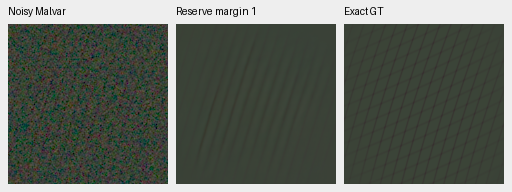
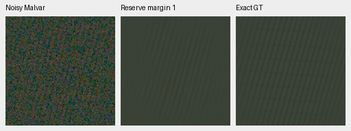

# Keeping more whole-image donor frequency candidates

A wider donor shortlist contains a plausible weak frequency more often on
the main wire panel. The reserved query check rarely chooses it. Even using
the known weak frequency to select from the confirmed shortlist leaves most
of the faint signal missing, especially at ISO6400. The established
single-bracket guide and eight-knot query fit remain the comparison baseline.
[Executed evidence, metrics and native crops](results/donor-frequency-bank-v1/publication.json).

## Candidate selection and delivery

The [previous whole-image replay](scene-wire-footprint.md) checked whether a
finite footprint helps after frequency selection. This replay keeps the
original uniform eight-knot basis and changes the candidates that reach it.
It uses the original V143 EMA predictions, saved scene affinities, candidate
windows and sensor observations. The main panel uses the prior multiple
window sizes. The separate panel uses its original four donor patches.
Each panel has eight geometries per noise profile and independent no-wire,
strong-only and strong-plus-weak RAW roles.

The search keeps the first active direction from the original guide as an
anchor. It considers complementary peak pairs from every compatible donor
bracket, including lower-ranked pairs in the same bracket. Candidate
brackets must lie within 0.10 of the best eligible scene affinity. The
search ranks by affinity times the matched peak strength and keeps up to
eight distinct frequencies, merging sign-equivalent candidates within one
query DFT bin. It then tests each candidate on the original crossed donor
validation folds. A strong separable direction in the same bracket
competes in that validation when available.

Three policies choose a companion while keeping the anchor fixed.

- **Donor only** uses the highest-ranked donor-confirmed candidate.
- **Positive reserve** requires the candidate to predict better than both the
  anchor-only model and the original companion on both crossed halves of
  the query screening reserve.
- **Reserve margin 1** requires each standardized gain to exceed one.

If the baseline has no active anchor, the existing output is retained.
Only the one-quarter screening reserve ranks the candidate. Its predictions
use CFA-weighted residuals with independently fitted RGB coefficients.
All three policies retain the later independent per-color admission on the
remaining query samples and the same all-site weighted delivery. The
extra reserve scores are empirical margins.

## How much the shortlist covers

Counts are out of eight two-direction captures. Coverage means a candidate
within one DFT bin at native query size of the declared weak center
frequency. The donor-confirmed union includes the original active guides.
The last three columns use the active frequencies actually passed to the
query fitter.

| Panel | Original | All compatible bank pairs | Shortlist | Confirmed bank | Confirmed union | Donor only | Positive reserve | Reserve margin 1 |
| --- | ---: | ---: | ---: | ---: | ---: | ---: | ---: | ---: |
| Main ISO400 | 3 | 5 | 4 | 4 | 6 | 2 | 3 | 3 |
| Main ISO6400 | 0 | 7 | 6 | 6 | 6 | 0 | 0 | 0 |
| Separate ISO400 | 5 | 3 | 3 | 3 | 5 | 4 | 5 | 5 |
| Separate ISO6400 | 5 | 4 | 4 | 4 | 5 | 2 | 5 | 5 |

The main ISO400 margin-one test replaces two guides in two-direction
captures and two in strong-only captures. The positive reserve replaces
one additional two-direction guide. Neither improves the weak-guide hit
count. On the main ISO6400 two-direction observations, all eight
donor-only replacements miss the declared weak frequency by more than
one bin. The same bank contains a closer confirmation in six cases.
Neither reserve check admits a replacement in those observations.

## Weak response and false correction

Cells give weak-increment projection and weak-increment RMS DN16.
For this diagnostic each arm can reduce its scale to stay within the
original screened fit's quiet RMS on that panel. The nominal wave gates
are 2 at ISO400 and 1 at ISO6400. The final column uses the constructed
target's nominal weak frequency to pick a donor-confirmed companion
within one bin, when it is closer than the original companion. It
leaves the anchor, phase fit, amplitude fit and final RAW gate unchanged.

| Panel | Original | Donor only | Positive reserve | Reserve margin 1 | Known-frequency choice |
| --- | ---: | ---: | ---: | ---: | ---: |
| Main ISO400 | 4.801% / 11.1802 | 1.371% / 11.2019 | 4.803% / 11.1858 | 4.803% / 11.1815 | 5.622% / 11.1787 |
| Main ISO6400 | 0.661% / 25.4380 | 0.663% / 25.4373 | 0.661% / 25.4399 | 0.661% / 25.4380 | 0.925% / 25.4363 |
| Separate ISO400 | 6.436% / 11.2023 | 4.972% / 11.2081 | 6.436% / 11.2023 | 6.436% / 11.2023 | 6.436% / 11.2023 |
| Separate ISO6400 | 2.464% / 22.9455 | 2.175% / 22.9456 | 2.464% / 22.9455 | 2.464% / 22.9455 | 2.464% / 22.9455 |

The known-frequency choice has little leverage once the independent query
fit is held fixed. The conditional phase, spatial support and amplitude
still have to be inferred from the noisy query.
[Fixed thresholds, per-case coverage and quiet-matched metrics](results/donor-frequency-bank-v1/summary.json).

The 48 retained flat and rail-only controls assign seven plausible but
false companions around the nominal rail, as if they had passed the donor
step. Neither reserve policy changes the original output on these controls.
Donor-only complex-rail correction rises from 1.313 to 1.336 DN16 RMS and
its peak from 20.18 to 20.23. Straight RMS rises from 0.447 to 0.453 DN16.
The forced donor-only rotation also removes the three small nonzero flat
corrections previously present with the supplied guide.

## Native synthetic crops

The triplets show noisy Malvar, reserve margin 1 and exact GT at native
160×160 pixels, ROI `[176,176,160,160]`, exposure ×2, contrast 5 and
shared WB/matrix. Sources 91 GBRG and 92 RGGB use V143 EMA
`96d146d017c54196288c585f8b7eddcf030e8a235061049c31e985b9380b7ce4`,
ISO400-prior shot/read `8e-5/2.56e-8`, ADC16 and black 0.03.
Both show the dominant line family, with few visible weak crossings.
The replacement does not complete the finer lattice.
[Crop coordinates and source receipt](images/donor-frequency-bank-v1/manifest.json).

[Source 91 full comparison](images/donor-frequency-bank-v1/iso400-source91-GBRG-comparison.png) ·
[Source 92 full comparison](images/donor-frequency-bank-v1/iso400-source92-RGGB-comparison.png).

## Native GFX100S review

The standing crops use V120 EMA
`a9d9b6b4f974e24a6b11e5e740aab32314233a7f53c056cf37c7d2aac1c589fb`,
same-side evidence, gate 2 and both scene and spectral guide families.
DSCF3879 uses shot/read `.00128/6.5536e-6` at exposure ×4, with
DSCF3880 ISO100 AHD as an independent qualitative reference.

Both reserve policies reproduce the original guide fit in these crops.
All sky outputs match V120. The donor-only spectral fit reduces the
building correction from 2.94 to 1.74 DN16 RMS relative to V120. Foliage
stays soft. The coarse fence preserves the visible lattice, with no
clear new crossings.
[Sky](images/donor-frequency-bank-v1/main-overcast-sky.png) ·
[Building](images/donor-frequency-bank-v1/main-building-detail.png) ·
[Foliage](images/donor-frequency-bank-v1/main-foliage.png) ·
[Coarse fence](images/donor-frequency-bank-v1/main-chain-link-fence.png).

Both DSCF3842 native cab ROIs remain exact to their conditioned V120
pixels under all tested policies. Fine crossings visible in the
DSCF3835 ISO100 AHD and both straight-out-of-camera JPEG references
remain unresolved. Exposure is ×16. The qualitative references differ
in aperture, exposure time and motion.

| Cab profile | Shot/read | Boards |
| --- | --- | --- |
| Nominal | `.00128/6.5536e-6` | [Left](images/donor-frequency-bank-v1/mesh-nominal-left.png) · [Right](images/donor-frequency-bank-v1/mesh-nominal-right.png) |
| DSCF3879 profile | `.0014635775921166604/1.0715704128646712e-6` | [Left](images/donor-frequency-bank-v1/mesh-profile3879-left.png) · [Right](images/donor-frequency-bank-v1/mesh-profile3879-right.png) |

This scoped CPU replay uses existing checkpoints and adds no full427
or held-out camera scores. V120 remains the general recommendation.
