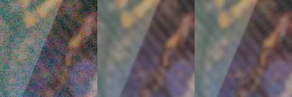
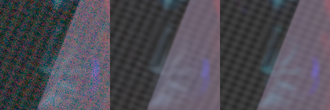

# Narrow spectral peaks in exterior RAW

A search that ranks peaks above nearby radial frequencies nominates the
planted weak carrier in **15 of 40** held-out ISO6400 observations, up from
**3 of 40** for the previous exterior search. Above the same Corpus 100k
EMA and localized phase fit, intact-detail recovery rises from **24.3% to
38.9%** at a common flat-texture calibration budget. Gap leakage also rises.
With both flat and gap calibration limits, recovery is **30.6%**. The
automatic search leaves the standing sky pixel-identical and still leaves
the fine cab crossings incomplete.

[Numerical results and uncertainty](results/donor-peak-prominence-v1/publication.json) ·
[Frozen inputs, selection records and code](results/donor-peak-prominence-v1/evidence.tar.xz) ·
[Native crops and provenance](images/donor-peak-prominence-v1/manifest.json).

## Discovery and local restoration

The [previous search](green-gap-validation.md) ranks frequencies by green
cross-power in four native 128-pixel tiles outside the reconstruction
query. Strong low-frequency content can occupy both nominations. This
test compares that search with two versions using 12 native 96-pixel
tiles around a native 256-pixel query.

- **Oversampled tiles** zero-pad the two green planes separately after
  fitting a smooth plane on each. The frequency spacing is 1/512 cycles
  per native pixel, with the original green sample positions used for phase.
- **Radial prominence** ranks the same peaks by their height relative to
  sidebands 0.033 cycles per pixel away along the same radial direction.
  The higher sideband and an empirical noise floor set the comparison
  level. This favors isolated periodic features over a broad spectral ridge.

Both new searches require positive cross-power of at least 5 in noise units,
signed coherence of at least 0.70, and agreement in two spatially disjoint
tiles. Prominence also has a minimum score of 1.35. The disjoint tiles
can differ by two oversampled frequency bins. The two nominations must
differ in direction. These scores are empirical. Replacing the query
RAW and its variance changes none of the three searches in six audited
captures.

The nominations supply frequency only. All methods use the same near-field
phase and amplitude resolver from the [gap study](green-gap-validation.md).
It fits both suggested directions jointly, takes phase outside a radius of
30 native pixels for each local fit, and still requires agreement in
disjoint sets of local Bayer samples. The parent and the inference code
are held fixed. The exact-frequency comparison supplies both planted
frequencies while estimating phase and amplitude in the usual way.

## Held-out recovery and leakage

The 32 validation photos are different from the prior gap study and
disjoint from the 90,692-image full-epoch training manifest. Twelve
photos calibrate output strength and 20 are held out. Each bin4
512-pixel field has a natural background, a stronger sinusoid and a
weaker nonparallel sinusoid. Half include a shared abrupt edge. The
weak carrier has a stripe or elliptical gap in the query. A second
role has the same weak pattern outside the query and no weak signal
in the scored center. Strong-only and exact-flat-center controls
complete the panel. Each role has two independent sensor draws at ISO6400.

A hit is within two 256-pixel DFT bins of the exact frequency, including
sign equivalence. For the present role, the previous search nominates
both directions in **3/40** observations, the oversampled control in
**0/40**, and radial prominence in **15/40**. At one bin the three
counts are **2/40**, **0/40** and **7/40**. When the pattern exists
only outside, radial prominence still finds the weak frequency in
**16/40**. Local evidence matters most in those observations.

The primary operating point matches added luma RMS on the 12 exact-flat
calibration cores at **3.503 DN16**. The table gives the held-out means at that point.

| ISO6400 method | Intact response | Intact increment RMS, DN16 | Added gap RMS, DN16 | Spurious gap response | Added flat RMS, DN16 |
| --- | ---: | ---: | ---: | ---: | ---: |
| Corpus 100k | 20.70% | 171.428 | 0.000 | 3.90% | 0.000 |
| Previous exterior search | 24.27% | 170.174 | 6.047 | 4.54% | 2.361 |
| Oversampled tiles | 20.71% | 171.868 | 5.167 | 3.96% | 2.921 |
| Radial prominence | 38.89% | 162.857 | 16.610 | 6.37% | 2.981 |
| Exact frequency | 70.28% | 156.480 | 23.905 | 9.30% | 3.540 |

Intact response projects the present-minus-outside-only restoration onto
the exact weak increment where the pattern is fully present. Spurious gap
response projects that same pair onto the missing weak carrier and reports
the absolute projection. Added gap RMS includes the change to the
stronger direction, which is still present inside the gap.

Radial prominence gains 14.62 percentage points of intact response
over the previous search (95% paired bootstrap interval +5.59 to +25.22)
and lowers intact error by 7.317 DN16 (−13.938 to −1.789). It raises
the spurious gap projection by 1.82 points (+0.66 to +3.22). In the
outside-only role, the false weak projection across the scored center
rises from 0.838% to 0.885%.

A sensitivity replay limits both mean calibration gap and flat RMS to
the previous arm's 9.031 and 3.503 DN16. The held-out gain falls to
**6.36 points** of intact response (+0.48 to +12.70), with intact error
**4.764 DN16 lower** (−9.225 to −0.994). Held-out added gap RMS is
still higher, 9.073 versus 6.047 DN16, and the spurious gap projection
rises 0.63 points (−0.10 to +1.42). Added flat RMS falls to 1.628
from 2.361 DN16. The gap and flat limits are calibrated on separate
photos and realized differently on the test scenes.

### Native exact-target crops

Columns are noisy Malvar, radial prominence and exact constructed
target. Cells are 160×160 native pixels at `[48,48,160,160]` in the
256-pixel query. Both use repeat 0 with shot/read `.00128/6.5536e-6`,
simulated exposure 0.33, fixed display exposure ×2, common WB/matrix
and clipped sRGB. The parent is Corpus 100k EMA
`87b96f3c487b9edaf1c477742b6c38f2a82cc6b20a94716d51cc8cf46a17a760`.
The first held-out source in each gap family was selected by index.

[All stripe methods](images/donor-peak-prominence-v1/exact/012-present-comparison.png) ·
[Weak carrier outside only](images/donor-peak-prominence-v1/exact/012-outside-only-comparison.png) ·
[Flat query](images/donor-peak-prominence-v1/exact/012-quiet-query-comparison.png).

[All ellipse methods](images/donor-peak-prominence-v1/exact/014-present-comparison.png) ·
[Weak carrier outside only](images/donor-peak-prominence-v1/exact/014-outside-only-comparison.png) ·
[Flat query](images/donor-peak-prominence-v1/exact/014-quiet-query-comparison.png).

## Standing GFX100S comparisons

All eight standing crops were viewed at native resolution. The sky
returns the 100k parent exactly. The coarse fence keeps both crossing
directions. The prominence fit changes the building by 1.927 RGB DN16
RMS relative to 100k, down from 8.127 with the previous search. The
finest building cables and foliage texture remain soft.

[Sky](images/donor-peak-prominence-v1/standing/main-overcast-sky-main-overcast-sky.png) ·
[Building](images/donor-peak-prominence-v1/standing/main-building-detail-main-building-detail.png) ·
[Foliage](images/donor-peak-prominence-v1/standing/main-foliage-main-foliage.png) ·
[Coarse fence](images/donor-peak-prominence-v1/standing/main-chain-link-fence-main-chain-link-fence.png).

At both noise settings the left cab has above-threshold exterior candidates
within three DFT bins of each [previously measured in-query peak](green-phase-spectrum.md).
The final two nominations still miss that pair. Neither observed peak
neighborhood on the right clears the exterior two-tile check. The prominence
output changes the cab crops by 1.08–1.84 camera-linear RGB DN16 and
leaves the crossings incomplete. In the left crop candidate ranking remains
a limitation. In the right crop the tested exterior tiles supply
insufficient evidence. The [replay with locally measured frequencies](green-gap-validation.md#standing-gfx100s-comparisons)
still shows more of the right cab lattice.

| Cab conditioning | Left | Right |
| --- | --- | --- |
| Nominal `.00128/6.5536e-6` | [Comparison](images/donor-peak-prominence-v1/standing/mesh-nominal-fine-green-mesh-left.png) | [Comparison](images/donor-peak-prominence-v1/standing/mesh-nominal-fine-green-mesh-right.png) |
| Transferred `.0014635775921166604/1.0715704128646712e-6` | [Comparison](images/donor-peak-prominence-v1/standing/mesh-profile3879-fine-green-mesh-left.png) | [Comparison](images/donor-peak-prominence-v1/standing/mesh-profile3879-fine-green-mesh-right.png) |

The main DSCF3879 crops use display exposure ×4 and the independent
DSCF3880 ISO100 AHD reference. The DSCF3842 cab uses ×16, DSCF3835
ISO100 AHD and both original camera JPEGs. The separate captures
and JPEGs are qualitative references. This scoped inference diagnostic
has no new trained weights or comparable full427 and known/unseen PSNR.
